# JTVauctions.com Stand-alone Auction Site

# Jewelry Television E-Commerce

Business Requirements Document

Pre-Project Draft, Version 3.1

Prepared by: Rick Wingender

Date: 08/10/2010

<table><tr><td rowspan=1 colspan=4>Revision History</td></tr><tr><td rowspan=1 colspan=1>Revision #</td><td rowspan=1 colspan=1>Description</td><td rowspan=1 colspan=1>Initials</td><td rowspan=1 colspan=1>Date</td></tr><tr><td rowspan=1 colspan=1>3.0 Draft</td><td rowspan=1 colspan=1>Major revisions from 1.xx and 2.xx versions.</td><td rowspan=1 colspan=1>rw</td><td rowspan=1 colspan=1>3/26/2010</td></tr><tr><td rowspan=1 colspan=1>3.01</td><td rowspan=1 colspan=1>Various minor corrections, minor modifications, andadded 2d-Chance program</td><td rowspan=1 colspan=1>rw</td><td rowspan=1 colspan=1>4/8/10</td></tr><tr><td rowspan=1 colspan=1>3.1</td><td rowspan=1 colspan=1>Numerous changes / additions throughout resultingfrom Software Engineering feedback.</td><td rowspan=1 colspan=1>rw</td><td rowspan=1 colspan=1>8/10/10</td></tr><tr><td rowspan=1 colspan=1></td><td rowspan=1 colspan=1></td><td rowspan=1 colspan=1></td><td rowspan=1 colspan=1></td></tr><tr><td rowspan=1 colspan=1></td><td rowspan=1 colspan=1></td><td rowspan=1 colspan=1></td><td rowspan=1 colspan=1></td></tr><tr><td rowspan=1 colspan=1></td><td rowspan=1 colspan=1></td><td rowspan=1 colspan=1></td><td rowspan=1 colspan=1></td></tr><tr><td rowspan=1 colspan=1></td><td rowspan=1 colspan=1></td><td rowspan=1 colspan=1></td><td rowspan=1 colspan=1></td></tr><tr><td rowspan=1 colspan=1></td><td rowspan=1 colspan=1></td><td rowspan=1 colspan=1></td><td rowspan=1 colspan=1></td></tr><tr><td rowspan=1 colspan=1></td><td rowspan=1 colspan=1></td><td rowspan=1 colspan=1></td><td rowspan=1 colspan=1></td></tr><tr><td rowspan=1 colspan=1></td><td rowspan=1 colspan=1></td><td rowspan=1 colspan=1></td><td rowspan=1 colspan=1></td></tr></table>

## 8/10/2010 3.1 Draft Distribution List:

1. Craig Shields   
2. Rachel Munson   
3. Chris Meystrik   
4. Todd Trivette   
5. David Sink   
6. David Freels   
7. Carey Dalton   
8. Tim Engle   
9. Chris Haidri   
10. Mike Combest   
11. Jessica Kemp   
12. Zach Cochran   
13. Lisa Cornelius   
14. Greg West   
15. Jim Unger

## Table of Contents

REVISION HISTORY.   
TABLE OF CONTENTS..   
INTRODUCTION .........   
1.1 PURPOSE. . 8   
1.2 BACKGROUND AND GOALS . 8   
1.3 NEAR-TERM OBJECTIVES. 8   
1.4 LONG-TERM STRATEGIC OBJECTIVES 8   
2 GAP ANALYSIS / SITE COMPARISON: BIDZ.COM VS. JTVAUCTIONS.COM (V. 3)....   
3 LISTING OF MAJOR REQUIREMENTS (PHASE 1)...... ... 10   
4 SITE DIAGRAM... .. 11   
4.1 CUSTOMER-FACING WEBSITE PAGES. 11   
4.2 AUCTION ADMIN APPLICATION PAGES. 12   
5 USER STORIES.. .. 13   
6 AUCTION SITE PAGES.. .. 16   
6.1 HOME PAGE 16   
6.1.1 General Requirements . 16   
6.1.2 “Canned Search” Button Section. 16   
6.1.3 Today’s Top Auctions Product Module Section 16   
6.1.4 Promotional Spots 17   
6.1.5 Category Links. 17   
6.1.6 SEO Plan. 17   
6.1.7 Home Page Mockup . 18   
6.2 CATEGORY “BROWSE” PAGES / SEARCH RESULT PAGES. 19   
6.2.1 General Requirements 19   
6.2.2 Product Modules . 19   
6.2.3 Page Navigation. 20   
6.2.4 SEO Plan.... 20   
6.2.5 Category Page “Views” . 20   
6.2.6 Category Page Mockup - List View . 21   
6.2.7 Category Page Mockup - Catalog View (Default) 22   
6.3 PRODUCT DETAILS PAGES (BIDDING PAGES). 23   
6.3.1 General Requirements . 23   
6.3.2 Product Detail Section. 23   
6.3.3 Bidding Section. 25   
6.3.4 Product Details Page Mockup. 27   
6.3.5 Product Details Page Mockup, Showing Bid Confirmation Popup DIV. 28   
6.3.6 Product Details Pages, Product Attributes by Product Type 29   
6.4 SIGN IN PAGE.. 36   
6.4.1 Page Elements. 36   
6.4.2 Sign in Process 36   
6.4.3 Sign in Page Mockup.. 37   
6.4.4 Sign-in Page with Credit Card Message DIV Mockup . 38   
6.5 REGISTRATION PROCESS OVERVIEW. 39   
6.6 REGISTRATION PAGE 1 . 39   
6.6.1 General requirements. 39   
6.6.2 User Information Section.. . 39   
6.6.3 My Payment Methods Section. 40   
6.6.4 Terms of Use Agreement.... . 40   
6.6.5 Finishing the Short Registration Process 40   
6.6.6 Registration Page 1 Mockup. 41   
6.7 R P 2 42   
6.7.1 General requirements. . 42   
6.7.2 My Information Section 42   
6.7.3 My Billing and Shipping Addresses Section. 42   
6.7.4 My Shipping Preferences Section.. 43   
6.7.5 My Email Preferences Section. 43   
6.7.6 Other Registration Page Elements. 43   
6.7.7 Registration Process and Duplicate Accounts 43   
6.7.8 Registration Page 2 Mockup (Top Half) 45   
6.7.9 Registration Page 2 Mockup (Bottom Half) 46   
6.7.10 Registration Page 2 - DIV Mockup. 47   
6.8 MY ACCOUNT PAGE. 48   
6.8.1 My Information Section . . 48   
6.8.2 My Billing Address / My Shipping Address Section . 48   
6.8.3 My Shipping Preferences Section. 48   
6.8.4 My Payment Methods Section. 49   
6.8.5 My Email Preferences Section. 49   
6.8.6 My Account Page Mockup.. 50   
6.9 MY ACCOUNT EDIT PAGE 1 . 51   
6.9.1 My Account Edit Page 1 Mockup. 52   
6.10 MY ACCOUNT EDIT PAGE 2. . 53   
6.10.1 My Account Edit Page 2 Mockup 54   
6.11 MY ACCOUNT EDIT PAGE 3. 55   
6.11.1 My Account Edit Page 3 Mockup 56   
6.12 MY ACCOUNT EDIT PAGE 4. . 57   
6.12.1 My Account Edit Page 4 Mockup 58   
6.13 THE PAYPAL / AMAZON PMTS PAGE FOR RETURNING WINNERS. 59   
6.14 MY CURRENT BIDS PAGE. 60   
6.14.1 My Current Bids Page Mockup 61   
6.15 MY WATCH LIST PAGE 62   
6.15.1 My Watch List Page Mockup. 63   
6.16 MY BID HISTORY PAGE. 64   
6.16.1 My Bid History Page Mockup 65   
6.17 THE RECENTLY-ENDED AUCTIONS PAGE 66   
6.17.1 The Recently-Ended Auctions Page Mockup . 67   
6.18 PRIVACY POLICY PAGE 68   
6.19 TERMS OF USE PAGE 69   
6.20 HELP & FAQ PAGE 70   
6.21 SAFE SHOPPING GUARANTEE PAGE. 71   
6.22 EVENT SCHEDULE PAGE. 72   
6.23 AUCTION GLOSSARY PAGE . 73   
6.24 SITE MAP PAGE. 74   
6.25 LANDING PAGES FOR SEO . 75   
6.25.1 SEO Landing Page Mockup: 76   
NAVIGATION & SEARCH...... . 77   
7.1 GLOBAL HEADER COMPONENTS 77   
7.1.1 Global Header Mockups (with and without the “Alert Message” text bar) 78   
7.2 GLOBAL FOOTER COMPONENTS. . 79   
7.2.1 Global Footer Mockup: . 80   
7.3 SEARCH.. . 81   
7.4 NAVIGATION 82   
7.4.1 Top Menu Bar options are listed in section 5.1 under Global Header. . 82   
7.4.2 Navigation “Breadcrumbs” 82   
7.4.3 Sorting. 82   
7.4.4 Endeca or Endeca-like search and navigation capability 82   
7.4.5 Home page Top-level Left Navigation will include the following categories . 82   
7.4.6 Navigation Hierarchy.. 83   
7.4.7 Multi-category merchandising. 83   
E-MAIL REQUIREMENTS ........ .... 85   
8.1 SAFE SENDER INSTRUCTIONS TO USERS . 85   
8.2 REGISTRATION (ACCOUNT SETUP) CONFIRMATION EMAI . 85   
8.3 “BID EXCEEDED” NOTIFICATION EMAIL . 85   
8.4 “WINNER NOTIFICATION” EMAIL. YOU ARE A WINNER!. . 85   
8.5 “SHIPPING CONFIRMATION" EMAIL . 85   
8.6 “THANK YOU!” EMAIL #1. . 86   
8.7 “THANK YOU!” EMAIL #2 . 86   
8.8 AUCTION WINNERS WILL NOT RECEIVE BAZAARVOICE “PLEASE REVIEW YOUR ITEM” EMAIL REQUEST . 86   
AUCTION ADMINISTRATION APPLICATION.... ... 87   
9.1 GENERAL REQUIREMENTS. . 87   
9.2 INVENTORY IMPORT . 87   
9.3 PURPOSE & STRUCTURE . 87   
9.4 AUCTION ADMIN MAIN MENU PAGE. 88   
9.4.1 Global Header Section . 88   
9.4.2 Administration Menu Section. 88   
9.4.3 Reports Menu Section.. 88   
9.4.4 Yesterday’s KPIs Section. . 88   
9.4.5 Today’s Auction Inventory Recap Section. 89   
9.4.6 Auction Admin Main Menu Mockup. 89   
9.5 THE MANAGE GLOBAL SETTINGS PAGE. 90   
9.5.1 Reserve Tier and Bid Increment Sitewide Default Settings Section. . 90   
9.5.2 Overtime Bidding Section. 90   
9.5.3 Shipping Settings Section. . 90   
9.5.4 Preview Section . 91   
9.5.5 The Manage Global Settings Page Mockup. 92   
9.6 THE AUCTION EVENT PROFILES PAGE. 93   
9.6.1 Purpose of Auction Event Profiles 93   
9.6.2 Event Profile Data Parameters.. 93   
9.6.3 Usage Scenario. 93   
9.6.4 The Auction Event Profiles Page Mockup. 94   
9.7 THE SKU HISTORY PAGE. . 95   
9.7.1 The Top Section Will Display The Following Data: 95   
9.7.2 The Bottom Section. 95   
9.7.3 The SKU History Page Mockup. . 96   
9.8 THE CREATE NEW AUCTIONS PAGE . 97   
9.8.1 General Requirements . 97   
9.8.2 The Search Section . 97   
9.8.3 The Search Results Section . 97   
9.8.4 Scheduling New Auctions.. . 99   
9.8.5 The Create New Auctions Page Mockup. 100   
9.9 THE VIEW / EDIT CURRENT & SCHEDULED AUCTIONS PAGE. 102   
9.9.1 General Requirements . . 102   
9.9.2 The Search Section . . 102   
9.9.3 The Search Results Section . 102   
9.9.4 View / Edit Current & Scheduled Auctions Page Mockup 103   
9.10 USER ACCESS MANAGEMENT . 105   
9.10.1 User Access Management Page Mockup. 105   
9.10.2 List All Users page . 106   
9.10.3 List All Users Page Mockup 106   
9.10.4 Create or Edit User Page 107   
9.10.5 Create or Edit User Page Mockup 108   
9.11 THE CUSTOMER HISTORY PAGE 109   
9.11.1 Purpose . 109   
9.11.2 Requirements. 109   
9.11.3 The Customer History Page Mockup. 110   
9.12 CONTENT MANAGEMENT. . 111   
9.13 SITE MONITORING AND NOTIFICATIONS. 111   
9.14 AUCTION ADMIN REPORTING. 112   
9.14.1 General.. 112   
9.14.2 Current Auctions Status Page (Daily View) 112   
9.14.3 Current Auctions Status Page Mockup (Daily View) 112   
9.14.4 Current Auctions Status Page (Hourly View) 113   
9.14.5 Current Auctions Status Page Mockup (Hourly View). 113   
9.14.6 Sales Report... 114   
9.14.7 Sales Report Mockup. 116   
9.14.8 Competition Report . . 117   
9.14.9 Competition Report Mockup. 119   
9.14.10 Auctions RFM Report. 120   
9.14.11 Auctions RFM Report Mockup . 121   
9.14.12 Customer Ranking Report . 122   
9.14.13 Customer Ranking Report Mockup 123   
9.14.14 Inventory Performance & Aging Report. 124   
9.14.15 Inventory Performance & Aging Report Mockup 126   
9.14.16 Analytics. 127   
9.15 PERSONNEL ROLES. 127   
9.15.1 Site Designer 127   
9.15.2 Auction Merchandiser / Scheduler ("Auctioneer") 127   
9.15.3 Customer Service Representatives. 127   
9.16 TEST ACCOUNTS . 128   
10 CHECKOUT PROCESS. .. 129   
10.1 PAYMENT METHODS . 129   
10.2 PROCESSING ORDERS . 129   
10.2.1 Auction Order Processing . 129   
10.2.2 Processing Credit Cards. 129   
10.2.3 Processing Alternative Payment Methods (APMs) 129   
10.2.4 Returning Winners Payments Page mockup. 131   
10.2.5 Returning Winners Payments Page mockup, with Amazon widget. 132   
10.2.6 Returning Winners Payments Page mockup, with No Problem DIV. 133   
10.2.7 The PayPal-hosted payments page is shown below, for reference only 134   
10.2.8 Non-Payment Procedure and Locked Accounts. 135   
10.2.9 Escalation Policy for Review Status Accounts. . 135   
11 2ND-CHANCE AUCTIONS....... ... 136   
11.1 PURPOSE. 136   
11.2 PROCESS. 136   
When auction participants who have PayPal or Amazon Payments set as their default Method of Payment, they   
are required to pay for their winnings within 7 days (168 hours) of the auction ending time. When they do not, those   
orders will be cancelled and the item placed into a “hold” status.. 136   
When these orders are cancelled, it will trigger an automated email, which will go to the second-place finisher, if   
there is one. This email will offer to sell the item to the 2nd-place finisher at their last bid price. It will give the email   
recipient three options:. 136   
11.3 FRAUD PREVENTION MEASURE. 137   
11.4 REPORTING. 137   
12 AUCTION PROCESSING. 138   
13 SUPPORTING DATABASE.. . 139   
14 SHIPPING / LOGISTICS.. . 140   
14.1 SIMULTANEOUS (COMBINED) SHIPPING. 140   
14.2 INVOICES. 140   
14.3 AUCTIONEER CAPABILITIES. 140   
14.3.1 Preferred Customer Free Shipping flag. 140   
14.3.2 Shipping Charges. 140   
14.4 INTERNATIONAL SHIPPING REQUIREMENTS (PHASE 2 ENHANCEMENT) 140   
15 KNOWN / UNRESOLVED ISSUES AND TO-DO LIST.. . 141   
16 INITIAL PRODUCT BACKLOG ITEMS (INITIAL ESTIMATE OF REQUIREMENTS) . .... 143   
17 FUTURE ENHANCEMENTS (PHASE 2 AND BEYOND).. . 144   
17.1 MEMBER IDS. 144   
17.2 BUY IT NOW! FUNCTIONALITY - IMPLEMENT IN PHASE 1 IF POSSIBLE 144   
17.3 EBILLME, BILLMELATER, AND OTHER ALTERNATIVE PAYMENT METHODS. 144   
17.4 SMS OUTBID TEXT MESSAGE NOTIFICATIONS. 144   
17.5 BIDDER-TO-BIDDER CHAT CAPABILITY . 144   
17.6 DUTCH OR YANKEE AUCTION CAPABILITY 144   
17.7 INTERNATIONAL FUNCTIONALITY. 144   
17.8 ANDREW JACKSON AUCTIONS. 144   
17.9 3RD-PARTY VENDORS ON JTVAUCTIONS.COM. 144   
17.10 NETWORK OF BRANDED AUCTION SITES 145

## 1 Introduction

## 1.1 Purpose

The purpose of this document is to define the Business Requirements (the “vision”) for the JTV auction platform on www.jtvauctions.com. Components of the platform covered include the consumer-facing auction site, auction management functions, and reporting (site metrics, merchandising / inventory, and sales).

It is intended to be a flexible, “living document”, and will change and expand throughout the development of the platform, as work is completed in multiple sprints and releases. For now, its primary purpose is to identify the platform’s high-level features and minimum functional requirements.

## 1.2 Background and Goals

JTV recognizes the value of its auction business and the potential opportunities that a world-class auction platform can provide. Consequently, JTV has set the following near and long-term strategic and tactical objectives. Our goal is to build the best business-to-consumer auction site on Earth.

One significant reason we need a new auction site is that our current site compares poorly to Bidz.com and others. In order for us to take market share away from Bidz.com, we need an auction platform that offers advantages to our customers that Bidz.com does not. The platform as outlined in this BRD will do that.

## 1.3 Near-term Objectives

The near-term objectives include:

 A stable site with maximum uptime, eliminating many existing issues.

 Easily navigable by new users, with strong drill-down capabilities.

 Integrates into existing systems and tools (Order Pipeline, Omniture, Microstrategy, Jupiter, WMS, etc).

 Has powerful, but easy-to-use, administrative and scheduling tools.

 Is cosmetically attractive, but designed with SEO (Search Engine Optimization) in mind.

 Ability to scale to and handle large numbers of auctions per day (in the thousands).

 Has a wide variety of features that customers have asked for, including (but not limited to) alternative payment methods, comprehensive bidding histories, watch lists, dynamically updated bidding and timing data, complete product detail information, and more.

## 1.4 Long-term Strategic Objectives

 International auction capabilities.

 The longer-term objective is to have an auction platform which can share multiple sources of inventory (from multiple retailers, not a consumer-to-consumer model) among multiple, separatelybranded auction sites or storefronts. For example, Zales, ICE.com, and JTV could all supply jewelry to the same site. See the Future Enhancements section for details.

2 Gap Analysis / Site Comparison: Bidz.com vs. JTVauctions.com (v. 3)
<table><tr><td rowspan=1 colspan=5>Current                        NewFeature                         JTVauctions     Bidz.com      JTVauctions</td></tr><tr><td rowspan=1 colspan=1></td><td rowspan=1 colspan=1>Overtime Bidding</td><td rowspan=1 colspan=1>X</td><td rowspan=1 colspan=1></td><td rowspan=1 colspan=1></td></tr><tr><td rowspan=1 colspan=1>2</td><td rowspan=1 colspan=1>PayPal</td><td rowspan=1 colspan=1>X</td><td rowspan=1 colspan=1></td><td rowspan=1 colspan=1></td></tr><tr><td rowspan=1 colspan=1>3</td><td rowspan=1 colspan=1>Amazon Payments</td><td rowspan=1 colspan=1>X</td><td rowspan=1 colspan=1>X</td><td rowspan=1 colspan=1></td></tr><tr><td rowspan=1 colspan=1>4</td><td rowspan=1 colspan=1>Bill Me Later¹</td><td rowspan=1 colspan=1>X</td><td rowspan=1 colspan=1></td><td rowspan=1 colspan=1></td></tr><tr><td rowspan=1 colspan=1>5</td><td rowspan=1 colspan=1>Deep Navigation (Endeca)</td><td rowspan=1 colspan=1></td><td rowspan=1 colspan=1>X</td><td rowspan=1 colspan=1></td></tr><tr><td rowspan=1 colspan=1>6</td><td rowspan=1 colspan=1>Free Shipping Capability</td><td rowspan=1 colspan=1>X</td><td rowspan=1 colspan=1></td><td rowspan=1 colspan=1></td></tr><tr><td rowspan=1 colspan=1>7</td><td rowspan=1 colspan=1>Multilingual Site</td><td rowspan=1 colspan=1>X</td><td rowspan=1 colspan=1></td><td rowspan=1 colspan=1>X</td></tr><tr><td rowspan=1 colspan=1>8</td><td rowspan=1 colspan=1>International Sales Capability</td><td rowspan=1 colspan=1>X</td><td rowspan=1 colspan=1></td><td rowspan=1 colspan=1></td></tr><tr><td rowspan=1 colspan=1>9</td><td rowspan=1 colspan=1>Live Chat</td><td rowspan=1 colspan=1>X</td><td rowspan=1 colspan=1></td><td rowspan=1 colspan=1>X</td></tr><tr><td rowspan=1 colspan=1>10</td><td rowspan=1 colspan=1>Loyalty / Referral Program</td><td rowspan=1 colspan=1>X</td><td rowspan=1 colspan=1></td><td rowspan=1 colspan=1></td></tr><tr><td rowspan=1 colspan=1>11</td><td rowspan=1 colspan=1>Preferred Customer Free Shipping Threshold</td><td rowspan=1 colspan=1>X</td><td rowspan=1 colspan=1>X</td><td rowspan=1 colspan=1></td></tr><tr><td rowspan=1 colspan=1>12</td><td rowspan=1 colspan=1>Non-Jewelry/Gemstone Product Mix</td><td rowspan=1 colspan=1>X</td><td rowspan=1 colspan=1></td><td rowspan=1 colspan=1></td></tr><tr><td rowspan=1 colspan=1>13</td><td rowspan=1 colspan=1>3rd-Party Brands</td><td rowspan=1 colspan=1>X</td><td rowspan=1 colspan=1></td><td rowspan=1 colspan=1>X</td></tr><tr><td rowspan=1 colspan=1>14</td><td rowspan=1 colspan=1>3rd-Party Merchant Sales ¹</td><td rowspan=1 colspan=1>X</td><td rowspan=1 colspan=1></td><td rowspan=1 colspan=1></td></tr><tr><td rowspan=1 colspan=1>15</td><td rowspan=1 colspan=1>Allow Winners to Pay After the Auction was Won</td><td rowspan=1 colspan=1>X</td><td rowspan=1 colspan=1></td><td rowspan=1 colspan=1></td></tr><tr><td rowspan=1 colspan=1>16</td><td rowspan=1 colspan=1>Allow Winners to Pay With Store Credit ¹</td><td rowspan=1 colspan=1>X</td><td rowspan=1 colspan=1></td><td rowspan=1 colspan=1></td></tr><tr><td rowspan=1 colspan=1>17</td><td rowspan=1 colspan=1>Allow Tax-Exempt / Reseller Sales²</td><td rowspan=1 colspan=1></td><td rowspan=1 colspan=1></td><td rowspan=1 colspan=1></td></tr><tr><td rowspan=1 colspan=1>18</td><td rowspan=1 colspan=1>2nd-Chance Offers</td><td rowspan=1 colspan=1></td><td rowspan=1 colspan=1></td><td rowspan=1 colspan=1></td></tr><tr><td rowspan=1 colspan=1>19</td><td rowspan=1 colspan=1>Allow Discount Coupon Usage</td><td rowspan=1 colspan=1>X</td><td rowspan=1 colspan=1></td><td rowspan=1 colspan=1>X</td></tr><tr><td rowspan=1 colspan=1>20</td><td rowspan=1 colspan=1>Show real-time countdown clock on catalog page</td><td rowspan=1 colspan=1>X</td><td rowspan=1 colspan=1></td><td rowspan=1 colspan=1></td></tr><tr><td rowspan=1 colspan=1>22</td><td rowspan=1 colspan=1>Zoomify on Catalog Page</td><td rowspan=1 colspan=1></td><td rowspan=1 colspan=1></td><td rowspan=1 colspan=1></td></tr><tr><td rowspan=1 colspan=1>23</td><td rowspan=1 colspan=1>More Of The Same Capability</td><td rowspan=1 colspan=1>X</td><td rowspan=1 colspan=1></td><td rowspan=1 colspan=1>X</td></tr><tr><td rowspan=1 colspan=1>24</td><td rowspan=1 colspan=1>2-Year Warranty Plan</td><td rowspan=1 colspan=1>X</td><td rowspan=1 colspan=1></td><td rowspan=1 colspan=1></td></tr><tr><td rowspan=1 colspan=1>25</td><td rowspan=1 colspan=1>Combined Order Shipping</td><td rowspan=1 colspan=1>X</td><td rowspan=1 colspan=1>X</td><td rowspan=1 colspan=1></td></tr><tr><td rowspan=1 colspan=1>26</td><td rowspan=1 colspan=1>Catalog Page List View Option</td><td rowspan=1 colspan=1>X</td><td rowspan=1 colspan=1>X</td><td rowspan=1 colspan=1></td></tr><tr><td rowspan=1 colspan=1>27</td><td rowspan=1 colspan=1>Catalog Page Sorting Capability</td><td rowspan=1 colspan=1></td><td rowspan=1 colspan=1>X</td><td rowspan=1 colspan=1></td></tr><tr><td rowspan=1 colspan=1>28</td><td rowspan=1 colspan=1>Recently-Ended Auctions Page</td><td rowspan=1 colspan=1>X</td><td rowspan=1 colspan=1>X</td><td rowspan=1 colspan=1></td></tr><tr><td rowspan=1 colspan=1>H</td><td rowspan=1 colspan=1>Personalized Greetings</td><td rowspan=1 colspan=1>X</td><td rowspan=1 colspan=1>X</td><td rowspan=1 colspan=1></td></tr><tr><td rowspan=1 colspan=1>30</td><td rowspan=1 colspan=1>Canned Search Buttons (&quot;Closing Soon&quot;)</td><td rowspan=1 colspan=1></td><td rowspan=1 colspan=1>X</td><td rowspan=1 colspan=1></td></tr><tr><td rowspan=1 colspan=1>31</td><td rowspan=1 colspan=1>Top Auctions Promotional Section on Home Page</td><td rowspan=1 colspan=1></td><td rowspan=1 colspan=1>X</td><td rowspan=1 colspan=1></td></tr><tr><td rowspan=1 colspan=1>32</td><td rowspan=1 colspan=1>Watch List</td><td rowspan=1 colspan=1></td><td rowspan=1 colspan=1></td><td rowspan=1 colspan=1></td></tr><tr><td rowspan=1 colspan=1>33</td><td rowspan=1 colspan=1>Current Bids Page</td><td rowspan=1 colspan=1></td><td rowspan=1 colspan=1></td><td rowspan=1 colspan=1></td></tr><tr><td rowspan=1 colspan=1>34</td><td rowspan=1 colspan=1>Bid History Page</td><td rowspan=1 colspan=1></td><td rowspan=1 colspan=1></td><td rowspan=1 colspan=1></td></tr><tr><td rowspan=1 colspan=1>35</td><td rowspan=1 colspan=1>Safe Shopping Guarantee</td><td rowspan=1 colspan=1>X</td><td rowspan=1 colspan=1>X</td><td rowspan=1 colspan=1></td></tr><tr><td rowspan=1 colspan=1>36</td><td rowspan=1 colspan=1>QuickBid Button Capability</td><td rowspan=1 colspan=1>X</td><td rowspan=1 colspan=1>X</td><td rowspan=1 colspan=1></td></tr><tr><td rowspan=1 colspan=1>37</td><td rowspan=1 colspan=1>Buy It Now Functionality</td><td rowspan=1 colspan=1>X</td><td rowspan=1 colspan=1>X</td><td rowspan=1 colspan=1>X</td></tr><tr><td rowspan=1 colspan=1>38</td><td rowspan=1 colspan=1>SMS Outbid Text Message Notifications</td><td rowspan=1 colspan=1>X</td><td rowspan=1 colspan=1>X</td><td rowspan=1 colspan=1></td></tr><tr><td rowspan=1 colspan=1>39</td><td rowspan=1 colspan=1>Bidder-to-Bidder Chat Capability¹</td><td rowspan=1 colspan=1>X</td><td rowspan=1 colspan=1>X</td><td rowspan=1 colspan=1>X</td></tr><tr><td rowspan=1 colspan=1>40</td><td rowspan=1 colspan=1>Recently-Viewed Items Filmstrip Widget on Product Page</td><td rowspan=1 colspan=1>X</td><td rowspan=1 colspan=1>X</td><td rowspan=1 colspan=1></td></tr><tr><td rowspan=1 colspan=1>41</td><td rowspan=1 colspan=1>Ability To Show Multiple Images on Product Page</td><td rowspan=1 colspan=1>X</td><td rowspan=1 colspan=1></td><td rowspan=1 colspan=1></td></tr><tr><td rowspan=1 colspan=1>42</td><td rowspan=1 colspan=1>Outbid Notification Emails</td><td rowspan=1 colspan=1></td><td rowspan=1 colspan=1></td><td rowspan=1 colspan=1></td></tr><tr><td rowspan=1 colspan=1>43</td><td rowspan=1 colspan=1>Event-Driven Schedule and Product Groupings</td><td rowspan=1 colspan=1>X</td><td rowspan=1 colspan=1>X</td><td rowspan=1 colspan=1></td></tr><tr><td rowspan=1 colspan=1>44</td><td rowspan=1 colspan=1>SEO (Optimized) Landing Pages</td><td rowspan=1 colspan=1>X</td><td rowspan=1 colspan=1>X</td><td rowspan=1 colspan=1></td></tr><tr><td rowspan=1 colspan=1></td><td rowspan=1 colspan=4>This capa bility would be part of future phases.              Only because we do not currently collect sales tax.</td></tr></table>

## 3 Listing of Major Requirements (Phase 1)

The following are the absolute minimum requirements for site launch. This list is a summary of the major requirements – it is not a complete list of all requirements.

 PayPal payment integration.

 Amazon Payments integration.

 Endeca navigation / search integration.

 Color Scheme / Brand: The site should use a different style guide than JTV.com.

 URL: www.jtvauctions.com and www.jtv-auctions.com (jtv-auctions will redirect to jtvauctions).

 A staging site IS required.

 A simple Content Management System is required.

 Browser compatibility: same as www.jtv.com.

 Screen resolution: same as www.jtv.com.

 “SmartBid” capability (aka, proxy bidding or max bidding).

 Overtime bidding (“Bid Extend”) must be available and administratively configurable.

 Administrative controls must have the ability to set opening bid prices according to cost, either by percentage of cost or by setting straight dollar amounts.

 Free Shipping Flag capability, configurable by the “Auctioneer”.

 Aggregated orders: items won by a single bidder on the same day will be shipped together.

 Consistent global site header & footer.

 Home page - Designed in accordance with SEO best practices.

 Category pages with image rollovers & mini-details pages, dynamic countdown clocks, list view option, - Designed in accordance with SEO best practices.

 Product Details pages (Bidding pages), with detailed product information & dynamic countdown clock.

 Sign in page.

 Registration page.

 My Account page & My Account Edit pages.

 My Current Bids page.

 My Watch List page.

 The My Bid History page. (Includes sections for items won and items lost).

 Recently-Ended Auctions Page.

 Privacy Policy page.

 Terms of Use page.

 Help & FAQ page - Designed in accordance with SEO best practices.

 A variety of automated bidder notification (“transactional”) emails.

 The platform must be PCI compliant.

4.2

## 4.1 Customer-Facing Website Pages

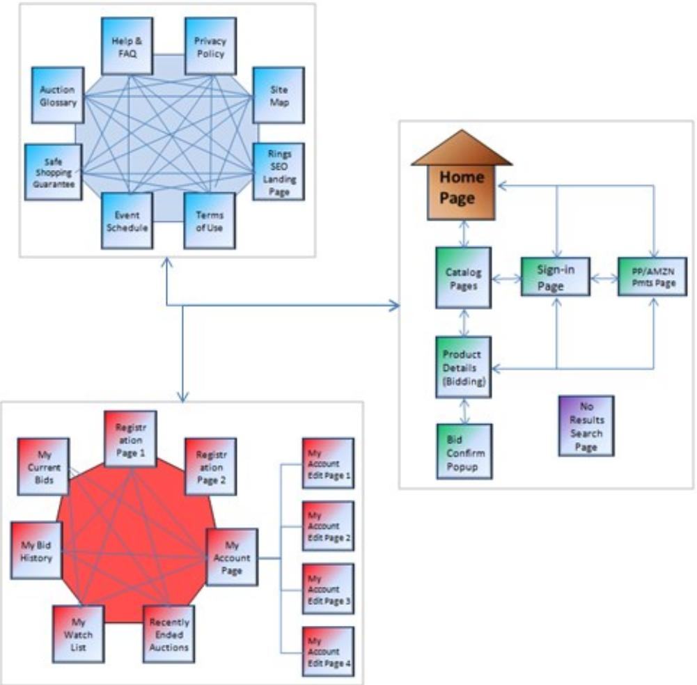

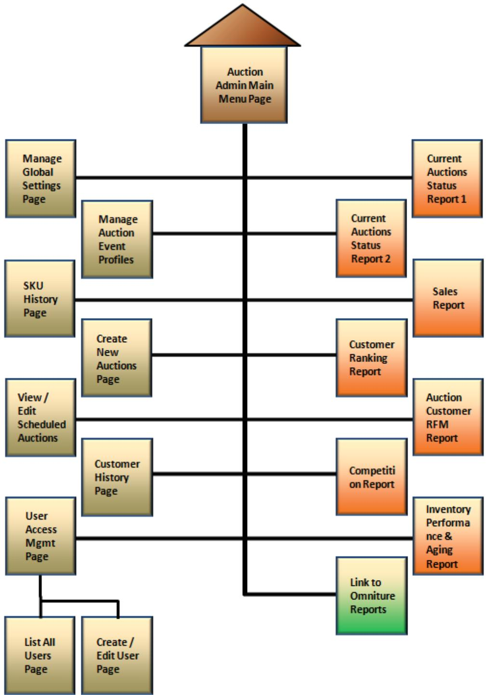

The following sections list various user stories / scenarios that the new auction system must support upon completion of “Iteration Zero” (the first release). User stories will apply to: End-user customers, the auction scheduler (“Auctioneer”), management, web designers, and customer service reps.

## 5.1 End Users

## 5.1.1 Creating an Account

As a site user, I want to be able to create an account as quickly as possible, know that my data is secure, and have access to my preferred payment type. I’d like to be able to enter only what is necessary to start bidding, then come back and finish the process later, so that I don’t miss out on a last-second bidding opportunity.

## 5.1.2 Modifying Account Settings

To be included in the next draft.

## 5.1.3 Browsing and Searching the Site

To be included in the next draft.

## 5.1.4 Bidding on Items for Sale

To be included in the next draft.

## 5.1.5 Monitoring Current and Past Auctions

To be included in the next draft.

## 5.1.6 Being Notified by Email About Events While I’m Away

To be included in the next draft.

## 5.1.7 Returning to Pay for Items Using APMs

To be included in the next draft.

## 5.2 The Auctioneer(s)

## 5.2.1 Scheduling Auctions

As the person scheduling the auctions, I need a great deal of flexibility in selecting product, applying it to particular events, and scheduling timeframes.

## 5.2.2 Changing Global Settings

To be included in the next draft.

## 5.3 Management

## 5.3.1 Reviewing Reports

To be included in the next draft.

## 5.3.2 Managing Inventory

To be included in the next draft.

## 5.3.3 Developing Customer Loyalty

To be included in the next draft.

$2 ^ { \mathsf { n d } } .$ -Chance Offers; Free Shipping thresholds, Combined Order Shipping, Personalization/Greetings, Safe-Shopping Guarantee,

## 5.3.4 Driving Traffic To The Site

To be included in the next draft.

SEO-friendly landing pages.

## 5.4 Customer Service Reps

## 5.4.1 Resolving Customer Inquiries

To be included in the next draft.

## 5.4.2 Closing or Suspending Accounts

To be included in the next draft.

## 5.5 Web Designers

## 5.5.1 Uploading New Design Content

To be included in the next draft.

## 6 Auction Site Pages

## 6.1 Home Page

## 6.1.1 General Requirements

 Global site header & footer.

 SEO Plan (Page should be designed in accordance with SEO best practices). Title tags: “JTV Auctions: Jewelry, Colored Gemstones, Diamonds, Online Auctions”.

 Endeca navigation section will appear on the left side of the page, in a “semi-expanded” state, below the canned search button stack. See the homepage mockup at the end of section 5.1. Also see the navigation hierarchy at the end of section six.

 The site should provide a personalized greeting whenever the user comes back, even before they sign in.

## 6.1.2 “Canned Search” Button Section

 These will be in the upper left-hand corner of the page, immediately below the text bar, in a “stack” of buttons.

 Closing Soon button (brings up catalog page of soon-to-close items; it should FIRST display any items in the user's current bid list or watch list. This button will be at the top of the “stack”.

 Hot Items button (brings up page of 12 hottest items [i.e. Items with most bids and lowest current gross margin]).

 Recently Ended button (brings up separate page for customer reference; it shows items closed within past 24 hours. See 5.17)

 Newly Listed Items button should use a cookied solution, and only display items added since the last user sign-in. (If this can't be done, then it should list items that were added within the past 24 hours). Show items in order, newest to oldest.

 Lowest Bid button will list all available items, sorted by current bid, lowest to highest.

 Upcoming Items button (brings up list/page of scheduled but not yet available items).

## 6.1.3 Today’s Top Auctions Product Module Section

 A horizontal row of current jewelry auctions will appear at the top of the page, just below the promotional text bar. It will consist of four (4) “product modules”. Each product module is an AJAX module that enables real-time updates and live bidding on the item. Each product module includes a thumbnail image, a short product description, the current price, and a bid button. The short description field from the SKU Creation application will be used (The “On-Air Description”). [100 characters maximum]

 The horizontal row of product modules will appear directly below a “Headline” (using <H1> tags, for SEO) that will say, “Today’s Top Jewelry Auctions”. When clicked on, it will have the same on-click action as the “Hot Items” button.

 Directly below the jewelry headline and product module section, there will be a duplicate section for loose gemstone product. The headline/title will be “Today’s Top Gemstone Auctions”.

 The platform will execute an algorithm which will populate these eight (8) product modules. It will function essentially as follows:

1. It will evaluate all current Jewelry auctions in order to populate the four (4) product modules, and separately evaluate all current gemstone auctions in order to populate the four (4) gemstone product modules.

2. The first criterion will limit eligible items to those that will close within the next hour. Once an item is chosen to populate a product module, it will remain in that position until the auction closes.

3. The second criterion will be “number of bidders.” Items with zero or one bidders will be excluded from eligibility. It is assumed that there will usually, if not always, be a significant quantity of items with two or more bidders with less than one hour remaining before the auction ends.

4. The algorithm should now rank the eligible items according to currently projected gross margin dollars if the auction were to end “right now,” with the four items having the lowest projected gross margin dollar earnings ranking the highest.

5. These four items will populate the four product modules.

6. In the future, the algorithm might be modified to look at a stored value (possibly in a cookie?) which classifies the user as primarily either a gemstone or a jewelry customer. If the customer can be so identified, the system will serve (for example), eight (8) gemstones in the product modules and zero jewelry items.

## 6.1.4 Promotional Spots

 The home page will host two promotional spots. See the mockup below for visual example.

 The top spot will be smaller (shorter), and will be similar in size to the current “Gemstone of the Week promotional banner.

 The bottom spot will be larger, and support promotional events such as “Lunchtime Lunacy”.

 Content will be populated from the CMA.

## 6.1.5 Category Links

 The homepage will include four (4) boxes (similar to the current JTVauctions site) which contain images and links to:

 Jewelry Auctions

 Watch Auctions

 Gemstone Auctions

 “Learn About Auctions”. This box will include a link to the permanent Survey Monkey online survey. The other links will link to the Help & FAQ page

## 6.1.6 SEO Plan

TBD

## 6.1.7 Home Page Mockup

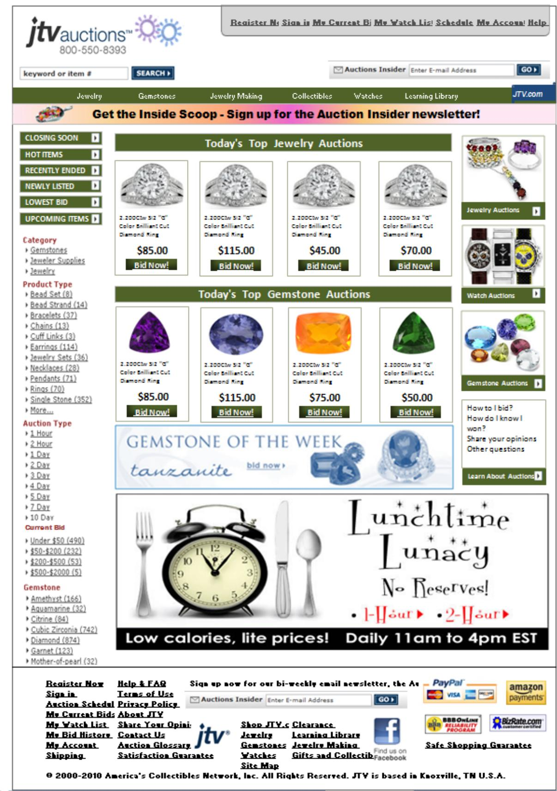

## 6.2 Category “Browse” Pages / Search Result Pages

## 6.2.1 General Requirements

 Global site header & footer.

 Navigational bread crumb trail at top of page, similar to Demandware's.

 Drill-down capabilities are defined in the navigation section. Endeca navigation section will appear on the left side of the page. On these pages, Endeca will appear in an expanded state. See sections 5.2.6 & 5.2.7 for visuals.

 Multiple page templates, depending on the user’s initial click action (gemstones, jewelry, watches, jeweler supplies, and collectibles). Each template will have different title tags and frequently-searched text at the bottom for SEO.

 Closed Items. Items that are closed will be removed within 1 minute (or whatever interval, as chosen in the global settings by the "Auctioneer".)

 No product will ever be eligible to appear on a product details page, search results, or catalog page if it does not have an available image to display.

## 6.2.2 Product Modules

 Product Modules are the “heart and soul” of this page. Each product module, in the catalog page view, will include:

 Thumbnail image,

short description (from the short description field in the JTV SKU Creation application (the “On-Air Description”),

 a countdown timer showing the time remaining,

 the current high bid, and

 a “QuickBid” button.

 The Product Module in the List View is the same, except it also has the “SmartBid” button, and is laid out horizontally.

 The countdown timer will show days, hours, minutes, and seconds in D:HH:MM:SS format). This must be in prominent red text.

 The QuickBid Button, when clicked, automatically enters a single bid (higher than the current bid, in accordance with the next highest bid as determined by the displayed bid increment). If the user is not signed in, the user will be prompted to sign in, then returned to the catalog page. WE SHOULD TRADEMARK THE QUICKBID BUTTON.

 Current High Bid. All items should show the current high bid, dynamically, without the need to refresh the page.

##  On-Click behavior:

Clicking anywhere within the product module will take the user to the Product Details (bidding) page, with the exception of clicking on the QuickBid button. If the user is not signed in, the user will be presented with a sign-in page, complete the sign-in process, and then the user will be delivered to the Product Details page.

Clicking on the QuickBid button actually places a “QuickBid”, unless the user is not signed in.

 On Mouseover behavior: If the user “mouses over” the item’s thumbnail image, the large size image (533 x 400, from the Product Details page) should appear, along with the Product ID (SKU number).

## 6.2.3 Page Navigation

 Upon choosing a top-level category (jewelry, gemstones, jeweler supplies, watches, or collectibles), or one of the “canned search” buttons from the home page (Hot Items, Newly Listed, etc), a category page with appropriate product will be displayed.

 A dropdown sort by: list will give the user the following sort options:

■ Ending Soon (in order, ending soonest, etc)

 Just Listed (in order, most recent to older)

 # of Bids (High to Low)

 # of Bids (Low to High)

 Current Price (High to Low)

 Current Price (Low to High)

 A “Items Per Page” dropdown list: Default = 40. User options: 40, 80, 120. Will appear at both top and bottom of the page.

 A “Go To Page” dropdown list will include as many page numbers as needed. Will appear at both top and bottom of the page.

 Previous and Next page links with arrow icons will appear at the top and bottom of the page.

## 6.2.4 SEO Plan

 Page should be designed in accordance with SEO best practices.

 There should be multiple page templates, depending on the user’s first click. For example, if the user first clicked on “Gemstones” from the homepage, then the “Gemstones” page template should be served. This page would have different text and title tags than the “Jewelry” page; similarly different from the “Jeweler Supplies” , “Collectibles”, and “Watches” pages.

 Title tags for the Jewelry category page: “JTV Online Jewelry Auctions: Rings, Earrings, Necklaces, Bracelets, Pendants, Silver Jewelry, Gold Jewelry”.

 Title tags for the Gemstone category page: “JTV Online Gemstone Auctions: Diamond, Ruby, Sapphire, Emerald, Tanzanite, Peridot, Garnet, & Topaz Loose Gemstone Auctions”.

 Title tags for the Watches category page: “JTV Online Watch Auctions: Men’s Watches, Women’s Watches, Croton, Citizen, Oceanaut Watches”.

## 6.2.5 Category Page “Views”

 The user will have two “Views” to choose from:

 A “List View”.

 A typical “Catalog View”.

 All category page items will include a thumbnail image; both in list view and catalog view.

 Content of each page type will be the same, with one exception: the List View will also include “SmartBid” buttons.

6.2.6 Category Page Mockup - List View  
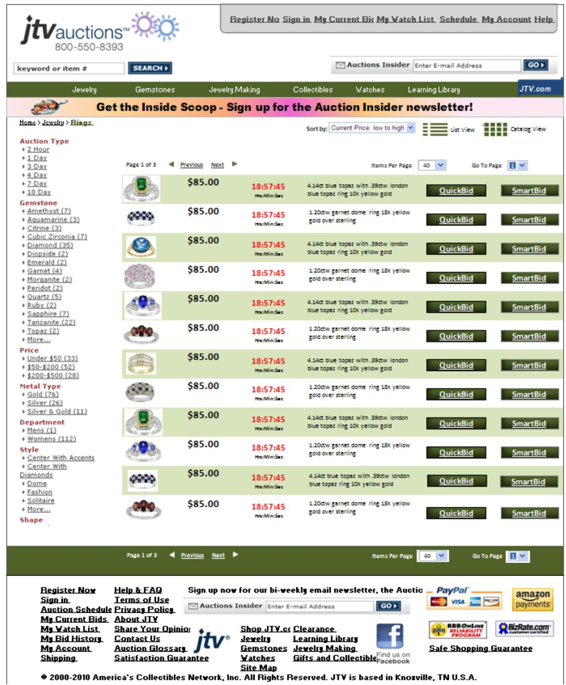

## 6.2.7 Category Page Mockup - Catalog View (Default)

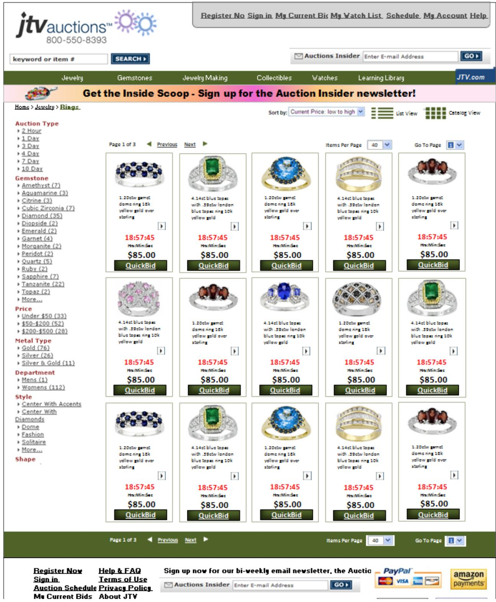

## 6.3 Product Details Pages (Bidding pages)

## 6.3.1 General Requirements

 Global site header & footer.

 Navigation breadcrumb trail at top of page.

 “Back to List of Auctions” button/link

 “Add to My Watch List” button.

 “Send to a Friend” button / capability. This would be a button similar to the Add to My Watch List button, and be in close proximity to it. This would generate a mailto: action, and send the item number, auction number, sender name and email address, and page URL to the recipient.

 Recently Viewed Items list (a strip of thumbnails & item numbers showing last five items viewed).

 NOTE: On this page, the Endeca left nav is deliberately omitted. This is because the customer has, by this point, determined what they want to look it, so the full space is dedicated to the chosen product. This is similar to both Ebay and Overstock.com. The page should include a “Back to List of Auctions” button/link. This will have the same effect as clicking one level back on the breadcrumb trail.

 Overtime Bidding: The site must support “Overtime bidding” (“bid extend“ / “popcorn bidding”) functionality, which will be configured by the Auctioneer in the Auction Admin application.

 Buy It Now! Functionality. (Phase 2, if necessary)

 No product will ever be eligible to appear on a product details page, search results, or catalog page if it does not have an available image to display.

## 6.3.2 Product Detail Section

 Product Title / Short Description (from SKU Creation application)

 Product Description / Specifications (from SKU Creation application. 1000 character limitation)

 Other Product Details product attribute fields (from SKU Creation application). The labels and fields displayed will depend on the product type (i.e., loose gemstone, ring, necklace, etc). Important product types (Single stone, rings, bracelets, earrings, necklaces, pendants, watches) will display the particular product fields as shown below in the Product Details by Product Attributes tables. (Section 5.3.6).

 No product attribute field label should appear if the value is NULL.

 The “Gemstone Treatment” field will always be visible for all gemstone category products, and for any jewelry products that contain a gemstone value. The field label will be linked to the following page on JTV.com: http://learning.jewelrytelevision.com/article/gem-enhancementsand-care.aspx? . The field label will be underlined.

 Product Image. (295 x 221 pix - same size as current product image) (clicking or mousing over brings up larger 533 x 400 image)

 Ability to show multiple images, if existing. Thumbnails below image area (similar to JTV.com).

 Item Product ID (SKU number).

 Auction number. (A unique auction sequence number)

## 6.3.3 Bidding Section

 Clearly defined (delineated) from the product details area.

 Current winning bid.

 Statement: “Overtime Bidding is ON”. (hyperlink to definition popup)

 Opening bid.

 Bid increment.

 Countdown clock – show remaining days:hours:minutes until the auction closes. This must be “live” – i.e., dynamic.

 “QuickBid Now” button. This bid would quickly place a single (not a max bid) bid, adding the stated bid increment to the last bid. There will be a question mark icon/link next to the button; users who click on it will be taken to the paragraph on the FAQ page that explains QuickBids.

 “SmartBid” field and button. SmartBid provides users with the ability to set a maximum bid amount and have the system bid for them automatically (according to the minimum bid increment) until they win the auction or meet their maximum bid. Need bid confirmation popup. Possible SmartBid amounts are listed in a dropdown list. After placing and confirming their bid, the user will remain on the bidding page. There will be a question mark icon/link next to the button; users who click on it will be taken to the paragraph on the FAQ page that explains SmartBids.

 Bid Confirmation Pop-up: When customers bid from this page, a bid confirmation pop-up message will appear, telling the customer that they have just bid “\$XX, using a “[type] bid”. For example, “You are bidding \$30 for this item using a SmartBid, on a card ending in 6744. Is this correct?” [Yes, Place SmartBid / Cancel buttons]. When this popup appears, the rest of the page will be grayed out and “unclickable”. See the visual representation in section 5.3.5.

 Checkbox: There will be a “I want to be notified by email when my bid is exceeded”. “Notified by email” will be hyperlinked. Clicking on this link will result in a popup DIV layer with messaging from the FAQ page explaining to the participant how they can ensure receipt of these emails.

 After-Bid Behavior: After the user confirms their bid, they will remain on the product details page.

 Before allowing a bid to be placed, the system will check the bidder’s sign-in status. If the bidder has not signed in, the system will take the bidder directly to the sign-in page. If the user has the required minimum information required to bid, the system will return the bidder to the product details page of the item they initially tried to bid on.

 Item Bid History. Shows bidder member IDs, bid amounts & times. There will be an indicator telling all users if someone is using “SmartBids”, with a link explaining what that is, and why they should also use it. This section will display the most recent bids on top (show a maximum of 25 bids.)

 In the bid history, the date/time stamp used for computer-generated SmartBids should be the date/time that the computer placed the last bid, not the date/time that the participant placed the original SmartBid.

 Phase 2: Member IDs are linked to their city/state. Member ID can be clicked on to show what city/state bidder is bidding from. (Cool feature…)

 Live Bid. Bidding information dynamically streamed includes Time Remaining, Current Bids, Placing Bids, and Bidder User Name. Java Flash Plug-in for auction platform to provide "real time" bidding experience. This Flash application re-creates the feel of a "live auction" by

streaming into the customers' browsers all relevant bidding information for the customers to follow, manage, and place bids on specific products without refreshing their browser.

 Legal notice – Prominently highlighted. Text: “Please Note: When you place a bid, you are entering into a legally binding contract. If you are the winning bidder, you must pay for the item(s) upon receipt of the “winning notification” e-mail. Non-payment of winning bids may result in suspension and/or termination of your bidding privileges. We ask you to please bid only on items that you intend to purchase.

I want to be notified by email when my bid is exceeded.

Home > Jewelry > Bings > Emerald

RAW2222

## 6.3.4 Product Details Page Mockup

Jewelry Making

Collectibles

## 8x6mm Oval Opal Doublet Harlequin

Product Description / Specifications go here. This field can accommodate up to 1000 characters.

<table><tr><td rowspan=1 colspan=1>Richard H.$ 65.00</td><td rowspan=1 colspan=1></td><td rowspan=1 colspan=1></td></tr><tr><td rowspan=1 colspan=1>HelenS64.00</td><td rowspan=1 colspan=1></td><td rowspan=1 colspan=1>2/24/10 2:56:33 AMNo</td></tr><tr><td rowspan=1 colspan=1>Geminator$ 63.00</td><td rowspan=1 colspan=1></td><td rowspan=1 colspan=1>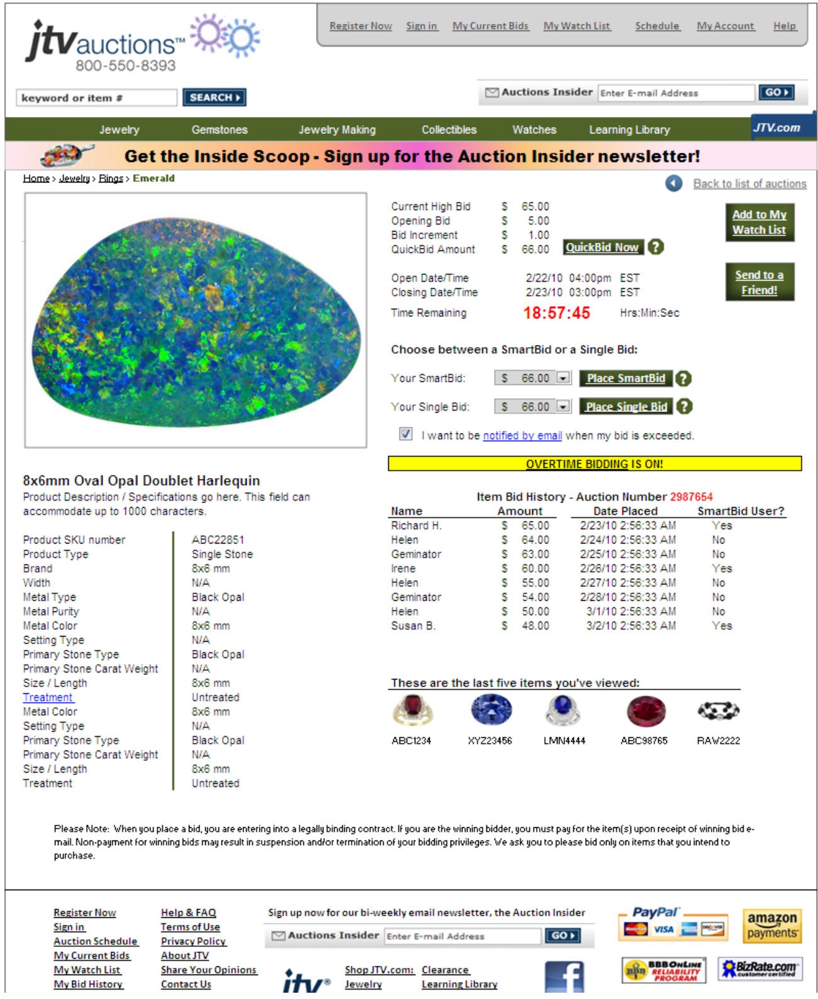</td></tr><tr><td rowspan=1 colspan=1>Irene$ 60.00</td><td rowspan=1 colspan=1></td><td rowspan=1 colspan=1></td></tr><tr><td rowspan=1 colspan=2></td><td rowspan=1 colspan=1>2/27/10 2:56:33 AMNo</td></tr><tr><td rowspan=1 colspan=2>Geminator$ 54.00</td><td rowspan=1 colspan=1></td></tr><tr><td rowspan=1 colspan=3></td></tr><tr><td rowspan=1 colspan=3></td></tr></table>

Product SKU number   
Product Type   
Brand   
Width   
Metal Type   
Metal Purity   
Metal Color   
Setting Type   
Primary Stone Type   
Primary Stone Carat Weight   
Size / Length   
Treatment   
Metal Color   
Setting Type   
Primary Stone Type   
Primary Stone Carat Weight   
Size / Length   
Treatment   
ABC22851   
Single Stone   
8x6 mm   
N/A   
Black Opal   
N/A   
8x6 mm   
N/A   
Black Opal   
N/A   
8x6 mm   
Untreated   
8x6 mm   
N/A   
Black Opal   
N/A   
8x6 mm   
Untreated

ABC1234

XYZ23456

LMN4444

ABC98765

Please Note: When you place a bid, you are entering into a legally binding contract. If you are the winning bidder, you must pay for the item(s) upon receipt of winning bid e mail. Non-payment for winning bids may result in suspension andror termination of your bidding privileges. 'W'e ask you to please bid only on items that you intend to purchase.

6.3.5 Product Details Page Mockup, Showing Bid Confirmation Popup DIV  
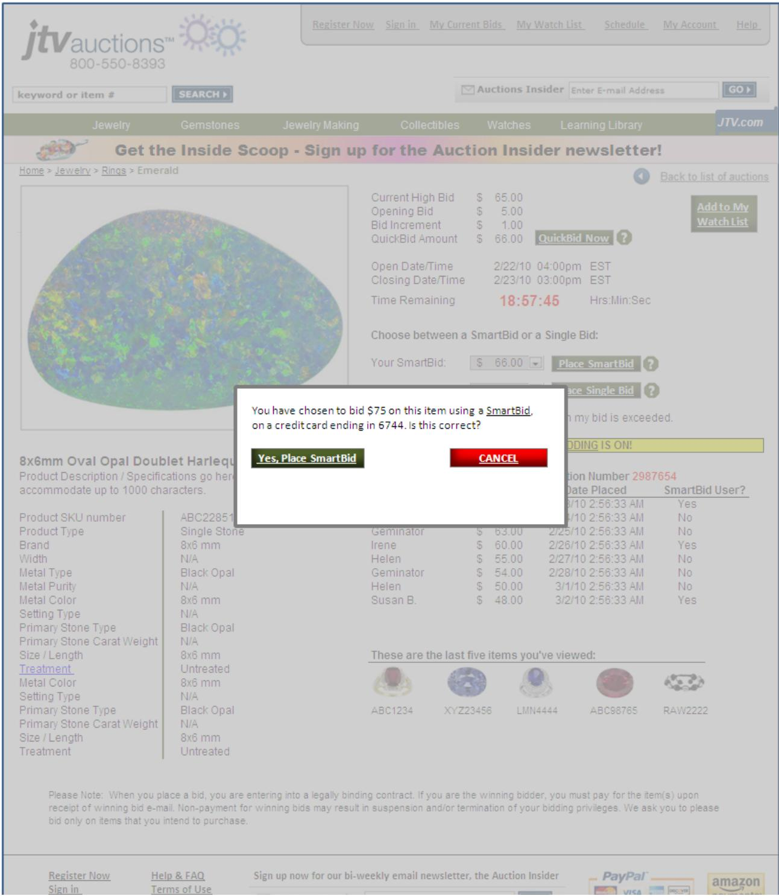

## 6.3.6 Product Details Pages, Product Attributes by Product Type

Product Detail Page Product Attributes to be Displayed -- Single Gemstones
<table><tr><td rowspan=1 colspan=1>SKU Creation Field Name</td><td rowspan=1 colspan=1>Product Details Page Label</td><td rowspan=1 colspan=1>Example Data</td></tr><tr><td rowspan=1 colspan=1></td><td rowspan=1 colspan=1></td><td rowspan=1 colspan=1></td></tr><tr><td rowspan=1 colspan=1>Primary Gemstone:</td><td rowspan=1 colspan=1></td><td rowspan=1 colspan=1></td></tr><tr><td rowspan=1 colspan=1>Product Type</td><td rowspan=1 colspan=1>Product Type</td><td rowspan=1 colspan=1>Single Stone</td></tr><tr><td rowspan=1 colspan=1>Gemstone</td><td rowspan=1 colspan=1>Gemstone</td><td rowspan=1 colspan=1>Emerald</td></tr><tr><td rowspan=1 colspan=1>Stone Country</td><td rowspan=1 colspan=1>Gemstone Country of Origin</td><td rowspan=1 colspan=1>Colombia</td></tr><tr><td rowspan=1 colspan=1>Stone Group</td><td rowspan=1 colspan=1>Gemstone Family</td><td rowspan=1 colspan=1>Beryl</td></tr><tr><td rowspan=1 colspan=1>Merch Color</td><td rowspan=1 colspan=1>Gemstone Color</td><td rowspan=1 colspan=1>Green</td></tr><tr><td rowspan=1 colspan=1>Stone Ct</td><td rowspan=1 colspan=1>Gemstone Count</td><td rowspan=1 colspan=1>1</td></tr><tr><td rowspan=1 colspan=1>CTW</td><td rowspan=1 colspan=1>Gemstone Carat Weight</td><td rowspan=1 colspan=1>0.75ct</td></tr><tr><td rowspan=1 colspan=1>Shape</td><td rowspan=1 colspan=1>Gemstone Shape</td><td rowspan=1 colspan=1>Round</td></tr><tr><td rowspan=1 colspan=1>Cutting Style</td><td rowspan=1 colspan=1>Gemstone Cut Style</td><td rowspan=1 colspan=1>Bead</td></tr><tr><td rowspan=1 colspan=1>Composition</td><td rowspan=1 colspan=1>Composition</td><td rowspan=1 colspan=1>Natural</td></tr><tr><td rowspan=1 colspan=1>Treatment</td><td rowspan=1 colspan=1>Gemstone Treatment</td><td rowspan=1 colspan=1>Excel</td></tr><tr><td rowspan=1 colspan=1>Dimensions</td><td rowspan=1 colspan=1>Gemstone Dimensions</td><td rowspan=1 colspan=1>7mm</td></tr><tr><td rowspan=1 colspan=1>Brand</td><td rowspan=1 colspan=1>Brand</td><td rowspan=1 colspan=1>Eternity Natural Em</td></tr><tr><td rowspan=1 colspan=1>Product Line</td><td rowspan=1 colspan=1>Collection</td><td rowspan=1 colspan=1>Trade Show Treasur</td></tr><tr><td rowspan=1 colspan=1>Clarity</td><td rowspan=1 colspan=1>Gemstone Clarity</td><td rowspan=1 colspan=1>13</td></tr><tr><td rowspan=1 colspan=1>Color Grade</td><td rowspan=1 colspan=1>Color Grade</td><td rowspan=1 colspan=1>F</td></tr></table>

Product Detail Page Product Attributes to be Displayed -- Watches
<table><tr><td rowspan=1 colspan=1>SKU Creation Field Name</td><td rowspan=1 colspan=1>Product Details Page Label</td><td rowspan=1 colspan=1>Example Data</td></tr><tr><td rowspan=1 colspan=1></td><td rowspan=1 colspan=1></td><td rowspan=1 colspan=1></td></tr><tr><td rowspan=1 colspan=1>Product Type</td><td rowspan=1 colspan=1>Product Type</td><td rowspan=1 colspan=1>Wrist Watch</td></tr><tr><td rowspan=1 colspan=1>Brand</td><td rowspan=1 colspan=1>Brand</td><td rowspan=1 colspan=1>Adee Kaye</td></tr><tr><td rowspan=1 colspan=1>Width/Band Width</td><td rowspan=1 colspan=1>Width / Band Width</td><td rowspan=1 colspan=1>11/8inch</td></tr><tr><td rowspan=1 colspan=1>Drop / Length</td><td rowspan=1 colspan=1>Length</td><td rowspan=1 colspan=1>7 inches</td></tr><tr><td rowspan=1 colspan=1>Material</td><td rowspan=1 colspan=1>Metal Type</td><td rowspan=1 colspan=1>Gold</td></tr><tr><td rowspan=1 colspan=1>Metal Purity</td><td rowspan=1 colspan=1>Metal Purity</td><td rowspan=1 colspan=1>10kt</td></tr><tr><td rowspan=1 colspan=1>Metal Color</td><td rowspan=1 colspan=1>Metal Color</td><td rowspan=1 colspan=1>Yellow</td></tr><tr><td rowspan=1 colspan=1>Closure</td><td rowspan=1 colspan=1>Closure</td><td rowspan=1 colspan=1>Tang Buckle</td></tr><tr><td rowspan=1 colspan=1>Style</td><td rowspan=1 colspan=1>Style</td><td rowspan=1 colspan=1>Casual</td></tr><tr><td rowspan=1 colspan=1>Jewelry Country</td><td rowspan=1 colspan=1>Jewelry Country</td><td rowspan=1 colspan=1>Italy</td></tr><tr><td rowspan=1 colspan=1></td><td rowspan=1 colspan=1></td><td rowspan=1 colspan=1></td></tr></table>

Product Detail Page Product Attributes to be Displayed -- Rings
<table><tr><td rowspan=1 colspan=1>SKU Creation Field Name</td><td rowspan=1 colspan=1>Product Details Page Label</td><td rowspan=1 colspan=1>Example Data</td></tr><tr><td rowspan=1 colspan=1></td><td rowspan=1 colspan=1></td><td rowspan=1 colspan=1></td></tr><tr><td rowspan=1 colspan=1>Jewelry Attributes:</td><td rowspan=1 colspan=1></td><td rowspan=1 colspan=1></td></tr><tr><td rowspan=1 colspan=1>Product Type</td><td rowspan=1 colspan=1>Product Type</td><td rowspan=1 colspan=1>Ring</td></tr><tr><td rowspan=1 colspan=1>Brand</td><td rowspan=1 colspan=1>Brand</td><td rowspan=1 colspan=1>Bella Luce</td></tr><tr><td rowspan=1 colspan=1>Width/Band Width</td><td rowspan=1 colspan=1>Width / Band Width</td><td rowspan=1 colspan=1>1/16 inch</td></tr><tr><td rowspan=1 colspan=1>Size</td><td rowspan=1 colspan=1>Size</td><td rowspan=1 colspan=1>7</td></tr><tr><td rowspan=1 colspan=1>Material</td><td rowspan=1 colspan=1>Metal Type</td><td rowspan=1 colspan=1>Gold</td></tr><tr><td rowspan=1 colspan=1>Density</td><td rowspan=1 colspan=1>Density</td><td rowspan=1 colspan=1>Solid</td></tr><tr><td rowspan=1 colspan=1>Metal Purity</td><td rowspan=1 colspan=1>Metal Purity</td><td rowspan=1 colspan=1>10kt</td></tr><tr><td rowspan=1 colspan=1>Metal Color</td><td rowspan=1 colspan=1>Metal Color</td><td rowspan=1 colspan=1>Yellow</td></tr><tr><td rowspan=1 colspan=1>Setting</td><td rowspan=1 colspan=1>Setting Type</td><td rowspan=1 colspan=1>4-prong</td></tr><tr><td rowspan=1 colspan=1>Rhodium</td><td rowspan=1 colspan=1>Rhodium Used</td><td rowspan=1 colspan=1>Settings</td></tr><tr><td rowspan=1 colspan=1>Style</td><td rowspan=1 colspan=1>Style</td><td rowspan=1 colspan=1>Fashion</td></tr><tr><td rowspan=1 colspan=1></td><td rowspan=1 colspan=1></td><td rowspan=1 colspan=1></td></tr><tr><td rowspan=1 colspan=1>Primary Gemstone:</td><td rowspan=1 colspan=1></td><td rowspan=1 colspan=1></td></tr><tr><td rowspan=1 colspan=1>Gemstone</td><td rowspan=1 colspan=1>Gemstone</td><td rowspan=1 colspan=1>Amethyst</td></tr><tr><td rowspan=1 colspan=1>Stone Group</td><td rowspan=1 colspan=1>Gemstone Family</td><td rowspan=1 colspan=1>Quartz</td></tr><tr><td rowspan=1 colspan=1>Merch Color</td><td rowspan=1 colspan=1>Gemstone Color</td><td rowspan=1 colspan=1>Lavender</td></tr><tr><td rowspan=1 colspan=1>CTW</td><td rowspan=1 colspan=1>Gemstone Carat Weight</td><td rowspan=1 colspan=1>2.25ct</td></tr><tr><td rowspan=1 colspan=1>Shape</td><td rowspan=1 colspan=1>Gemstone Shape</td><td rowspan=1 colspan=1>Round</td></tr><tr><td rowspan=1 colspan=1>Cutting Style</td><td rowspan=1 colspan=1>Gemstone Cut Style</td><td rowspan=1 colspan=1>Single</td></tr><tr><td rowspan=1 colspan=1>Composition</td><td rowspan=1 colspan=1>Composition</td><td rowspan=1 colspan=1>Natural</td></tr><tr><td rowspan=1 colspan=1>Treatment</td><td rowspan=1 colspan=1>Gemstone Treatment</td><td rowspan=1 colspan=1>No Treatment</td></tr><tr><td rowspan=1 colspan=1>Dimensions</td><td rowspan=1 colspan=1>Gemstone Dimensions</td><td rowspan=1 colspan=1>9mm</td></tr><tr><td rowspan=1 colspan=1></td><td rowspan=1 colspan=1></td><td rowspan=1 colspan=1></td></tr><tr><td rowspan=1 colspan=1>Accent Stone 1 Stone</td><td rowspan=1 colspan=1>Accent Stone1 Gemstone</td><td rowspan=1 colspan=1>Topaz</td></tr><tr><td rowspan=1 colspan=1>Accent Stone 1 Color</td><td rowspan=1 colspan=1>Accent Stone1 Gemstone Color</td><td rowspan=1 colspan=1>Blue</td></tr><tr><td rowspan=1 colspan=1>Accent Stone 1 Shape</td><td rowspan=1 colspan=1>Accent Stone1 Gemstone Shapé</td><td rowspan=1 colspan=1>Round</td></tr><tr><td rowspan=1 colspan=1>Accent Stone 1 Setting</td><td rowspan=1 colspan=1>Accent Stone1 Setting</td><td rowspan=1 colspan=1>4-Prong</td></tr><tr><td rowspan=1 colspan=1>Accent Stone 1 CTW</td><td rowspan=1 colspan=1>Accent Stone1 Carat Weight</td><td rowspan=1 colspan=1>0.11</td></tr><tr><td rowspan=1 colspan=1>Accent Stone 1 Stone Ct</td><td rowspan=1 colspan=1>Accent Stone1 Gemstone Count</td><td rowspan=1 colspan=1>1</td></tr><tr><td rowspan=1 colspan=1></td><td rowspan=1 colspan=1></td><td rowspan=1 colspan=1></td></tr><tr><td rowspan=1 colspan=1>Accent Stone 2 Stone</td><td rowspan=1 colspan=1>Accent Stone2 Gemstone</td><td rowspan=1 colspan=1>Topaz</td></tr><tr><td rowspan=1 colspan=1>Accent Stone 2 Color</td><td rowspan=1 colspan=1>Accent Stone2 Gemstone Color</td><td rowspan=1 colspan=1>Blue</td></tr><tr><td rowspan=1 colspan=1>Accent Stone 2 Shape</td><td rowspan=1 colspan=1>Accent Stone2 Gemstone Shap</td><td rowspan=1 colspan=1>éRound</td></tr><tr><td rowspan=1 colspan=1>Accent Stone 2 Setting</td><td rowspan=1 colspan=1>Accent Stone2 Setting</td><td rowspan=1 colspan=1>4-Prong</td></tr><tr><td rowspan=1 colspan=1>Accent Stone 2 CTW</td><td rowspan=1 colspan=1>Accent Stone2 Carat Weight</td><td rowspan=1 colspan=1>0.11</td></tr><tr><td rowspan=1 colspan=1>Accent Stone 2 Stone Ct</td><td rowspan=1 colspan=1>Accent Stone2 Gemstone Count</td><td rowspan=1 colspan=1>1</td></tr></table>

Product Detail Page Product Attributes to be Displayed -- Necklaces
<table><tr><td rowspan=1 colspan=1>SKU Creation Field Name</td><td rowspan=1 colspan=1>Product Details Page Label</td><td rowspan=1 colspan=1>Example Data</td></tr><tr><td rowspan=1 colspan=1></td><td rowspan=1 colspan=1></td><td rowspan=1 colspan=1></td></tr><tr><td rowspan=1 colspan=1>Jewelry Attributes:</td><td rowspan=1 colspan=1></td><td rowspan=1 colspan=1></td></tr><tr><td rowspan=1 colspan=1>Product Type</td><td rowspan=1 colspan=1>Product Type</td><td rowspan=1 colspan=1>Necklace</td></tr><tr><td rowspan=1 colspan=1>Brand</td><td rowspan=1 colspan=1>Brand</td><td rowspan=1 colspan=1>Bella Luce</td></tr><tr><td rowspan=1 colspan=1>Width/Band Width</td><td rowspan=1 colspan=1>Width / Band Width</td><td rowspan=1 colspan=1>3 /8 inch</td></tr><tr><td rowspan=1 colspan=1>Drop / Length</td><td rowspan=1 colspan=1>Length</td><td rowspan=1 colspan=1>16 1/2 inches</td></tr><tr><td rowspan=1 colspan=1>Material</td><td rowspan=1 colspan=1>Metal Type</td><td rowspan=1 colspan=1>Gold</td></tr><tr><td rowspan=1 colspan=1>Density</td><td rowspan=1 colspan=1>Density</td><td rowspan=1 colspan=1>Solid</td></tr><tr><td rowspan=1 colspan=1>Metal Purity</td><td rowspan=1 colspan=1>Metal Purity</td><td rowspan=1 colspan=1>10kt</td></tr><tr><td rowspan=1 colspan=1>Metal Color</td><td rowspan=1 colspan=1>Metal Color</td><td rowspan=1 colspan=1>Yellow</td></tr><tr><td rowspan=1 colspan=1>Setting</td><td rowspan=1 colspan=1>Setting Type</td><td rowspan=1 colspan=1>Strung</td></tr><tr><td rowspan=1 colspan=1>Rhodium</td><td rowspan=1 colspan=1>Rhodium Used</td><td rowspan=1 colspan=1>Settings</td></tr><tr><td rowspan=1 colspan=1>Style</td><td rowspan=1 colspan=1>Style</td><td rowspan=1 colspan=1>Fashion</td></tr><tr><td rowspan=1 colspan=1>Closure</td><td rowspan=1 colspan=1>Closure</td><td rowspan=1 colspan=1>Lobster Clasp</td></tr><tr><td rowspan=1 colspan=1></td><td rowspan=1 colspan=1></td><td rowspan=1 colspan=1></td></tr><tr><td rowspan=1 colspan=1>Primary Gemstone:</td><td rowspan=1 colspan=1></td><td rowspan=1 colspan=1></td></tr><tr><td rowspan=1 colspan=1>Gemstone</td><td rowspan=1 colspan=1>Gemstone</td><td rowspan=1 colspan=1>Amethyst</td></tr><tr><td rowspan=1 colspan=1>Stone Group</td><td rowspan=1 colspan=1>Gemstone Family</td><td rowspan=1 colspan=1>Quartz</td></tr><tr><td rowspan=1 colspan=1>Merch Color</td><td rowspan=1 colspan=1>Gemstone Color</td><td rowspan=1 colspan=1>Lavender</td></tr><tr><td rowspan=1 colspan=1>Stone Ct</td><td rowspan=1 colspan=1>Gemstone Count</td><td rowspan=1 colspan=1>120</td></tr><tr><td rowspan=1 colspan=1>CTW</td><td rowspan=1 colspan=1>Gemstone Carat Weight</td><td rowspan=1 colspan=1>2.25ct</td></tr><tr><td rowspan=1 colspan=1>Shape</td><td rowspan=1 colspan=1>Gemstone Shape</td><td rowspan=1 colspan=1>Round</td></tr><tr><td rowspan=1 colspan=1>Cutting Style</td><td rowspan=1 colspan=1>Gemstone Cut Style</td><td rowspan=1 colspan=1>Bead</td></tr><tr><td rowspan=1 colspan=1>Composition</td><td rowspan=1 colspan=1>Composition</td><td rowspan=1 colspan=1>Natural</td></tr><tr><td rowspan=1 colspan=1>Treatment</td><td rowspan=1 colspan=1>Gemstone Treatment</td><td rowspan=1 colspan=1>No Treatment</td></tr><tr><td rowspan=1 colspan=1>Dimensions</td><td rowspan=1 colspan=1>Gemstone Dimensions</td><td rowspan=1 colspan=1>0mm</td></tr><tr><td rowspan=1 colspan=1></td><td rowspan=1 colspan=1></td><td rowspan=1 colspan=1></td></tr><tr><td rowspan=1 colspan=1>Accent Stone 1 Stone</td><td rowspan=1 colspan=1>Accent Stone1 Gemstone</td><td rowspan=1 colspan=1>Topaz</td></tr><tr><td rowspan=1 colspan=1>Accent Stone 1 Color</td><td rowspan=1 colspan=1>Accent Stone1 Gemstone Color</td><td rowspan=1 colspan=1>Blue</td></tr><tr><td rowspan=1 colspan=1>Accent Stone 1 Shape</td><td rowspan=1 colspan=1>Accent Stone1 Gemstone Shapé</td><td rowspan=1 colspan=1>Round</td></tr><tr><td rowspan=1 colspan=1>Accent Stone 1 Setting</td><td rowspan=1 colspan=1>Accent Stone1 Setting</td><td rowspan=1 colspan=1>4-Prong</td></tr><tr><td rowspan=1 colspan=1>Accent Stone 1 CTW</td><td rowspan=1 colspan=1>Accent Stone1 Carat Weight</td><td rowspan=1 colspan=1>0.11</td></tr><tr><td rowspan=1 colspan=1>Accent Stone 1 Stone Ct</td><td rowspan=1 colspan=1>Accent Stone1 Gemstone Count</td><td rowspan=1 colspan=1>1</td></tr><tr><td rowspan=1 colspan=1></td><td rowspan=1 colspan=1></td><td rowspan=1 colspan=1></td></tr><tr><td rowspan=1 colspan=1>Accent Stone 2 Stone</td><td rowspan=1 colspan=1>Accent Stone2 Gemstone</td><td rowspan=1 colspan=1>Topaz</td></tr><tr><td rowspan=1 colspan=1>Accent Stone 2 Color</td><td rowspan=1 colspan=1>Accent Stone2 Gemstone Color</td><td rowspan=1 colspan=1>Blue</td></tr><tr><td rowspan=1 colspan=1>Accent Stone 2 Shape</td><td rowspan=1 colspan=1>Accent Stone2 Gemstone Shape</td><td rowspan=1 colspan=1>Round</td></tr><tr><td rowspan=1 colspan=1>Accent Stone 2 Setting</td><td rowspan=1 colspan=1>Accent Stone2 Setting</td><td rowspan=1 colspan=1>4-Prong</td></tr><tr><td rowspan=1 colspan=1>Accent Stone 2 CTW</td><td rowspan=1 colspan=1>Accent Stone2 Carat Weight</td><td rowspan=1 colspan=1>0.11</td></tr><tr><td rowspan=1 colspan=1>Accent Stone 2 Stone Ct</td><td rowspan=1 colspan=1>Accent Stone2 Gemstone Count</td><td rowspan=1 colspan=1>1</td></tr></table>

Product Detail Page Product Attributes to be Displayed -- Earrings
<table><tr><td rowspan=1 colspan=1>SKU Creation Field Name</td><td rowspan=1 colspan=1>Product Details Page Label</td><td rowspan=1 colspan=1>Example Data</td></tr><tr><td rowspan=1 colspan=1></td><td rowspan=1 colspan=1></td><td rowspan=1 colspan=1></td></tr><tr><td rowspan=1 colspan=1>Jewelry Attributes:</td><td rowspan=1 colspan=1></td><td rowspan=1 colspan=1></td></tr><tr><td rowspan=1 colspan=1>Product Type</td><td rowspan=1 colspan=1>Product Type</td><td rowspan=1 colspan=1>Earrings</td></tr><tr><td rowspan=1 colspan=1>Brand</td><td rowspan=1 colspan=1>Brand</td><td rowspan=1 colspan=1>Bella Luce</td></tr><tr><td rowspan=1 colspan=1>Width/Band Width</td><td rowspan=1 colspan=1>Width / Band Width</td><td rowspan=1 colspan=1>5 /16 inch</td></tr><tr><td rowspan=1 colspan=1>Drop / Length</td><td rowspan=1 colspan=1>Length</td><td rowspan=1 colspan=1>11/4 inches</td></tr><tr><td rowspan=1 colspan=1>Material</td><td rowspan=1 colspan=1>Metal Type</td><td rowspan=1 colspan=1>Gold</td></tr><tr><td rowspan=1 colspan=1>Metal Purity</td><td rowspan=1 colspan=1>Metal Purity</td><td rowspan=1 colspan=1>10kt</td></tr><tr><td rowspan=1 colspan=1>Metal Color</td><td rowspan=1 colspan=1>Metal Color</td><td rowspan=1 colspan=1>Yellow</td></tr><tr><td rowspan=1 colspan=1>Density</td><td rowspan=1 colspan=1>Density</td><td rowspan=1 colspan=1>Hollow</td></tr><tr><td rowspan=1 colspan=1>Setting</td><td rowspan=1 colspan=1>Setting Type</td><td rowspan=1 colspan=1>4-prong</td></tr><tr><td rowspan=1 colspan=1>Rhodium</td><td rowspan=1 colspan=1>Rhodium Used</td><td rowspan=1 colspan=1>Settings</td></tr><tr><td rowspan=1 colspan=1>Style</td><td rowspan=1 colspan=1>Style</td><td rowspan=1 colspan=1>Fashion</td></tr><tr><td rowspan=1 colspan=1>Backing</td><td rowspan=1 colspan=1>Backing</td><td rowspan=1 colspan=1>French Clip</td></tr><tr><td rowspan=1 colspan=1>Gram Weight</td><td rowspan=1 colspan=1>Gram Weight</td><td rowspan=1 colspan=1>2.5</td></tr><tr><td rowspan=1 colspan=1></td><td rowspan=1 colspan=1></td><td rowspan=1 colspan=1></td></tr><tr><td rowspan=1 colspan=1>Primary Gemstone:</td><td rowspan=1 colspan=1></td><td rowspan=1 colspan=1></td></tr><tr><td rowspan=1 colspan=1>Gemstone</td><td rowspan=1 colspan=1>Gemstone</td><td rowspan=1 colspan=1>Amethyst</td></tr><tr><td rowspan=1 colspan=1>Stone Group</td><td rowspan=1 colspan=1>Gemstone Family</td><td rowspan=1 colspan=1>Quartz</td></tr><tr><td rowspan=1 colspan=1>Merch Color</td><td rowspan=1 colspan=1>Gemstone Color</td><td rowspan=1 colspan=1>Purple</td></tr><tr><td rowspan=1 colspan=1>Stone Ct</td><td rowspan=1 colspan=1>Gemstone Count</td><td rowspan=1 colspan=1>2</td></tr><tr><td rowspan=1 colspan=1>CTW</td><td rowspan=1 colspan=1>Gemstone Carat Weight</td><td rowspan=1 colspan=1>4.8ct</td></tr><tr><td rowspan=1 colspan=1>Shape</td><td rowspan=1 colspan=1>Gemstone Shape</td><td rowspan=1 colspan=1>Oval</td></tr><tr><td rowspan=1 colspan=1>Cutting Style</td><td rowspan=1 colspan=1>Gemstone Cut Style</td><td rowspan=1 colspan=1>Concave</td></tr><tr><td rowspan=1 colspan=1>Composition</td><td rowspan=1 colspan=1>Composition</td><td rowspan=1 colspan=1>Natural</td></tr><tr><td rowspan=1 colspan=1>Treatment</td><td rowspan=1 colspan=1>Gemstone Treatment</td><td rowspan=1 colspan=1>No Treatment</td></tr><tr><td rowspan=1 colspan=1>Dimensions</td><td rowspan=1 colspan=1>Gemstone Dimensions</td><td rowspan=1 colspan=1>0mm</td></tr><tr><td rowspan=1 colspan=1></td><td rowspan=1 colspan=1></td><td rowspan=1 colspan=1></td></tr><tr><td rowspan=1 colspan=1>Accent Stone 1 Stone</td><td rowspan=1 colspan=1>Accent Stone1 Gemstone</td><td rowspan=1 colspan=1>Topaz</td></tr><tr><td rowspan=1 colspan=1>Accent Stone 1 Color</td><td rowspan=1 colspan=1>Accent Stone1 Gemstone Color</td><td rowspan=1 colspan=1>Blue</td></tr><tr><td rowspan=1 colspan=1>Accent Stone 1 Shape</td><td rowspan=1 colspan=1>Accent Stone1 Gemstone Shapé</td><td rowspan=1 colspan=1>Round</td></tr><tr><td rowspan=1 colspan=1>Accent Stone 1 Setting</td><td rowspan=1 colspan=1>Accent Stone1 Setting</td><td rowspan=1 colspan=1>4-Prong</td></tr><tr><td rowspan=1 colspan=1>Accent Stone 1 CTW</td><td rowspan=1 colspan=1>Accent Stone1 Carat Weight</td><td rowspan=1 colspan=1>0.11</td></tr><tr><td rowspan=1 colspan=1>Accent Stone 1 Stone Ct</td><td rowspan=1 colspan=1>Accent Stone1 Gemstone Count</td><td rowspan=1 colspan=1>1</td></tr><tr><td rowspan=1 colspan=1></td><td rowspan=1 colspan=1></td><td rowspan=1 colspan=1></td></tr><tr><td rowspan=1 colspan=1>Accent Stone 2 Stone</td><td rowspan=1 colspan=1>Accent Stone2 Gemstone</td><td rowspan=1 colspan=1>Topaz</td></tr><tr><td rowspan=1 colspan=1>Accent Stone 2 Color</td><td rowspan=1 colspan=1>Accent Stone2 Gemstone Color</td><td rowspan=1 colspan=1>Blue</td></tr><tr><td rowspan=1 colspan=1>Accent Stone 2 Shape</td><td rowspan=1 colspan=1>Accent Stone2 Gemstone Shapé</td><td rowspan=1 colspan=1>Round</td></tr><tr><td rowspan=1 colspan=1>Accent Stone 2 Setting</td><td rowspan=1 colspan=1>Accent Stone2 Setting</td><td rowspan=1 colspan=1>4-Prong</td></tr><tr><td rowspan=1 colspan=1>Accent Stone 2 CTW</td><td rowspan=1 colspan=1>Accent Stone2 Carat Weight</td><td rowspan=1 colspan=1>0.11</td></tr><tr><td rowspan=1 colspan=1>Accent Stone 2 Stone Ct</td><td rowspan=1 colspan=1>Accent Stone2 Gemstone Count</td><td rowspan=1 colspan=1>1</td></tr></table>

Product Detail Page Product Attributes to be Displayed -- Bracelets
<table><tr><td rowspan=1 colspan=1>SKU Creation Field Name</td><td rowspan=1 colspan=1>Product Details Page Label</td><td rowspan=1 colspan=1>Example Data</td></tr><tr><td rowspan=1 colspan=1></td><td rowspan=1 colspan=1></td><td rowspan=1 colspan=1></td></tr><tr><td rowspan=1 colspan=1>Jewelry Attributes:</td><td rowspan=1 colspan=1></td><td rowspan=1 colspan=1></td></tr><tr><td rowspan=1 colspan=1>Product Type</td><td rowspan=1 colspan=1>Product Type</td><td rowspan=1 colspan=1>Bracelet</td></tr><tr><td rowspan=1 colspan=1>Brand</td><td rowspan=1 colspan=1>Brand</td><td rowspan=1 colspan=1>Bella Luce</td></tr><tr><td rowspan=1 colspan=1>Width/Band Width</td><td rowspan=1 colspan=1>Width / Band Width</td><td rowspan=1 colspan=1>11 /16 inch</td></tr><tr><td rowspan=1 colspan=1>Drop / Length</td><td rowspan=1 colspan=1>Length</td><td rowspan=1 colspan=1>8inches</td></tr><tr><td rowspan=1 colspan=1>Material</td><td rowspan=1 colspan=1>Metal Type</td><td rowspan=1 colspan=1>Gold</td></tr><tr><td rowspan=1 colspan=1>Metal Purity</td><td rowspan=1 colspan=1>Metal Purity</td><td rowspan=1 colspan=1>10kt</td></tr><tr><td rowspan=1 colspan=1>Metal Color</td><td rowspan=1 colspan=1>Metal Color</td><td rowspan=1 colspan=1>Yellow</td></tr><tr><td rowspan=1 colspan=1>Density</td><td rowspan=1 colspan=1>Density</td><td rowspan=1 colspan=1>Hollow</td></tr><tr><td rowspan=1 colspan=1>Setting</td><td rowspan=1 colspan=1>Setting Type</td><td rowspan=1 colspan=1>Bezel</td></tr><tr><td rowspan=1 colspan=1>Rhodium</td><td rowspan=1 colspan=1>Rhodium Used</td><td rowspan=1 colspan=1>Settings</td></tr><tr><td rowspan=1 colspan=1>Style</td><td rowspan=1 colspan=1>Style</td><td rowspan=1 colspan=1>Fashion</td></tr><tr><td rowspan=1 colspan=1>Closure</td><td rowspan=1 colspan=1>Closure</td><td rowspan=1 colspan=1>Toggle</td></tr><tr><td rowspan=1 colspan=1>Gram Weight</td><td rowspan=1 colspan=1>Gram Weight</td><td rowspan=1 colspan=1>29.7</td></tr><tr><td rowspan=1 colspan=1></td><td rowspan=1 colspan=1></td><td rowspan=1 colspan=1></td></tr><tr><td rowspan=1 colspan=1>Primary Gemstone:</td><td rowspan=1 colspan=1></td><td rowspan=1 colspan=1></td></tr><tr><td rowspan=1 colspan=1>Gemstone</td><td rowspan=1 colspan=1>Gemstone</td><td rowspan=1 colspan=1>Ruby</td></tr><tr><td rowspan=1 colspan=1>Stone Group</td><td rowspan=1 colspan=1>Gemstone Family</td><td rowspan=1 colspan=1>Corundum</td></tr><tr><td rowspan=1 colspan=1>Merch Color</td><td rowspan=1 colspan=1>Gemstone Color</td><td rowspan=1 colspan=1>Red</td></tr><tr><td rowspan=1 colspan=1>Stone Ct</td><td rowspan=1 colspan=1>Gemstone Count</td><td rowspan=1 colspan=1>6</td></tr><tr><td rowspan=1 colspan=1>CTW</td><td rowspan=1 colspan=1>Gemstone Carat Weight</td><td rowspan=1 colspan=1>38ct</td></tr><tr><td rowspan=1 colspan=1>Shape</td><td rowspan=1 colspan=1>Gemstone Shape</td><td rowspan=1 colspan=1>Oval</td></tr><tr><td rowspan=1 colspan=1>Cutting Style</td><td rowspan=1 colspan=1>Gemstone Cut Style</td><td rowspan=1 colspan=1>Faceted</td></tr><tr><td rowspan=1 colspan=1>Composition</td><td rowspan=1 colspan=1>Composition</td><td rowspan=1 colspan=1>Natural</td></tr><tr><td rowspan=1 colspan=1>Treatment</td><td rowspan=1 colspan=1>Gemstone Treatment</td><td rowspan=1 colspan=1>Oiling / Resin</td></tr><tr><td rowspan=1 colspan=1>Dimensions</td><td rowspan=1 colspan=1>Gemstone Dimensions</td><td rowspan=1 colspan=1>0mm</td></tr><tr><td rowspan=1 colspan=1></td><td rowspan=1 colspan=1></td><td rowspan=1 colspan=1></td></tr><tr><td rowspan=1 colspan=1>Accent Stone 1 Stone</td><td rowspan=1 colspan=1>Accent Stone1 Gemstone</td><td rowspan=1 colspan=1>Topaz</td></tr><tr><td rowspan=1 colspan=1>Accent Stone 1 Color</td><td rowspan=1 colspan=1>Accent Stone1 Gemstone Color</td><td rowspan=1 colspan=1>Blue</td></tr><tr><td rowspan=1 colspan=1>Accent Stone 1 Shape</td><td rowspan=1 colspan=1>Accent Stone1 Gemstone Shapé</td><td rowspan=1 colspan=1>Round</td></tr><tr><td rowspan=1 colspan=1>Accent Stone 1 Setting</td><td rowspan=1 colspan=1>Accent Stone1 Setting</td><td rowspan=1 colspan=1>4-Prong</td></tr><tr><td rowspan=1 colspan=1>Accent Stone 1 CTW</td><td rowspan=1 colspan=1>Accent Stone1 Carat Weight</td><td rowspan=1 colspan=1>0.11</td></tr><tr><td rowspan=1 colspan=1>Accent Stone 1 Stone Ct</td><td rowspan=1 colspan=1>Accent Stone1 Gemstone Count</td><td rowspan=1 colspan=1>1</td></tr><tr><td rowspan=1 colspan=1></td><td rowspan=1 colspan=1></td><td rowspan=1 colspan=1></td></tr><tr><td rowspan=1 colspan=1>Accent Stone 2 Stone</td><td rowspan=1 colspan=1>Accent Stone2 Gemstone</td><td rowspan=1 colspan=1>Topaz</td></tr><tr><td rowspan=1 colspan=1>Accent Stone 2 Color</td><td rowspan=1 colspan=1>Accent Stone2 Gemstone Color</td><td rowspan=1 colspan=1>Blue</td></tr><tr><td rowspan=1 colspan=1>Accent Stone 2 Shape</td><td rowspan=1 colspan=1>Accent Stone2 Gemstone Shapé</td><td rowspan=1 colspan=1>Round</td></tr><tr><td rowspan=1 colspan=1>Accent Stone 2 Setting</td><td rowspan=1 colspan=1>Accent Stone2 Setting</td><td rowspan=1 colspan=1>4-Prong</td></tr><tr><td rowspan=1 colspan=1>Accent Stone 2 CTW</td><td rowspan=1 colspan=1>Accent Stone2 Carat Weight</td><td rowspan=1 colspan=1>0.11</td></tr><tr><td rowspan=1 colspan=1>Accent Stone 2 Stone Ct</td><td rowspan=1 colspan=1>Accent Stone2 Gemstone Count</td><td rowspan=1 colspan=1>1</td></tr></table>

Product Detail Page Product Attributes to be Displayed -- Pendants
<table><tr><td colspan="1" rowspan="1">SKU Creation Field Name</td><td colspan="1" rowspan="1">Product Details Page Label</td><td colspan="1" rowspan="1">Example Data</td></tr><tr><td colspan="1" rowspan="1"></td><td colspan="1" rowspan="1"></td><td colspan="1" rowspan="1"></td></tr><tr><td colspan="1" rowspan="1">Jewelry Attributes:</td><td colspan="1" rowspan="1"></td><td colspan="1" rowspan="1"></td></tr><tr><td colspan="1" rowspan="1">Product Type</td><td colspan="1" rowspan="1">Product Type</td><td colspan="1" rowspan="1">Pendant</td></tr><tr><td colspan="1" rowspan="1">Brand</td><td colspan="1" rowspan="1">Brand</td><td colspan="1" rowspan="1">Bella Luce</td></tr><tr><td colspan="1" rowspan="1">Width/Band Width</td><td colspan="1" rowspan="1">Width / Band Width</td><td colspan="1" rowspan="1">5/8 inch</td></tr><tr><td colspan="1" rowspan="1">Drop / Length</td><td colspan="1" rowspan="1">Length</td><td colspan="1" rowspan="1">7/8 inch</td></tr><tr><td colspan="1" rowspan="1">Material</td><td colspan="1" rowspan="1">Metal Type</td><td colspan="1" rowspan="1">Gold</td></tr><tr><td colspan="1" rowspan="1">Metal Purity</td><td colspan="1" rowspan="1">Metal Purity</td><td colspan="1" rowspan="1">10kt</td></tr><tr><td colspan="1" rowspan="1">Metal Color</td><td colspan="1" rowspan="1">Metal Color</td><td colspan="1" rowspan="1">Yellow</td></tr><tr><td colspan="1" rowspan="1">Density</td><td colspan="1" rowspan="1">Density</td><td colspan="1" rowspan="1">Hollow</td></tr><tr><td colspan="1" rowspan="1">Setting</td><td colspan="1" rowspan="1">Setting Type</td><td colspan="1" rowspan="1">Bezel</td></tr><tr><td colspan="1" rowspan="1">Rhodium</td><td colspan="1" rowspan="1">Rhodium Used</td><td colspan="1" rowspan="1">Settings</td></tr><tr><td colspan="1" rowspan="1">Style</td><td colspan="1" rowspan="1">Style</td><td colspan="1" rowspan="1">Fashion</td></tr><tr><td colspan="1" rowspan="1">Bail Size</td><td colspan="1" rowspan="1">Bail Size</td><td colspan="1" rowspan="1">2mm</td></tr><tr><td colspan="1" rowspan="1">Gram Weight</td><td colspan="1" rowspan="1">Gram Weight</td><td colspan="1" rowspan="1">2.2</td></tr><tr><td colspan="1" rowspan="1"></td><td colspan="1" rowspan="1"></td><td colspan="1" rowspan="1"></td></tr><tr><td colspan="1" rowspan="1">Primary Gemstone:</td><td colspan="1" rowspan="1"></td><td colspan="1" rowspan="1"></td></tr><tr><td colspan="1" rowspan="1">Gemstone</td><td colspan="1" rowspan="1">Gemstone</td><td colspan="1" rowspan="1">Ruby</td></tr><tr><td colspan="1" rowspan="1">Stone Group</td><td colspan="1" rowspan="1">Gemstone Family</td><td colspan="1" rowspan="1">Corundum</td></tr><tr><td colspan="1" rowspan="1">Merch Color</td><td colspan="1" rowspan="1">Gemstone Color</td><td colspan="1" rowspan="1">Red</td></tr><tr><td colspan="1" rowspan="1">Stone Ct</td><td colspan="1" rowspan="1">Gemstone Count</td><td colspan="1" rowspan="1">1</td></tr><tr><td colspan="1" rowspan="1">CTW</td><td colspan="1" rowspan="1">Gemstone Carat Weight</td><td colspan="1" rowspan="1">38ct</td></tr><tr><td colspan="1" rowspan="1">Shape</td><td colspan="1" rowspan="1">Gemstone Shape</td><td colspan="1" rowspan="1">Oval</td></tr><tr><td colspan="1" rowspan="1">Cutting Style</td><td colspan="1" rowspan="1">Gemstone Cut Style</td><td colspan="1" rowspan="1">Faceted</td></tr><tr><td colspan="1" rowspan="1">Composition</td><td colspan="1" rowspan="1">Composition</td><td colspan="1" rowspan="1">Synthetic</td></tr><tr><td colspan="1" rowspan="1">Treatment</td><td colspan="1" rowspan="1">Gemstone Treatment</td><td colspan="1" rowspan="1">Oiling / Resin</td></tr><tr><td colspan="1" rowspan="1">Dimensions</td><td colspan="1" rowspan="1">Gemstone Dimensions</td><td colspan="1" rowspan="1">0mm</td></tr><tr><td colspan="1" rowspan="1"></td><td colspan="1" rowspan="1"></td><td colspan="1" rowspan="1"></td></tr><tr><td colspan="1" rowspan="1">Accent Stone 1 Stone</td><td colspan="1" rowspan="1">Accent Stone1 Gemstone</td><td colspan="1" rowspan="1">Topaz</td></tr><tr><td colspan="1" rowspan="1">Accent Stone 1 Color</td><td colspan="1" rowspan="1">Accent Stone1 Gemstone Color</td><td colspan="1" rowspan="1">Blue</td></tr><tr><td colspan="1" rowspan="1">Accent Stone 1 Shape</td><td colspan="1" rowspan="1">Accent Stone1 Gemstone Shap</td><td colspan="1" rowspan="1">é Round</td></tr><tr><td colspan="1" rowspan="1">Accent Stone 1 Setting</td><td colspan="1" rowspan="1">Accent Stone1 Setting</td><td colspan="1" rowspan="1">4-Prong</td></tr><tr><td colspan="1" rowspan="1">Accent Stone 1 CTW</td><td colspan="1" rowspan="1">Accent Stone1 Carat Weight</td><td colspan="1" rowspan="1">0.11</td></tr><tr><td colspan="1" rowspan="1">Accent Stone 1 Stone Ct</td><td colspan="1" rowspan="1">Accent Stone1 Gemstone Count</td><td colspan="1" rowspan="1">1</td></tr><tr><td colspan="1" rowspan="1"></td><td colspan="1" rowspan="1"></td><td colspan="1" rowspan="1"></td></tr><tr><td colspan="1" rowspan="1">Accent Stone 2 Stone</td><td colspan="1" rowspan="1">Accent Stone2 Gemstone</td><td colspan="1" rowspan="1">Topaz</td></tr><tr><td colspan="1" rowspan="1">Accent Stone 2 Color</td><td colspan="1" rowspan="1">Accent Stone2 Gemstone Color</td><td colspan="1" rowspan="1">Blue</td></tr><tr><td colspan="1" rowspan="1">Accent Stone 2 Shape</td><td colspan="1" rowspan="1">Accent Stone2 Gemstone Shap</td><td colspan="1" rowspan="1">é Round</td></tr><tr><td colspan="1" rowspan="1">Accent Stone 2 Setting</td><td colspan="1" rowspan="1">Accent Stone2 Setting</td><td colspan="1" rowspan="1">4-Prong</td></tr><tr><td colspan="1" rowspan="1">Accent Stone 2 CTW</td><td colspan="1" rowspan="1">Accent Stone2 Carat Weight</td><td colspan="1" rowspan="1">0.11</td></tr><tr><td colspan="1" rowspan="1">Accent Stone 2 Stone Ct</td><td colspan="1" rowspan="1">Accent Stone2 Gemstone Count</td><td colspan="1" rowspan="1">1</td></tr><tr><td colspan="1" rowspan="1">Product Type</td><td colspan="1" rowspan="1">Product Type</td><td colspan="1" rowspan="1">Earrings</td></tr><tr><td colspan="1" rowspan="1">Brand</td><td colspan="1" rowspan="1">Brand</td><td colspan="1" rowspan="1">Bella Luce</td></tr><tr><td colspan="1" rowspan="1">Width/Band Width</td><td colspan="1" rowspan="1">Width / Band Width</td><td colspan="1" rowspan="1">5 /16 inch</td></tr><tr><td colspan="1" rowspan="1">Drop / Length</td><td colspan="1" rowspan="1">Length</td><td colspan="1" rowspan="1">1 1/4 inches</td></tr><tr><td colspan="1" rowspan="1">Material</td><td colspan="1" rowspan="1">Metal Type</td><td colspan="1" rowspan="1">Gold</td></tr><tr><td colspan="1" rowspan="1">Metal Purity</td><td colspan="1" rowspan="1">Metal Purity</td><td colspan="1" rowspan="1">10kt</td></tr><tr><td colspan="1" rowspan="1">Metal Color</td><td colspan="1" rowspan="1">Metal Color</td><td colspan="1" rowspan="1">Yellow</td></tr><tr><td colspan="1" rowspan="1">Density</td><td colspan="1" rowspan="1">Density</td><td colspan="1" rowspan="1">Hollow</td></tr><tr><td colspan="1" rowspan="1">Setting</td><td colspan="1" rowspan="1">Setting Type</td><td colspan="1" rowspan="1">4-prong</td></tr><tr><td colspan="1" rowspan="1">Rhodium</td><td colspan="1" rowspan="1">Rhodium Used</td><td colspan="1" rowspan="1">Settings</td></tr><tr><td colspan="1" rowspan="1">Style</td><td colspan="1" rowspan="1">Style</td><td colspan="1" rowspan="1">Fashion</td></tr><tr><td colspan="1" rowspan="1">Gram Weight</td><td colspan="1" rowspan="1">Gram Weight</td><td colspan="1" rowspan="1">2.5</td></tr><tr><td colspan="1" rowspan="1"></td><td colspan="1" rowspan="1"></td><td colspan="1" rowspan="1"></td></tr><tr><td colspan="1" rowspan="1">Primary Gemstone:</td><td colspan="1" rowspan="1"></td><td colspan="1" rowspan="1"></td></tr><tr><td colspan="1" rowspan="1">Gemstone</td><td colspan="1" rowspan="1">Gemstone</td><td colspan="1" rowspan="1">Amethyst</td></tr><tr><td colspan="1" rowspan="1">Stone Group</td><td colspan="1" rowspan="1">Gemstone Family</td><td colspan="1" rowspan="1">Quartz</td></tr><tr><td colspan="1" rowspan="1">Merch Color</td><td colspan="1" rowspan="1">Gemstone Color</td><td colspan="1" rowspan="1">Purple</td></tr><tr><td colspan="1" rowspan="1">Stone Ct</td><td colspan="1" rowspan="1">Gemstone Count</td><td colspan="1" rowspan="1">2</td></tr><tr><td colspan="1" rowspan="1">CTW</td><td colspan="1" rowspan="1">Gemstone Carat Weight</td><td colspan="1" rowspan="1">4.8ct</td></tr><tr><td colspan="1" rowspan="1">Shape</td><td colspan="1" rowspan="1">Gemstone Shape</td><td colspan="1" rowspan="1">Oval</td></tr><tr><td colspan="1" rowspan="1">Cutting Style</td><td colspan="1" rowspan="1">Gemstone Cut Style</td><td colspan="1" rowspan="1">Concave</td></tr><tr><td colspan="1" rowspan="1">Composition</td><td colspan="1" rowspan="1">Composition</td><td colspan="1" rowspan="1">Natural</td></tr><tr><td colspan="1" rowspan="1">Treatment</td><td colspan="1" rowspan="1">Gemstone Treatment</td><td colspan="1" rowspan="1">No Treatment</td></tr><tr><td colspan="1" rowspan="1">Dimensions</td><td colspan="1" rowspan="1">Gemstone Dimensions</td><td colspan="1" rowspan="1">0mm</td></tr><tr><td colspan="1" rowspan="1"></td><td colspan="1" rowspan="1"></td><td colspan="1" rowspan="1"></td></tr><tr><td colspan="1" rowspan="1">Accent Stone 1 Stone</td><td colspan="1" rowspan="1">Accent Stone1 Gemstone</td><td colspan="1" rowspan="1">Topaz</td></tr><tr><td colspan="1" rowspan="1">Accent Stone 1 Color</td><td colspan="1" rowspan="1">Accent Stone1 Gemstone Color</td><td colspan="1" rowspan="1">Blue</td></tr><tr><td colspan="1" rowspan="1">Accent Stone 1 Shape</td><td colspan="1" rowspan="1">Accent Stone1 Gemstone Shapé</td><td colspan="1" rowspan="1">Round</td></tr><tr><td colspan="1" rowspan="1">Accent Stone 1 Setting</td><td colspan="1" rowspan="1">Accent Stone1 Setting</td><td colspan="1" rowspan="1">4-Prong</td></tr><tr><td colspan="1" rowspan="1">Accent Stone 1 CTW</td><td colspan="1" rowspan="1">Accent Stone1 Carat Weight</td><td colspan="1" rowspan="1">0.11</td></tr><tr><td colspan="1" rowspan="1">Accent Stone 1 Stone Ct</td><td colspan="1" rowspan="1">Accent Stone1 Gemstone Count</td><td colspan="1" rowspan="1">1</td></tr><tr><td colspan="1" rowspan="1"></td><td colspan="1" rowspan="1"></td><td colspan="1" rowspan="1"></td></tr><tr><td colspan="1" rowspan="1">Accent Stone 2 Stone</td><td colspan="1" rowspan="1">Accent Stone2 Gemstone</td><td colspan="1" rowspan="1">Topaz</td></tr><tr><td colspan="1" rowspan="1">Accent Stone 2 Color</td><td colspan="1" rowspan="1">Accent Stone2 Gemstone Color</td><td colspan="1" rowspan="1">Blue</td></tr><tr><td colspan="1" rowspan="1">Accent Stone 2 Shape</td><td colspan="1" rowspan="1">Accent Stone2 Gemstone Shapé</td><td colspan="1" rowspan="1">Round</td></tr><tr><td colspan="1" rowspan="1">Accent Stone 2 Setting</td><td colspan="1" rowspan="1">Accent Stone2 Setting</td><td colspan="1" rowspan="1">4-Prong</td></tr><tr><td colspan="1" rowspan="1">Accent Stone 2 CTW</td><td colspan="1" rowspan="1">Accent Stone2 Carat Weight</td><td colspan="1" rowspan="1">0.11</td></tr><tr><td colspan="1" rowspan="1">Accent Stone 2 Stone Ct</td><td colspan="1" rowspan="1">Accent Stone2 Gemstone Count</td><td colspan="1" rowspan="1">1</td></tr></table>

## 6.4 Sign in Page

## 6.4.1 Page Elements

 Page uses global site header and footer.

 Does not include Endeca left navigation.

 A vanity URL will be created for users to bookmark (www.jtvauctions.com/signin). This URL will be prominently displayed on the page.

 Sign-in section. This section allows existing users to sign in, using their email address or member ID and PW. The ID & PW fields will be extra large (keeping in mind our customer demographic).

 Sign in section includes a “Keep me signed in for today” checkbox.

 The sign-in section includes “Forgot Password” & “Forgot Member ID” links (causing a separate DIV to open ) that includes a blank for the customer email address, and instructions for the customer to check their email inbox for their new password.

 The page includes a simple headline text reminder for them to sign up for the email newsletter.

 New User registration section. Includes a very large “Register Now” button, which takes the user to the registration page 1.

 There is no “Guest Checkout”. Only registered users may use the auction site.

## 6.4.2 Sign in Process

 System must not allow closed or suspended accounts to sign in. If a user’s account is closed or suspended, a popup message will appear, telling the user: “We’re sorry, this account has been closed [suspended]. If you believe this is an error, please call or email Customer Care at (800) 123-4567 or Auctions@jtv.com.

 The site should provide a personalized greeting whenever the user comes back, even before they sign in.

 Users may sign in using either their member ID (their “handle”) or their email address.

 Each time a user signs in, the system should check the default payment type. If the default payment type is PayPal or Amazon Payments; the system lets the user sign in and proceed.

 If the default payment method is a credit card on file, the system should verify the credit card expiration date. If it is expired, the system will display a DIV layer that prompts the user to enter a new credit card. The “Yes” link will take the user to the My Account Edit page 3. The “No” button will take the user to the home page. The DIV will gray-out the page. See the DIV mockup below.

 If the default payment type is PayPal or Amazon Payments, the system will check for unpaid auction winnings. If there are unpaid auction winnings, the system will serve up the “Winnings Alert” sidewide text bar, which notifies the user that she has unpaid winnings, and provides a link to the “Returning Winners Payments” page.

 If the user hasn’t signed in within the past 3 months, the system should “ping” the card on file by sending an authorization request to validate the card before allowing the customer to bid. If the user has completed an auction purchase within the past three months, that will count as a “validation”. PENDING LEGAL APPROVAL; IF APPROVED, THIS WILL NEED TO BE ADDED TO THE TERMS AND CONDITIONS.

6.4.3 Sign in Page Mockup  
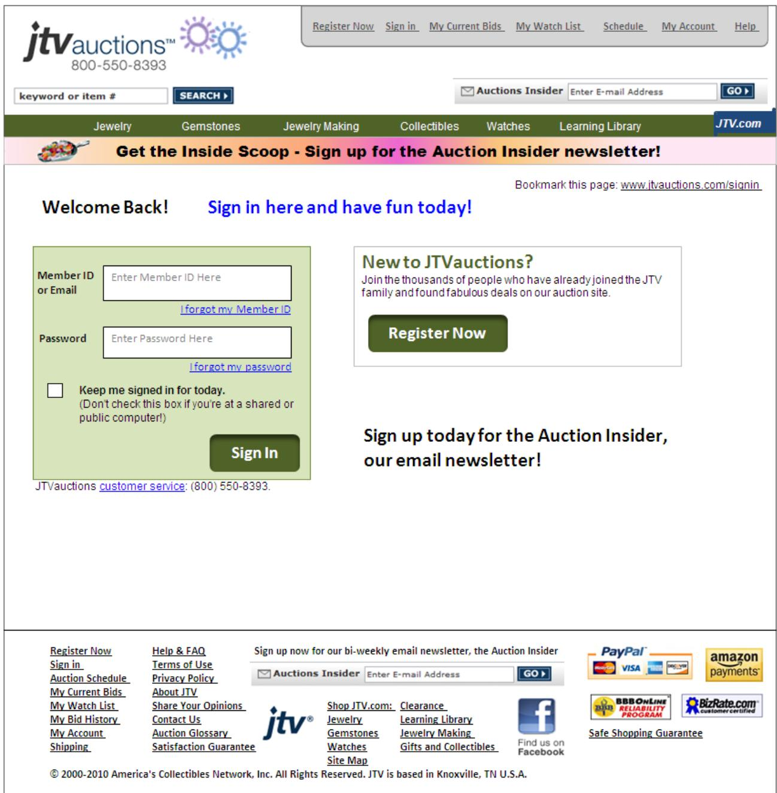

6.4.4 Sign-in Page with Credit Card Message DIV Mockup  
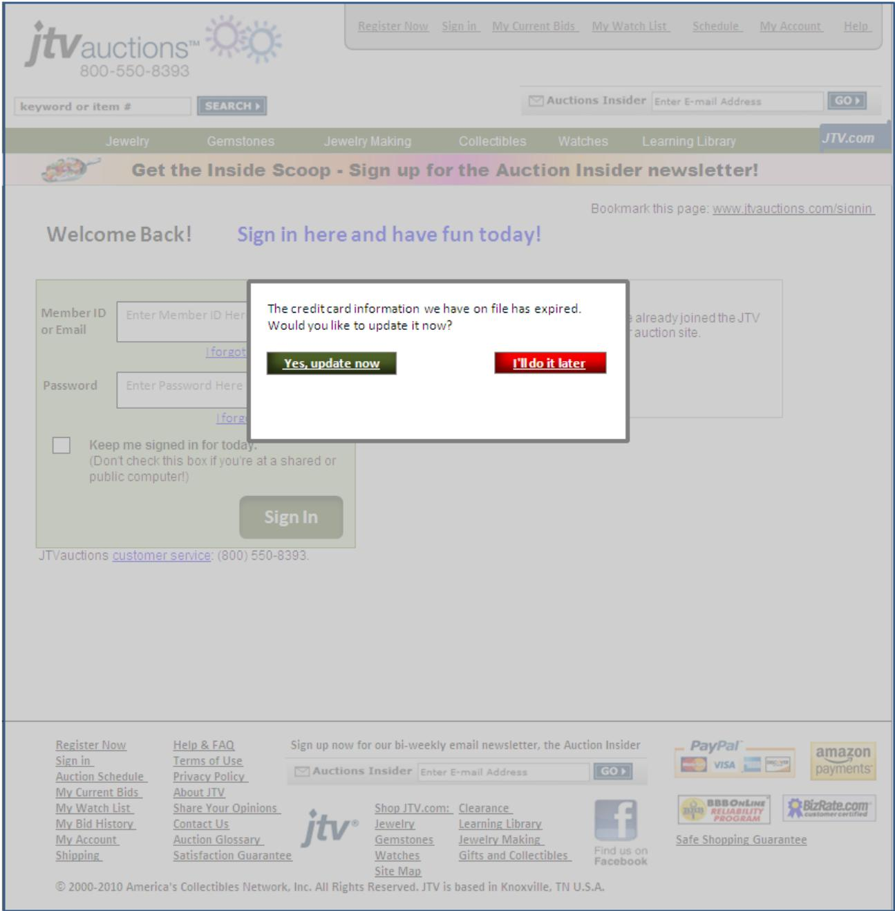

## 6.5 Registration Process Overview

 There are two pages in the registration process.

 The first page collects the minimum required information in order to create an account, collect payment, and place bids. (The “short process”)

 The second page collects the additional information required in order to ship winning orders and set email preferences.

 Neither page will include Endeca left navigation.

 Both pages use the global header or footer.

 Completing either the short or full registration process will trigger an automated “transactional” email, with a Thank You message for registering, and telling the customer to enable cookies, and add the appropriate email address(es) to their whitelist or Safe Senders list, or address book/contact list.

## 6.6 Registration Page 1

## 6.6.1 General requirements

 Global site header & footer.

 Welcome message text:

 Headline: Welcome to JTVauctions.com! Create your free membership account here.

Subtext: The information below is the minimum information we need from you so you can place bids. We can get the rest later or you can finish the member account process now.

 Completing the short registration process will trigger an automated “transactional” email, with a Thank You message for registering, and telling the customer to enable cookies, and add the appropriate email address(es) to their whitelist or Safe Senders list, or address book/contact list.

 JTV customer service phone number and email mailto: link at the bottom of the page, just above the global footer.

 Footnote: “Why we need your email address” at the bottom of the page, just above the global footer.

## 6.6.2 User Information Section

 First Name label and field.

 Last Name label and field.

 Email Address labels and fields (Create and verify). Required, enter twice, must be unique in customer table.

 Two password labels and fields (Create and verify). Must be 8 to 12 characters, enter twice.

 Member ID (“Handle”) label and field. (User-defined, explain limitations) (Required, must be unique in database customer table)

 The site should provide a personalized greeting whenever the user comes back, even before they sign in. Use the member-created Member ID (“Handle”) or email address if a “handle” wasn’t created.

## 6.6.3 My Payment Methods Section

 Radio buttons give choice of default payment method: Credit card, PayPal, or Amazon Payments.

 Credit Card Type, Credit Card #, Expiration Date. Do NOT store the card security code.

 Billing address warning (account must match address on credit card account).

 Link to important note about payment methods (text box on bottom of this page).

 Note: Each time a user signs in, the system should check the credit card information, to ensure it’s not expired. If it is, the system should prompt the user to enter a new credit card. If the user chooses the “Yes, Update Now” button indicating that they wish to do this now, they will be taken directly to MyAccountEdit Page 3. If PayPal or Amazon Payments is the default payment method, this step would be omitted.

 Free Paypal signup message and link to www.paypal.com. (Opens new Browser tab/page.)

 Amazon Payments information section. Link to www.amazonpayments.com (Opens new Browser tab/page.)

## 6.6.4 Terms of Use Agreement

 Before any auction participant may place a bid, they must agree to be bound by the Terms of Use Agreement.

 A checkbox will appear on this page, directly underneath the Payment Methods section and above the “We will need to get additional information…” statement, and accompanied by the following text.

 I accept and agree with the JTVauctions.com Terms of Use Agreement (required to participate in JTVauctions.com auctions).

## 6.6.5 Finishing the Short Registration Process

 Option text and link/button to finish account creation now. The text will state: “We will need to get additional information from you when you win. Do you want to complete that information now?”. Clicking on this “finish now” button takes the user to the second registration page. This button will be grayed out until the user has checked the Terms of Use checkbox. If the user clicks on the grayed-out button, a popup message will appear, telling the user that they must read and agree to the Terms of Use before they can proceed.

 Option text and link/button to create account and “browse now”. Clicking on this button takes the user to the sign-in page. This button will be grayed out until the user has checked the Terms of Use checkbox. If the user was previously browsing prior to registering and then signs in, they will be returned to their last product details page. If they were on the home page, after signing in, they will be returned to the home page.

6.6.6 Registration Page 1 Mockup  
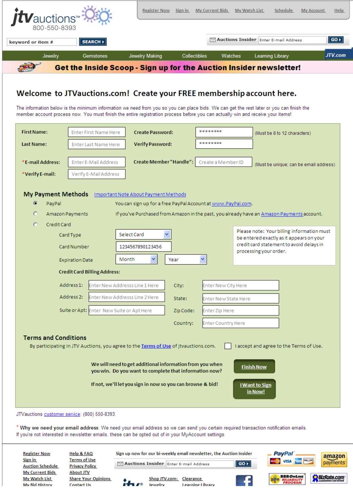

## 6.7 Registration Page 2

## 6.7.1 General requirements.

 Global site header & footer.

 Headline: “Continuing Your Membership Creation”.

 JTV customer service phone number and email mailto: link.

 Footnote: “Why we need your email address”.

## 6.7.2 My Information Section

 All of these fields will already be populated with the information provided by the user from the previous page (the registration page 1) – except for the phone number.

 First Name label and field.

 Last Name label and field.

 Email Address labels and fields (Create and verify). Required, enter twice, must be unique in customer table.

 Two password labels and fields (Create and verify). Must be 8 to 12 characters, enter twice.

 Member ID (“Handle”) label and field. (User-defined, explain limitations) (Required, must be unique in database customer table)

 Phone Number label and field.

## 6.7.3 My Billing and Shipping Addresses Section

 Address 1 label and field.

 Address 2 label and field.

 Suite or Apt label and field.

 City label and field.

 State label and field.

 Zip Code label and field.

 Country label and field.

 The preceding fields will be duplicated for the Shipping Addresses section.

 There will be a “Same as Billing Address” checkbox above the Shipping Addresses section.

 Address validation. To improve enterprise risk assessment, address validation and improvement (via the Core web service that returns address correction suggestions) should be used when accepting new and edited customer addresses as input.

 In Phase 2, we intend on adding international functionality, so this section will need to accommodate foreign address formats for multiple countries, such as the U.K., Canada, and others.

What else is needed for foreign addresses?

## 6.7.4 My Shipping Preferences Section

 Decision radio button determines which shipping method the customer prefers (standard ground or expedited shipping).

 Warning note text: “Shipping settings only apply to credit card orders. PayPal and Amazon Payments users will be given a shipping option during the PayPal / Amazon checkout process.”

## 6.7.5 My Email Preferences Section

 Checkboxes for “transactional” emails:

 1) Please notify me via email when I am outbid (the “outbid” email);

 2) Please notify me when I win an auction (the “winner” email);

 3) Please notify me when my item(s) has shipped (the “shipping” email).

 A link for changing the JTV email newsletter subscription, taking the user to the JTV.com email subscription center.

## 6.7.6 Other Registration Page Elements

 “Save Changes” (to complete registration) and “Cancel” buttons.

 “Save Changes” on-click action: Upon clicking this button, the registration process is complete. The user should see a pop-up message with the following information: (See DIV mockup after the Registration Page 2 mockup).

“Please add shop@jewelryTV.rsys1.com to your address book or white list / safe senders list. This is so you will get your outbid, winner, and product shipment notification emails.

“Please enable cookies in your web browser. Our site requires cookies to be enabled in your browser to function correctly. See our Help section if you’re unsure of how to do this.”

 “About Payment Methods” textbox at the bottom of the page (above global footer), explaining how the PayPal and Amazon Payments checkout processes are different from the automatic credit card process.

 Completing the Registration process will trigger an automated “transactional” email, with a Thank You message for registering, and telling the customer to enable cookies, and add the appropriate email address(es) to their white list or Safe Senders list, or address book/contact list.

## 6.7.7 Registration Process and Duplicate Accounts

 The registration process must include some type of data validation technique that reduces duplicate account creation (much of which is intentional by our customers). Suggestion: check for multiple fields, such as a combination of first name, last name, and street address. If they are the same, inform customer that an account already exists for a customer with this name and address, and offer to send sign in information to the email address on file for that account.

 No two accounts may use the same email address. If a registrant tries to create a new account using an existing email address, the system will generate a response notifying the registrant that the email address is already in use, and ask the registrant if they need to reset the

password for that account. If the user indicates “yes”, the system will generate an email to the email address, with a temporary password that the user should be advised to change.

 We need to have a risk-management addition made to the JTVauctions.com registration process. When a NEW customer tries to create a new JTVauctions.com account, the Consumer Protection negative file should be cross-referenced before the NEW account can be successfully established. This will prevent undesirable customers (whose previous accounts have been closed by us) from opening new accounts and engaging in shill bidding. In the event of a match to the negative file, the registrant should receive a message that states, “We are sorry, we are unable to create an auction account for you at this time. If you believe this message to be in error, please contact our Customer Service team at: 800-550-8393.”

6.7.8 Registration Page 2 Mockup (Top Half)  
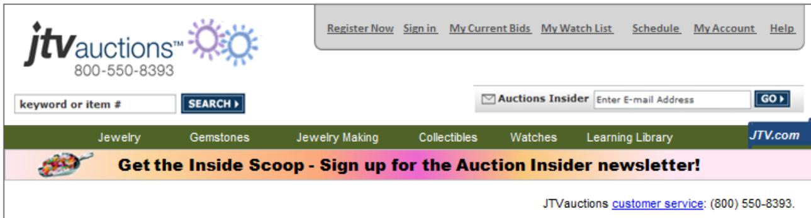

## Continuing Your Membership Creation:

## My Information:

First Name:

Already populated

Last Name:

Already populated

New Member "Handle":

Already populated

Phone Number:

\*E-mail Address:

Already populated

Verify E-mail:

Already populated

New Password:

Verify Password:

## My Billing Address:

## My Shipping Address:

Same as Billing Address

Address 1:

Address 1:

Address 2:

Address 2:

Enter New Addresss Line 2 Here

Suite or Apt:

Suite or Apt:

City:

Enter New City Here

City:

Enter New City Here

State:

State:

Enter New State Here M

Zip Code:

Enter Zip Here

Zip Code:

Enter Zip Here

Country:

Enter Country Here

Country:

## My Shipping Preferences

USPS Standard

Expedited (5-day, add \$5.00)

Shipping settings only applyto credit card orders. PayPal users will be given a shipping option during the PayPal checkout process.

## 6.7.9 Registration Page 2 Mockup (Bottom Half)

## My Email Preferences:

Please notify me via email whenI am outbid.

Please notify me whenI win an auction. (PayPal & Amazon users may not opt out of "winner" emails).

Please notify me when my winnings are shipped.

Change my "Auction Insider" Email Newsletter Subscription

## SAVECHANGES

## CANCEL

About Payment Methods: Please note that payment processing differs with PayPal and Amazon Payments versus credit cards. If credit card is your defaultmethod of payment, the system will automatically process your payment for any auctions you win that day.

If PayPal or Amazon Payments is your default method of payment, we will send you an email to let you know that you've won; and for you to sign into your JTV accountto process your payment through PayPal. You must process your payment within 7 days, or bad things will happen to you ;-).

\* Why we need your email address: We need your email address so we can send you certain required transaction notification emails If you're not interested in newsletter emails, these can be opted out of in vour MyAccount settings.

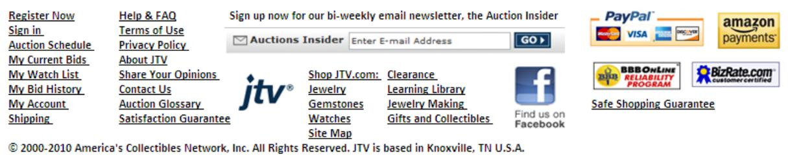

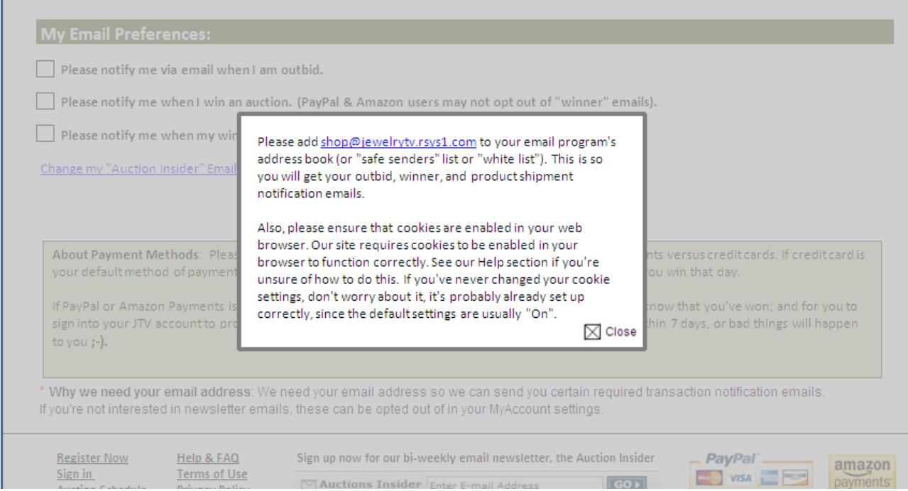

## 6.8 My Account Page

 Global site header & footer.

 Personalized welcome message, based on cookie or sign-in data. Include question: “Not Rick? Sign in here.)

 This page displays the user’s information as entered during registration (or subsequently modified).

 Does not include Endeca left navigation.

 This page includes a link to the “Returning Winners Payments” page. See the “Auction Processing” section for details.

 Edits to this data are done via the My Account Edit pages.

## 6.8.1 My Information Section

Displays each of the following:

 First Name

 Last Name

 Email Address

 Member “Handle”

 Phone number

 Password

 EDIT button/link to the My Account Edit page 1

## 6.8.2 My Billing Address / My Shipping Address Section

Displays each of the following (one of each field for Billing Address and Shipping Address)

 Address 1

 Address 2

 Suite or Apt

 City

State

 Zip Code

 Country

 EDIT button/link to the My Account Edit page 2.

## 6.8.3 My Shipping Preferences Section

 Radio button choices for either Standard or Expedited shipping options

 SAVE CHANGE button/link

 Text box explaining that shipping settings only apply to credit card orders. PayPal and Amazon Payments users will be given a shipping option during the PayPal checkout process.

## 6.8.4 My Payment Methods Section

 EDIT button/link to the My Account Edit page 3.

 Radio button choices for either PayPal , Amazon Payments, or Credit Card. The (previously selected during registration) user-chosen type will be selected.

 If Credit Card is the default payment method, then the Card Type, Last Four Digits, and Card Expiration Date will be displayed.

 A user may have two credit cards on file. If two are on file, the information for both will be displayed as above, with one being designated as the “default” card. (The following mockup only shows one card on file, the second would be displayed direct beneath the first).

 Links to www.paypal.com. and www.amazonpayments.com

 Text box called “About Payment Methods”. This box explains how the checkout process differs for PayPal / Amazon users versus credit card users. This information is critically important, and must be in text on this page and prominent – it cannot be in a DIV or popup or separate page.

## 6.8.5 My Email Preferences Section

 Displays a link to the My Email Preferences on My Account Edit Page 4.

6.8.6 My Account Page Mockup  
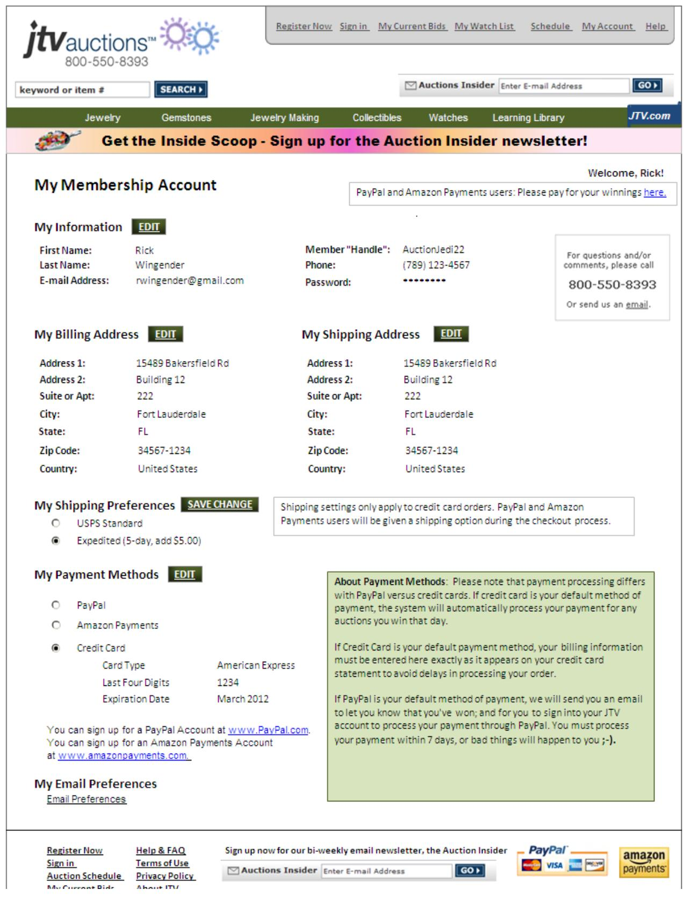

## 6.9 My Account Edit Page 1

 Global site header & footer.

 Does not include Endeca left navigation.

 Personalized welcome message, based on cookie.

 Page headline should be: “Change Membership Account Information” in large red text.

 The top section (“My Current Information”) displays the user’s information as entered during registration (or subsequently modified), including:

 First Name

 Last Name

 Member ID (“Handle”)

 E-mail Address

Phone

Current Password. The user will be required to enter their current password before being allowed to make any other changes.

 The bottom section (“My New Information”) displays labels and fields for the user to enter updated information, including:

 First Name

 Last Name

 Member ID (“Handle”)

 E-mail Address (enter a second time in the “Verify E-mail” field).

Phone

 Password (enter a second time in the “Verify Password” field).

 Save Changes button

 Cancel button (red color).

 There will be a footnote at the bottom explaining “Why we need your email address: We need your email address so we can send you certain required transaction emails. If you’re not interested in newsletter emails, these can be opted out of in your My Account settings.”

 Upon saving changes or canceling, the user will be returned to the My Account page.

6.9.1 My Account Edit Page 1 Mockup  
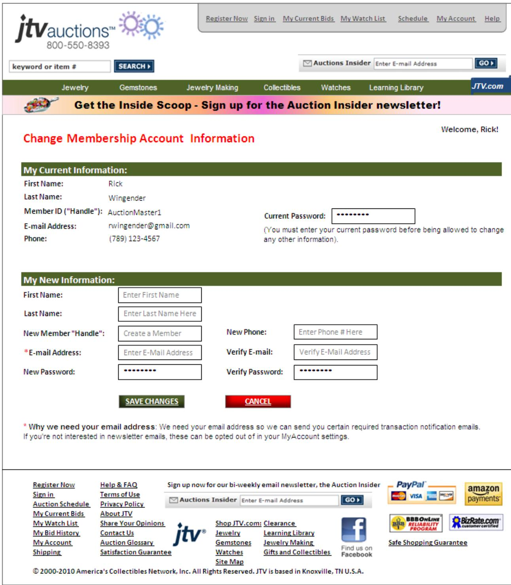

## 6.10 My Account Edit Page 2

 Global site header & footer.

 Does not include Endeca left navigation.

 Personalized welcome message, based on cookie.

 Page headline should be: “Change Membership Account Information” in large red text.

The top section (“My Current Billing Address” and “My Current Shipping Address”) displays the user’s information as entered during registration (or subsequently modified), including (one set for billing, one set for shipping):

 Address line 1

 Address line 2

 Suite or Apartment #

 City

 State

 Zip Code

 Country

 The bottom section (“My New Billing Address” and “My New Shipping Address) displays labels and fields for the user to enter updated information, including:

 Address line 1

 Address line 2

 Suite or Apartment #

 City

 State

 Zip Code

 Country

 Save Changes button

 Cancel button (red color).

The on-click action in all of these fields should highlight the text, instructing the user what data type to enter.

 The bottom section should also include a "Same as Billing Address" checkbox above the New Shipping Address data.

 Address validation. To improve enterprise risk assessment, address validation and improvement (via the Core web service that returns address correction suggestions) should be used when accepting new and edited customer addresses as input.

 Upon saving changes or canceling, the user will be returned to the My Account page.

6.10.1 My Account Edit Page 2 Mockup  
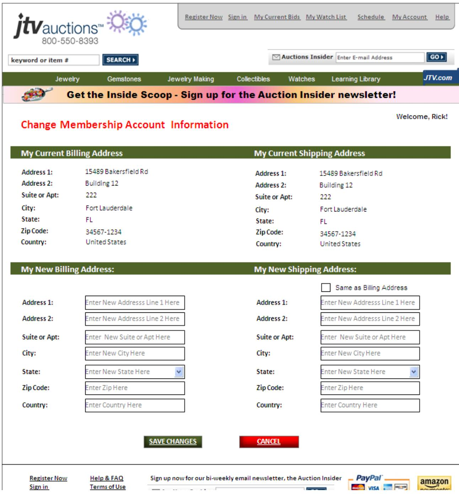

## 6.11 My Account Edit Page 3

 Global site header & footer.

 Does not include Endeca left navigation.

 Personalized welcome message, based on cookie.

 Page headline should be: “Change Membership Account Information” in large red text.

 The top section (“My Current Payment Method”) displays the user’s information as entered during registration (or subsequently modified), including:

 Radio buttons showing the choice made previously between PayPal, Amazon, or credit cards.

If credit card was chosen, it will show the name on card, billing address, card type (V/MC/D/Amex), the last four digits of the card on file, and the expiration date.

A user may have two credit cards on file. If two are on file, the information for both will be displayed as above, with one being designated as the “default” card. (The following mockup only shows one card on file, the second would be displayed direct beneath the first in a similar arrangement).

Each credit card will also have a checkbox enabling the user to “Delete this card from this account”.

 The bottom section (“My New Payment Method”) will display:

 Radio buttons enabling the user to choose between PayPal, Amazon, or credit cards.

If credit card is chosen, it will provide fields for the new card type (V/MC/D/Amex), the new card number, and the expiration date.

This section will also include this messaging: “You can sign up for a free PayPal account at www.paypal.com . If the customer clicks this link, Paypal.com should open up in a separate window or browser instance.

This section will also include this messaging: “If you’ve purchased from Amazon in the past, you already have an Amazon Payments account. If the customer clicks on this link, a new browser session will open, and take the user to the Amazon Payments website, where they can register for a new Amazon Payments account.

This section must also include a warning note: “Please note: Your billing address information must be entered exactly as it appears on your credit card statement to avoid delays in processing your order.

 Save Changes button

 Cancel button (red color).

 Upon saving changes or canceling, the user should be returned to the My Account page.

6.11.1 My Account Edit Page 3 Mockup  
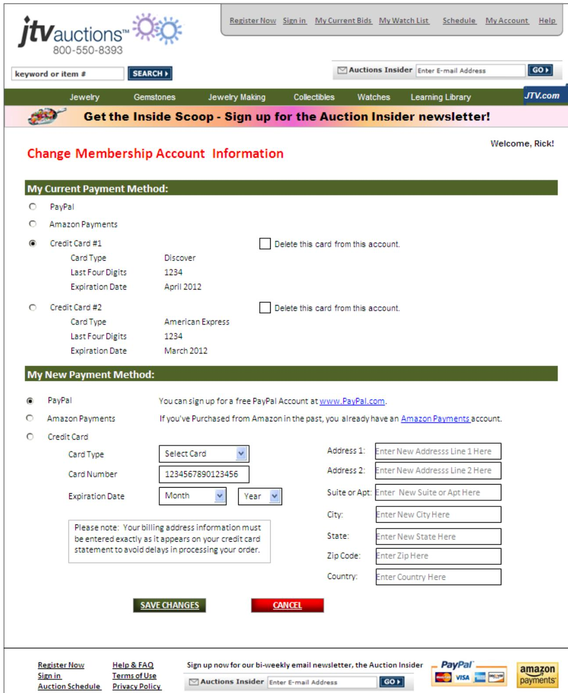

## 6.12 My Account Edit Page 4

 Global site header & footer.

 Does not include Endeca left navigation.

 Personalized welcome message, based on cookie.

 Page headline should be: “Change Membership Account Information” in large red text.

 There is only one section on this page, called “My Email Preferences”.

 There will be three checkboxes:

1. “Please notify me via email when I am outbid.”

2. “Please notify me when I win an auction. (PayPal & Amazon Payments users may not opt out of "winner" emails).”

3. “Please notify me when my winnings are shipped. “

4. These boxes will be “pre-checked” by default. If a user has chosen PayPal or Amazon as their paytype, then this choice will be grayed out so the user may not de-select the box.

 There will be a text link stating, “Change my JTV Email Newsletter Subscriptions.” This will link to the JTV Email Subscription Center (https://jewelrytv.rsys1.net/servlet/campaignrespondent?\_ID\_=jtv.13&LID=1007&ZID=9092006&E MAIL\_ADDRESS&cm\_sp=ISP4530013&cm\_re=IRE4530013&up=UP4530013

 Save Changes button (with underlined text)

 Cancel button (red color, with underlined text).

 Upon saving changes or canceling, the user should be returned to the My Account page.

6.12.1 My Account Edit Page 4 Mockup  
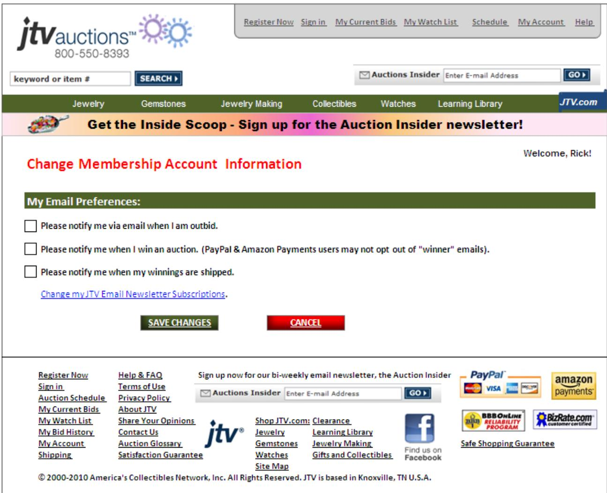

## 6.13 The PayPal / Amazon Pmts Page for Returning Winners

This is the page that returning users will see after they've won an auction if their default MOP is PayPal or Amazon Payments. It will offer them a choice of shipping methods, and get them started on the payment process for their winnings.

More information on this page, and a page mockup, are in section 9 (Checkout Process.)

## 6.14 My Current Bids Page

 This page is a Phase 1 must-have requirement.

 Use global site header & footer.

 Does not include Endeca navigation.

 This is a list of items the customer is currently bidding on. It should contain the data shown in the mockup.

 Data will be sortable by clicking on the column headers. The initial (default) sort will be by ending time, soonest on top.

 The “JTV Current Date/Time” must be dynamic, without refreshing by the user.

 The Item # will be linked to the Product Details (Bidding) page.

 The Bid button will be linked to the Product Details (Bidding) page.

 Dollar amounts in the “My Current Bid” column will appear in bold red if the user’s current bid is less than the Current High Bid.

 This page includes a link to the “Recently Ended Auctions” page.

 This page includes a link to the “Returning Winners Payments” page. See the “Auction Processing” section for details.

 A vanity URL will be created so auction participants can bookmark this page: www.jtvauctions.com/mybids.

6.14.1 My Current Bids Page Mockup  
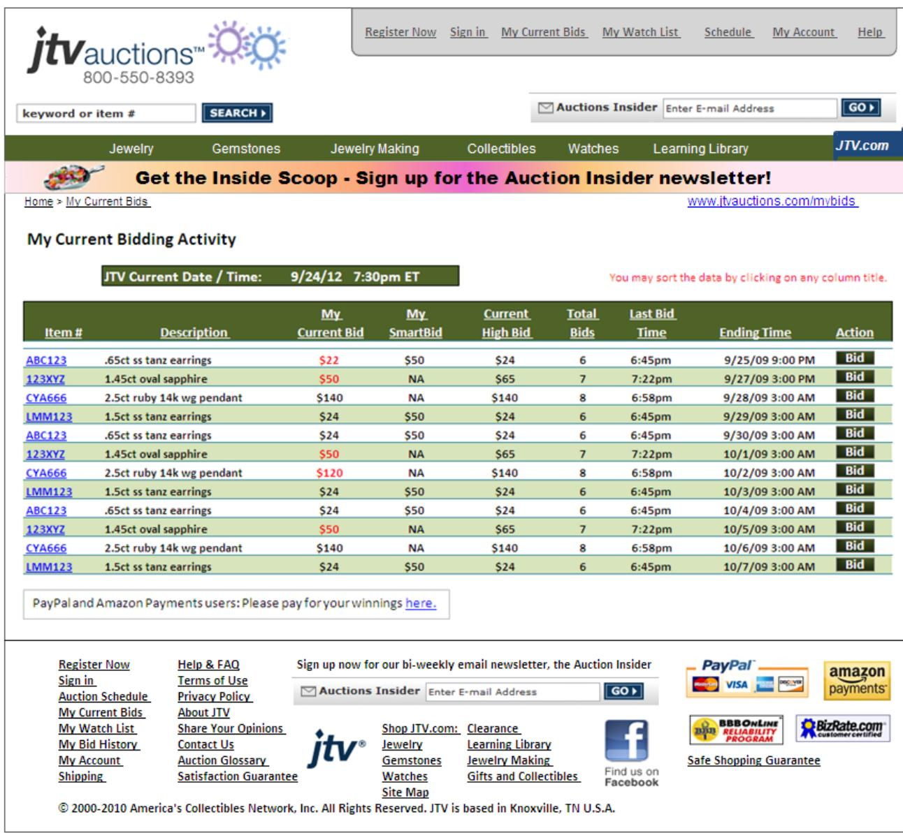

## 6.15 My Watch List Page

 This page is a Phase 1 must-have requirement.

 Use global site header & footer.

 Does not include Endeca navigation.

 This is a list of items the customer is interested in but not bidding on. It should contain the data shown in the mockup.

 Data will be sortable by clicking on the column headers. The initial (default) sort will be by ending time, soonest on top.

 The “JTV Current Date/Time” must be dynamic, without refreshing by the user.

 The Item # will be linked to the Product Details (Bidding) page.

 The Bid button will be linked to the Product Details (Bidding) page.

 A vanity URL will be created so auction participants can bookmark this page: www.jtvauctions.com/mywatchlist

 This page includes a link to the “Recently Ended Auctions” page.

 This page includes a link to the “Returning Winners Payments” page. See the “Auction Processing” section for details.

6.15.1 My Watch List Page Mockup
<table><tr><td rowspan=1 colspan=2>Auction    Current      Total    Last Bid     Ending.Item #          Description          Number    High Bid      Bids     Time      Time       Action</td></tr><tr><td rowspan=1 colspan=1>ABC123    .65ct ss tanz earrings            2624367      $24         6      6:45pm    9/25/09 9:00 PM</td><td rowspan=1 colspan=1>Bid</td></tr><tr><td rowspan=1 colspan=1>123XYZ    1.45ct oval sapphire             2625987      $65         7      7:22pm   9/27/09 3:00 PM</td><td rowspan=1 colspan=1>Bid</td></tr><tr><td rowspan=1 colspan=1>CYA666    2.5ct ruby 14k wg pendant        2624945     $140         8      6:58pm   9/28/09 3:00 AM</td><td rowspan=1 colspan=1>Bid</td></tr><tr><td rowspan=1 colspan=1>LMM123   1.5ct ss tanz earrings            2625844      $24          6      6:45pm   9/29/09 3:00 AM</td><td rowspan=1 colspan=1>Bid</td></tr><tr><td rowspan=1 colspan=2>ABC123    .65ct ss tanz earrings            2626133      $24         6      6:45pm    9/30/09 3:00 AM  Bid</td></tr><tr><td rowspan=1 colspan=2>123XYZ    1.45ct oval sapphire             2626472      $65         7      7:22pm   10/1/09 3:00 AM   Bid</td></tr><tr><td rowspan=1 colspan=1>CYA666    2.5ct ruby 14k wg pendant        2626811     $140         8      6:58pm   10/2/09 3:00 AM</td><td rowspan=1 colspan=1>Bid</td></tr><tr><td rowspan=1 colspan=1>LMM123   1.5ct ss tanz earrings            2627150     $24          6     6:45pm    10/3/09 3:00 AM</td><td rowspan=1 colspan=1>Bid</td></tr><tr><td rowspan=1 colspan=1>ABC123    .65ct ss tanz earrings            2627489      $24         6     6:45pm    10/4/09 3:00 AM</td><td rowspan=1 colspan=1>Bid</td></tr><tr><td rowspan=1 colspan=1>123XYZ    1.45ct oval sapphire             2627828      $65         7      7:22pm    10/5/09 3:00 AM</td><td rowspan=1 colspan=1>Bid</td></tr><tr><td rowspan=1 colspan=1>CYA666    2.5ct ruby 14k wg pendant        2628166     $140         8      6:58pm   10/6/09 3:00 AM</td><td rowspan=1 colspan=1>Bid</td></tr><tr><td rowspan=1 colspan=1>LMM123   1.5ct ss tanz earrings            2628505      $24          6      6:45pm    10/7/09 3:00 AM</td><td rowspan=1 colspan=1>Bid</td></tr></table>

## 6.16 My Bid History Page

 The My Bid History page is a Phase 1 must-have requirement.

 This is a list of items the customer has previously bid on. It includes both items won and items not won. It should appear almost exactly as shown in the mockup.

 Use global site header & footer.

 Does not include Endeca navigation.

 There are two sections: 1) “Items I’ve Won” and 2) “Items I Bid On, But Did Not Win”.

 Sorted by ending time, most recent on top.

 The “JTV Current Date/Time” must be dynamic, without refreshing by the user.

 The Item # should be linked to the Product Details (Bidding) page.

 This page includes a link to the “Returning Winners Payments” page. See the “Auction Processing” section for details.

 The “Items I’ve Won” section includes a “Payment Status” column. Items should be shown as “Paid” if credit card is the user’s default payment type. It may show “Not Paid” if PayPal or Amazon Payments is the default payment type, until the user has paid for their winnings. Until they’ve paid, the “Not Paid” text should appear in bold red, and it should link to the “Returning Winner’s Payments” page.

 This page is not personalized (because the payments message will go where the greeting would normally be – this is an intentional interruption of the customer experience.)

 Page includes a link to the “Recently Ended Auctions” page, which shows 24 hours worth of history.

6.16.1 My Bid History Page Mockup  
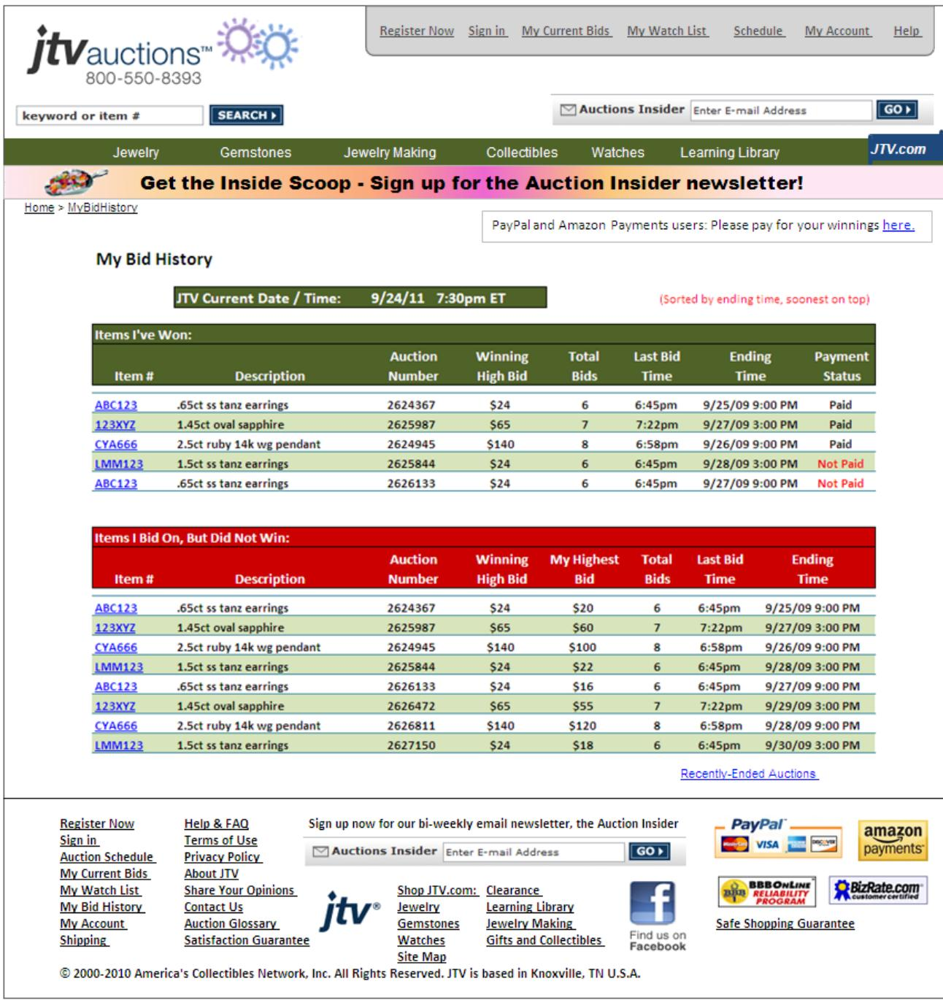

<table><tr><td colspan="8">Items I&#x27;ve Won:</td></tr><tr><td>Item #</td><td>Description</td><td>Auction Number</td><td>Winning High Bid</td><td>Total Bids</td><td>Last Bid Time</td><td>Ending Time</td><td>Payment Status</td></tr><tr><td></td><td></td><td></td><td></td><td></td><td></td><td></td><td></td></tr><tr><td>ABC123</td><td>.65ct ss tanz earrings</td><td>2624367</td><td>$24</td><td>6</td><td>6:45pm</td><td>9/25/09 9:00 PM</td><td>Paid</td></tr><tr><td>123XYZ</td><td>1.45ct oval sapphire</td><td>2625987</td><td>$65 $140</td><td>7</td><td>7:22pm</td><td>9/27/09 3:00 PM 9/26/09 9:00 PM</td><td>Paid</td></tr><tr><td>CYA666</td><td>2.5ct ruby 14k wg pendant</td><td>2624945</td><td>$24</td><td>8 6</td><td>6:58pm 6:45pm</td><td></td><td>Paid Not Paid</td></tr><tr><td>LMM123</td><td>1.5ct ss tanz earrings</td><td>2625844</td><td></td><td></td><td></td><td>9/28/09 3:00 PM</td><td></td></tr><tr><td>ABC123</td><td>.65ct ss tanz earrings</td><td>2626133</td><td>$24</td><td>6</td><td>6:45pm</td><td>9/27/09 9:00 PM</td><td>Not Paid</td></tr></table>

<table><tr><td colspan="8">Items I Bid On, But Did Not Win:</td></tr><tr><td>Item #</td><td>Description</td><td>Auction Number</td><td>Winning High Bid</td><td>My Highest Bid</td><td>Total Bids</td><td>Last Bid Time</td><td>Ending Time</td></tr><tr><td>ABC123</td><td>.65ct ss tanz earrings</td><td>2624367</td><td>$24</td><td>$20</td><td>6</td><td>6:45pm</td><td>9/25/09 9:00 PM</td></tr><tr><td>123XYZ</td><td>1.45ct oval sapphire</td><td>2625987</td><td>$65</td><td>$60</td><td>7</td><td>7:22pm</td><td>9/27/09 3:00 PM</td></tr><tr><td>CYA666</td><td>2.5ct ruby 14k wg pendant</td><td>2624945</td><td>$140</td><td>$100</td><td>8</td><td>6:58pm</td><td>9/26/09 9:00 PM</td></tr><tr><td>LMM123</td><td>1.5ct ss tanz earrings</td><td>2625844</td><td>$24</td><td>$22</td><td>6</td><td>6:45pm</td><td>9/28/09 3:00 PM</td></tr><tr><td>ABC123</td><td>.65ct ss tanz earrings</td><td>2626133</td><td>$24</td><td>$16</td><td>6</td><td>6:45pm</td><td>9/27/09 9:00 PM</td></tr><tr><td>123XYZ</td><td>1.45ct oval sapphire</td><td>2626472</td><td>$65</td><td>$55</td><td>7</td><td>7:22pm</td><td>9/29/09 3:00 PM</td></tr><tr><td>CYA666</td><td>2.5ct ruby 14k wg pendant</td><td>2626811</td><td>$140</td><td>$120</td><td>8</td><td>6:58pm</td><td>9/28/09 9:00 PM</td></tr><tr><td>LMM123</td><td>1.5ct ss tanz earrings</td><td>2627150</td><td>$24</td><td>$18</td><td>6</td><td>6:45pm</td><td>9/30/09 3:00 PM</td></tr></table>

## 6.17 The Recently-Ended Auctions Page

 This is a Phase 1 must-have requirement.

 This is a very common request from customers. All closed auctions will be removed immediately after closing from the site's category pages, and these items will appear on the “Recently-ended” page for 24 hours, in order by closing time, most recent at the top.

 It should contain the data shown in the mockup.

 These items will not appear in search results.

 Use global site header & footer.

 Does not include Endeca left navigation.

 The “JTV Current Date/Time” must be dynamic, without refreshing by the user.

6.17.1 The Recently-Ended Auctions Page Mockup  
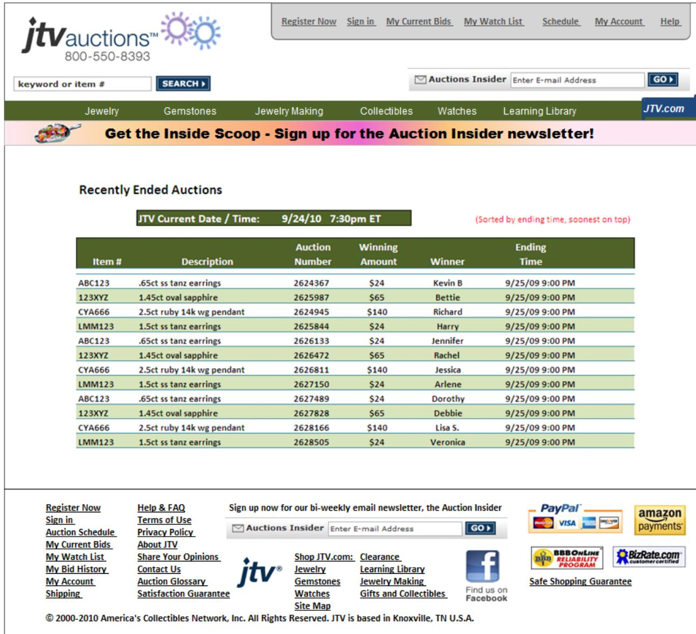

## 6.18 Privacy Policy Page

 This page is a Phase 1 must-have requirement.

 Use global site header & footer.

 Does not include Endeca navigation.

 Will use current JTV.com / JTVauctions.com text.

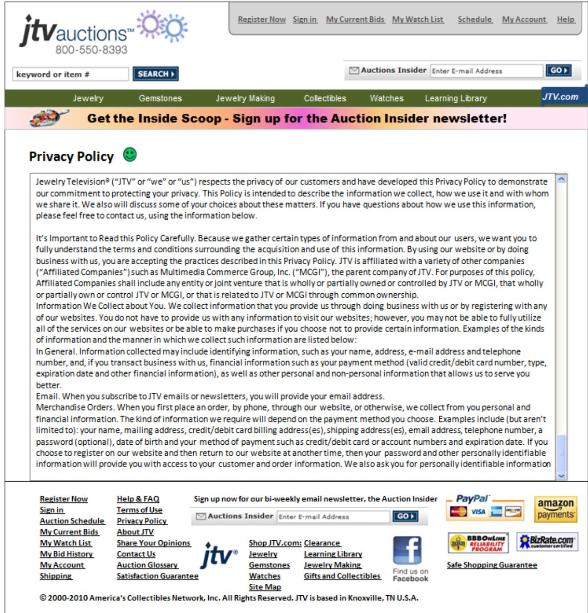

## 6.19 Terms of Use Page

 This page is a Phase 1 must-have requirement.

 Use global site header & footer.

 Does not include Endeca navigation.

 Will use current JTV.com / JTVauctions.com text.

## Terms of Use

Welcome to Jewelry Television® and to ityauctions,comSM! These terms and conditions are entered into by and between vou and America's Collectibles Network, Inc. d/b/a Jewelry Television® (“JTV” or “We” or “Us”) (the “Agreement”). By accessing and/or using the jtvauctions.com website (the "Website") and/or by bidding on (or ordering) products offered on the Website, you are agreeing to this Agreement. If you do not agree to be bound by the Agreement, then you cannot access or use the Website or submit an order or bid on the Website.This Agreementis effective as of October 20, 2009.

JTV is affiliated with a variety of other companies (“Affiliated Companies”) such as Multimedia Commerce Group, Inc. (“MCGI”), the parent company of JTV. For purposes of this Agreement, Affiliated Companies shall include any entity or joint venture that is wholly or partially owned or controlled by JTV or MCGI, that wholly or partially owns or controls JTV or MCGI, or that is related to JTV or MCGl through common ownership. The references to “JTV” in this Agreementalso refer to Affiliated Companies that utilize jtv.com or that links to this Agreementfrom another website.

Use of the website. Use of the Website is restricted to individuals who are either age 18 or over, or those between the ages of 13 and 18, who are using the Website with the permission of a parent or guardian. By using the Website, you representto JTV that you are in one of these categories.

If you would like, you may register on the Website by creating an account, In order to register, you must provide your name (not an assumed name), valid address, valid email address and valid phone number. In order to bid on and participate in auctions on the Website. you must register, as well as provide your valid creditcard information. You are responsible for providingJTV with updated contact information. JTV will rely on the most recentinformation provided by you in order to contact you.

It is your sole responsibility to maintain the security of your accountand password. Your password is for your personal use only and may not be used by any third party, even with your permission. You are solely responsible for any and all actions taken under your password on this Website. You agree to be financially responsible for all of your use of this Website.

Prices, Bids and Ordering. All prices and bids shown on the Website are quoted in United States Dollars. JTV will add charges for shipping

## 6.20 Help & FAQ Page

 This page is a Phase 1 must-have requirement.

 Use global site header & footer.

 Does not include Endeca navigation.

 Will use current JTV.com / JTVauctions.com text.

 Will include external links to PayPal & Amazon Payments FAQ pages.

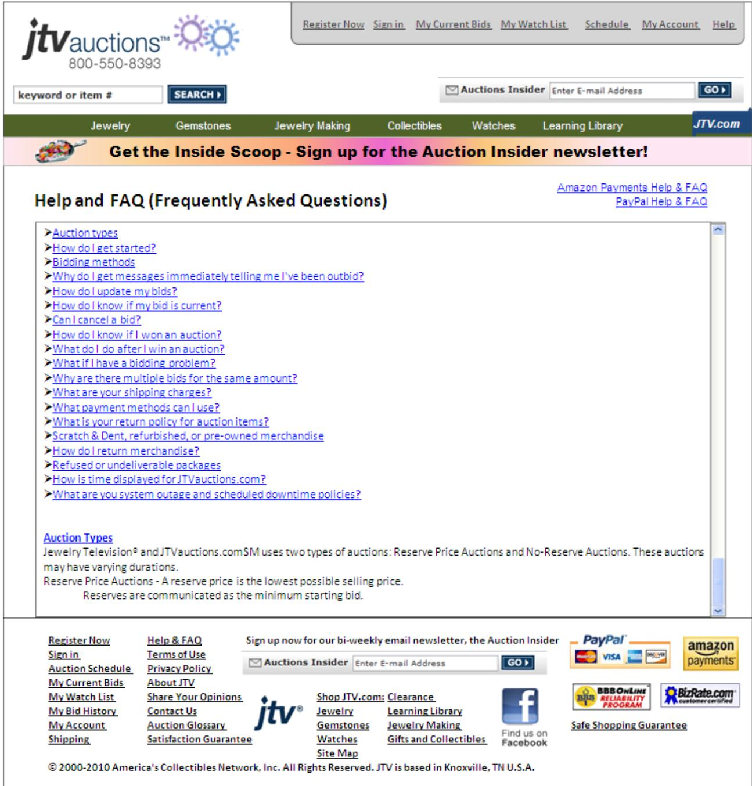

## 6.21 Safe Shopping Guarantee Page

 Use global site header & footer.

 Does not include Endeca navigation.

 This page explains our Safe Shopping Guarantee (anti-credit card fraud guarantee) and also explains various security measures we take to ensure a secure site (SSL, McAfee SECURE, etc).

 This is a static page with no dynamic content.

## Bid with Confidence! (You're covered by our Safe Shopping Guarantee!)

Participating in JTVauctions.com's auctions is safe!

When you use a credit card on JTVauctions.com, you're covered by our Safe Shopping Guarantee:

Your bank cannot hold you liable for more than \$50.00 of fraudulent charges under the USA's Fair Credit Billing Act. If your bank does hold you liable for this \$50.00, we will cover the liabilityfor you, up to \$50,00, JTVauctions.com will cover this liability onlvif the unauthorized use of your credit card resulted, through no fault of your own, from purchases made at JTVauctions.com while using our secure servers. This is our Safe Shopping Guarantee.

Don't forget to notify your credit card provider in accordance withits reporting rules and procedures if you believe the use of your credit card was unathorized.

## BBB Accredited Business

We are a Better Business Bureau Accredited Business, and have been since 2003.

## Bizrate.com

We have an overall "Smiley" rating on Bizrate.com'

## JTVauctions.com Privacy Policy

We don't like it when someone gives away our personal information, so we won't give away yours either. We don't rent, sell or share your personal information with anyone. Our Privacy Policy details how your personal information is collected and how your personal information maybe used.

http://www.ftc.qov/os/statutes/fcb/fcb.pdf

Return to JTVauctions.com Home Page.

PayPal and Amazon Payments users: Please payfor your winnings here.

Participatingin JTVauctions.com's auctions is secure!

We understand that the safetyof your personal information is extremelyimportant to you. We use a wide array of electronic and physical security measures and devices to protect vour personal data and credit card information from unauthorized access.

## Secure Sockets Layer (SSL Technology)

JTVauctions.com uses Secure Sockets Layer (SSL) technologyto provide you with the safest, most secure shopping experience possible. SSL technology enables encryption (scrambling) of sensitive information during your online transactions. All of the forms on our site are secured with SSL technologyso your personal information stays safe and out of malicious hands.

The McAfee SECURE™" trustmark only appears when the website has passed McAfee's intensive, dailysecurityscan. They test for possible personal information access, links McAfee SECURE TESTED DAILY 18-MAR to dangerous sites, phishing, and other online dange.

VeriSign, Inc. is a technology company that specializes in data encryption and e-commerce. It is one of the most recognized companies for certifying that a website is secure and encrypted. With VeriSign, you can fee Veris secu confident bidding at JTVauctions!

## Industry Standard Firewalls

Our servers are protected by secure firewalls—communication management computers speciallydesignedtokeepinformation secure andinaccessible by other Internet users. So you're absolutely safe while you shop.

SSLTechnology, McAfee SECURE, Verisign, and Industry Standard Firewalls all work together to ensure your privacy and to assist in protecting your personal data.

## 6.22 Event Schedule Page

 This page shows site visitors / bidders the planned event schedule in a format similar to an Outlook monthly calendar.

 Use global site header & footer.

 Does not include Endeca navigation.

 Data source: CMS.

 Published by the “Auctioneer” (Auctions Category Manager)

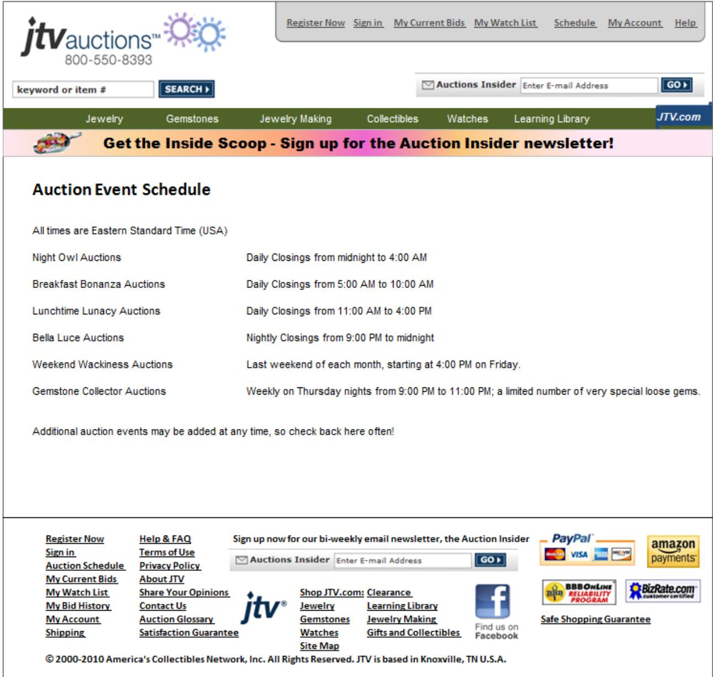

## 6.23 Auction Glossary Page

 This page is a Phase 1 must-have requirement.

 Use global site header & footer.

 Does not include Endeca navigation.

 Written in plain HTML. This page is mostly for SEO purposes.

 Will use current JTV.com / JTVauctions.com text.

 Will link to Learning Library on JTV.com, and to Mindat.Org.

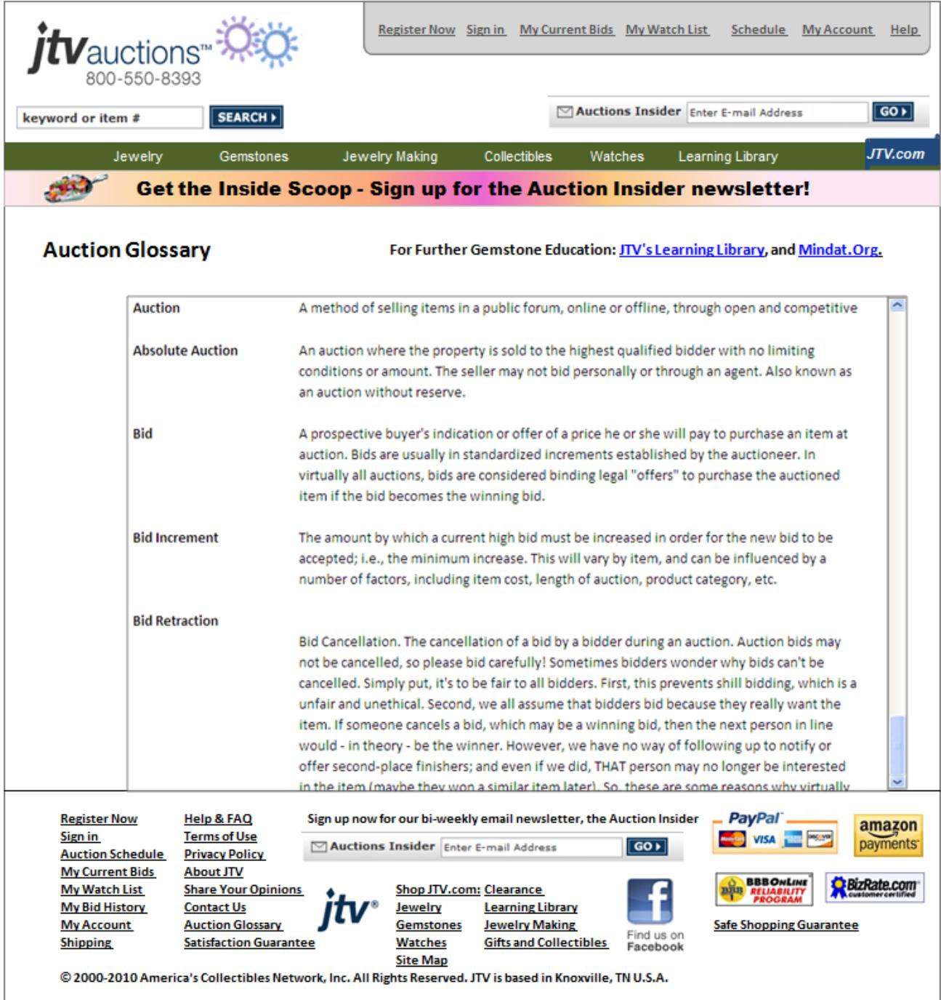

## 6.24 Site Map Page

 Use global site header & footer.

 Does not include Endeca navigation.

 Written in plain HTML. This page is mostly for SEO purposes.

 All terms will be linked to specific pages or Endeca results pages.

 Minimum categories are shown in the mockup below. Other categories that we might consider: Birthstone Jewelry, Current High Bid, Metal Type

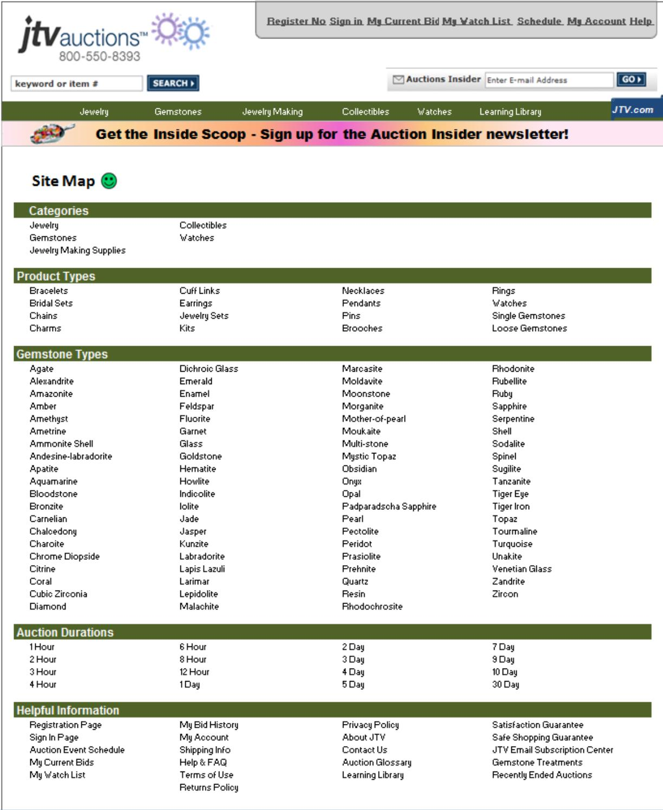

## 6.25 Landing Pages for SEO

 Use global site header & footer.

 Include Endeca navigation.

 There will be several SEO-optimized landing pages based on gemstone type or product type (i.e., a “tanzanite page” and a “Rings page”.

 This page must be designed in accordance with SEO best practices.

 Page will include specific <Title> tags (content TBD)

 Page will include specific <Description> tags (content TBD)

The text content will contain links to the product category. For example, the tanzanite page would include one link taking the user to all loose tanzanite stones. Another link would take the user to all tanzanite rings, all tanzanite necklaces, and so on.

 We might consider copying selected articles from the Learning Library in some SEO landing pages – to be discussed. Or, we might develop content specific to this page. For example, a brief article explaining the differences between 10K, 14K, and 24K gold would work well. (See GIA AJP training materials).

 We’d like to find a way to be able have the Auctioneer publish content to these pages, in the form of comments taken from online customer surveys.

 Some of these pages may contain general product information about the stone type, the meta type, buying considerations (“what to look for”).

 Contains links to the JTV Learning Library.

6.25.1 SEO Landing Page Mockup:  

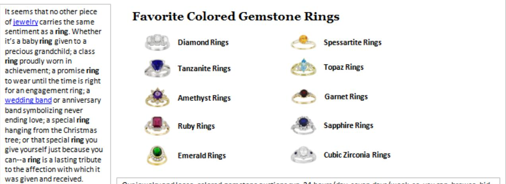

You may have a passion for diamond rings that dazzle or deep-hued gemstone rings that suit your personality perfectly. Perhaps you’re a classic pearl ring girl or solitaire diamond diva. Maybe you’re someone who refuses tolimit yourself-- you have a jewelry box full of birthstone rings, multi gemstone rings, diamond rings of every color, pearl rings, silver rings, gold rings, platinum rings and more. Whatever your tastes may be, we're confident we have the ring for you.

Ourjewelryandloose colored gemstone auctions run 24 hours/day, seven days/week, so you can browse, bid, and playanytime you want! Many of our live online auction jewelry and gemstone items start with opening bids of just \$1, so there are treasures to be found on a daily basis! Our auction lengths vary by event and product type, but there are hundreds of items that are closing at various times every single day. Our buyers scour the globe, looking for great deals and hidden treasures. On JTVauctions, you'll find a great selection of products, including silver and gold rings, colored gemstone jewelry, loose gemstones, jewelry making items, and other unique collectible items. With so many quality diamond rings and a wide assortment of jewelry, you're sure to find the perfect piece for less. Elegant pearls, bracelets, rings, necklaces, earrings, and watches will make the perfect gift for any occasion. Register for yourfree membership now and start hunting for exceptonal values right away!

All jewelry and gemstone items are shipped from our secure facilityin Knoxville, TN, USA.

How can this page be routinely updated with fresh content?

\- can't do product reviews in auctions.

Description tags: What should be in them?

## 7 Navigation & Search

## 7.1 Global Header Components

 All links will use proper case (i.e., all initial capital letters on all words)

 JTVauctions logo

 Search Form (same functionality as current JTV.com search)

 Auction Insider email newsletter signup box (form). Form text should state: “Enter your email here”.

 Register Now link

 Sign in link

 My Current Bids link.

 My Watch List link.

 Schedule

 My Account link

 Help link

 Menu Bar (links for: Jewelry, Gemstones, Jewelry Making, Collectibles, Watches, Learning Library, JTV.com)

Anytime a user clicks on a link that contains no product (this will happen for collectibles routinely), the user should be served a “no results found” page, as shown later in this section.

Menu bar links should expand into DHTML dropdown menus, similar to our current websites, with the same options as the current JTVauctions.com site. See image here for visual:

## Jewelry Gemstones Jewelry Mak

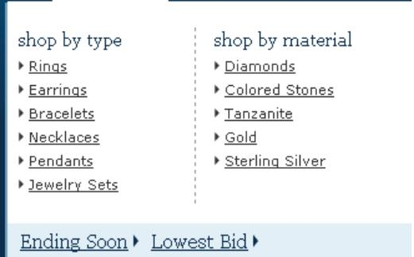

7.1.1 Global Header Mockups (with and without the “Alert Message” text bar)  
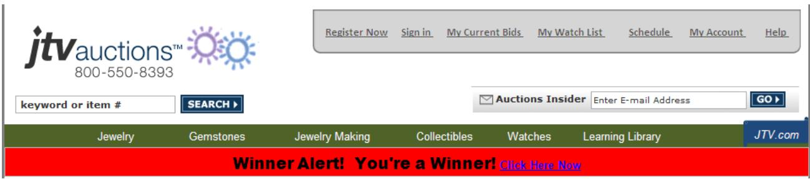

## 7.2 Global Footer Components

 All links will use proper case (i.e., all initial capital letters on all words)

 Register Now link – Takes the user to the Registration Page 1.

 Sign In link – Takes the user to the sign-in page.

 Auction Schedule – Links to the Auction Event Schedule page.

 My Current Bids page link.

 My Watch List link.

 My Bid History link.

 My Account page link.

 Shipping link – Links to an anchor tag at the Shipping section on the Help & FAQ page.

 Help & FAQ page link.

 Terms of Use page link.

 Privacy Policy page link.

 About JTV link (http://www.jtv.com/about-us/jewelry-television-about-us.htm/aboutus,default,pg.html) .

 Share Your Opinions (External link to Survey Monkey survey)

 Contact Us link. (http://www.jtv.com/on/demandware.store/Sites-jtv-Site/default/Page-Show?cid=help-contactus&cm\_sp=ISP6580062&cm\_re=IRE6580062&up=UP6580062)

 Auction Glossary link.

 Satisfaction Guarantee link. (See mockup of popup DIV below). The page should be grayed out when this DIV appears, and remain grayed out (and unclickable) until the user closes the DIV.

Close Window   
Jewelry Television's® Satisfaction Guarantee   
We at Jewelry Television® want vou to be completely satisfied with vour purchase, If vou're not. send it   
back in its as-shipped condition within 30 days of receipt. Please complete and include the Satisfaction   
Guarantee return form located on the back of vour invoice   
For vour own protection, merchandise should be returned prepaid and insured via UPS, Fed Ex, or U.S. mail. Send all   
returns to:   
Jewelry Television®   
Customer Returns   
190 Hayfield Rd.   
Knoxville, TN 37922   
For your convenience, a pre-addressed return label can be found on the front of your invoice at the bottom. Please   
return one item only per package. Shipping charges are nonrefundable.

 Auction Insider email newsletter signup box (form).

 JTV.com logo and links:

 JTV.com Jewelry link

 JTV.com Gemstones link

 JTV.com Watches link

 JTV.com Clearance link

 JTV.com Learning Library link

 JTV.com Jewelry Making link

 JTV.com Gifts & Collectibles link

 JTVauctions site map link

 Image and link to our JTVauctions.com Facebook page.

 Credit Card logos, PayPal logo, Amazon Payments logo.

 BizRate.com, BBB Online, other logos

 Safe Shopping Guarantee Link (links to Safe Shopping Guarantee page).

 Copyright notice.

## 7.2.1 Global Footer Mockup:

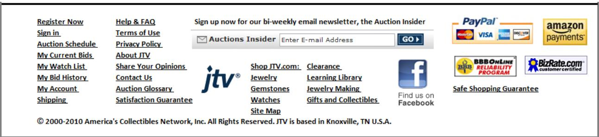

## 7.3 Search

 All active auction items must be searchable by all item attributes, including product ID, auction number, product category, product type, stone type, metal type, current price, as well as full text search on the description field.

 Searches should be able to use wildcards.

 No product will ever be eligible to appear on a product details page, search results, or catalog page if it does not have an available image to display.

 If there is only one search match, the product details page should load.

 If the search results in multiple items found, a category / search result page should load, using the default catalog view page.

 No Results Found: The No Results page should include a “Popular Searches” links section, with a static list of popular gemstone searches and a separate list of popular jewelry searches. It should also include a list of search terms or search phrases that will be dynamically updated using Omniture data.

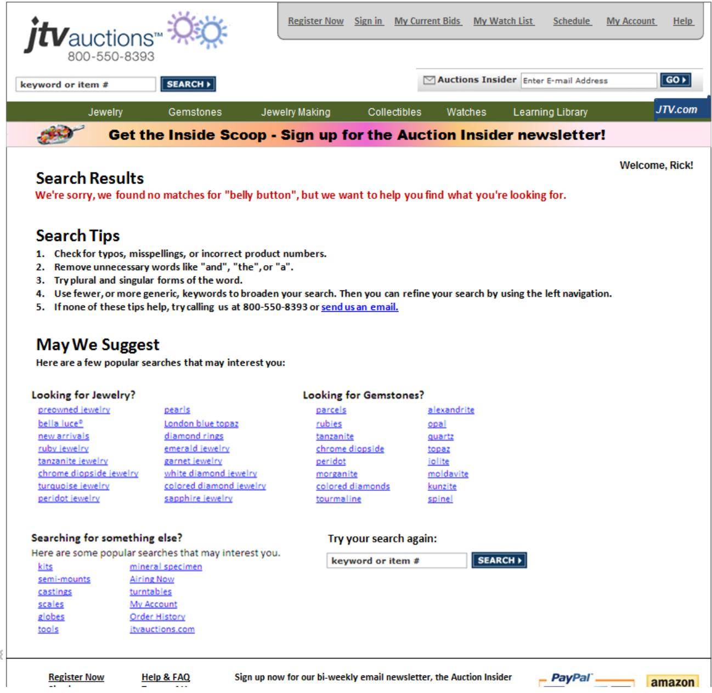

## 7.4 Navigation

## 7.4.1 Top Menu Bar options are listed in section 5.1 under Global Header

## 7.4.2 Navigation “Breadcrumbs”

 Breadcrumbs will appear similar to: Home > Browse/search criteria 1 > Additional criteria > Additional criteria.

 Breadcrumbs will appear on the category pages and the product details pages.

## 7.4.3 Sorting

See the category page navigation requirements in section 5.2.3 .

## 7.4.4 Endeca or Endeca-like search and navigation capability

MUST be integrated into any platform solution. It must have significant drill-down capability due to the large number of SKUs. This is a must-have, non-negotiable, Go/No Go requirement.

## 7.4.5 Home page Top-level Left Navigation will include the following categories

 Category

 Product Type

 Auction Type\*\*

 Current Bid (NOT “Price”!)

 Gemstone

 \*\* We would prefer the Auction Type to be replaced by “Closing Time” if possible. This would have to be “nested” closing periods, similar to how Price is handled in the left nav on JTV.com. Ideally, when the user clicks on “Closing Time”, they would see a list of Closing Time Ranges. It would look like:

 Under 1 hour

 1 – 2 hours

 2 – 4 hours

 4 – 8 hours

 8 – 16 hours

 16 – 24 hours

 Over 24 hours

 Then, for example, if a user then chose “16 – 24 hours”, they would be presented with a set of choices as follows:

 16 – 18 hours

 18 – 20 hours

 20 – 22 hours

 22 – 24 hours

## 7.4.6 Navigation Hierarchy

 Users will be able to drill down to an unlimited number of levels.

 See the mockup below for navigation hierarchy.

## 7.4.7 Multi-category merchandising

 All auction items should be able to be displayed in multiple categories. For instance, users should be able to find sapphire rings if they follow either of the following paths: Home > Jewelry > Rings > Sapphire OR Home > Jewelry > Rings > Sapphire.

<table><tr><td rowspan=1 colspan=1>Top Level</td><td rowspan=1 colspan=2>2nd-Level</td><td rowspan=1 colspan=14>3rd-Level</td><td rowspan=1 colspan=1>4th &amp; Subsequent Levels:</td></tr><tr><td></td><td rowspan=3 colspan=2>Jeweler Making SuppliesJewelry</td><td></td><td></td><td></td><td></td><td></td><td></td><td></td><td></td><td></td><td></td><td></td><td></td><td></td><td></td><td></td></tr><tr><td></td><td rowspan=5 colspan=14>Gemstone, Product Type, Auction Type, Current Bid, Gemstone Color, Gemstone Shape, Gemstone Cut, Brand, Birthstone, Carat Weight, Dimensions, Optical Properties, Country.Product Type, Auction Type, Gemstone, Current Bid, Metal Type, Department, Gemstone Shape, Gemstone Color, Brand, Hot Buys, Birthstone, Carat WeightProduct Type, Auction Type, Current Bid.Gemstone, Metal Type, Metal Purity, Metal Color, Current Bid, Gemstone Shape, Gemstone Color, Size/Length, DimensionsGemstone, Metal Type, Metal Purity, Metal Color, Current Bid, Gemstone Shape, Gemstone Color, Size/Length, Dimensionsct Types will be as above)</td><td rowspan=2 colspan=1>Same as third, minus chosen criteria.Same as third, minus chosen criteria.</td></tr><tr><td rowspan=2 colspan=1></td></tr><tr><td rowspan=1 colspan=2>Collectables</td><td rowspan=1 colspan=1>Same as third, minus chosen criteria.</td></tr><tr><td rowspan=1 colspan=1>Product Type</td><td rowspan=1 colspan=2>Bead Set (4)</td><td></td></tr><tr><td rowspan=2 colspan=1></td><td rowspan=1 colspan=2>Bead Strand (10)(All Other Jewelry Making Supplies Produ</td><td rowspan=1 colspan=1>Same as third, minus chosen criteria.</td></tr><tr><td rowspan=1 colspan=2>Bracelets (41)</td><td rowspan=1 colspan=14>Product Type, Size, Metal Type, Metal Purity, Metal Color, Gemstone, Gemstone Shape, Gemstone Color, Brand, Style, Birthstone, Carat Weight, Auction Type, Current Bid, Hot Buys,</td><td rowspan=1 colspan=1>Same as third, minus chosen criteria.</td></tr><tr><td rowspan=2 colspan=1></td><td rowspan=1 colspan=2>Chains (17)</td><td rowspan=1 colspan=14>Product Type, Size, Metal Type, Metal Purity, Metal Color, Gemstone, Gemstone Shape, Gemstone Color, Brand, Style, Birthstone, Carat Weight, Auction Type, Current Bid, Hot Buys,</td><td rowspan=1 colspan=1>Same as third, minus chosen criteria.</td></tr><tr><td rowspan=1 colspan=2>Cuff Links (3)</td><td rowspan=1 colspan=14>Metal Type, Metal Purity, Metal Color, Gemstone, Gemstone Shape, Gemstone Color, Brand, Style, Birthstone, Carat Weight, Auction Type, Current Bid, Hot Buys,</td><td rowspan=1 colspan=1>Same as third, minus chosen criteria.</td></tr><tr><td rowspan=1 colspan=1></td><td rowspan=1 colspan=2>Earrings (110)Enhancer (1)</td><td rowspan=1 colspan=14>Product Type, Metal Type, Metal Purity, Metal Color, Gemstone, Gemstone Shape, Gemstone Color, Brand, Style, Birthstone, Carat Weight, Auction Type, Current Bid, Hot Buys,Product Type, Size, Metal Type, Metal Purity, Metal Color, Gemstone, Gemstone Shape, Gemstone Color, Brand, Style, Birthstone, Carat Weight, Auction Type, Current Bid, Hot Buys,</td><td rowspan=1 colspan=1>Same as third, minus chosen criteria.</td></tr><tr><td rowspan=1 colspan=1></td><td rowspan=1 colspan=2>Enhancer with Chain (2)</td><td rowspan=1 colspan=14>Product Type, Size, Metal Type, Metal Purity, Metal Color, Gemstone, Gemstone Shape, Gemstone Color, Brand, Style, Birthstone, Carat Weight, Auction Type, Current Bid, Hot Buys,</td><td rowspan=1 colspan=1>Same as third, minus chosen criteria.</td></tr><tr><td></td><td rowspan=1 colspan=2>Jewelry Sets (36)</td><td rowspan=1 colspan=14>Product Type, Size, Metal Type, Metal Purity, Metal Color, Gemstone, Gemstone Shape, Gemstone Color, Brand, Style, Birthstone, Carat Weight, Auction Type, Current Bid, Hot Buys,</td><td rowspan=1 colspan=1>Same as third, minus chosen criteria.</td></tr><tr><td rowspan=1 colspan=1></td><td rowspan=1 colspan=2>Pendants (79)</td><td rowspan=1 colspan=14>Product Type, Size, Metal Type, Metal Purity, Metal Color, Gemstone, Gemstone Shape, Gemstone Color, Brand, Style, Birthstone, Carat Weight, Auction Type, Current Bid, Hot Buys,Product Type, Size, Metal Type, Metal Purity, Metal Color, Gemstone, Gemstone Shape, Gemstone Color, Brand, Style, Birthstone, Carat Weight, Auction Type, Current Bid, Hot Buys,</td><td rowspan=1 colspan=1>Same as third, minus chosen criteria.</td></tr><tr><td rowspan=3 colspan=1></td><td rowspan=1 colspan=2>Rings (70)</td><td rowspan=1 colspan=14>Product Type, Size, Metal Type, Metal Purity, Metal Color, Gemstone, Gemstone Shape, Gemstone Color, Brand, Style, Birthstone, Carat Weight, Auction Type, Current Bid, Hot Buys,</td><td rowspan=1 colspan=1>Same as third, minus chosen criteria.</td></tr><tr><td rowspan=1 colspan=2>Semi-Mount (5)</td><td rowspan=1 colspan=14>Product Type, Size, Metal Type, Metal Purity, Metal Color, Gemstone, Gemstone Shape, Gemstone Color, Brand, Style, Birthstone, Carat Weight, Auction Type, Current Bid, Hot Buys,Product Type, Size, Metal Type, Metal Purity, Metal Color, Gemstone, Gemstone Shape, Gemstone Color, Brand, Style, Birthstone, Carat Weight, Auction Type, Current Bid, Hot Buys,</td><td rowspan=1 colspan=1>Same as third, minus chosen criteria.</td></tr><tr><td rowspan=1 colspan=2>Matched Set</td><td rowspan=2 colspan=14>Gemstone, Auction Type, Current Bid, Gemstone Color, Gemstone Shape, Gemstone Cut, Brand, Birthstone, Carat Weight, Dimensions, Optical Properties, Country.Gemstone, Auction Type, Current Bid, Gemstone Color, Gemstone Shape, Gemstone Cut, Brand, Birthstone, Carat Weight, Dimensions, Optical Properties, Country.</td><td></td></tr><tr><td rowspan=3 colspan=1></td><td rowspan=1 colspan=2>Parcels &amp; Sets</td><td rowspan=1 colspan=8></td><td rowspan=1 colspan=1>Same as third, minus chosen criteria.</td></tr><tr><td></td><td></td><td rowspan=3 colspan=9>Gemstone, Auction Type, Current Bid, Gemstone Color, Gemstone Shape, Gemstone C</td><td rowspan=1 colspan=6>ut, Brand, Birthstone, Carat Weight, Dimensions, Optical Properties, Country.</td><td></td></tr><tr><td rowspan=1 colspan=2>Watches (10)</td><td rowspan=3 colspan=14>Product Type, Size, Metal Type, Metal Purity, Metal Color, Gemstone, Gemstone Shape, Gemstone Color, Brand, Style, Birthstone, Carat Weight, Auction Type, Current Bid, Hot Buys,Product Type, Gemstone, Current Bid, Metal Type, Department, Gemstone Shape, Gemstone Color, Brand, Birthstone, Carat Weight, Category, Current Bids</td><td rowspan=1 colspan=1>Same as third, minus chosen criteria.</td></tr><tr><td rowspan=1 colspan=1></td><td rowspan=1 colspan=2>(All Others)</td><td rowspan=1 colspan=1>Same as third, minus chosen criteria.</td></tr><tr><td rowspan=1 colspan=1>Auction Type</td><td rowspan=1 colspan=2>1 Hour</td><td rowspan=1 colspan=1>Same as third, minus chosen criteria.</td></tr><tr><td rowspan=8 colspan=1></td><td rowspan=1 colspan=2>2 Hour</td><td rowspan=2 colspan=14>Product Type, Gemstone, Current Bid, Metal Type, Department, Gemstone Shape, Gemstone Color, Brand, Birthstone, Carat Weight, Category, Current BidsProduct Type, Gemstone, Current Bid, Metal Type, Department, Gemstone Shape, Gemstone Color, Brand, Birthstone, Carat Weight, Category, Current Bids</td><td rowspan=1 colspan=1>Same as third, minus chosen criteria.</td></tr><tr><td rowspan=1 colspan=2>1 Day</td><td rowspan=1 colspan=4></td><td rowspan=1 colspan=1>Same as third, minus chosen criteria.</td></tr><tr><td rowspan=14 colspan=17>2 Day                   Product Type, Gemstone, Current Bid, Metal Type, Department, Gemstone Shape, Gemstone Color, Brand, Birthstone, Carat Weight, Category, Current Bids3 Day                   Product Type, Gemstone, Current Bid, Metal Type, Department, Gemstone Shape, Gemstone Color, Brand, Birthstone, Carat Weight, Category, Current Bids                     Same as third, minus chosen criteria.4 Day                   Product Type, Gemstone, Current Bid, Metal Type, Department, Gemstone Shape, Gemstone Color, Brand, Birthstone, Carat Weight, Category, Current Bids                     Same as third, minus chosen criteria.5 Day                   Product Type, Gemstone, Current Bid, Metal Type, Department, Gemstone Shape, Gemstone Color, Brand, Birthstone, Carat Weight, Category, Current BidsProduct Type, Gemstone, Current Bid, Metal Type, Department, Gemstone Shape, Gemstone Color, Brand, Birthstone, Carat Weight, Category, Current Bids                     Same as third, minus chosen criteria.Product Type, Gemstone, Current Bid, Metal Type, Department, Gemstone Shape, Gemstone Color, Brand, Birthstone, Carat Weight, Category, Current BidsProduct Type, Auction Type, Gemstone, Current Bid, Metal Type, Department, Gemstone Shape, Gemstone Color, Brand, Hot Buys, Birthstone, Carat Weight, CategoryProduct Type, Auction Type, Gemstone, Current Bid, Metal Type, Department, Gemstone Shape, Gemstone Color, Brand, Hot Buys, Birthstone, Carat Weight, Category$200-$500 (53)             Product Type, Auction Type, Gemstone, Current Bid, Metal Type, Department, Gemstone Shape, Gemstone Color, Brand, Hot Buys, Birthstone, Carat Weight, CategoryProduct Type, Auction Type, Gemstone, Current Bid, Metal Type, Department, Gemstone Shape, Gemstone Color, Brand, Hot Buys, Birthstone, Carat Weight, CategoryCategory, Product Type, Auction Type, Current Bid, Gemstone Color, Gemstone Shape, Gemstone Cut, Brand, Birthstone, Carat Weight, Dimensions, Optical Properties, Size, Metal Type,Metal Purity, Metal Color, Country.Category, Product Type, Auction Type, Current Bid, Gemstone Color, Gemstone Shape, Gemstone Cut, Brand, Birthstone, Carat Weight, Dimensions, Optical Properties, Size, Metal TypeMetal Purity, Metal Color, Country.                                                                                          Same as third, minus chosen criteria.Emerald                  Category, Product Type, Auction Type, Current Bid, Gemstone Color, Gemstone Shape, Gemstone Cut, Brand, Birthstone, Carat Weight, Dimensions, Optical Properties, Size, Metal Type,Etc                     Category, Product Type, Auction Type, Current Bid, Gemstone Color, Gemstone Shape, Gemstone Cut, Brand, Birthstone, Carat Weight, Dimensions, Optical Properties, Size, Metal Type,Metal Purity, Metal Color, Country.                                                                                          Same as third, minus chosen criteria.Etc.                     Category, Product Type, Auction Type, Current Bid, Gemstone Color, Gemstone Shape, Gemstone Cut, Brand, Birthstone, Carat Weight, Dimensions, Optical Properties, Size, Metal Type,Metal Purity, Metal Color, Country.</td><td rowspan=1 colspan=1></td></tr><tr><td rowspan=1 colspan=2></td></tr><tr><td rowspan=1 colspan=2></td><td rowspan=1 colspan=5>Product Type, Gemstone, Current Bid, Me</td><td rowspan=1 colspan=3></td></tr><tr><td rowspan=3 colspan=2></td><td rowspan=1 colspan=4>Product Type, Gemstone, Current Bid</td><td rowspan=1 colspan=3>Bid, Metal Type</td><td rowspan=1 colspan=1>pe, Depar</td><td rowspan=3 colspan=4></td></tr><tr><td rowspan=1 colspan=2></td><td rowspan=2 colspan=1>same as third, ius chen crtria.</td></tr><tr><td rowspan=1 colspan=1>Same as third, m</td></tr><tr><td rowspan=3 colspan=1>Current Bid</td><td rowspan=1 colspan=2></td><td rowspan=1 colspan=1>Same as third,minus chosen crteri.</td></tr><tr><td rowspan=2 colspan=2></td><td rowspan=1 colspan=1>Same as third, minus chosen criteria.</td></tr><tr><td rowspan=1 colspan=1></td></tr><tr><td rowspan=1 colspan=1>Gemstone</td><td rowspan=1 colspan=2></td></tr><tr><td rowspan=1 colspan=1></td><td rowspan=1 colspan=1></td></tr><tr><td rowspan=2 colspan=1></td><td rowspan=1 colspan=2>Category, Product Type, Auctio</td></tr><tr><td rowspan=1 colspan=4>Metal Purity, Metal Color, Country.</td></tr><tr><td rowspan=1 colspan=1></td><td rowspan=1 colspan=1>Category, Prod</td></tr></table>

## 8 E-Mail Requirements

## 8.1 Safe Sender Instructions to users

 Instructions on how to add our email addresses to the user’s “whitelist” or “safe senders” list must be included in the registration process;

 and the My Account page, and;

 in the subsequent registration confirmation email.

## 8.2 Registration (account setup) confirmation email

 Should include "Welcome and Thank You" message. Use customer's real name. "You are now registered with JTV Auctions!" .

 "Please subscribe to the Auction Insider Newsletter". Include link or subscriber form.

 "Please add "Shop@jewelrytv.rsys1.com" to your "Safe Senders" list or "White List" (for Responsys emails)

 “Please add [acnauction@jewelrytelevision.com or appropriate JTV email address] to your “Safe Senders list or “White List” (for JTV-sent transactional emails.)

 "Please add "www.jtvauctions.com" to your Favorite Links in your browser"

## 8.3 “Bid Exceeded” notification email

 Don’t send if bid was automatically increased

 Transactional text email only (not through Responsys)

Data included: Item #, Description, My Bid Amount, New Current Bid, Closing Date & Time, link to the Product Detail page, Personalized greeting: “Dear [FirstName]”.

## 8.4 “Winner Notification” email. You are a Winner!

 Will go through Responsys, as it does currently.

 Link to My Account page.

 If the winner is a PayPal or Amazon Payments customer, they will be instructed to sign in to JTVauctions and pay for their winnings. (When they sign in, a message on the promo text bar will automatically pop up, telling them they have unpaid winnings, and give them a link to the payments page).

 Data included: Personalized greeting: “Dear [FirstName]”, Item #, Description, Winning Bid Amount, Date Won.

 “ Another email will be sent to you shortly confirming your order and shipping information”.

## 8.5 “Shipping Confirmation” email

 Will go through Responsys, as it does currently.

 Data included: Personalized greeting: “Dear [FirstName]”, Item #, Description, Last four digits of credit card (or PayPal info), card type (e.g. Visa) , Total amount to be charged, Link to the My Account page, Shipping Address, Expected Arrival date range, Carrier ID (e.g. UPS), Tracking #.

## 8.6 “Thank You!” email #1

 Send 30 days after winning.

 Simple transactional text email only (not through Responsys)

 Data included: Personalized greeting: “Dear [FirstName]”, Link to auction site, Thank you message.

 Include logo and link to JTVauctions page on Facebook.

## 8.7 “Thank You!” email #2

 Send 120 days after winning,

 Link to auction site.

 Send only if customer has NOT placed a bid within previous 120 days.

 Data included:

o Personalized greeting: “Dear [FirstName]”,

o Link to auction site.

o Thank you message.

 Simple transactional text email only (not through Responsys)

## 8.8 Auction winners will NOT receive BazaarVoice “Please review your item” email requests

 The auction site will not support product reviews (since many items will be one-only items).

## 9 Auction Administration Application

## 9.1 General Requirements

 It must be understood that some users will routinely access this application remotely using a Virtual Private Network (VPN).

 There must be NO non-functional links/commands in the user interface.

## 9.2 Inventory Import

Inventory for sale via auctions will be imported from JTV’s current inventory system, using inventory that meets particular criteria. NEED TO DECIDE IF THERE WILL BE AN AUTOMATED PROCESS OR IF THE CURRENT MANUAL PROCESS WILL CONTINUE.

## 9.3 Purpose & Structure

The business users control the auction business through the Auction Administration (“AA”) application. This web-based application will offer the following significant capabilities. These functions will be accessed via a “Main Menu” page.

 Creating new auctions.

 Viewing & editing existing auctions.

 Managing the global settings.

 Editing auction profiles.

 Viewing SKU histories.

 Viewing, suspending, and deactivating customer accounts.

 Viewing the status of current auctions.

 Creating / viewing sales & churn reports, customer activity reports, inventory performance reports.

 Managing user access.

## 9.4 Auction Admin Main Menu Page

Refer to the page mockup below. This page will have five (5) sections.

## 9.4.1 Global Header Section

 The global header will be shared by all AA pages and reports. It will consist of a welcome message, today’s date (very important for auction scheduling), and the page title as a centered headline.

## 9.4.2 Administration Menu Section

 Contains labels and links to the following pages:

 Create New Auctions

 View / Edit Current or Scheduled Auctions

 Manage Global Settings

 Edit Auction Event Profiles

 SKU History

 Customer History

 User Access Management

## 9.4.3 Reports Menu Section

 Contains labels and links to the following pages:

 Status of Current Auctions

 Sales Report

 Competition Report

 RFM Report

 Customer Ranking Report

 Inventory Performance and Aging Report

 Omniture Reports (This is an external link to https://sitecatalyst.omniture.com/login/?r=/sc13/reports/index.html)

## 9.4.4 Yesterday’s KPIs Section

This section will contain a variety of sales metrics, broken down into these categories: Auction Jewelry, Auction Gemstones, Auction Other, and Total Auctions. The KPIs will include: Gross Revenue, Gross Margin Dollars, Gross Margin Percent, Total Auctions Closed, Total Orders (before cancels), Churn Rate, Unique Customers, New Registrations, New Customers, Average Price Point, Total Bids, Bids per Auction.

 This data will populate automatically when the “Auctioneer” opens the Auction Admin Main Menu page.

 Gross Margin Percent will be defined as ((Total Product Sales + Total Shipping Revenue) – (Total Product Cost + Total Shipping Expense)) / (Total Product Sales + Total Shipping Revenue).

 Gross Margin Dollars will be defined as ((Total Product Sales + Total Shipping Revenue) – (Total Product Cost + Total Shipping Expense))

 Churn Rate will be defined as: (Total Auctions – Total Auctions Won) / Total Auctions) (in other words, auctions scheduled but not won, divided by auctions scheduled).

 Bids per Auction will be defined as Total Bids Placed / Total Auctions Scheduled.

## 9.4.5 Today’s Auction Inventory Recap Section

 This data will populate automatically when the “Auctioneer” opens the Auction Admin Main Menu page.

 This section will provide a summary of key inventory data, in terms of cost, units, and unique SKUs.

 Under each category, the data will include Auction Available Inventory (Gemstones), Auction Available Inventory (Jewelry), Auction Available Inventory (Other), and Total Auction Available Inventory.

 Note that product should be counted in these inventory numbers only if it is both “Auction Available” AND “Auction Eligible” in the JTV enterprise systems. Furthermore, it must be “sellable”; i.e., it must be in a valid, “sellable” physical inventory location and sellable realm (“white”), and must have a image available in the JTV SuperNova system.

## 9.4.6 Auction Admin Main Menu Mockup

<table><tr><td>Welcome Back, Auctioneer! Today is: Tuesday, April 7, 2011</td><td colspan="2">Auction Administration Main Menu</td><td></td><td>JTVauctions.com</td></tr><tr><td>Administration Menu</td><td></td><td colspan="3">Reports Menu</td></tr><tr><td>Create New Auctions</td><td>GO</td><td>Status of Current Auctions</td><td>GO</td><td></td></tr><tr><td>View / Edit Current or Scheduled Auctions</td><td>GO</td><td></td><td>Sales Report GO</td><td></td></tr><tr><td>Manage Global Settings</td><td>GO</td><td></td><td>Competition Report RFM Report</td><td>GO GO</td></tr><tr><td>Edit Auction Event Profiles GO SKU History</td><td>GO</td><td></td><td>Customer Ranking Report</td><td>O</td></tr><tr><td>Customer History</td><td>GO</td><td>Inventory Performance &amp; Aging Report</td><td></td><td>GO</td></tr><tr><td>User Access Management</td><td>GO</td><td></td><td>Omniture Reports</td><td>GO</td></tr><tr><td></td><td></td><td></td><td></td><td></td></tr></table>

<table><tr><td></td><td colspan="2">Auction Jewelry</td><td colspan="2">Auction Gemstones</td><td colspan="2">Auction Other</td><td colspan="2">Total Auctions</td></tr><tr><td>Gross Revenue</td><td>s</td><td>11,089</td><td>S</td><td>5,455</td><td>s</td><td>420</td><td></td><td>$ 16,964</td></tr><tr><td>Returns</td><td>$</td><td>2,107</td><td>S</td><td>1,036</td><td>$</td><td>80</td><td></td><td>$ 3,223</td></tr><tr><td>Net Revenue</td><td>S</td><td>8,982</td><td>S</td><td>4,419</td><td>$</td><td>340</td><td></td><td>$ 13,741</td></tr><tr><td>Gross Margin Dollars</td><td>s</td><td>2,784</td><td>S</td><td>1,458</td><td>s</td><td>143</td><td>s</td><td>4,385</td></tr><tr><td>Gross Margin Percent</td><td></td><td>31%</td><td></td><td>33%</td><td></td><td>42%</td><td></td><td>32%</td></tr><tr><td>Total Auctions Closed</td><td></td><td>302</td><td></td><td>225</td><td></td><td>7</td><td></td><td>534</td></tr><tr><td>Total Orders (before Cancels)</td><td></td><td>289</td><td></td><td>218</td><td></td><td>7</td><td></td><td>514</td></tr><tr><td>Churn Rate</td><td></td><td>4%</td><td></td><td>3%</td><td></td><td>0%</td><td></td><td>4%</td></tr><tr><td>Unique Customers</td><td></td><td>231</td><td></td><td>108</td><td></td><td>5</td><td></td><td>344</td></tr><tr><td>New Registrations</td><td></td><td>24</td><td></td><td>8</td><td></td><td>1</td><td></td><td>29</td></tr><tr><td>New Customers</td><td></td><td>8</td><td></td><td>2</td><td></td><td>0</td><td></td><td>10</td></tr><tr><td>Average Price Point</td><td>s</td><td>38.37</td><td>$</td><td>25.02</td><td>$</td><td>60.00</td><td>15</td><td>33.00</td></tr><tr><td>Total Bids</td><td></td><td>2356</td><td></td><td>1755</td><td></td><td>40</td><td></td><td>4151</td></tr><tr><td>Bids per Auction</td><td></td><td>7.8</td><td></td><td>7.8</td><td></td><td>5.7</td><td></td><td>7.8</td></tr></table>

<table><tr><td>Today&#x27;s Auction Inventory Recap At Cost: Auction Available Inventory (Gemstones): Auction Available Inventory (Jewelry):</td><td>$ 420,000</td></tr><tr><td>Auction Available Inventory (Other): Total Auction Available Inventory:</td><td>$ 675,000 s 8,000 $ 1,103,000</td></tr><tr><td>Units: Auction Available Inventory (Gemstones):</td><td>17,108</td></tr><tr><td>Auction Available Inventory (Jewelry):</td><td>21,395</td></tr><tr><td></td><td></td></tr><tr><td>Auction Available Inventory (Other): Total Auction Available Inventory:</td><td>249</td></tr><tr><td></td><td>38,751</td></tr><tr><td>Unique SKUs:</td><td></td></tr><tr><td>Auction Available Inventory (Gemstones):</td><td>289</td></tr><tr><td>Auction Available Inventory (Jewelry):</td><td>319</td></tr><tr><td>Auction Available Inventory (Other):</td><td>4</td></tr><tr><td></td><td></td></tr><tr><td>Total Auction Available Inventory:</td><td>612</td></tr></table>

## 9.5 The Manage Global Settings Page

Refer to the page mockup below. This page will have four (4) sections.

## 9.5.1 Reserve Tier and Bid Increment Sitewide Default Settings Section

 This section will contain user-definable cost tiers.

 Each cost tier will have corresponding fields which govern the reserve (opening bids) amount and the bid increment for all items in that cost tier.

 The opening bid fields will have radio button options, allowing the Auctioneer to choose the field for opening bid amount or percentage of cost.

 The bid increment fields allow for discrete, full dollar amounts.

 This section should include a button to "Apply Changes."

 These parameters may be overridden by Event Profiles. See the Event Profiles section for details.

## 9.5.2 Overtime Bidding Section

 The overtime bidding section contains a radio button option for On or Off.

 There will be two data fields, where the Auctioneer can enter the duration of the time extension, and a "Apply Changes" button. The Auctioneer can create a time extension of anywhere from 10 seconds to 60 minutes.

 When overtime bidding is ON, the Product Details pages will notify the auction participants with a prominent message, stating: "Overtime Bidding is On!" See the Product Details page mockup for visual example.

 When overtime bidding is ON, it will function as follows. Assume, for example, that the time extension is set at 20 seconds. If User A places a bid five seconds before the scheduled end of the auction, the auction will automatically be extended by 20 seconds. If no one else bids before 20 seconds is over, the auction ends. If another user places a subsequent bid before the extension is over, the auction is extended for yet another 20 seconds, and so on.

 This section should include a button to "Apply Changes."

## 9.5.3 Shipping Settings Section

 This section contains two fields for setting shipping charges: One for "sitewide first item shipping charge", and a second for "sitewide subsequent items shipping charge."

 Subsequent Items are items that are won during the same calendar day.

 There will be a "Preferred Customer" shipping charge. This section allows the Auctioneer to set two values: the "Revenue Threshold to Qualify for Preferred Status" and the "New Per-Item Shipping Charge."

 Revenue threshold re-sets to zero for all customers on January 1 each year.

 The Auctioneer will also be able to set temporary shipping promotions. There will be two fields for entering starting and ending dates and times. Data validation should be used to ensure that the dates are in the future and that the ending date is after the start date. The system should prevent the promotion from lasting for more than seven days.

 There will be a field for the Auctioneer to enter the temporary promotional shipping charge.

 This section should include a button to "Apply Changes."

## 9.5.4 Preview Section

 The preview section determines how soon new items will appear online before the system will begin accepting bids.

 There will be two fields: one for hours, one for minutes. The maximum amount of time that an item can be in "Preview" status is 24 hours.

 This section should include a button to "Apply Changes."

## 9.5.5 The Manage Global Settings Page Mockup

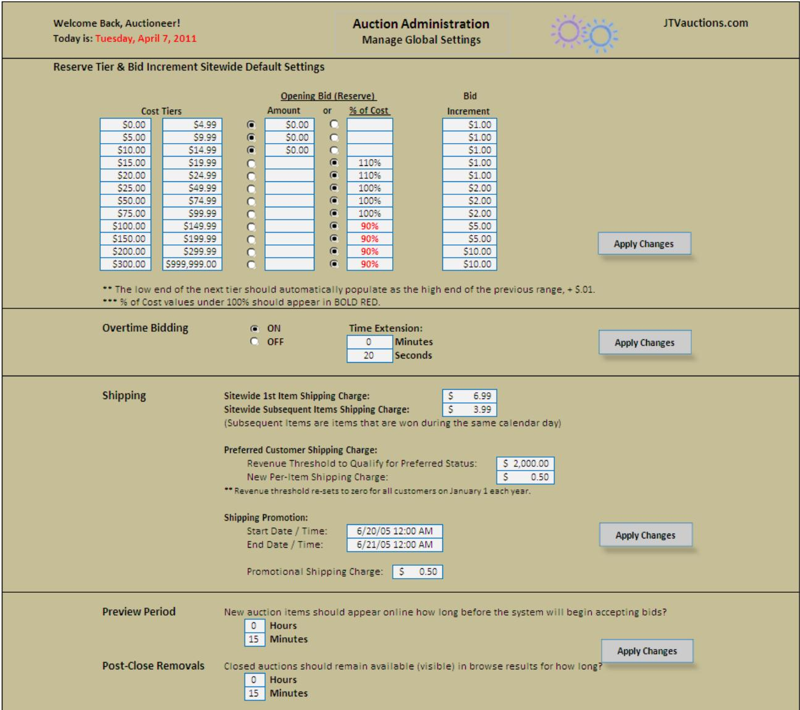

## 9.6 The Auction Event Profiles Page

Refer to the page mockup below.

## 9.6.1 Purpose of Auction Event Profiles

Auction event profiles will be created and used by the Auctioneer. These profiles will provide a common set of characteristics to a group of product, which will make scheduling groups of product easier and faster, providing consistency, and reducing data entry errors.

## 9.6.2 Event Profile Data Parameters

An event profile will contain the following information:

 Profile Name (such as “Night Owl Auctions”).

 cost tier values (ranges).

 opening bid (reserve) amounts (expressed as either a discrete amount or as a percentage of the item’s unit cost).

 the bid increment for the tier.

 the auction duration for the tier.

 radio button options to specify what products will be eligible to use the profile.

## 9.6.3 Usage Scenario

 If the Auctioneer wants to create a new promotional event (we’ll call it “Crazy Auctions”), she would begin by accessing this page.

 The Auctioneer will then tab or click into the “Create New Profile” field and enter a new profile name, then click on “Create.”

 She would then fill in the 2nd column, which is always the upper range of the cost tier. The system would automatically fill in the lower range of the subsequent cost tier by adding \$0.01 to the last value entered by the auctioneer, until all fields are completed.

 Working horizontally and adjacent to each cost tier, the Auctioneer will choose a radio button for either “amount” or “% of cost”, and fill in the appropriate field.

 Any % of cost values under 100% will automatically appear in BOLD RED as a warning to the Auctioneer. This does not prevent the Auctioneer from proceeding.

 The Auctioneer will proceed to designate a bid increment for all items in the cost tier.

 The Auctioneer will proceed by designating an auction duration to all items within the cost tier.

 The Auctioneer will then choose one of the radio buttons at the bottom. If, for example, she chooses, “Apply to Gemstones Only”, and then later tries to apply the profile to a grouping of jewelry items, the system will generate an error message telling her that this profile can only be applied to products in the gemstone category (retail category = gemstones).

 She will finish profile creation by clicking on the “Apply” button.

 Similarly, the Auctioneer can edit existing profiles by accessing the page and choosing the profile she wishes to edit from the list. Once she clicks on the profile name, the previouslyentered values will populate the page. She can edit, and then click “Apply” to save the changes.

 Discussion: Explore a way to randomize closing times within a chosen interval.

## 9.6.4 The Auction Event Profiles Page Mockup

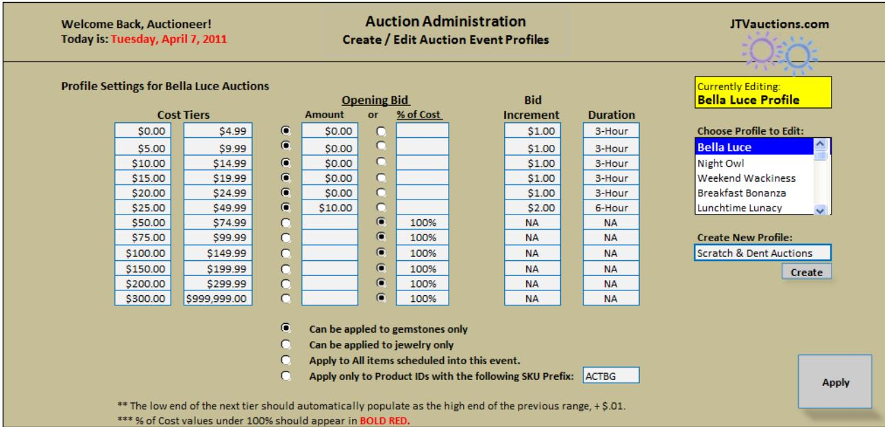

## 9.7 The SKU History Page

 This page will provide the auction performance history of an individual SKU (“Product ID”).

 The user will enter the Product ID and click on “Go.”

 The search results will be displayed in two sections.

## 9.7.1 The Top Section Will Display The Following Data:

 Product ID

 Short “On-Air” description from the SKU Creation application

 Product Type

 Unit Cost

 P1 (Price)

 Thumbnail Image

 Auction History: # of times scheduled, # of sales, churn rate

 Buyer’s Name

 Auction Available Quantity

 Red Available Qty (red inventory realm)

 White Physical Qty

 Active Date

## 9.7.2 The Bottom Section

 Displays auction history data for the SKU on separate lines.

 Auction Status

 Auction Sequence

 Start Date/Time

 End Date/Time

 Reserve Amount (i.e., Opening Bid)

 High Bid

 # of Bids

 Winner / High Bidder

## 9.7.3 The SKU History Page Mockup

<table><tr><td colspan="6">Welcome Back, Auctioneer! Today is: Tuesday, April 7, 2011</td></tr><tr><td>Search by Product ID: ABC123 Go</td><td></td><td></td><td></td><td></td><td>Clicking on the Winner/High Bidder takes you to customer&#x27;s history.</td></tr><tr><td>Search Results for Item: ABC123 History: Scheduled: 30</td><td>7.50CT MIN 16x12MM OV CITRINE FROM BRAZIL</td><td>Prod Type: Single Stone</td><td>Buyer: Boyle</td><td>Cost: $33.13</td><td></td></tr><tr><td></td><td>Auction Available: 3 Red Available: 68</td><td>White Physical: 65</td><td>Active Date: 02/12/2010</td><td></td><td></td></tr><tr><td>Auction Status Auction_Seg Unscheduled 2630585 2630586</td><td>Start Date/Time</td><td>End Date/Time</td><td>Reserve s</td><td>High Bid</td><td>#of Bids Winner / High Bidder</td></tr><tr><td></td><td></td><td></td><td>5.00</td><td></td><td></td></tr><tr><td>Unscheduled 2630587</td><td></td><td></td><td>5.00</td><td></td><td></td></tr><tr><td>Unscheduled</td><td></td><td></td><td>5.00</td><td></td><td></td></tr><tr><td>Unscheduled 2630588</td><td></td><td></td><td>5.00</td><td></td><td>0</td></tr><tr><td>Scheduled 2685094</td><td>Feb 24, 2009 10:00am</td><td>Feb 26, 2009 10:00am</td><td>9.00</td><td></td><td>0</td></tr><tr><td>Scheduled 2713128 2660766</td><td></td><td>Feb 28, 2009 11:00pm</td><td></td><td></td><td></td></tr><tr><td></td><td>Feb 28, 2009 11:00pm</td><td></td><td>9.00</td><td></td><td></td></tr><tr><td>Scheduled</td><td>Mar 02, 2009 8:00pm</td><td>March 01, 2009 8:00pm</td><td>9.00</td><td></td><td></td></tr><tr><td>Current (Live)</td><td>Feb 21, 2009 11:30am</td><td>Feb 22, 2009 5:30pm</td><td>5.00</td><td>8.00</td><td>rwingender</td></tr><tr><td>Current (Live)</td><td>Feb 22, 2009 8:30pm</td><td>Feb 23, 2009 10:30pm</td><td>5.00</td><td>5.00</td><td>auction lover</td></tr><tr><td>Closed</td><td>June 11, 2008 7:00pm</td><td>June 12, 2008 9:00pm</td><td></td><td>14.00</td><td>carolinatarheel</td></tr><tr><td>Closed</td><td>June 09, 2008 6:00am</td><td>June 09, 2008 8:00am</td><td></td><td>18.00</td><td>rwingender</td></tr><tr><td>Closed</td><td></td><td>May 24, 2008 4:00pm</td><td></td><td>22.00</td><td></td></tr><tr><td></td><td></td><td></td><td></td><td></td><td>gemstonecollector</td></tr><tr><td></td><td></td><td>Dec 09, 2007 2:45pm</td><td></td><td></td><td></td></tr><tr><td>Closed</td><td></td><td></td><td></td><td>17.00</td><td></td></tr><tr><td></td><td>May 22, 2008 4:00pm</td><td></td><td></td><td></td><td></td></tr><tr><td></td><td></td><td></td><td></td><td></td><td></td></tr><tr><td></td><td></td><td></td><td></td><td></td><td></td></tr><tr><td></td><td></td><td></td><td></td><td></td><td></td></tr><tr><td></td><td></td><td></td><td></td><td></td><td></td></tr><tr><td></td><td></td><td></td><td></td><td></td><td></td></tr><tr><td></td><td></td><td></td><td></td><td></td><td></td></tr><tr><td></td><td></td><td></td><td></td><td></td><td></td></tr><tr><td></td><td></td><td></td><td></td><td></td><td></td></tr><tr><td></td><td></td><td></td><td></td><td></td><td></td></tr><tr><td></td><td></td><td></td><td></td><td></td><td></td></tr><tr><td></td><td></td><td></td><td></td><td></td><td></td></tr><tr><td></td><td>Dec 08, 2007 11:45am</td><td></td><td></td><td></td><td>taratanzanite</td></tr><tr><td></td><td></td><td></td><td></td><td></td><td></td></tr><tr><td></td><td></td><td></td><td></td><td></td><td></td></tr><tr><td></td><td></td><td></td><td></td><td></td><td></td></tr><tr><td></td><td></td><td></td><td></td><td></td><td></td></tr><tr><td></td><td></td><td></td><td></td><td></td><td></td></tr><tr><td></td><td></td><td></td><td></td><td></td><td></td></tr><tr><td></td><td></td><td></td><td></td><td></td><td></td></tr><tr><td></td><td></td><td></td><td></td><td></td><td></td></tr><tr><td></td><td></td><td></td><td></td><td></td><td></td></tr><tr><td></td><td></td><td></td><td></td><td></td><td></td></tr><tr><td></td><td></td><td></td><td></td><td></td><td></td></tr><tr><td></td><td></td><td></td><td></td><td></td><td></td></tr><tr><td></td><td></td><td></td><td></td><td></td><td></td></tr><tr><td></td><td></td><td></td><td></td><td></td><td></td></tr><tr><td></td><td></td><td></td><td></td><td></td><td></td></tr><tr><td></td><td></td><td></td><td></td><td></td><td></td></tr><tr><td></td><td></td><td></td><td></td><td></td><td></td></tr><tr><td></td><td></td><td></td><td></td><td></td><td></td></tr><tr><td></td><td></td><td></td><td></td><td></td><td></td></tr><tr><td></td><td></td><td></td><td></td><td></td><td></td></tr><tr><td></td><td></td><td></td><td></td><td></td><td></td></tr><tr><td></td><td></td><td></td><td></td><td></td><td></td></tr><tr><td></td><td></td><td></td><td></td><td></td><td></td></tr><tr><td></td><td></td><td></td><td></td><td></td><td></td></tr><tr><td></td><td></td><td></td><td></td><td></td><td></td></tr><tr><td></td><td></td><td></td><td></td><td></td><td></td></tr><tr><td></td><td></td><td></td><td></td><td></td><td></td></tr><tr><td></td><td></td><td></td><td></td><td></td><td></td></tr><tr><td></td><td></td><td></td></table>

## 9.8 The Create New Auctions Page

## 9.8.1 General Requirements

 The Auction Merchandiser/Scheduler (the “Auctioneer”) will use this page on a daily basis to schedule new auctions.

 The platform will NOT be limited to hourly closing times!

 This page will use the AA global header section.

 Need to be able to schedule far into the future (at least a month).

 The scheduling application should never allow the Auctioneer to create an auction with the same starting & ending date / time. This should result in an error message, and the system should highlight (color-code) the offending data.

 The ability to select and schedule an unlimited number of SKUs at once (select a large group of SKUs, give it an event name (apply a “profile” to it), and create a schedule and parameters for them).

## 9.8.2 The Search Section

 This section enables the Auctioneer to find product for scheduling.

 It includes scrolling list boxes for

 Retail Category

 Product Type

 Gemstone Type

 Material Type

 Material Purity

 Brand

 Holding down the Control key will enable the user to make multiple selections from each list box.

 It includes a capability to search based on cost, by entering a low and high cost

 It includes the capability to search based on the product ID (SKU number). Search will support partial matches using wildcards (\* or %).

 It will include a checkbox to enable/disable thumbnail images in the search results.

 It will include a “Find Product” button to execute the search.

 No product will ever be eligible to appear on a product details page, search results, or catalog page if it does not have an available image to display or if it is not in a valid, sellable inventory location. These items should not be imported into auction inventory, but if they are and subsequently appear in a search, they should NOT be eligible for scheduling.

## 9.8.3 The Search Results Section

 The Auctioneer will have the ability to “filter” search results (very similar to how Excel’s autofilter functions). Autofilters should be turned on / off via a checkbox above the search results.

 Auctioneer will have the ability to rearrange item attribute columns from their default settings.

 The search results will display data using the following columns in this default order:

 “Action” column (shows a checkbox)

 Item thumbnail image

 Product ID (SKU #)(Clicking on this takes the user to the SKU History page)

 Description (Same description as in the “Inventory Research” report)

 Reserve (Functions as an Opening Bid)

 Item Unit Cost

 Increment

Quantity Available (do not include any Qty already scheduled)

 Duration (will initially be blank in search results)

Start time (will initially be blank in search results)

 End time (will initially be blank in search results)

 Product Type (i.e., Ring, Single Stone, etc)

 Gemstone

 Material Type

 Material Purity

 Size

 Active Date

 Retail Category (i.e,, Jewelry, Gemstones, Collectibles, etc)

 Buyer

 Vendor

 Under the search results and under the “Action” column, there will be a “Choose All” checkbox.

 Under the search results, there will be a scrolling “Action” list box. This box will give the user the following options:

 Remove checked items from this auction

 Apply duration to all

 Create grouping / event.

 Under the search results, there will be a "Apply Manual Reserves to Selections" box. This box will give the Auctioneer the ability create opening bid amounts for each selected item in the group by either a percentage of item unit cost, or by cost plus a dollar amount. Clicking on the "Apply" button will apply the choice entered to all selected items above.

 Under the search results, there will be a list box displaying available event profiles. Event profiles will be discussed in a later section. The Auctioneer can select one of the event profiles (but no more than one), and click on an "Apply" button. Clicking on the "Apply" button will apply the selected event profile to all selected items above.

 Under the search results, there will be a "Export to Excel" button, which will generate a CSV file of all data in the search results. This will be used for manual tracking subsequent to events.

 Under the "Export to Excel" button will be a Create New Auction button, which will create an auction event of all the selected items, with their applied and/or manually input data parameters.

 The search results will contain many columns - too many to display in a 1024 x 768 resolution display, so a horizontal scroll bar will be necessary. However, ALL of the Auctioneer's selection list boxes or action buttons will appear within a 1024 x 768 resolution display without scrolling to the right.

## 9.8.4 Scheduling New Auctions

 After searching for and selecting a list of auction product, the Auctioneer will have the ability to edit the selected auction items. Editable fields will be shown in gray.

 The Auctioneer will be able to navigate from field-to-field using the TAB key and the arrow keys, or using the mouse.

 The Auctioneer will be able to copy-and-paste data between fields.

 Once the auction group is created, the Auctioneer can either apply an "event profile" to the group (which will be faster), or create the auction manually, by setting each item's opening bid, bid increment, duration, and ending time. Once the duration and ending time are filled in, the opening time will be system-generated (calculated).

 Event profiles will be outlined later.

 Auctioneer will have the ability to choose an auction duration for any group from the following standard durations, or to schedule alternative durations by manually choosing starting and ending dates/times. Standard durations will be reportable; i.e., these timeframes will be available in the standard reporting criteria.

20-Minute   
30-Minute   
1-hour   
2-hour   
3-hour   
4-hour   
6-hour   
8-hour   
12-hour   
1 Day   
2 Day   
3 Day   
4 Day   
5 Day   
7 Day   
8 Day   
9 Day   
10 Day   
30 Day

 The system should provide some type of warning, preferably via a popup window, to the Auctioneer before the auction is created if any of the items being scheduled have additional quantities of the same item already scheduled in overlapping auction events.

 Auto-Scheduler capability should be able to randomly choose product and schedule product from an available list over a timeframe chosen by the Auctioneer, using any parameters given by the Auctioneer. Any auto-scheduler capability should be able to randomly schedule auction ending times – down to 5 minute intervals. For example: Need automated scheduler capability for scheduling ten-minute auctions. The Auctioneer would simply choose the start and end times of the event, and the automated scheduler would choose an assortment of SKUs from specified categories or product types (with cost ranges), and then the auto-scheduler would randomly and evenly schedule them. NEED MOCKUP & ADD TO SCHEDULING MENU.

## 9.8.5 The Create New Auctions Page Mockup

<table><tr><td>Welcome Back, Auctioneer! Today is: Tuesday, April 7, 2011</td><td colspan="9">JTVauctions.com</td><td></td><td colspan="8"></td></tr><tr><td colspan="3">Retail Categorg: Product Type</td><td colspan="3">Create New Auctions Search by: (Parameters may be combined. Hold down Control Key to make multiple selections). Gemstone Type:</td><td colspan="2">Material Type: Material Purity</td><td colspan="3">Brand: Bon Voyage Bridal</td><td colspan="8"></td></tr><tr><td>Apparel None cibles Coupons Gemstones</td><td>None Anklet Appraisal Backpack Bag</td><td>Adjustable Ring</td><td colspan="2">None K Abalone Shell Achroite Adulana Agate Agate Cameo M</td><td colspan="2">None 图 Acrylic Base Metal Bone Brass</td><td colspan="3">None 图O 10kt 12kt 14kt 14kt Electroform</td><td colspan="2">^ Crystallized-Swarovski Element Dermagem Gemplex 5 M</td><td colspan="8"></td></tr><tr><td>Lo4: High:</td><td>Cost Range $0.00 Product ID Prefiz: S24.00 ACTBG</td><td colspan="2">Shov Thumbnail Images </td><td colspan="2">Bmz/Pewt Over Base Find Product</td><td colspan="5">18kt M</td><td colspan="8"></td></tr><tr><td colspan="15">This search only returns product that is: 1) Auction Eligible, 2) Auction Available, 3) in the White inventory realm, 4) Has an Image, 5) Is in a sellable inventory location.</td></tr><tr><td colspan="15">Search Results: (List can be sorted by clicking on underlined column headers) ☑ Filters On / Off Image Open. Bid Unit Co: $ 5.00</td></tr><tr><td>Action</td><td colspan="4">Product Ipescription ABC1234 .35CT MIN 4MM RD MAHALEO RUBY FISSURE FILLED</td><td>$0.90 $ 1.00</td><td>IncremeQty AvaDurati 6</td><td>Starts 1-Hour</td><td>口 5/5/10 12:00 AM</td><td>Ends 5/6/10 10:00 AM</td><td>Product Type 日 Single Stone</td><td>Gemstone Mat. Purity Ruby None</td><td>Mat. Type</td><td>Siz None NA</td><td></td><td>Active Dat 3/12/2007</td><td>Retail Cat  Buger Gemstone</td><td>Boyle</td><td>Yendor</td></tr><tr><td>4 V</td><td colspan="4">ABC1235 .50CT MIN 4.5MM RD MAHALEO RUBY FISSURE FILLED</td><td>$1.31 $ 1.00</td><td></td><td>1-Hour</td><td>5/5/10 12:00 AM</td><td>5/6/10 10:00 AM</td><td>Single Stone</td><td>Ruby</td><td>None None</td><td>NA</td><td></td><td>3/13/2007</td><td>Gemstone</td><td>O&#x27;Sullivan</td><td>Zales</td></tr><tr><td>V</td><td colspan="4">ABC1236 .60CT AVG 5MM RD FISSURE FILLED RUBY DIAMOND CUT DO NO</td><td>$3.15 $</td><td>1.00</td><td>1-hour</td><td>5/5/10 12:00 AM</td><td>5/6/10 10:00 AM</td><td>Single Stone</td><td>Emerald</td><td>None</td><td>None</td><td>NA</td><td>3/14/2007</td><td>Gemstone</td><td>Williams</td><td>Knox Jewelers</td></tr><tr><td>V</td><td colspan="4">ABC1237 .60CT AVG SMM RD MAHALEO RUBY FISSURE FILLED / DIAMOND</td><td>$3.15 $</td><td>1.00 2</td><td>2-Day</td><td>5/5/10 12:00 AM</td><td>5/6/10 10:00 AM</td><td>Single Stone</td><td>Emerald None</td><td>None</td><td>NA</td><td></td><td>3/15/2007</td><td>Gemstone</td><td>Wrye</td><td>Knox Jewelers</td></tr><tr><td></td><td colspan="4">ABC1238.65CT AVG 6X4MM OV MAHALEO RUBY FISSURE FILLED</td><td>$2.96 $</td><td>1.00 5</td><td>2-D号y</td><td>5/6/10 9:00 AM</td><td>5/6/10 8:00 AM</td><td>Single Stone</td><td>Sapphire None</td><td></td><td></td><td></td><td>3/16/2007</td><td>Gemstone</td><td></td><td></td></tr><tr><td>V</td><td colspan="4">ABC1239.70CT AVG 5.5X5.5MM FISSURE FILLED RUBY FC / DO NOT USE THI</td><td></td><td></td><td>2-Day</td><td>5/6/10 9:00 AM</td><td>5/6/10 8:00 AM</td><td></td><td>Sapphire</td><td></td><td>None</td><td>NA</td><td></td><td></td><td>Maples</td><td>Knox Jewelers</td></tr><tr><td>V</td><td colspan="4">ABC1240 .75CT AVG TX5MM OV FISSURE FILLED RUBY FROM AFRICA DO N$</td><td>15.00 $2.21 $ 15.00</td><td>1.00 15</td><td>2-Day</td><td>5/6/10 9:00 AM</td><td>5/6/10 8:00 AM</td><td>Bracelet Necklace</td><td></td><td>10K</td><td>Gold</td><td>NA</td><td>3/17/2007</td><td>Jewelry</td><td>Rothchild</td><td>Kay</td></tr><tr><td>口 22</td><td colspan="4">ABC1241 .75CT AYG TX5MM OY FISSURE FILLED RUBY FROM AFRICA DO N $</td><td>$0.00 $</td><td>1.00 2</td><td></td><td>5/6/10 9:00 AM</td><td>5/6/10 8:00 AM</td><td></td><td>Bixbite</td><td>14K</td><td>Gold</td><td>NA</td><td>3/18/2007</td><td>Jewelry</td><td>Boyle</td><td>Kay NY Jeweler</td></tr><tr><td></td><td colspan="4"></td><td>$0.00 $</td><td>1.00</td><td>2-Day</td><td>5/6/10 9:00 AM</td><td></td><td>Ring</td><td>Labradorite</td><td>18K</td><td>Gold</td><td>7</td><td>3/19/2007</td><td>Jewelry</td><td>O&#x27;Sullivan</td><td></td></tr><tr><td>V</td><td colspan="4">ABC1242 .75CT AVG TX5MM PS MAHALEO RUBY FISSURE FILLED</td><td>15.00 $3.22 $</td><td>1.00</td><td>2-Day</td><td></td><td>5/6/10 8:00 AM</td><td>Ring</td><td>Alexandrite</td><td>14K</td><td>Gold</td><td>6</td><td>3/20/2007</td><td>Jewelry</td><td>Williams</td><td>NY Jeweler</td></tr><tr><td>a</td><td colspan="4">ABC1243 .75CT AVG MM VARIES EC MAHALEO RUBY FISSURE FILLED / FRC $</td><td>$1.33 $</td><td>1.00 19</td><td>2-Day 2-Day</td><td>5/6/10 9:00 AM 5/6/10 9:00 AM</td><td>5/6/10 8:00 AM 5/6/10 8:00 AM</td><td>Earrings</td><td>Diamond</td><td>24K</td><td>Gold</td><td>NA</td><td>3/21/2007</td><td>Jewelry</td><td>Rothohild</td><td>NY Jeweler</td></tr><tr><td>V</td><td colspan="4">ABC1244 .75CT MIN 5X5MM EC FISSURE FILLED RUBY FROM AFRICA</td><td colspan="4">$4.92 $ 1.00 2</td><td colspan="2">Earrings</td><td>Lapis Lazuli 10K</td><td></td><td>Gold</td><td>NA</td><td>3/22/2007</td><td>Jewelry</td><td>Wrye</td><td>NY Jeweler</td></tr><tr><td>D</td><td colspan="4">Choose All Action:</td><td colspan="4">Apply Manual Reserves to Selections Sitevide DefaultA A. As Percentage of Cost, or, Bella Luce</td><td colspan="2">Export to Excel</td><td colspan="5"></td><td></td><td></td><td></td></tr></table>

<table><tr><td colspan="2">Welcome Back, Auctioneer! Today is: Tuesday, April 7, 2011</td><td colspan="4">Auction Administration Create New Auctions</td><td>JTVauctions.com</td><td colspan="5"></td></tr><tr><td colspan="9">Search by: (Parameters may be combined. Hold down Control Key to make multiple selections). Retail Category: Product Type: ^ None</td></tr><tr><td>None Apparel</td><td>K None Adjustable Ring</td><td colspan="5">Gemstone Type: Material Type: 图 None Abalone Shell Acrylic</td><td colspan="5"></td></tr><tr><td>Beauty Collectibles Coupons</td><td>Anklet Achroite Appraisal Adularia Agate</td><td>Base Metal Bone</td><td>KD</td><td>&lt;国</td><td>Bon Voyage Bridal Charizma Crystallized-Swarovski Element</td><td colspan="5" rowspan="11"></td></tr><tr><td></td><td>Backpack</td><td>Brass Agate Cameo</td><td>14kt 14kt Electroform 18kt</td><td>Dermagem</td><td></td></tr><tr><td>Gemstones</td><td>Bag</td><td>V Brz/Pewt Over Base</td><td></td><td></td><td>M</td></tr><tr><td>Cost Range:</td><td></td><td></td><td></td><td>Gemplex 5</td><td></td></tr><tr><td>$0.00 Product ID Prefix: $24.00 ACTBG</td><td>how Thumbnail Images</td><td>Find Product</td><td></td><td></td><td></td></tr><tr><td colspan="10">This search only returns product that is: 1) Auction Eligible, 2) Auction Available, 3) in the White inventory realm, 4) Has an Image, 5) Is in a sellable inventory location.</td></tr><tr><td>Search Results: (List can be sorted by clicking on underlined column headers)</td><td>-</td><td> Filters On/Off</td><td></td><td>Ends</td><td></td></tr><tr><td>Action Image Product IDDescription</td><td></td><td>IncremeQty Avail Duratic</td><td>Starts -</td><td>Product Type</td><td>Gemstone</td></tr><tr><td>ABC1234 .35CT MIN 4MM RD MAHALEO RUBY FISSURE FILLED</td><td>Open. Bid Unit Cos</td><td>1.00</td><td>1-Hour 5/5/10 12:00 AM</td><td>5/6/10 10:00 AM</td><td>Ruby</td></tr><tr><td>ABC1235 ABC1236 ABC1237</td><td>5.00 $0.90 5 1.00 S</td><td>6 1-Hour</td><td>5/5/10 12:00 AM</td><td>Single Stone Single Stone</td><td></td></tr><tr><td></td><td>S 5.00 $1.31 .50CT MIN 4.5MMRD MAHALEO RUBY FISSURE FILLED</td><td></td><td>5/6/10 10:00 AM 5/5/10 12:00 AM</td><td>Ruby Single Stone</td><td>None None</td></tr><tr><td>2222</td><td>.60CT AVG 5MM RD FISSURE FILLED RUBY DIAMOND CL$ 10.00</td><td></td><td>5/6/10 10:00 AM</td><td>Emerald</td><td>None</td></tr><tr><td>P</td><td>.60CT AVG 5MM RD MAHALEO RUBY FISSURE FILLED /$ 10.00</td><td>1-hour</td><td>5/6/10 10:00 AM</td><td>Emerald Sapphire</td><td>None</td></tr><tr><td></td><td>ABC1238 .65CT AVG 6X4MM OV MAHALEO RUBY FISSURE FILLED $ 10.00</td><td>2-Day</td><td>5/6/10 8:00 AM</td><td>Sapphire</td><td>None 10K</td></tr><tr><td></td><td>ABC1239 .70CT AVG 5.5X5.5MM FISSURE FILLED RUBY FC / DO NO$ 15.00 ABC1240 .75CT AVG 7X5MM OV FISSURE FILLED RUBY FROM AFF $ 15.00</td><td>2-Day 2-Day</td><td>5/6/10 8:00 AM 5/6/10 8:00 AM</td><td></td><td>14K</td></tr><tr><td></td><td>.75CT AVG 7X5MM OV FISSURE FILLED RUBY FROM AFF $ 15.00</td><td>2-Day</td><td>Necklace 5/6/10 8:00 AM Ring</td><td>Bixbite Labradorite</td><td></td></tr><tr><td></td><td>.75CT AVG 7X5MM PS MAHALEO RUBY FISSURE FILLED $ 15.00</td><td>2-Day</td><td>Ring</td></tr><tr><td></td><td>.75CT AVG MM VARIES EC MAHALEO RUBY FISSURE FIL S</td><td>5/6/10 9:00 AM 5/6/10 9:00 AM 5/6/10 9:00 AM</td><td>Alexandrite Diamond</td></tr><tr><td>V</td><td>.75CT MIN 5X5MM EC FISSURE FILLED RUBY FROM AFR $</td><td>2-Day 2-Day</td><td>Earrings Earrings Lapis Lazuli</td></tr><tr><td></td><td></td><td></td><td>5/6/10 8:00 AM</td></tr><tr><td>Action:</td><td></td><td></td><td>Export to Excel</td></tr><tr><td></td><td></td><td></td><td></td></tr><tr><td></td><td></td><td></td><td></td></tr><tr><td></td><td>Apply Manual Reserves to Selections:</td><td>Apply Profile to Selected Items:</td><td>Sitewide Default Bella Luce</td></tr><tr><td></td><td></td></tr><tr><td>Choose All</td><td></td></tr><tr><td></td><td>$4.92 S</td></tr><tr><td></td><td></td></tr><tr><td></td><td></td></tr><tr><td></td><td>110%A. As Percentage of Cost, or</td></tr><tr><td></td><td></td></tr><tr><td></td><td></td></tr><tr><td></td><td>Remove checked items from this auction Create Grouping/Event</td></tr><tr><td></td><td></td></tr><tr><td></td><td>$ (15.00) B. As Cost + Dollar Amount.</td></tr><tr><td></td><td></td></tr><tr><td></td><td></td></tr><tr><td></td><td>Apply Duration to all</td></tr><tr><td></td><td></td></tr><tr><td></td><td></td></tr><tr><td></td><td>Apply</td></tr><tr><td></td><td>V</td></tr><tr><td></td><td></td></tr><tr><td></td><td></td></tr><tr><td></td><td></td></tr><tr><td></td><td></td></tr><tr><td></td><td></td></tr><tr><td></td><td></td></tr><tr><td></td><td></td></tr><tr><td></td><td></td></tr><tr><td></td><td></td></tr><tr><td></td><td></td></tr><tr><td></td><td></td></tr><tr><td></td><td></td></tr><tr><td></td><td></td></tr><tr><td></td><td></td></tr><tr><td></td><td></td></tr><tr><td></td><td></td></tr><tr><td></td><td></td></tr><tr><td></td><td></td></tr><tr><td></td><td></td></tr><tr><td></td><td></td></tr><tr><td></td><td></td></tr><tr><td></td><td></td></tr><tr><td></td><td></td></tr><tr><td></td><td></td></tr><tr><td></td><td></td></tr><tr><td></td><td></td></tr><tr><td></td><td></td></tr><tr><td></td><td></td></tr><tr><td></td><td></td></tr><tr><td></td><td></td></tr><tr><td></td><td></td></tr><tr><td></td><td></td></tr><tr><td></td><td></td></tr><tr><td></td><td></td></tr><tr><td></td><td></td></tr><tr><td></td><td></td></tr><tr><td></td><td></td></tr><tr><td></td><td></td></tr><tr><td></td><td></td></tr><tr><td></td><td></td></tr><tr><td></td><td></td></tr></table>

## 9.9 The View / Edit Current & Scheduled Auctions Page

## 9.9.1 General Requirements

The Auction Merchandiser/Scheduler (the “Auctioneer”) will use this page on a daily basis to edit currently running or scheduled auctions.

 The scheduling application should never allow the Auctioneer to create an auction with the same starting & ending date / time. This should result in an error message, and the system should highlight (color-code) the offending data.

## 9.9.2 The Search Section

 This section enables the Auctioneer to find product for editing or removal.

 It includes the capability to search:

 scheduled (but not currently running) auctions, currently running auctions, or both.

based on the product ID (SKU number). Search will support partial matches using wildcards (\* or %).

 based on the customer (participant) email address.

based on scheduled start date or end date.

 based on cost, by entering a low and high cost.

based on product type, via a scrolling list box (holding down the Control key will enable the user to make multiple selections)

 based on auction duration , via a scrolling list box.

 It will include a checkbox to enable/disable thumbnail images in the search results.

 It will include a “Find Product” button to execute the search.

## 9.9.3 The Search Results Section

 The Auctioneer will have the ability to “filter” search results (very similar to how Excel’s autofilter functions). Autofilters should be turned on / off via a checkbox above the search results.

 Auctioneer will have the ability to rearrange item attribute columns from their default settings.

 The search results will display data using the following columns in this default order:

 “Action” column (shows a checkbox)

 Item thumbnail image

 Product ID (SKU #)(Clicking on this takes the user to the SKU History page)

 Auction ID number

 Description (Same description as in the “Inventory Research” report)

 Opening Bid

 High Bid

 Item Unit Cost

 Start time (will initially be blank in search results)

End time (will initially be blank in search results)

 Duration (will initially be blank in search results)

 Product Type (i.e., Ring, Single Stone, etc)

 Increment

 Under the search results and under the “Action” column, there will be a “Choose All” checkbox.

 Under the search results, there will be a scrolling “Action” list box. This box will give the user the following options:

 Remove checked items from this auction

 Edit durations

 Edit bid increments

 Edit reserve amounts

 Apply ending time to all

 Apply starting time to all

 Create grouping / event

 When applying ending/starting times to all, the user should choose the time from the dropdown list in the column header.

 Under the search results, there will be a list box displaying available event profiles. The Auctioneer can select one of the event profiles (but no more than one), and click on an "Apply" button. Clicking on the "Apply" button will apply the selected event profile to all selected items above.

 The “Apply Changes” button, will appear in the bottom right corner of the screen (at 1024 x 768 resolution).

 Even if the search results contain too many columns to display in a 1024 x 768 resolution display, the list boxes or action buttons will appear within a 1024 x 768 resolution display without scrolling to the right.

## 9.9.4 View / Edit Current & Scheduled Auctions Page Mockup

There are two mockups shown here. One shows what the page should look like WITH thumbnail images; the other without. Otherwise, they are identical.

<table><tr><td rowspan=1 colspan=25>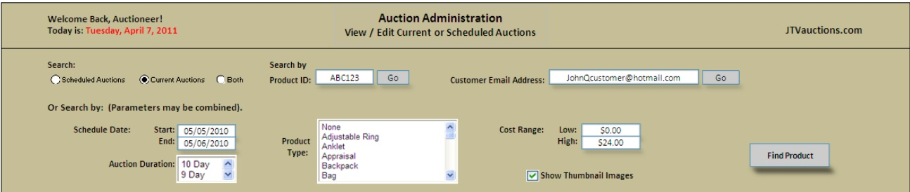|Search Results: (List can be sorted by clicking on underlined column headers)         Filters On / Off           Blue auctions are scheduled (not current live auctions)</td></tr><tr><td rowspan=1 colspan=1>Action</td><td rowspan=1 colspan=4>ImageProduct ID</td><td rowspan=1 colspan=2>Auction #</td><td rowspan=1 colspan=7>Description                       口</td><td rowspan=1 colspan=1>Open. Bi</td><td rowspan=1 colspan=2>High BicUnit</td><td rowspan=1 colspan=2>Cost</td><td rowspan=1 colspan=1>Starts      、</td><td rowspan=1 colspan=1>Ends     日</td><td rowspan=1 colspan=1>Durationroduct</td><td rowspan=1 colspan=2>Type   日</td><td rowspan=1 colspan=1>Increment</td></tr><tr><td rowspan=1 colspan=1>V</td><td rowspan=1 colspan=4></td><td rowspan=1 colspan=2></td><td rowspan=1 colspan=7></td><td rowspan=1 colspan=1></td><td rowspan=1 colspan=2></td><td rowspan=1 colspan=2></td><td rowspan=1 colspan=1></td><td rowspan=1 colspan=1></td><td rowspan=1 colspan=1></td><td rowspan=1 colspan=2></td><td rowspan=1 colspan=1></td></tr><tr><td rowspan=2 colspan=1>V</td><td rowspan=2 colspan=4>ABC1234</td><td rowspan=2 colspan=2>1234567</td><td rowspan=1 colspan=7>.35CT MIN 4MMRD MAHALEO RUBY FISSURE FILLED</td><td rowspan=1 colspan=1>s 5.00</td><td rowspan=1 colspan=2>S 7.00</td><td rowspan=1 colspan=2>S0.90</td><td rowspan=1 colspan=1>5/5/10 12:00 AM</td><td rowspan=1 colspan=1>5/6/10 10:00 AM</td><td rowspan=1 colspan=1>1-Hour</td><td rowspan=1 colspan=2>SINGLE STONE</td><td rowspan=1 colspan=1>s 1.00</td></tr><tr><td rowspan=1 colspan=3></td><td></td><td></td><td></td><td></td><td></td><td></td><td></td><td></td><td></td><td></td><td></td><td></td><td></td><td></td><td></td><td></td><td></td><td></td></tr><tr><td rowspan=5 colspan=1></td><td rowspan=5 colspan=3></td><td rowspan=5 colspan=2>ABC1235</td><td rowspan=5 colspan=2>1234568</td><td></td><td></td><td></td><td></td><td></td><td></td><td></td><td></td><td></td><td></td><td></td><td></td><td></td><td></td><td></td><td></td><td></td></tr><tr><td rowspan=4 colspan=7>.50CT MIN 4.5MM RD MAHALEO RUBY FISSURE FILLED</td><td></td><td></td><td></td><td></td><td></td><td></td><td></td><td></td><td></td><td></td><td></td></tr><tr><td rowspan=3 colspan=3>.50CT MIN 4.5MM RD</td><td rowspan=3 colspan=1>S 5.00</td><td></td><td></td><td></td><td></td><td></td><td></td><td></td><td></td><td></td><td></td></tr><tr><td rowspan=2 colspan=2>S  6.00</td><td rowspan=2 colspan=2>S1.31</td><td rowspan=2 colspan=1>5/5/10 12:00 AM</td><td></td><td></td><td></td><td></td><td></td></tr><tr><td rowspan=1 colspan=1>5/6/10 10:00 AM</td><td rowspan=1 colspan=1>1-Hour</td><td rowspan=1 colspan=2>SINGLE STONE</td><td rowspan=1 colspan=1>S 1.00</td></tr><tr><td rowspan=1 colspan=1>V</td><td rowspan=1 colspan=1></td><td rowspan=1 colspan=3>3</td><td rowspan=1 colspan=2></td><td rowspan=1 colspan=1></td><td rowspan=1 colspan=1></td><td rowspan=1 colspan=5></td><td rowspan=1 colspan=1></td><td rowspan=1 colspan=2></td><td rowspan=1 colspan=2></td><td rowspan=1 colspan=1></td><td rowspan=1 colspan=1></td><td rowspan=1 colspan=1></td><td rowspan=2 colspan=2>SINGLE STONE</td><td rowspan=2 colspan=1>5 1.00</td></tr><tr><td rowspan=1 colspan=1></td><td rowspan=1 colspan=1></td><td rowspan=1 colspan=3>ABC1236</td><td rowspan=1 colspan=2>1234569</td><td rowspan=1 colspan=3>.60CT AVG 5MMRD</td><td rowspan=1 colspan=5>,60CT AVG 5MM RD FISSURE FILLED RUBY DIAMOND CUT DO NC</td><td rowspan=1 colspan=1>s10.00</td><td rowspan=1 colspan=2>s 11.00</td><td rowspan=1 colspan=1>$3.15</td><td rowspan=1 colspan=1>5/5/10 12:00 AM</td><td rowspan=1 colspan=1>5/6/10 10:00 AM</td><td rowspan=1 colspan=1>1-hour</td></tr><tr><td rowspan=4 colspan=1>V</td><td rowspan=4 colspan=3></td><td rowspan=1 colspan=2></td><td rowspan=1 colspan=2></td><td rowspan=1 colspan=1></td><td rowspan=1 colspan=4></td><td></td><td></td><td></td><td></td><td></td><td></td><td></td><td></td><td></td><td></td><td></td><td></td></tr><tr><td></td><td></td><td></td><td rowspan=4 colspan=7>.60CT AVG 5MM RD MAHALEO RUBY FISSURE FILLED / DIAMONI</td><td rowspan=3 colspan=1>s10.00</td><td></td><td></td><td></td><td></td><td></td><td></td><td></td><td></td><td></td><td></td></tr><tr><td></td><td></td><td></td><td rowspan=2 colspan=2>s 10.00</td><td rowspan=2 colspan=2>S3.15</td><td rowspan=2 colspan=1>5/5/10 12:00 AM</td><td rowspan=2 colspan=1>5/6/10 10:00 AM</td><td rowspan=2 colspan=1>2-Day</td><td rowspan=2 colspan=2>SINGLE STONE</td><td rowspan=2 colspan=1>s 1.00</td></tr><tr><td rowspan=2 colspan=4>ABC1237</td><td rowspan=2 colspan=2>1234570</td></tr><tr><td rowspan=5 colspan=1>V</td><td rowspan=5 colspan=2></td><td rowspan=3 colspan=7>.65CT AVG 6X4MM OV MAHALEO RUBY FISSURE FILLED</td><td rowspan=3 colspan=1>s10.00</td><td rowspan=1 colspan=2></td><td rowspan=1 colspan=2></td><td rowspan=1 colspan=1></td><td rowspan=1 colspan=1></td><td rowspan=1 colspan=1></td><td rowspan=1 colspan=1></td><td></td><td></td></tr><tr><td></td><td></td><td rowspan=3 colspan=2>1234571</td><td rowspan=3 colspan=2></td><td rowspan=3 colspan=2>$2.96</td><td rowspan=3 colspan=1>5/6/10 9:00 AM</td><td rowspan=3 colspan=1>5/6/10 8:00 AM</td><td rowspan=3 colspan=1>2-Day</td><td rowspan=3 colspan=1>SINGLE STONE</td><td></td><td></td></tr><tr><td></td><td></td><td rowspan=2 colspan=1></td><td rowspan=2 colspan=1>5 1.00</td></tr><tr><td rowspan=2 colspan=4>ABC1238</td><td></td><td></td><td></td><td></td><td></td><td></td><td></td><td></td></tr><tr><td rowspan=1 colspan=4></td><td rowspan=1 colspan=2></td><td rowspan=1 colspan=7></td><td></td><td></td><td></td><td rowspan=1 colspan=2></td><td rowspan=1 colspan=1></td><td rowspan=1 colspan=1></td><td rowspan=1 colspan=1></td><td rowspan=1 colspan=1></td><td rowspan=1 colspan=1></td><td rowspan=1 colspan=1></td></tr><tr><td rowspan=1 colspan=1></td><td rowspan=1 colspan=4>ABC1239</td><td rowspan=1 colspan=2>1234572</td><td rowspan=1 colspan=7>.70CT AVG 5.5X5.5MM FISSURE FILLED RUBY FC / DO NOT USE TH</td><td rowspan=1 colspan=1>S15.00</td><td rowspan=1 colspan=2>S</td><td rowspan=1 colspan=2>S2.21</td><td rowspan=1 colspan=1>5/6/10 9:00 AM</td><td rowspan=1 colspan=1>5/6/10 8:00 AM</td><td rowspan=1 colspan=1>2-Day</td><td rowspan=1 colspan=1>SINGLE STONE</td><td rowspan=1 colspan=1></td><td rowspan=1 colspan=1>5 1.00</td></tr><tr><td rowspan=2 colspan=1>V</td><td rowspan=2 colspan=4>ABC1240</td><td rowspan=2 colspan=2>1234573</td><td rowspan=2 colspan=7>.75CT AVG 7X5MM OV FISSURE FILLED RUBY FROM AFRICA DOI</td><td rowspan=2 colspan=1>s15.00</td><td rowspan=2 colspan=2>s</td><td rowspan=2 colspan=2>S0.00</td><td></td><td></td><td></td><td></td><td></td><td></td></tr><tr><td rowspan=1 colspan=1>5/6/10 9:00 AM</td><td rowspan=1 colspan=1>5/6/10 8:00 AM</td><td rowspan=1 colspan=1>2-Day</td><td rowspan=1 colspan=1>SINGLE STONE</td><td rowspan=1 colspan=1></td><td rowspan=1 colspan=1>S 1.00</td></tr><tr><td rowspan=11 colspan=25>VABC1241VABC1242VABC1243       .75CT AVG MM VARIES EC MAHALEO RUBY FISSURE FILLED /FFVABC1244 1234577.75CT MIN 5X5MM EC FISSURE FILLED RUBY FROM AFRICAV   Choose AllSitewide DefaultAction:  Remove Checked Items from Auction.                        Apply Profile to    Bella LuceEdit Reserve Amounts                               Selected Items:    Night OwI        ApplyEdit Bid Increment Amounts                                         Weekend Wackine                         Apply ChangesEdit Duration                                                 Breakfast BonanzaCreate Grouping / Event        V                                Lunchtime LunacyV</td></tr><tr><td rowspan=2 colspan=1>$0.00</td><td rowspan=2 colspan=1></td><td rowspan=2 colspan=1></td></tr><tr><td rowspan=1 colspan=1></td><td rowspan=1 colspan=1></td><td rowspan=1 colspan=1></td><td rowspan=1 colspan=1></td></tr><tr><td rowspan=1 colspan=2></td><td rowspan=1 colspan=7></td></tr><tr><td rowspan=2 colspan=2>1234575</td><td rowspan=2 colspan=7>.75CT AVG 7X5MM PS MAHALEO RUBY FISSURE FILLED</td><td rowspan=2 colspan=1>S 15.00</td><td rowspan=2 colspan=2></td><td rowspan=2 colspan=2></td><td rowspan=2 colspan=1></td><td rowspan=2 colspan=1></td><td rowspan=2 colspan=1></td><td rowspan=2 colspan=1>SINGLE STONE</td></tr><tr><td rowspan=1 colspan=1></td><td rowspan=1 colspan=1></td></tr><tr><td rowspan=3 colspan=2></td><td rowspan=3 colspan=4>75CTAYG MM YARIES</td></tr><tr><td rowspan=2 colspan=3>1VARIES EC MAH</td></tr><tr><td rowspan=1 colspan=3>C MALE RUYFISSRE FILLF</td><td rowspan=1 colspan=1></td><td rowspan=1 colspan=2></td><td rowspan=1 colspan=2></td><td rowspan=1 colspan=1></td><td rowspan=1 colspan=1></td><td rowspan=1 colspan=1></td><td rowspan=1 colspan=1></td><td rowspan=1 colspan=1></td><td rowspan=1 colspan=1></td></tr><tr><td rowspan=2 colspan=1></td><td rowspan=2 colspan=2></td><td rowspan=2 colspan=2></td><td rowspan=1 colspan=1></td><td rowspan=1 colspan=1></td><td rowspan=1 colspan=1></td><td rowspan=1 colspan=1></td><td rowspan=1 colspan=1></td><td rowspan=1 colspan=1></td></tr><tr><td rowspan=1 colspan=1></td><td rowspan=1 colspan=1></td><td rowspan=1 colspan=1>2-Day</td><td rowspan=1 colspan=1>SINGLE STONE</td><td rowspan=1 colspan=1></td><td rowspan=1 colspan=1></td></tr></table>

<table><tr><td rowspan=1 colspan=1>Action</td><td rowspan=1 colspan=1>Image</td><td rowspan=1 colspan=1>Product ID</td><td rowspan=1 colspan=1>Auction #</td><td rowspan=1 colspan=2></td><td rowspan=1 colspan=1>Open. Bi</td><td rowspan=1 colspan=1>High Bid</td><td rowspan=1 colspan=1>Unit Cost</td><td rowspan=1 colspan=3>Starts</td><td rowspan=1 colspan=1>Ends</td><td rowspan=1 colspan=1>Duration</td><td rowspan=1 colspan=1>roduct Type</td><td rowspan=1 colspan=1>Increment</td></tr><tr><td rowspan=1 colspan=1></td><td rowspan=1 colspan=1></td><td rowspan=1 colspan=1>ABC1234</td><td rowspan=1 colspan=1>1234567</td><td rowspan=1 colspan=2></td><td rowspan=1 colspan=1>$ 5.00</td><td rowspan=1 colspan=1></td><td rowspan=1 colspan=1>$0.90</td><td rowspan=1 colspan=3>5/5/10.12:00 AM</td><td rowspan=1 colspan=1>5/6/10 10:00 AM</td><td rowspan=1 colspan=1>1-Hour</td><td rowspan=1 colspan=1>SINGLE STONE</td><td rowspan=1 colspan=1>S 1.00</td></tr><tr><td rowspan=1 colspan=1></td><td rowspan=1 colspan=1></td><td rowspan=1 colspan=1>ABC1235</td><td rowspan=1 colspan=1>1234568</td><td rowspan=1 colspan=2></td><td rowspan=1 colspan=1>$ 5.00</td><td rowspan=1 colspan=1>S 6.00</td><td rowspan=1 colspan=1></td><td rowspan=1 colspan=3>5/5/10 12:00 AM</td><td rowspan=1 colspan=1>5/6/10 10:00 AM</td><td rowspan=1 colspan=1>1-Hour</td><td rowspan=1 colspan=1>SINGLE STONE</td><td rowspan=1 colspan=1>$ 1.00</td></tr><tr><td rowspan=1 colspan=1></td><td rowspan=1 colspan=1></td><td rowspan=1 colspan=1>ABC1238</td><td rowspan=1 colspan=1>1234571</td><td rowspan=1 colspan=2></td><td></td><td></td><td></td><td></td><td></td><td></td><td></td><td></td><td></td><td></td></tr><tr><td rowspan=1 colspan=1></td><td rowspan=1 colspan=1></td><td rowspan=1 colspan=1>ABC1244</td><td rowspan=1 colspan=1>1234577</td><td rowspan=1 colspan=2></td><td rowspan=1 colspan=1></td><td rowspan=1 colspan=1></td><td rowspan=1 colspan=1></td><td rowspan=1 colspan=3></td><td rowspan=1 colspan=1></td><td rowspan=1 colspan=1></td><td rowspan=1 colspan=1>SINGLE STONE</td><td rowspan=1 colspan=1></td></tr><tr><td rowspan=1 colspan=1></td><td rowspan=2 colspan=15></td></tr><tr><td rowspan=1 colspan=2></td><td rowspan=1 colspan=1></td><td rowspan=1 colspan=1></td><td rowspan=1 colspan=1></td><td rowspan=1 colspan=1>Bella luce</td><td rowspan=1 colspan=2></td></tr></table>

## 9.10 User Access Management

 User Access Management (UAM) will be an option on the Administration Menu from the Auction Administration Main Menu.

 There will be three pages for UAM. The first is a very simple page with only two buttons/links: 1) List All Users; and 2) Create New User. The second page is the “List All Users” page. The third page is the “Create or Edit User” page. See the mockups below for examples of all three pages.

## 9.10.1 User Access Management Page Mockup

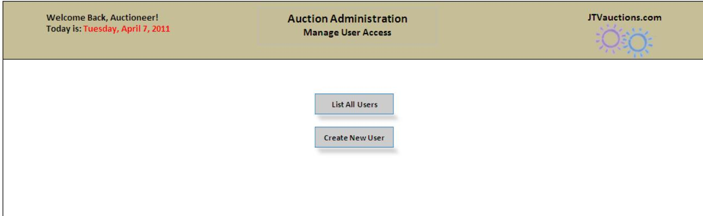

## 9.10.2 List All Users page

 This page will list all users authorized to use the auction administration application. Columns will include Last Name, First Name, (Job) Title, Login ID, Admin, Delete, and Edit.

 Login IDs will be the user’s company email address.

 The Admin column will be “Yes” or “No”, signifying that they have / don’t have administrator access.

 The Delete column will contain “Delete” buttons, which will be RED. If the user clicks on this button, they are deleting a user from the system. A confirmation dialogue box will pop up, asking the user to confirm the action (“You have chosen to delete user Joe Namath. Are you sure?” The dialogue box will contain two buttons: a “Yes, Delete User” button, and a “Cancel” button, which will be RED.

 The Edit column will contain “Edit” buttons. When clicked, these buttons will take the user to the “Create or Edit User” page.

## 9.10.3 List All Users Page Mockup

<table><tr><td colspan="3">Welcome Back, Auctioneer! Today is: Tuesday, April 7, 2011</td><td colspan="4">Auction Administration User Access - List All Users</td><td>JTVauctions.com</td></tr><tr><td>Last Name</td><td>First Name</td><td>Title</td><td>Login ID</td><td>Admin</td><td>Delete</td><td>Edit</td></tr><tr><td>Aikman</td><td>Troy</td><td>Auctioneer</td><td>Troy.Aikman@itv.com</td><td>Yes</td><td>Delete</td><td>Edit</td></tr><tr><td>Bradshaw</td><td>Terry</td><td>Auctioneer</td><td>Terry.Bradshaw@jtv.com</td><td>Yes</td><td>Delete</td><td>Edit</td></tr><tr><td>Brady</td><td>Tom</td><td>CSR</td><td>Tom.Brady@itv.com</td><td>No</td><td>Delete</td><td>Edit</td></tr><tr><td>Dawson</td><td>Len</td><td>CSR</td><td>Len.Dawson@jtv.com</td><td>No</td><td>Delete</td><td>Edit</td></tr><tr><td>Elway</td><td>John</td><td>CSR</td><td>John.Elway@itv.com</td><td>No</td><td>Delete</td><td>Edit</td></tr><tr><td>Favre</td><td>Brett</td><td>CSR</td><td>Brett.Favre@itv.com</td><td>No</td><td>Delete</td><td>Edit</td></tr><tr><td>Manning</td><td>Payton</td><td>CSR</td><td>Payton.Manning@itv.com</td><td>No</td><td>Delete</td><td>Edit</td></tr><tr><td>Montana</td><td>Joe</td><td>Help Desk</td><td>Joe.Montana@itv.com</td><td>No</td><td>Delete</td><td>Edit</td></tr><tr><td>Namath</td><td>Joe</td><td>Help Desk</td><td>Joe.Namath@jtv.com</td><td>No</td><td>Delete</td><td>Edit</td></tr><tr><td>Starr</td><td>Bart</td><td>Help Desk</td><td>Bart.Starr@itv.com</td><td>No</td><td>Delete</td><td>Edit</td></tr><tr><td>Staubach</td><td>Roger</td><td>SE/ IT</td><td>Roger.Staubach@itv.com</td><td>Yes</td><td>Delete</td><td>Edit</td></tr><tr><td>Young</td><td>Steve</td><td>SE/ IT</td><td>Steve.Young@jtv.com</td><td>Yes</td><td>Delete</td><td>Edit</td></tr></table>

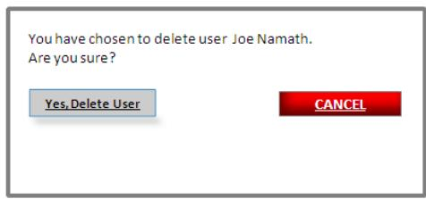

## 9.10.4 Create or Edit User Page

 This page is accessed when the user chooses either: 1) the “Create New User” button on the UAM front page, or 2) the “Edit” button on the “List All Users” page.

 This page will include labels and data fields for: First Name, Last Name, Title, Email Address, Change PW, Confirm PW.

 There will be a checkbox labeled as “Require user to change PW on next login.”

 There will be a set of radio buttons giving the user the choice of “Administrator” or “User” access.

 “Administrator”-level access gives the user full access to all platform functions.

The system will prevent any administrator from making himself or herself the sole (only) administrator. There will always be a minimum of two administrators.

 “User”-level access will depend on the “Permissions” granted.

 Permissions will be granted by using Yes/No radio buttons.

 Permissions that can be granted include:

 Permission to create new auctions

 Permission to edit or remove existing auctions

 Permission to deactivate a customer account.

Permission to place a customer account in review status. Review status means “suspended”. The customer can log in, change account settings (for example, payment method), but may not bid, and the system will not generate orders for any auctions-inprogress that the customer may win.

 There will be a “Save Changes” button and a “Cancel” button (in RED) at the bottom of the page.

## 9.10.5 Create or Edit User Page Mockup

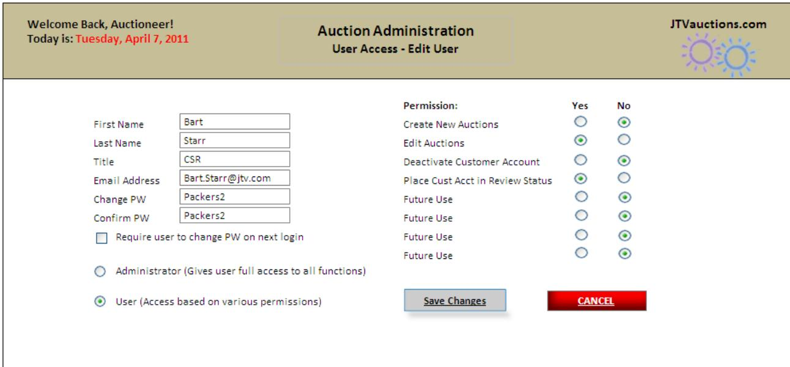

## 9.11 The Customer History Page

## 9.11.1 Purpose

The customer history page is for use by Customer Service Reps, Help Desk staff, and Software Engineers to aid them in troubleshooting customer service issues.

## 9.11.2 Requirements

 This screen allows accounts to be suspended or deactivated. Deactivating accounts will require a supervisor's authorization code. A pop-up DIV layer will appear, asking for a supervisor's code. Only supervisors will know these codes, which will be issued by Administrators and generated by the Auction Admin application. Supervisors will not need to have Administrator access to input the codes.

 Users can search on customer e-mail address, phone number, or customer name.

 The “Results:” section will include Last Name, First Name, City, ST, Zip, Phone, E-mail address, and buttons for Bid History, Order History, View Notes, and Reset Password. The Bid History, Order History, and View Notesbuttons will utilize anchor tags to take the user to the correct section further down the page.

 The IP Address column is a nice-to-have if it can be done, but not required.

 Deactivated accounts will be listed in RED.

 The Method of Payment section (MOP) will display the customer’s current default paytype information. If credit card, it will only display the card type, expiration date, and last four digits.

The Account Notes section will be a free-form text field for use by CSRs. It should include a scroll bar.

 The “Order History” section should include order dates , auction sequence numbers, product ID (SKU) numbers, order amounts (includes shipping/tax), and status, even if the order was cancelled. Cancelled orders should appear in RED.

 The “Bid History” section should include the item’s closing date/time (or “Active” if the auction is still live), the auction sequence numbers, product ID (SKU) numbers, the customer’s last bid on that auction, their SmartBid (max bid) if one was placed, and the winning bid, regardless of who placed that bid. (If the customer won the auction, the last bid value will be equal to the winning bid value.

9.11.3 The Customer History Page Mockup
<table><tr><td colspan="3">Welcome Back, Auctioneer! Today is: Tuesday, April 7, 2011</td><td colspan="3">Auction Administration Customer History</td><td colspan="4">JTVauctions.com</td></tr><tr><td colspan="3" rowspan="2">Search by: Customer Email Address:</td><td colspan="3">Go</td><td colspan="4" rowspan="2"></td></tr><tr><td>JohnQcustomer@hotmail.com (865)692-6000</td><td>Go</td></tr><tr><td>Customer Name (last, First):</td><td>Customer Home Phone: Johnson-Smith</td><td></td><td>Go</td><td></td><td></td><td></td><td></td><td></td></tr><tr><td colspan="3"></td><td colspan="2">Lisa - Marie</td><td colspan="5">(Confirm City, State, Zip with the customer)</td></tr><tr><td colspan="10">Results:</td></tr><tr><td colspan="2"></td><td></td><td></td><td></td><td></td><td>Bid Order</td><td></td><td>View</td><td>Reset Last IP</td></tr><tr><td>Last Name, First Name</td><td colspan="2">City, State, ZIP</td><td>Phone</td><td colspan="2">Email Address</td><td>History GO</td><td>History</td><td>Notes</td><td>Password Address</td></tr><tr><td>Johnson-Smith, Lisa-Marie</td><td colspan="2">Richmond, VA 23231</td><td>(804) 741-1234</td><td colspan="2">Lisa.Customer@hotmail.com</td><td>GO</td><td>GO</td><td>GO</td><td>GO 65.198.207.11</td></tr><tr><td>Johnson-Smith, Lisa-Marie</td><td colspan="2">Richmond, VA 23233</td><td>(804) 741-1234</td><td colspan="2">Lisa.Customer@hotmail.com</td><td>O</td><td>GO</td><td>GO</td><td>GO</td></tr><tr><td>Johnson-Smith, Lisa-Marie</td><td colspan="2">Mechanicsville, VA 23235</td><td>(804) 747-5450</td><td colspan="2">Lisa.Customer@hotmail.com</td><td></td><td>GO</td><td>O</td><td>GO</td></tr><tr><td>Johnson-Smith, Lisa-Marie Johnson-Smith, Lisa-Marie</td><td colspan="2">Cleveland, OH 43050 Oshkosh, WI 54901</td><td>(216) 845-1780 (414) 424-5858</td><td colspan="2">DebbieSmith@Yahoo.com Linda123@AOL.com</td><td>GO→ GO</td><td>GO→ GO→</td><td>GO→ GO</td><td>O→ GO</td></tr><tr><td></td><td colspan="3"></td><td colspan="2"></td><td colspan="3">GO</td><td>WhatismylPaddress.com</td></tr><tr><td colspan="9">Deactivate an Account Place Account in Review Status GO→ Deactivated accounts will appear in RED. Deactivating an Account will require a Supervisor&#x27;s authorization code.</td></tr><tr><td colspan="9"></td></tr><tr><td colspan="9">Current Default MOP: O PayPal O Amazon Payments American Express Card Last Four: 1234 Expiration Date: March 2012</td></tr><tr><td colspan="9">Account Notes for Johnson-Smith, Lisa-Marie: This should be a free-form text field for use by Customer Service reps. It should have a vertical scroll bar on the right side of this text box.</td></tr><tr><td colspan="9">Order History for Johnson-Smith, Lisa-Marie:</td></tr><tr><td colspan="9">Order Order Date Auction Sequence Item Number Amount Status 12/2/09 2789987 ABC123-7 S 48.00 Complete 12/1/09 2789454 ABC124 s 35.00 Order Cancelled 11/15/09 2456451 ABC125-7 65.00 Complete</td></tr><tr><td colspan="9">s 11/15/09 2456451 ABC125-7 s 65.00 Complete 12/1/09 2789454 ABC124 s 35.00 Order Cancelled</td></tr><tr><td colspan="9"></td></tr><tr><td colspan="9"></td></tr><tr><td colspan="9">Closed Date/Time Auction Sequence Item Number Last Bid (SmartBid) Winning Bid Active 2345095 ABC123-8 S 66.00 115.00</td></tr><tr><td colspan="9">12/2/09 12:00 AM 2789987 ABC123-7 s 48.00 s 48.00</td></tr><tr><td colspan="9">12/1/09 2:00 PM 2789454 ABC124 35.00 35.00 s 45.00</td></tr><tr><td colspan="9">s</td></tr><tr><td colspan="9"></td></tr><tr><td colspan="9">s s s 11/15/09 8:00 PM 2456451 ABC125-7 S 65.00 75.00 5</td></tr><tr><td colspan="9">75.00</td></tr><tr><td colspan="9"></td></tr></table>

## 9.12 Content Management

 A relatively simply CMS will be needed.

 Endeca link generation capability is required.

 Used for promotional banner & text bar scheduling.

 Used for updating the auction schedule page.

## 9.13 Site Monitoring and Notifications

Various functions will need to be monitored and specific people notified if certain events are triggered. For example, if scheduled auctions do not begin or end, or if orders do not process ff the site, the Help Desk and Auctioneer should be notified via email.

Now, send an email to Rick W, and he will give you \$10. You must reference the page number. Just ask! Limit one payment per person. This is to see who actually reads this document!

## 9.14 Auction Admin Reporting

## 9.14.1 General

The auction system will require flexible reporting to operate the business. These reports will be available to the business owner via the Auction Admin Main Menu page. They will use the supporting / underlying database as discussed in section 9.

These reports will all use the same Auction Admin global header.

## 9.14.2 Current Auctions Status Page (Daily View)

This page exists so the business can monitor the expected performance for future days’ auctions. This page will allow the user to switch between the hourly view and the daily view, and choose to view only gemstone auctions, only jewelry auctions, or all auctions.

It will show the closing date, the total bids (total bids = aggregate in dollars of all winning bids on all current auctions) on all items closing on that date, and the total cost of all items closing on that date. In addition, it will show the # of items scheduled to close, the total # of bidders so far, the average unit cost per auction, the total number of bids placed so far, and the average number of bids placed per item so far.

## 9.14.3 Current Auctions Status Page Mockup (Daily View)

<table><tr><td colspan="8">Welcome Back, Auctioneer! Auction Administration Today is: Tuesday, April 7, 2011 Current Auction Status - Daily View</td></tr><tr><td colspan="2">C Jewelry Auctions Only C Gemstone Auctions Only C All Auctions</td><td colspan="2">Today&#x27;s Hourly Totals C Future Daily Totals Run</td><td colspan="4">Total Bids = Aggregate of all winning bids on all auctions scheduled to close on that day.</td></tr><tr><td colspan="2">Closing Date / Time Total Bids</td><td>Total Cost</td><td># of Closings Scheduled</td><td># of Bidders</td><td>Avg Cost /Auction</td><td># of Bids</td><td>Avg Bids / Item</td></tr><tr><td>4/1/11</td><td>$ 22,780</td><td>$ 20,502</td><td>474</td><td>129</td><td>S 43.25</td><td>4,257</td><td>8.98</td></tr><tr><td>4/2/11 4/3/11</td><td>$ 19,363</td><td>S 9,683 S 9,459</td><td>490 462</td><td>116 104</td><td>S 19.76 S 20.47</td><td>1,045 1,149</td><td>2.13</td></tr><tr><td>4/4/11</td><td>$ 16,459</td><td>$ 10,038</td><td>480</td><td>94</td><td>$ 20.91</td><td>846</td><td>2.49</td></tr><tr><td>4/5/11</td><td>$ 13,990</td><td>$ 10,311</td><td>468</td><td>85</td><td>$ 22.03</td><td>931</td><td>1.76</td></tr><tr><td>4/6/11</td><td>$ 11,891</td><td>$ 10,299</td><td>493</td><td>76</td><td>$ 20.89</td><td>914</td><td>1.99</td></tr><tr><td>4/7/11</td><td>$ 10,108</td><td>S 9,156</td><td>474</td><td>69</td><td>S 19.32</td><td>617</td><td>1.85</td></tr><tr><td>4/8/11</td><td>$ 8,591</td><td>Š 9,010</td><td>476</td><td>62</td><td>Š 18.93</td><td>740</td><td>1.30</td></tr><tr><td></td><td>š 7,303</td><td>$ 10,966</td><td>489</td><td>56</td><td>S 22.43</td><td>389</td><td>1.56</td></tr><tr><td>4/9/11</td><td>s 6,207</td><td>$ 9,753</td><td>464</td><td>50</td><td>š 21.02</td><td>600</td><td>0.79</td></tr><tr><td>4/10/11</td><td>S 5,276</td><td>S 9,123</td><td>491</td><td>45</td><td>S 18.58</td><td>585</td><td>1.29</td></tr><tr><td>4/11/11</td><td>$ 4,485</td><td>š 9,568</td><td>480</td><td>40</td><td>š 19.93</td><td>405</td><td>1.19</td></tr><tr><td>4/12/11</td><td>š 3,812</td><td>S 9,731</td><td>471</td><td>36</td><td>S 20.66</td><td>255</td><td>0.84</td></tr><tr><td>4/13/11 4/14/11</td><td>S 3,240 $</td><td>Š 9,601</td><td>476</td><td>33</td><td>$ 20.17</td><td>361</td><td>0.54</td></tr><tr><td>4/15/11</td><td>2,754 $ 2,341</td><td>$ 10,339</td><td>462</td><td>30</td><td>$ 22.38</td><td>384</td><td>0.76</td></tr><tr><td>4/16/11</td><td>s 1,990</td><td>$ 10,822</td><td>487</td><td>27</td><td>$ 22.22</td><td>239</td><td>0.83</td></tr><tr><td>4/17/11</td><td>S 1,691</td><td>$ 10,412</td><td>477</td><td>24</td><td>$ 21.83</td><td>239</td><td>0.49</td></tr><tr><td>4/18/11</td><td>Š 1,438</td><td>$ 9,384</td><td>493</td><td>22</td><td>Š 19.03</td><td>215</td><td>0.50</td></tr><tr><td>4/19/11</td><td>S 1,222</td><td>$ 9,718</td><td>493</td><td>19</td><td>S 19.71</td><td>252</td><td>0.44</td></tr><tr><td>4/20/11</td><td>S 1,039</td><td>$ 10,602</td><td>494</td><td>17</td><td>š 21.46</td><td>209</td><td>0.51</td></tr><tr><td>4/21/11</td><td>$ 883</td><td>$ 10,763</td><td>465</td><td>16</td><td>S 23.15</td><td>157</td><td>0.42 0.34</td></tr><tr><td>4/22/11</td><td>s 751</td><td>$ 10,567</td><td>477</td><td>14</td><td>S 22.15</td><td>169</td><td></td></tr><tr><td></td><td>s 638</td><td>$ 10,101</td><td>464</td><td>13</td><td>S 21.77</td><td>102</td><td>0.36</td></tr><tr><td>4/23/11</td><td>$ 542</td><td>$ 10,781</td><td>462</td><td>11</td><td>$ 23.34</td><td>103</td><td>0.22 0.22</td></tr><tr><td>4/24/11 4/25/11</td><td>$ 461</td><td>$ 10,225</td><td>462</td><td>10</td><td>$ 22.13</td><td>103</td><td>0.22</td></tr><tr><td>4/26/11</td><td>s 392</td><td>S 9,481</td><td>463</td><td>9</td><td>$ 20.48</td><td>102</td><td>0.22</td></tr><tr><td>4/27/11</td><td>$ 333</td><td>S 9,617</td><td>485</td><td>8</td><td>$ 19.83</td><td>108</td><td>0.22</td></tr><tr><td>4/28/11</td><td>s 283</td><td>$ 10,003</td><td>476</td><td>8</td><td>$ 21.01</td><td>98</td><td>0.20</td></tr><tr><td></td><td></td><td>$290,015</td><td>13,348</td><td>1,222</td><td>$ 21.73</td><td>15,573</td><td></td></tr><tr><td>Totals</td><td>$150,263</td><td></td><td></td><td></td><td></td><td></td><td>1.2</td></tr></table>

## 9.14.4 Current Auctions Status Page (Hourly View)

This is the default view. The page will have a button to switch to the Daily View.

This page exists so the business can monitor the expected performance for today’s auctions. This page will allow the user to switch between the hourly view and the daily view, and choose to view only gemstone auctions, only jewelry auctions, or all auctions.

It will show the closing date & time (broken down by hour), the total bids on all items closing on that date/time, and the total cost of all items closing on that date/time. In addition, it will show the # of items scheduled to close, the total # of bidders so far, the average unit cost per auction, the total number of bids placed so far, and the average number of bids placed per item so far.

In the case of odd times (due to scheduling or because of overtime bidding), those items will be tallied in the subsequent hour. For example, an item closing at 3:30pm would be included in the 4:00pm totals.

When all auctions in a time period have closed, the final column will state, “All Auctions Closed”. An item that was scheduled to close at 4pm but did not due to active overtime bidding would cause that hour’s numbers to NOT give this message, until the last auction closes.

## 9.14.5 Current Auctions Status Page Mockup (Hourly View)

<table><tr><td colspan="8">Welcome Back, Auctioneer! Auction Administration Today is: Tuesday, April 7, 2011 Current Auction Status - Hourly View</td></tr><tr><td colspan="8">a Jewelry Auctions Only C Today&#x27;s Hourly Totals C Gemstone Auctions Only C Future Daily Totals C All Auctions Total Bids = Aggregate of all winning bids on all auctions scheduled to close on that day. Run</td></tr><tr><td rowspan="2">Closing Date /Time</td><td rowspan="2">Total Bids</td><td rowspan="2">Total Cost</td><td rowspan="2"></td><td rowspan="2">Avg Cost /Auction</td><td rowspan="2">#of Bids</td><td rowspan="2">Avg Bids / Item</td><td rowspan="2"></td></tr><tr><td># of #of Closings Bidders</td></tr><tr><td>4/1/11 1:00 AM</td><td>s 2,311</td><td>s 2,283</td><td>19</td><td>137</td><td>$ 120.16</td><td>209 11.00 176</td><td>All Auctions Closed</td></tr><tr><td>4/1/11 2:00 AM</td><td>S 1,625</td><td>S 2,048</td><td>22</td><td>127 $</td><td>93.09</td><td>8.00</td><td>1 All Auctions Closed 2</td></tr><tr><td>4/1/11 3:00 AM</td><td>S 2,281</td><td>S 1,137</td><td>19</td><td>83 S</td><td>59.84 152</td><td>8.00</td><td>All Auctions Closed 3</td></tr><tr><td>4/1/11 4:00 AM</td><td>s 1,905</td><td>š 1,177</td><td>19</td><td>144 $</td><td>61.95 152</td><td>8.00</td><td>All Auctions Closed 4</td></tr><tr><td>4/1/11 5:00 AM</td><td>S 2,435</td><td>S 1,504</td><td>17</td><td>110 S</td><td>88.47 153</td><td>9.00</td><td>All Auctions Closed 5</td></tr><tr><td>4/1/11 6:00 AM</td><td>S 2,317</td><td>S 1,530</td><td>18</td><td>116 S</td><td>85.00 216 187</td><td>12.00</td><td>All Auctions Closed 6</td></tr><tr><td>4/1/11 7:00 AM</td><td>S 2,306</td><td>$ 1,822</td><td>17</td><td>86</td><td>$ 107.18</td><td>11.00</td><td>All Auctions Closed 8</td></tr><tr><td>4/1/11 8:00 AM</td><td>s 1,870</td><td>S 1,939</td><td>23</td><td>114 ş</td><td>84.30 299</td><td>13.00</td><td>All Auctions Closed</td></tr><tr><td>4/1/11 9:00 AM</td><td>S 1,853</td><td>S 1,276</td><td>18</td><td>145 $</td><td>70.89 234</td><td>13.00</td><td>All Auctions Closed 9</td></tr><tr><td>4/1/11 10:00 AM</td><td>S 2,463</td><td>S 2,048</td><td>20</td><td>105</td><td>$ 102.40 160</td><td>8.00</td><td>All Auctions Closed 10</td></tr><tr><td>4/1/11 11:00 AM</td><td>S 2,447</td><td>$ 1,889</td><td>21</td><td>96 $</td><td>89.95 168</td><td>8.00</td><td>11</td></tr><tr><td>4/1/11 12:00 PM</td><td>S 2,203</td><td>$ 1,955</td><td>18</td><td>109</td><td>$ 108.61 180</td><td>10.00</td><td>12</td></tr><tr><td>4/1/11 1:00 PM</td><td>S 2,187</td><td>S 1,845</td><td>22</td><td>149 $</td><td>83.86 264 176</td><td>12.00</td><td>13</td></tr><tr><td>4/1/11 2:00 PM</td><td>S 2,230</td><td>š 1,602</td><td>22</td><td>133 Š</td><td>72.82</td><td>8.00</td><td>14</td></tr><tr><td>4/1/11 3:00 PM</td><td>S 1,702</td><td>S 1,542</td><td>21</td><td>107 S</td><td>73.43</td><td>273 13.00</td><td>15</td></tr><tr><td>4/1/11 4:00 PM</td><td>S 2,411</td><td>S 1,679 $ 1,987</td><td>16 18</td><td>147</td><td>$ 104.94 112</td><td>7.00</td><td>16</td></tr><tr><td>4/1/11 5:00 PM</td><td>S 2,393</td><td>Š 1,602</td><td>22</td><td>108 Š</td><td>$ 110.39 198 72.82</td><td>11.00</td><td>17</td></tr><tr><td>4/1/11 6:00 PM</td><td>s 2,473</td><td>S 1,101</td><td>19</td><td>85 149 S</td><td>286</td><td>13.00</td><td>18</td></tr><tr><td>4/1/11 7:00 PM</td><td>S 1,987</td><td>$ 2,065</td><td>22</td><td></td><td>57.95 133</td><td>7.00</td><td>19</td></tr><tr><td>4/1/11 8:00 PM</td><td>S 1,518</td><td>$ 1,153</td><td>19</td><td>148 S</td><td>93.86 220</td><td>10.00</td><td>20</td></tr><tr><td>4/1/11 9:00 PM</td><td>S 2,200</td><td>$ 1,529</td><td>17</td><td>79 S</td><td>60.68 171</td><td>9.00</td><td>21</td></tr><tr><td>4/1/11 10:00 PM</td><td>S 1,636</td><td>$ 1,440</td><td>22</td><td>76 $</td><td>89.94 204</td><td>12.00</td><td>22</td></tr><tr><td>4/1/11 11:00 PM</td><td>S 1,670</td><td>$ 1,427</td><td></td><td>114 $</td><td>65.45 176</td><td>8.00</td><td>23</td></tr><tr><td>4/2/11 12:00 AM</td><td>S 1,752</td><td></td><td>16</td><td>111 $</td><td>89.19 176</td><td>11.00</td><td>24</td></tr><tr><td colspan="8"></td></tr><tr><td>Today&#x27;s Totals</td><td>$ 50,175</td><td>$ 39,580</td><td>467</td><td>$ 84.75</td><td>4,675</td><td>10.01</td><td></td></tr></table>

## 9.14.6 Sales Report

The sales reporting capability is modeled off of the current JTV Coldfusion auction sales reports.

This report will allow the user to pull sales reports based on date range, via starting date and ending date fields.

 It will group the data by user preference, via selections made in the “groupings” drop-down list. The “groupings” criteria will be alphabetized and include:

 Ring Size (or just “Size”)

Brand

 Auction Length

 Retail Category

 Product Type

 Gemstone

 Material Type

 Material Color

 Material Purity

 Cut Style

 Department

 Gemstone Group

 Gem Buy Color

Motif

 Style

 Treatment

 Stone Shape

Link

 Setting

 Closure

 Product Line

 G/J Score

 Buyer

 It will provide a “Show links to thumbnails” checkbox.

 It will provide the following scrolling listboxes for product criteria. The option values will be the same as, and come from, the JTV SKU Creation application:

 Auction Length

 Retail Category

 Product Type

 Gemstone

 Material Type

 Material Color

 Material Purity

 Cut Style

 Department

 Gemstone Group

 Gem Buy Color

Motif

 Style

 Treatment

 Stone Shape

Link

 Setting

 Closure

 Product Line

 Brand

 Buyer

 Column Headers will be color-coded, so that related columns will share the same color, as shown in the mockup below.

 The report will include the following output (columns):

 Any columns generated by user choices from the Grouping list box

 Retail Category

 Gross Product

 Return Amount (in dollars)

 Net Revenue

 Return Rate Percentage

 COGS (raw product cost only)

 COG Returned

 Net COGS

Product GM% (Product Gross Margin Percentage, based on product cost and price only – does not include shipping or other cost components).

GM% JTV Definition (includes shipping revenue & expense, and other components of the JTV GM definition.

 Average Price

 Average Cost

 Units Sold

 Units Returned

 Net Units Sold

 Units Returned

 Shipping Revenue

 Cash Recovery Rate (a percentage; Gross Revenue / Gross COGS).

## 9.14.7 Sales Report Mockup

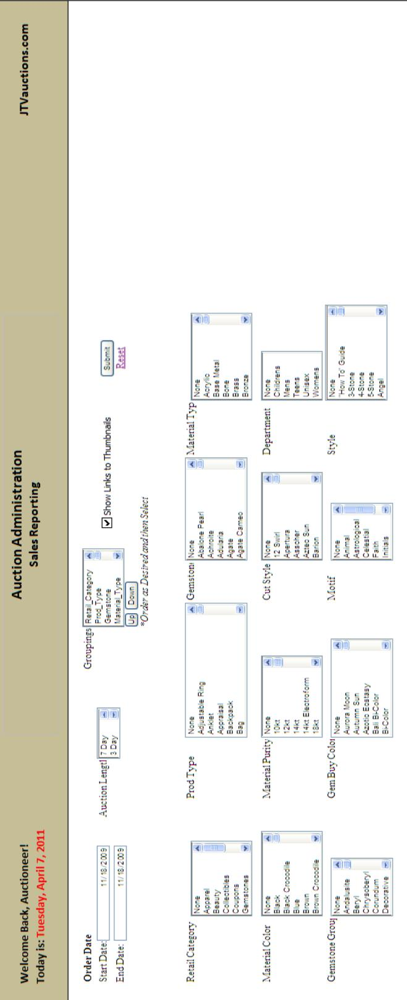

<table><tr><td rowspan=1 colspan=1>Retail Cat</td><td rowspan=1 colspan=1>GrossProduct</td><td rowspan=1 colspan=1>ReturnAmt</td><td rowspan=1 colspan=1>NetRevenue</td><td rowspan=1 colspan=1>Rev.Return %</td><td rowspan=1 colspan=1>COGS</td><td rowspan=1 colspan=1>COGReturned</td><td rowspan=1 colspan=1>NetCOGS</td><td rowspan=1 colspan=1>PRODUCTGM%</td><td rowspan=1 colspan=1>GM%JTV Def.</td><td rowspan=1 colspan=1>AvgPrice</td><td rowspan=1 colspan=1>AvgCost</td><td rowspan=1 colspan=1>UnitSold</td><td rowspan=1 colspan=1>UnitsReturne</td><td rowspan=1 colspan=1>NetUnitsR</td><td rowspan=1 colspan=1>Uniteturn %</td><td rowspan=1 colspan=1>ShipRev</td><td rowspan=1 colspan=1>CashRecovery</td></tr><tr><td rowspan=1 colspan=1>Jewelry</td><td rowspan=1 colspan=1>$626,910</td><td rowspan=1 colspan=1>$20,149</td><td rowspan=1 colspan=1>$606,761</td><td rowspan=1 colspan=1>3.2%</td><td rowspan=1 colspan=1>$561,357</td><td rowspan=1 colspan=1>$15,340</td><td rowspan=1 colspan=1>$546,017</td><td rowspan=1 colspan=1>10.5%</td><td rowspan=1 colspan=1>16.9%</td><td rowspan=1 colspan=1>$38.47</td><td rowspan=1 colspan=1>$38.47</td><td rowspan=1 colspan=1>16,294</td><td rowspan=1 colspan=1>281</td><td rowspan=1 colspan=1>16,013</td><td rowspan=1 colspan=1>1.7%</td><td rowspan=1 colspan=1>$101,620</td><td rowspan=1 colspan=1>20%</td></tr><tr><td rowspan=1 colspan=1>Gemstones</td><td rowspan=1 colspan=1>$228,399</td><td rowspan=1 colspan=1>$4,584</td><td rowspan=1 colspan=1>$223,815</td><td rowspan=1 colspan=1>2.0%</td><td rowspan=1 colspan=1>$258,005</td><td rowspan=1 colspan=1>$4,062</td><td rowspan=1 colspan=1>$253,944</td><td rowspan=1 colspan=1>-13.0%</td><td rowspan=1 colspan=1>3.7%</td><td rowspan=1 colspan=1>$18.77</td><td rowspan=1 colspan=1>$18.77</td><td rowspan=1 colspan=1>12,171</td><td rowspan=1 colspan=1>98</td><td rowspan=1 colspan=1>12,073</td><td rowspan=1 colspan=1>0.8%</td><td rowspan=1 colspan=1>$72,592</td><td rowspan=1 colspan=1>4%</td></tr><tr><td rowspan=1 colspan=1>Jeweler Supplies</td><td rowspan=1 colspan=1>$5,183</td><td rowspan=1 colspan=1>$129</td><td rowspan=1 colspan=1>$5,054</td><td rowspan=1 colspan=1>2.5%</td><td rowspan=1 colspan=1>$2,976</td><td rowspan=1 colspan=1>$99</td><td rowspan=1 colspan=1>$2,878</td><td rowspan=1 colspan=1>42.6%</td><td rowspan=1 colspan=1>45.9%</td><td rowspan=1 colspan=1>$26.72</td><td rowspan=1 colspan=1>$26.72</td><td rowspan=1 colspan=1>194</td><td rowspan=1 colspan=1>2</td><td rowspan=1 colspan=1>192</td><td rowspan=1 colspan=1>1.0%</td><td rowspan=1 colspan=1>$1,203</td><td rowspan=1 colspan=1>85%</td></tr><tr><td rowspan=1 colspan=1>Collectibles</td><td rowspan=1 colspan=1>$1,222</td><td rowspan=1 colspan=1>$80</td><td rowspan=1 colspan=1>$1,142</td><td rowspan=1 colspan=1>6.6%</td><td rowspan=1 colspan=1>$1,574</td><td rowspan=1 colspan=1>$113</td><td rowspan=1 colspan=1>$1,461</td><td rowspan=1 colspan=1>-28.8%</td><td rowspan=1 colspan=1>-17.8%</td><td rowspan=1 colspan=1>$43.64</td><td rowspan=1 colspan=1>$43.64</td><td rowspan=1 colspan=1>28</td><td rowspan=1 colspan=1>1</td><td rowspan=1 colspan=1>27</td><td rowspan=1 colspan=1>3.6%</td><td rowspan=1 colspan=1>$160</td><td rowspan=1 colspan=1>-15%</td></tr><tr><td rowspan=1 colspan=1>Other</td><td rowspan=1 colspan=1>$60</td><td rowspan=1 colspan=1>$0</td><td rowspan=1 colspan=1>$60</td><td rowspan=1 colspan=1>0.0%</td><td rowspan=1 colspan=1>$117</td><td rowspan=1 colspan=1>$0</td><td rowspan=1 colspan=1>$117</td><td rowspan=1 colspan=1>-95.0%</td><td rowspan=1 colspan=1>-30.1%</td><td rowspan=1 colspan=1>$10.00</td><td rowspan=1 colspan=1>$10.00</td><td rowspan=1 colspan=1>6</td><td rowspan=1 colspan=1>0</td><td rowspan=1 colspan=1>6</td><td rowspan=1 colspan=1>0.0%</td><td rowspan=1 colspan=1>$42</td><td rowspan=1 colspan=1>-23%</td></tr><tr><td rowspan=1 colspan=1>Totals:</td><td rowspan=1 colspan=1>$861,774</td><td rowspan=1 colspan=1>$24,942</td><td rowspan=1 colspan=1>$836,832</td><td rowspan=1 colspan=1>2.9%</td><td rowspan=1 colspan=1>$824,030</td><td rowspan=1 colspan=1>$19,613</td><td rowspan=1 colspan=1>$804,417</td><td rowspan=1 colspan=1>4.4%</td><td rowspan=1 colspan=1>13.2%</td><td rowspan=1 colspan=1>$30.03</td><td rowspan=1 colspan=1>$30.03</td><td rowspan=1 colspan=1>28,693</td><td rowspan=1 colspan=1>382</td><td rowspan=1 colspan=1>28,311</td><td rowspan=1 colspan=1>1.3%</td><td rowspan=1 colspan=1>$175,617</td><td rowspan=1 colspan=1>15%</td></tr></table>

## 9.14.8 Competition Report

The Competition report is intended to show how competitive certain auctions are, depending on the criteria chosen. For example, a high churn rate within a certain category of product over a certain period of time (could be an event) will show that it wasn’t competitive, possibly due to overscheduling. The Average Bids per Auction Won data will do the same thing, as will the New Customers and New Registrations data.

The report will include the following user-defined criteria options. The option values will be the same as, and come from, the JTV SKU Creation application:

 Start and End Date fields

 Auction Length scrolling list box

 Retail Category scrolling list box

 Product Type scrolling list box

 Gemstone scrolling list box

 Material Type scrolling list box

 Material Purity scrolling list box

 The report will group the data by user preference, via selections made in the “groupings” dropdown list. The “groupings” criteria will be alphabetized and include:

 Ring Size (or just “Size”)

 Brand

 Auction Length

 Retail Category

 Product Type

 Gemstone

 Material Type

 Material Color

 Material Purity

 Cut Style

 Department

 Gemstone Group

 Gem Buy Color

Motif

 Style

 Treatment

 Stone Shape

Link

 Setting

 Closure

 Product Line

 G/J Score

 Buyer

 Column Headers will be color-coded, so that related columns will share the same color, as shown in the mockup below.

 The report will include the following columns:

 Any columns generated by user choices from the Grouping list box

 Retail Category

 Gross Product Sales

 Total Product cost

 Product Gross Margin (negative values will appear in red)

 Average Price Point (PP)

 Total Auctions Scheduled

 Churn Rate (auctions scheduled minus auctions won, divided by auctions scheduled).

 Unique SKUs

 Unique Winners

 Total # of Bidders

Total Bids on All Won (This means Total Bids on all auctions won. It does not include bids on auctions that churned [were not won]).

 Average Bids per Auction Won

 Gross Sales per Unique Customer

 Cancelled Orders

 New Registrations

 New Customers

## 9.14.9 Competition Report Mockup

<table><tr><td rowspan=1 colspan=1>Retail Cat</td><td rowspan=1 colspan=1>GrossProductSales</td><td rowspan=1 colspan=1>TotalProductCost</td><td rowspan=1 colspan=1>ProductGrossMargin</td><td rowspan=1 colspan=1>AveragePP</td><td rowspan=1 colspan=1>TotalAuctionsScheduled</td><td rowspan=1 colspan=1>TotalAuctionsWon</td><td rowspan=1 colspan=1>ChurnRate</td><td rowspan=1 colspan=1>UniqueSKUs</td><td rowspan=1 colspan=1>UniqueWinners</td><td rowspan=1 colspan=1>Total # ofBidders</td><td rowspan=1 colspan=1>Total Bids/All Won</td><td rowspan=1 colspan=1>Avg Bids /AuctionWon</td><td rowspan=1 colspan=1>GrossSales /UniqueCustomer</td><td rowspan=1 colspan=1>CancelledOrders</td><td rowspan=1 colspan=1>NewRegistra-tions</td><td rowspan=1 colspan=1>NewCustomers</td></tr><tr><td rowspan=1 colspan=1>Collectibles</td><td rowspan=1 colspan=1>$  1,222</td><td rowspan=1 colspan=1>$   1,574</td><td rowspan=1 colspan=1>-28.8%</td><td rowspan=1 colspan=1>$43.64</td><td rowspan=1 colspan=1>28</td><td rowspan=1 colspan=1>28</td><td rowspan=1 colspan=1>8.0%</td><td rowspan=1 colspan=1>19</td><td rowspan=1 colspan=1>15</td><td rowspan=1 colspan=1>74</td><td rowspan=1 colspan=1>220</td><td rowspan=1 colspan=1>8.0</td><td rowspan=1 colspan=1>115.25</td><td rowspan=1 colspan=1>4</td><td rowspan=1 colspan=1>NA</td><td rowspan=1 colspan=1>54</td></tr><tr><td rowspan=1 colspan=1>Gemstones</td><td rowspan=1 colspan=1>$ 242,496</td><td rowspan=1 colspan=1>S 273,547</td><td rowspan=1 colspan=1>-12.8%</td><td rowspan=1 colspan=1>S18.73</td><td rowspan=1 colspan=1>14,722</td><td rowspan=1 colspan=1>12,950</td><td rowspan=1 colspan=1>5.5%</td><td rowspan=1 colspan=1>3,919</td><td rowspan=1 colspan=1>8,575</td><td rowspan=1 colspan=1>15,200</td><td rowspan=1 colspan=1>76,081</td><td rowspan=1 colspan=1>5.0</td><td rowspan=1 colspan=1>115.25</td><td rowspan=1 colspan=1>465</td><td rowspan=1 colspan=1>NA</td><td rowspan=1 colspan=1>31</td></tr><tr><td rowspan=1 colspan=1>Jeweler Supplies</td><td rowspan=1 colspan=1>s   5,552</td><td rowspan=1 colspan=1>$   3,128</td><td rowspan=1 colspan=1>43.7%</td><td rowspan=1 colspan=1>s 26.44</td><td rowspan=1 colspan=1>212</td><td rowspan=1 colspan=1>210</td><td rowspan=1 colspan=1>12.0%</td><td rowspan=1 colspan=1>63</td><td rowspan=1 colspan=1>180</td><td rowspan=1 colspan=1>305</td><td rowspan=1 colspan=1>1,582</td><td rowspan=1 colspan=1>7.0</td><td rowspan=1 colspan=1>115.25</td><td rowspan=1 colspan=1>3</td><td rowspan=1 colspan=1>NA</td><td rowspan=1 colspan=1>3</td></tr><tr><td rowspan=1 colspan=1>Jewelry</td><td rowspan=1 colspan=1>$ 663,970</td><td rowspan=1 colspan=1>$ 596,299</td><td rowspan=1 colspan=1>10.2%</td><td rowspan=1 colspan=1>$ 38.58</td><td rowspan=1 colspan=1>18,229</td><td rowspan=1 colspan=1>17,208</td><td rowspan=1 colspan=1>9.5%</td><td rowspan=1 colspan=1>5,040</td><td rowspan=1 colspan=1>8,900</td><td rowspan=1 colspan=1>19,123</td><td rowspan=1 colspan=1>159,400</td><td rowspan=1 colspan=1>9.0</td><td rowspan=1 colspan=1>115.25</td><td rowspan=1 colspan=1>655</td><td rowspan=1 colspan=1>NA</td><td rowspan=1 colspan=1>2</td></tr><tr><td rowspan=1 colspan=1>None</td><td rowspan=1 colspan=1>$     60</td><td rowspan=1 colspan=1>$    117</td><td rowspan=1 colspan=1>-95.0%</td><td rowspan=1 colspan=1>S10.00</td><td rowspan=1 colspan=1>6</td><td rowspan=1 colspan=1>6</td><td rowspan=1 colspan=1>8.0%</td><td rowspan=1 colspan=1>1</td><td rowspan=1 colspan=1>5</td><td rowspan=1 colspan=1>11</td><td rowspan=1 colspan=1>26</td><td rowspan=1 colspan=1>4.0</td><td rowspan=1 colspan=1>115.25</td><td rowspan=1 colspan=1>1</td><td rowspan=1 colspan=1>NA</td><td rowspan=1 colspan=1>0</td></tr><tr><td rowspan=1 colspan=1>Totals:</td><td rowspan=1 colspan=1>s 913,300</td><td rowspan=1 colspan=1>s 874,665</td><td rowspan=1 colspan=1>4.2%</td><td rowspan=1 colspan=1>$30.04</td><td rowspan=1 colspan=1>33,197</td><td rowspan=1 colspan=1>30,402</td><td rowspan=1 colspan=1>7.5%</td><td rowspan=1 colspan=1>9,042</td><td rowspan=1 colspan=1>15,450</td><td rowspan=1 colspan=1>29,455</td><td rowspan=1 colspan=1>237,309</td><td rowspan=1 colspan=1>7.0</td><td rowspan=1 colspan=1>115.25</td><td rowspan=1 colspan=1>1128</td><td rowspan=1 colspan=1>167</td><td rowspan=1 colspan=1>66</td></tr><tr><td rowspan=1 colspan=1></td><td rowspan=1 colspan=1></td><td rowspan=1 colspan=4></td><td rowspan=1 colspan=2></td><td rowspan=1 colspan=1></td><td rowspan=1 colspan=1></td><td rowspan=1 colspan=1></td><td rowspan=1 colspan=1></td><td rowspan=1 colspan=1></td><td rowspan=1 colspan=2></td><td rowspan=1 colspan=1></td><td rowspan=1 colspan=1></td></tr></table>

(o :l

## 9.14.10 Auctions RFM Report

RFM (Recency, Frequency, & Monetary) analysis reports are a good way to understand how the customer base is behaving, and where to focus segmentation efforts based on the identification of the best customers in aggregate. This report is not intended to be a full-fledged RFM analysis, but rather give us an idea of how the customer base is trending over time, and to tell us if they are spending more or less, purchasing more or less often, etc.

 The Recency section will be split into six tiers:

 0-30 days,

 31-60 days,

 61-90 days,

 91-180 days,

 181-365 days, and

 over 365 days.

 It will show the total number of accounts that have made a purchase transaction in each time range, as well as the revenue and orders amounts.

 Calculated fields will include revenue per account, orders per account, and % of total accounts within each tier.

 The final row should give the total for each column.

 The Monetary and Frequency sections will use the same data (columns) as the Recency section. The tiers for each will be as shown in the mockup below.

 Lastly, the user will be able to choose the timeframe for the report via a set of radio buttons, and be able to choose either: 1) a "lifetime" report (using all available sales data), or 2) limiting the report to only the past 12 months. The tiers used will be the same regardless of the timeframe chosen.

## 9.14.11 Auctions RFM Report Mockup

<table><tr><td>Welcome Back, Auctioneer! Today is: Tuesday, April 7, 2011</td><td></td><td colspan="7">Auction Administration RFM Report</td><td>JTVauctions.com</td><td></td><td></td></tr><tr><td>O Run Lifetime Report</td><td></td><td>O</td><td>Run Past 12 Months Report</td><td></td><td></td><td></td><td></td><td></td><td></td><td></td><td></td></tr><tr><td>Monetary Accounts</td><td>Revenue</td><td>Orders</td><td>Rev / Acct</td><td>Orders/ Acct</td><td>% Tot Accts</td><td>Frequency Accounts 35,418</td><td>Revenue</td><td>Orders</td><td>Rev / Acct $o</td><td>Acct</td><td>Accts</td></tr><tr><td>Under $250</td><td>7,379</td><td>418,214 11,240 901,987</td><td>$57</td><td>1.52</td><td>21.36%</td><td>0 1</td><td>10,348</td><td>$o</td><td>0</td><td>0.00</td><td>45.25%</td></tr><tr><td>$250 - 499</td><td>6,096</td><td>16,193</td><td>$148</td><td>2.66</td><td>17.65%</td><td></td><td>$2,830,755 5,973 $2,327,121</td><td>10,348 11,946</td><td>$274</td><td>1.00</td><td>24.90%</td></tr><tr><td>$500 - 749</td><td>4,253 1,054,122</td><td>15,123</td><td>$248</td><td>3.56</td><td>12.31%</td><td></td><td>$1,906,150</td><td>11,865</td><td>$390 $482</td><td>2.00</td><td>14.37%</td></tr><tr><td>$750 - 999</td><td>5,513 2,162,579</td><td>27,801</td><td>$392</td><td>5.04</td><td>15.96%</td><td></td><td>3,955 $1,662,507</td><td>11,492</td><td>$579</td><td>3.00</td><td>9.52%</td></tr><tr><td>$1000-1999</td><td>5,216 7,388,702</td><td>74,244</td><td>$1,417</td><td>14.23</td><td>15.10% 7.07%</td><td></td><td>2,873 2,181 $1,510,970</td><td>10,905</td><td></td><td>4.00</td><td>6.91%</td></tr><tr><td>$2000-2999</td><td>2,441 5,962,511</td><td>58,915</td><td>$2,443</td><td>24.14</td><td>3.94%</td><td></td><td>1,756 $1,279,386</td><td>10,536</td><td>$693</td><td>5.00</td><td>5.25%</td></tr><tr><td>$3000-3999</td><td>1,361 4,685,360</td><td>44,087</td><td>$3,443</td><td>32.39</td><td>2.21%</td><td></td><td>$1,252,998</td><td>10,010</td><td>$729</td><td>6.00</td><td>4.23% 3.44%</td></tr><tr><td>$4000-4999</td><td>762 3,389,263</td><td>30,792</td><td>$4,448 $7,861</td><td>40.41 61.18</td><td>4.39%</td><td>1,430</td><td>$1,126,196</td><td>9,680</td><td>$876 $931</td><td>7.00</td><td>2.91%</td></tr><tr><td>Over $5000</td><td>1,517 11,925,190</td><td>92,807</td><td>$1,097</td><td></td><td>100.00%</td><td>1,210</td><td>$1,021,270</td><td></td><td></td><td>8.00</td><td></td></tr><tr><td>Grand Total 34,538</td><td>37,887,928</td><td>371,202</td><td></td><td>10.75</td><td></td><td>986</td><td></td><td>8,874</td><td>$1,036</td><td>9.00</td><td>2.37%</td></tr><tr><td>Monetary = Total amount of product purchases over the lifetime of the account.</td><td></td><td></td><td></td><td></td><td></td><td>855</td><td>$965,554 $1,025,436</td><td>8,550</td><td>$1,129</td><td>10.00</td><td>2.06%</td></tr><tr><td></td><td></td><td></td><td></td><td></td><td></td><td>751 625</td><td>$843,707</td><td>8,261 7,500</td><td>$1,365</td><td>11.00</td><td>1.81%</td></tr><tr><td></td><td></td><td></td><td></td><td>% Tot Accts</td><td></td><td>567</td><td>$839,873</td><td>7,371</td><td>$1,350</td><td>12.00</td><td>1.50%</td></tr><tr><td>Recency</td><td>Accounts Revenue</td><td>Orders</td><td>Rev / Acct</td><td>Orders / Acct</td><td></td><td></td><td>$718,579</td><td></td><td>$1,481</td><td>13.00</td><td>1.36%</td></tr><tr><td>0-30</td><td>14,319 $24,865,264</td><td>249,133</td><td>$1,737</td><td>17.40</td><td>34.46% 17.96%</td><td>484 505</td><td>$822,024</td><td>6,776 7,575</td><td>$1,485</td><td>14.00</td><td>1.16%</td></tr><tr><td>31-60</td><td>7,464 $8,229,588</td><td>68,738</td><td>$1,103</td><td>9.21</td><td>15.43%</td><td>411</td><td>$647,139</td><td>6,576</td><td>$1,628 $1,575</td><td>15.00</td><td>1.22%</td></tr><tr><td>61-90</td><td>6,411 $4,803,667</td><td>46,067</td><td>$749</td><td>7.19</td><td>30.22%</td><td>355</td><td>$598,635</td><td>6,035</td><td>$1,686</td><td>16.00</td><td>0.99%</td></tr><tr><td>91-180</td><td>12,560 $4,844,572</td><td>60,768</td><td>$386</td><td>4.84</td><td>1.93%</td><td></td><td>$578,498</td><td>5,832</td><td>$1,785</td><td>17.00</td><td>0.85%</td></tr><tr><td>181-365</td><td>802 $170,796</td><td>1,648</td><td>$213</td><td>2.05</td><td></td><td>324</td><td></td><td></td><td></td><td>18.00</td><td>0.78%</td></tr><tr><td>Over 365</td><td>19,458 $6,878,778</td><td>1,648</td><td>$354</td><td>0.08</td><td></td><td>318 299</td><td>$626,570</td><td>6,042</td><td>$1,970</td><td>19.00</td><td>0.77%</td></tr><tr><td></td><td>61,014 $49,792,665</td><td>426,354</td><td>$816</td><td>6.99</td><td></td><td>351 -400</td><td>$581,067</td><td>5,980</td><td>$1,943</td><td>20.00</td><td>0.72%</td></tr><tr><td>Grand Total</td><td></td><td></td><td></td><td></td><td></td><td>401-450 451-500</td><td>254 $535,699 229</td><td>5,334 5,038</td><td>$2,109</td><td>21.00</td><td>0.61%</td></tr><tr><td>Recency = Length of time since a customer&#x27;s last purchase.</td><td></td><td></td><td></td><td></td><td></td><td>501 &amp; More</td><td>$490,733 $18,251,508</td><td>238,814</td><td>$2,143 $3,926</td><td>22.00</td><td>0.55%</td></tr><tr><td></td><td></td><td></td><td></td><td></td><td></td><td>4,649</td><td>$42,913,887</td><td>426,354</td><td></td><td>51.37</td><td>11.19%</td></tr><tr><td></td><td></td><td></td><td></td><td></td><td>Grand Total</td><td>41,556</td><td>Frequency = # of transactions on the account.</td><td></td><td>$1,033</td><td>10.26</td><td>100.00%</td></tr></table>

## 9.14.12 Customer Ranking Report

This report is intended to illustrate the behavior of the best customers within various categories, in terms of items won, revenue generated, cancel rate, return rate, and kept orders. It also distinguishes between new and long-term customers.

The user can specify the following criteria:

 Date Range (via start date and end date)

 Product Type

 Gemstone Type

 Retail Category

 Auction Duration or Event Profile (Not shown in mockup)

 The report output will include these columns:

 Customer's Member ID ("Handle")

Email Address

 New or Long-Term

 Total Items Bid On

 Total Bids Placed

 Gross Items Won

 Gross Winnings

 Average Price Point

 Cancelled Orders

 Cancel Rate (Units)

 Cancelled Order Value

 Cancel Rate (\$\$)

 Total Items Returned

 Total \$\$ Returned

 Net Kept Winnings

Net Kept Units

 Note: The email address is included so that a "special offer" mailing could be generated quickly if certain criteria are used in a query that results in customer list with a high probably conversion rate.

 This report must let the user either export to Excel or copy-and-paste to Excel, for further analysis, so the user can sort and filter, in order to identify the worst customers.

## 9.14.13 Customer Ranking Report Mockup

<table><tr><td colspan="4">Auction Administration Welcome Back, Auctioneer! Today is: Tuesday, April 7, 2011 Customer Ranking Report</td></tr><tr><td colspan="4"></td></tr><tr><td>Order Date Start Date:</td><td>11/18/2009</td><td>Prod Type None</td><td>Gemstone None</td></tr><tr><td>End Date:</td><td>11/18/2009</td><td>Adjustable Ring Anklet</td><td>3元 Abalone Pearl</td></tr><tr><td></td><td></td><td>3 Appraisal Backpack</td><td>Achroite Adularia</td></tr><tr><td colspan="2">Retail Category None</td></tr><tr><td>3 Apparel Beauty</td><td>Agate Bag V Agate Cameo Auction Lengt 7 Day 00</td></tr><tr><td>Collectibles Coupons</td><td>Submit</td></tr></table>

<table><tr><td rowspan=1 colspan=1>CustomerMember ID</td><td rowspan=1 colspan=1>Email Address</td><td rowspan=1 colspan=1>N or EItems</td><td rowspan=1 colspan=1>TotalBidOn</td><td rowspan=1 colspan=1>Total BidsPlaced</td><td rowspan=1 colspan=1>GrossItemsWon</td><td rowspan=1 colspan=1>GrossWinnings</td><td rowspan=1 colspan=1>AvgPricePoint</td><td rowspan=1 colspan=1>CancelledOrders</td><td rowspan=1 colspan=1>CancelRate(Units)</td><td rowspan=1 colspan=1>CancelledOrderValue</td><td rowspan=1 colspan=1>CancelRate($S)</td><td rowspan=1 colspan=1>TotalItemsReturned</td><td rowspan=1 colspan=1>Total$$Returned</td><td rowspan=1 colspan=1>ReturnRate(Units)</td><td rowspan=1 colspan=1>ReturnRate</td><td rowspan=1 colspan=1>NetKept</td><td rowspan=1 colspan=1>NetKeptUnits</td></tr><tr><td rowspan=1 colspan=1>FrenchLickHick</td><td rowspan=1 colspan=1>LarryBird@Celtics.com</td><td rowspan=1 colspan=1>LT</td><td rowspan=1 colspan=1>43</td><td rowspan=1 colspan=1>122</td><td rowspan=1 colspan=1>24</td><td rowspan=1 colspan=1>$684.00</td><td rowspan=1 colspan=1>$28.50</td><td rowspan=1 colspan=1></td><td rowspan=1 colspan=1>4%</td><td rowspan=1 colspan=1>$ 22</td><td rowspan=1 colspan=1>77%</td><td rowspan=1 colspan=1>4</td><td rowspan=1 colspan=1>$78.00</td><td rowspan=1 colspan=1>17%</td><td rowspan=1 colspan=1>11%</td><td rowspan=1 colspan=1>$606.00</td><td rowspan=1 colspan=1>$28.33</td></tr><tr><td rowspan=1 colspan=1>MagicMan</td><td rowspan=1 colspan=1>MagicJohnson@Lakers.com</td><td rowspan=1 colspan=1>LT</td><td rowspan=1 colspan=1>52</td><td rowspan=1 colspan=1>131</td><td rowspan=1 colspan=1>31</td><td rowspan=1 colspan=1>$961.00</td><td rowspan=1 colspan=1>$31.00</td><td rowspan=1 colspan=1>2</td><td rowspan=1 colspan=1>6%</td><td rowspan=1 colspan=1>$  34</td><td rowspan=1 colspan=1>110%</td><td rowspan=1 colspan=1>5</td><td rowspan=1 colspan=1>$149.00</td><td rowspan=1 colspan=1>16%</td><td rowspan=1 colspan=1>16%</td><td rowspan=1 colspan=1>$812.00</td><td rowspan=1 colspan=1>$30.84</td></tr><tr><td rowspan=1 colspan=1>The Doctor</td><td rowspan=1 colspan=1>DrJ@Sixers.com</td><td rowspan=1 colspan=1>NEW</td><td rowspan=1 colspan=1>24</td><td rowspan=1 colspan=1>122</td><td rowspan=1 colspan=1>24</td><td rowspan=1 colspan=1>$468.00</td><td rowspan=1 colspan=1>$19.50</td><td rowspan=1 colspan=1></td><td rowspan=1 colspan=1>0%</td><td rowspan=1 colspan=1>$</td><td rowspan=1 colspan=1>0%</td><td rowspan=1 colspan=1></td><td rowspan=1 colspan=1>$122.00</td><td rowspan=1 colspan=1>17%</td><td rowspan=1 colspan=1>26%</td><td rowspan=1 colspan=1>$346.00</td><td rowspan=1 colspan=1>$19.33</td></tr><tr><td rowspan=1 colspan=1>Mr Defense</td><td rowspan=1 colspan=1>Sid.Moncrief@Bucks.com</td><td rowspan=1 colspan=1>LT</td><td rowspan=1 colspan=1>167</td><td rowspan=1 colspan=1>131</td><td rowspan=1 colspan=1>31</td><td rowspan=1 colspan=1>$1,464.75</td><td rowspan=1 colspan=1>$47.25</td><td rowspan=1 colspan=1>2</td><td rowspan=1 colspan=1>6%</td><td rowspan=1 colspan=1>$  65</td><td rowspan=1 colspan=1>138%</td><td rowspan=1 colspan=1></td><td rowspan=1 colspan=1>$874.00</td><td rowspan=1 colspan=1>16%</td><td rowspan=1 colspan=1>60%</td><td rowspan=1 colspan=1>$590.75</td><td rowspan=1 colspan=1>$47.09</td></tr><tr><td rowspan=1 colspan=1>Nique</td><td rowspan=1 colspan=1>Dominique@Hawks.com</td><td rowspan=1 colspan=1>LT</td><td rowspan=1 colspan=1>121</td><td rowspan=1 colspan=1>131</td><td rowspan=1 colspan=1>31</td><td rowspan=1 colspan=1>$2,123.50</td><td rowspan=1 colspan=1>$68.50</td><td rowspan=1 colspan=1>44</td><td rowspan=1 colspan=1>142%</td><td rowspan=1 colspan=1>S1,440</td><td rowspan=1 colspan=1>2102%</td><td rowspan=1 colspan=1>5</td><td rowspan=1 colspan=1>$75.00</td><td rowspan=1 colspan=1>16%</td><td rowspan=1 colspan=1>4%</td><td rowspan=1 colspan=1>$2,048.50</td><td rowspan=1 colspan=1>$68.34</td></tr><tr><td rowspan=1 colspan=1>Skywalker</td><td rowspan=1 colspan=1>Skywalker@Nuggets.com</td><td rowspan=1 colspan=1>LT</td><td rowspan=1 colspan=1>183</td><td rowspan=1 colspan=1>131</td><td rowspan=1 colspan=1>31</td><td rowspan=1 colspan=1>$1,061.75</td><td rowspan=1 colspan=1>$34.25</td><td rowspan=1 colspan=1>3</td><td rowspan=1 colspan=1>10%</td><td rowspan=1 colspan=1>$ 26</td><td rowspan=1 colspan=1>76%</td><td rowspan=1 colspan=1>5</td><td rowspan=1 colspan=1>$125.00</td><td rowspan=1 colspan=1>16%</td><td rowspan=1 colspan=1>12%</td><td rowspan=1 colspan=1>$936.75</td><td rowspan=1 colspan=1>$34.09</td></tr><tr><td rowspan=1 colspan=1>Rocketman</td><td rowspan=1 colspan=1>H.Olajawon@Rockets.com</td><td rowspan=1 colspan=1>LT</td><td rowspan=1 colspan=1>196</td><td rowspan=1 colspan=1>131</td><td rowspan=1 colspan=1>31</td><td rowspan=1 colspan=1>$883.50</td><td rowspan=1 colspan=1>$28.50</td><td rowspan=1 colspan=1>3</td><td rowspan=1 colspan=1>10%</td><td rowspan=1 colspan=1>$  30</td><td rowspan=1 colspan=1>105%</td><td rowspan=1 colspan=1>5</td><td rowspan=1 colspan=1>$98.00</td><td rowspan=1 colspan=1>16%</td><td rowspan=1 colspan=1>11%</td><td rowspan=1 colspan=1>$785.50</td><td rowspan=1 colspan=1>$28.34</td></tr><tr><td rowspan=1 colspan=1>RoundMound</td><td rowspan=1 colspan=1>C.Barkley@Suns.com</td><td rowspan=1 colspan=1>LT</td><td rowspan=1 colspan=1>77</td><td rowspan=1 colspan=1>122</td><td rowspan=1 colspan=1>24</td><td rowspan=1 colspan=1>$642.00</td><td rowspan=1 colspan=1>$26.75</td><td rowspan=1 colspan=1>2</td><td rowspan=1 colspan=1>8%</td><td rowspan=1 colspan=1>$ 44</td><td rowspan=1 colspan=1>164%</td><td rowspan=1 colspan=1>4</td><td rowspan=1 colspan=1>$39.00</td><td rowspan=1 colspan=1>17%</td><td rowspan=1 colspan=1>6%</td><td rowspan=1 colspan=1>$603.00</td><td rowspan=1 colspan=1>$26.58</td></tr><tr><td rowspan=1 colspan=18></td></tr></table>

## 9.14.14 Inventory Performance & Aging Report

This report will be the main report used by various people throughout the company, for various reasons, to gain visibility into currently available auction inventory. This report will include product that is NOT part of available auction inventory.

 The criteria section will include:

 a “search for auction items” search box, which will provide wildcard (% or \*) capability.

 Radio button options to choose between “Items currently online only”, and “All sellable auction inventory”. These buttons will not impact the results of the “Red status” columns.

 Radio buttons to enable choosing between “Showing items with or without images” and “Showing items with or without a valid (sellable) location.”

 A Group By scrolling list box, which includes the following grouping options:

 Retail Category

 Product Type

 Gemstone

 Material

 Material Purity

 Product Group

 Brand

 Inventory Realm (Red, White,)

 Inventory Aging Bucket

 J/G Score

 Ring Size

##  The “Results” section will include the following columns:

 Any columns generated by user choices from the Grouping list box

 Product ID

 Active Date

 Last Shown Date

 Qty on Open Purchase Order (P.O.)

 Last Receipt Date

 Buyer Name

 Item Description

 Retail Category

 Gemstone

 Product Type

Brand

 J/G Score

GM/FTE

 Cost

 Has Image (Yes or No)

 Location (need to discuss; not sure if this is needed).

 Available (Total Company Inventory On Hand)

Auction Available (Auction Available AND Auction Eligible, with images, in sellable locations, not on any hold status)

 White Total Qty

 White Total Cost

 Red Unsellable Total Quantity

 Red Unsellable Total Cost

 Red Sellable Total Quantity

 Red Sellable Total Cost

 The “Results” section will include a “Summary Section” below the Results. It will summarize, based on the user’s chosen criteria, the following:

 SKU Count

 SKUs Missing Images

 SKUs with No/Unsellable Locations

 Auction Available Piece Count

 Auction Available Extended Cost

 Auction Available Average Unit Cost

 Auction Available MAXIMUM Unit Cost (highest single unit cost).

## 9.14.15 Inventory Performance & Aging Report Mockup

<table><tr><td colspan="10">Welcome Back, Auctioneer! Today is: Tuesday, April 7, 2011 Auction Administration</td></tr><tr><td colspan="2">Search for Auction Items: O Search</td><td colspan="2">Items Currently Online Only All Sellable Auction Inventory O</td><td colspan="2">Auction Inventory Report Group By: Show Items without Image Show Items with Image Show Items with No Location Show Items with Location</td><td colspan="5">Retail_Category Prod_Type Gemstone Material_Type Up Down Buyer *Order as Desired and then Select</td><td colspan="2">Groupings: Retail_Category, Product_Type, Gemstone, Material, Material_Purity, Product Group, Brand, Inventory Realm,</td><td></td></tr><tr><td>Retail Category BEAUTY COLLECTIBLES GEMSTONES</td><td colspan="2">Search for auction inventory using these drop-down lists: Gemstone AGATE</td><td>Product Type Brand ANKLET BEAD SET</td><td>Material Type ^ ACCUTRON ACTIVA</td><td>Material Purity 3O ADEE KAYE</td><td>None Aorylic Base Metal Bone Brass</td><td>40</td><td>None 10kt 12 14kà 14kt Electroform</td><td>3O Maples Wrye Boyle</td><td>Rothchild</td><td>J/G Score Status. Ring Size RO</td><td>Inventory Aging Bucket,</td><td></td><td></td></tr><tr><td>JEWELER SUPPLIES JEWELRY R</td><td colspan="2">AKOYA PEARL ALEXANDRITE ALMANDITE AMAZONITE AMBER AMBLYGONITE AMETHYST</td><td>BEAD STRAND BEAD STRAND SET BEAUTY KIT BRACELET BRACELET SET CARVED ANIMAL CHAIN</td><td>AKRIBOS ANDRE GIROUD AVIATOR AVIER M</td><td>ALTAI AQUAMARINE BAREHIPANI TOPAZ M</td><td>Bronze J/G Scores</td><td>国</td><td>18kt</td><td>R O&#x27;Sullivan Submit Reset</td><td></td><td></td><td></td><td></td><td></td></tr><tr><td></td><td colspan="2">AMETRINE Last Show Date Open PO</td><td>CHAIN SET</td><td>BELLA LUCE Retail Category</td><td colspan="2"></td><td>GM/FTE Cost</td><td colspan="2">Has Image S207-177</td><td>Auction Available</td><td>WHITE WHITE Total QTY</td><td>Red Red Unsell</td><td></td><td>Red Sellable</td></tr><tr><td>ACTCT00993</td><td>Date 10/5/09</td><td colspan="2">Date 10/30/09 100 10/5/09</td><td>10k 4.02ctw Pc/Tr/Rd Emerald/.08ctw Rd Jewelry</td><td>stone Type Emerald Ring None Emerald</td><td>J-2</td><td>1.50 $161.00</td><td></td><td>0</td><td></td><td>Total Cost</td><td></td><td>Unsell Sellable</td><td></td></tr><tr><td>ACTCT01054</td><td>10/8/09</td><td>11/2/09 0 10/8/09 11/3/09</td><td>Rothchild Boyle</td><td>10k Wg 2.43ctw Pc/Rd Emerald Ring Size 7 Jewelry</td><td>Ring None</td><td>1-0 1.50 1.50</td><td>S100.44 $62.00</td><td>S207-226 S207-226</td><td>o</td><td></td><td></td><td></td><td>1</td><td></td></tr><tr><td>ACTCT01063 MMC044E-8</td><td>10/9/09 3/3/09</td><td>10/9/09 0 3/28/09 3/3/09</td><td>Williams O&#x27;Sullivan</td><td>10k.90ctw Ov Emerald/.15ctw Rd Diamond Jewelry Emerald Jewelry</td><td>Ring None Emerald Ring None</td><td>10 J-NoHist 1.50</td><td>1.50 $94.00 $100.44</td><td>S201-233 S207-226</td><td>0 0 0</td><td></td><td></td><td>1</td><td></td><td></td></tr><tr><td>ACTCT01054 ACTCT01063</td><td>10/8/09 10/9/09</td><td>11/2/09 75 10/8/09 11/3/09 150 10/9/09</td><td>Boyle Williams</td><td>10k Wg 2.43ctw Pc/Rd Emerald Ring Size 7 Jewelry Emerald 10k.90ctw Ov Emerald/.15ctw Rd Diamond Jewelry Emerald</td><td>Ring None Emerald Ring None Ring None</td><td>J-2 J-0</td><td>1.50 $62.00 1.50 $94.00</td><td>S207-226 S201-233</td><td>0 0</td><td></td><td></td><td></td><td>1</td><td></td></tr><tr><td>MMC044E-8 ACTCT00993</td><td>3/3/09 10/5/09</td><td>3/28/09 0 3/3/09 10/30/09 0 10/5/09</td><td>O&#x27;Sullivan Rothchild Boyle</td><td>10k 2.40ctw Ps/Mq Emerald/Dia Acc Jewelry 10k 4.02ctw Pc/Tr/Rd Emerald/.08ctw Rd Jewelry 10k Wg 2.43ctw Pc/Rd Emerald Ring Size 7 Jewelry</td><td>Emerald Ring None Emerald Ring None</td><td>J-1 J-NoHist</td><td>1.50 $161.00 1.50 $100.44</td><td>S207-177 S207-226</td><td>0 0</td><td></td><td></td><td>1</td><td>1</td><td></td></tr><tr><td>ACTCT01054</td><td>10/8/09</td><td>11/2/09 75 10/8/09</td><td></td><td>Note: Define the &quot;Available&quot;Column in a text statement here. Is this just the Auction Eligible flag set to Yes, or something else?Is it nowonly White realm product that&#x27;s NOT in Auction Available?Or doesn&#x27;t have the auction eligible flag set??</td><td></td><td></td><td></td><td></td><td></td><td></td><td></td><td></td><td>1</td><td></td></tr><tr><td colspan="11">Note &quot;SKU Count&quot; in the summary pulls from..</td></tr></table>

## 9.14.16 Analytics

The site will utilize both Omniture and Google Analytics. Reports will be available in JTV’s current Omniture interface. Minimum reporting will include: Site traffic, customer frequency, sales/conversions, marketing promotions, entry/exit pathing. The (external) Omniture link will be available on the Reports menu.

## 9.15 Personnel Roles

## 9.15.1 Site Designer

Controls site templates, modules, promotional elements, navigation, search, style sheets.   
Loads promo graphics to the CMS. He or she makes the site look and function like it should.

## 9.15.2 Auction Merchandiser / Scheduler ("Auctioneer")

 Acts as the primary site Administrator and is generally responsible for day-to-day operations.

 Controls site settings and grants user credentials (“permissions”).

 Only Auctioneer(s) can end an auction early or delete an auction.

 Monitors and reports on auction inventory.

 Schedules all auctions. The Auctioneer should have ability to schedule varying (odd) end times (giving bidders a chance to manually view various auctions, serially, and manually place single bids). (In future phases: In the case of multiple sites or multiple storefronts, the Auctioneer should be able to control schedules on all sites/storefronts from a single user interface.)

 Schedules all promotional elements through the Auction CMS.

 Updates Auction Schedule page through CMS.

 Responds to Customer Care issues.

 Reports site problems to helpdesk or software engineering.

 Manages the site's global settings, including Bid Extend (“Overtime bidding”) functionality, shipping promos, etc.

## 9.15.3 Customer Service Representatives

 Handles customer complaints / concerns. Can access and edit customer information, remove bids (in emergency circumstances only), research bidding issues, etc.

 Can NOT place bids for customers.

 Edit customer accounts and enter account notes.

 Customer Service will also need a special email account: customerservice@jtvauctions.com.

 Suspend customers: Customer Care reps should be able to place auction customers in a “Review” status at the customer’s request or upon evidence of fraudulent or other undesirable activity. A Customer Care manager will be required to approve, via code, a permanent suspension of bidding rights (“Deactivate an Account”).

 The system will not allow any new account to be created if the email address being used exists on an email blacklist (which must be created).

## 9.16 Test Accounts

Test Accounts will be created for the following personnel. There may be multiple accounts created if there are multiple people in each role. These accounts should have dummy account holder data and dummy credit card numbers. They will allow testers to bid. "Handles" will be generic and transparent, so real participants can clearly see who is bidding. For example: "JTV Tester1". These accounts must be mentioned in our Terms of Use (giving us the right to participate as a means of testing the site.)

 Auctioneer (May be multiple Auctioneers)

 Customer Service (May be multiple Customer Service Reps who deal with auctions).

 Help Desk (May be multiple Help Desk personnel)

 Software Engineering.

## 10 Checkout Process

## 10.1 Payment Methods

The site will accept credit cards (Visa, MC, American Express, and Discover), PayPal, and Amazon Payments.

## 10.2 Processing Orders

## 10.2.1 Auction Order Processing

 When an auction ends, the system will check the winner’s payment method type in their registration data, and proceed according to payment method.

## 10.2.2 Processing Credit Cards

 Users who store their credit card information will have an automated checkout process. Upon winning an auction, the system will automatically process the order and send the winner an order confirmation email.

## 10.2.3 Processing Alternative Payment Methods (APMs)

 Users with PayPal or Amazon Payments as their default payment method in their registration information will experience a different checkout process.

 Upon winning an auction, these users will receive a “Congratulations Winner!” email. This email will instruct them to sign in and provide their payment information.

 Customers who have PayPal or Amazon Payments as their default Method of Payment (MOP) and who have unpaid auction winnings, will see a “Winnings Alert” in place of the normal promotional text bar. This text bar should be highly visible.

 Customers will be identified and served the text bar either via a cookie, or via the “pay now” link in the winner notification email from Responsys, or because they signed in.

 Payment must be made within seven days (168 hours) of the auction’s closing date/time. The email will include a notification that users who fail to complete transactions may have their accounts suspended.

 Orders not paid for with Amazon or PayPal (with 168 hours of being won) will be cancelled, and the item placed into a “Hold” status. These cancelled orders will count as churned auctions in the reporting.

 When the user clicks on the “Winnings Alert” link, they will be taken to the “Returning Winners Payments” page. See the mockup below. A link to this page will also be provided on various other pages, including the My Account page, My Watch List, My Current Bids, My Bid History, and the Safe Shopping Guarantee page.

 The “Returning Winners Payments” page will include the following elements and actions:

• A personalized Welcome Back Winner! Message.

• A text paragraph stating the following:

“Congratulations! You've won XX items for a total of \$XXX.XX. We've included a list of these items below. You are seeing this message because you have chosen either PayPal or Amazon Payments as your default method of payment. Please complete your transaction(s) by choosing which items you want to pay for right now, then a shipping method, and finally a payment type. As always, thank you for participating at JTVauctions.com!

A listing of items won but not yet paid for. It includes: Item #, Description, Auction Number, Amount owed, the auction ending time, and a “Pay Now” checkbox. The formatting of this list should be the same as that in the “My Bid History” page.

A shipping options section with radio buttons to choose the shipping method, and simple text explaining the options below.

The final section is the Checkout Options section. This section consists of three logo buttons, with a radio button next to each.

Clicking on the PayPal logo or radio button immediately takes the user to the PayPal checkout process. The next page the user sees is a PayPal-hosted page, shown below in 9.2.7.

Clicking on the Amazon Payments logo or radio button immediately loads the Amazon Payments checkout widget on the page, without leaving the page. The page remains in the background, but grayed out, and all other links are disabled. The rest of the process is per the Amazon integration guidelines documentation. See the mockup below.

Clicking on the “Checkout Later” button or radio button immediately grays out the page and disables all links. A DIV layer appears, the following specific text:

“No Problem! You can come back to pay anytime within 7 days (exactly 168 hours) after winning your auction(s). Please remember though, any unpaid orders will be cancelled after the payment window expires. Lastly, please remember, to be fair to all ofour auction participants, that bidding incurs an obligation on your part to pay when you win, per the Terms of Use Agreement.”

This DIV will also include two buttons: a “Return to Payments” link (which closes the DIV and re-enables the page links), and a “JTVauctions Homepage” link, which takes the user to the home page.

• This page does NOT include the global header or global footer.

 Upon completing the Amazon or PayPal checkout process, the user will be returned to a Thank You page, which uses the global header and footer, and a prominent link to the JTVauctions.com home page.

## 10.2.4 Returning Winners Payments Page mockup.

## Welcome Back Joanne! You're A Winner!

Congratulations! You've won XX items for a total of \$XXX.XX. We've included a list of these items below. You are seeing this message because you have chosen either PayPal or Amazon Payments as your default method of payment, Please complete vour transaction(s) now by choosing which items you want to pay for right now, then a shipping method, and finally a payment type. As always, thank you for participating at JTVauctions.com!

## First, choose the items you want to pay for now:

<table><tr><td>Item #</td><td>Description</td><td>Auction Number</td><td>Winning Amount</td><td>Ending Time</td><td>Pay Now</td></tr><tr><td>ABC123</td><td>.65ct ss tanz earrings</td><td>2624367</td><td>$24</td><td>9/25/09 9:00 PM</td><td>☑</td></tr><tr><td>123XYZ</td><td>1.45ct oval sapphire</td><td>2625987</td><td>$65</td><td>9/25/09 9:00 PM</td><td>V</td></tr><tr><td>CYA666</td><td>2.5ct ruby 14k wg pendant</td><td>2624945</td><td>$140</td><td>9/25/09 9:00 PM</td><td>口</td></tr><tr><td>LMM123</td><td>1.5ct ss tanz earrings</td><td>2625844</td><td>$24</td><td>9/25/09 9:00 PM</td><td>□</td></tr><tr><td>ABC123</td><td>.65ct ss tanz earrings</td><td>2626133</td><td>$24</td><td>9/25/09 9:00 PM</td><td>☑</td></tr></table>

## Second, choose a shipping speed:

USPS Standard, \$6.99

Expedited (5-day, add \$5.00)

## Finally, choose a checkout option:

Checkout PayPal

The safer, easier way to pay

Checkout Later

Standard : All packages shipped via USPS. Arrives within 14 business days. Expedited : Packages are shipped via an expedited carrier atadditional cost of \$5.00, totaling \$11.99 for U.S. deliveries. Arrives within five business davs. Note: Expedited

## 10.2.5 Returning Winners Payments Page mockup, with Amazon widget.

## Welcome Back Joanne! You're A Winner!

Rick Wingender

<table><tr><td>Item #</td><td>Description</td><td>Auctio Numb</td></tr><tr><td>ABC123</td><td>.65ct ss tanz earrings</td><td>262436</td></tr><tr><td>123XYZ</td><td>1.45ct oval sapphire</td><td>262598</td></tr><tr><td>CYA666</td><td>2.5ct ruby 14k wg pendant</td><td>262494</td></tr><tr><td>LMM123</td><td>1.5ct ss tanz earrings</td><td>262584</td></tr><tr><td>ABC123</td><td>.65ct ss tanz earrings</td><td>262613</td></tr></table>

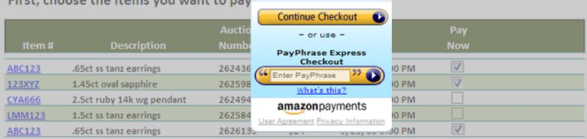

<table><tr><td rowspan=1 colspan=1>PayNow</td></tr><tr><td rowspan=1 colspan=1>10 PM    V</td></tr><tr><td rowspan=1 colspan=1>10 PM    V</td></tr><tr><td rowspan=1 colspan=1>10 PM     □</td></tr><tr><td rowspan=1 colspan=1>10 PM     □</td></tr><tr><td rowspan=1 colspan=1>JO PM     V</td></tr></table>

## Second, choose a shipping speed:

Finally, choose a checkout option:

Checkout Later

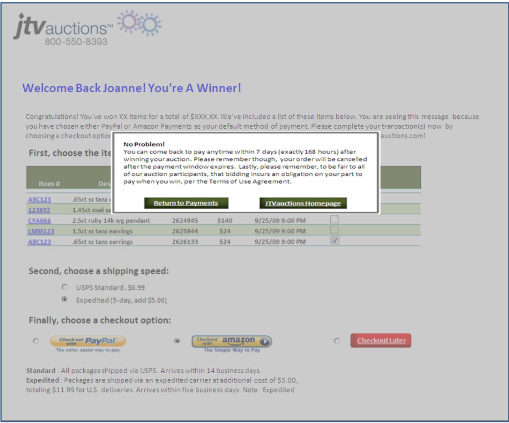

## 10.2.6 Returning Winners Payments Page mockup, with No Problem DIV.

## 10.2.7 The PayPal-hosted payments page is shown below, for reference only

## jewelrytelevision

Learn more about PayPal - the safer, easier way to pay.

Create a PayPal account

Country

United States

Payment method

Bill Me Later®, now from PayPal

New! Buy now, pay later.

Subject to credit approval. Learn More Credit Card

Credit Card Number

Payment Types

VISA

Expiration Date

CSC What is this?

First Name

Last Name

Address Line 1

Address Line 2 (optional)

ZIP Code

PayPal Secure Payments

Already have a PayPal account?

Please log in

Email

Password

Log In

Forgot email address or password?

## 10.2.8 Non-Payment Procedure and Locked Accounts

Customers / Bidders who have unresolved (i.e., unpaid) auction winnings greater than 7 days old will not be allowed to bid. The system will automatically lock accounts when a PayPal or Amazon Payments customer allows their order(s) to expire, thus putting the account into a "Review Status." These "Review Status" accounts can only be "unlocked" by a customer service representative. Customers cannot unlock the account themselves by paying for the orders, because the orders are automatically cancelled after 7 days (168 hours), so that this product may be returned to the inventory pool and re-auctioned.

Customers who have had orders cancelled can have Customer Service Reps unlock their accounts if they haven't paid up to three times. When these customers contact the call center, they will simply be reminded that winning incurs an obligation to pay.

## 10.2.9 Escalation Policy for Review Status Accounts

When an auction participant becomes subject to the escalation policy, they cannot bid again until a Customer Service Rep removes the account from Review Status. The only way for a customer to have their account removed from Review Status is by updating their account with a credit card. They may not use PayPal or Amazon Payments again until their order cancel rate falls below 10%.

Amazon Payments and PayPal customers who have a history of non-payment (whose auction orders are automatically cancelled after 7 days) will be subjected to an escalation process.

These customers will be subject to the escalation policy if they fail to pay for auction winnings more than three times in a twelve-month period, unless three times is less than 10% of their total winnings.

 Example #1: Customer A wins 11 auctions in a twelve-month period. She doesn't respond to the "winner notification" emails requesting payment, and three orders go unpaid. If item number 12 goes unpaid, for a total of four unpaid orders, this customer will become subject to the escalation policy.

 Example #2: Customer B wins 55 auctions in a twelve month period. She doesn't respond to the "winner notification" emails requesting payment, and five orders go unpaid (9%). This will not result in the escalation policy being applied at this point; however, each time the seven day period passes and a order is cancelled, a Customer Service Rep will still need to remove the account from Review Status. If the customer wins and doesn't pay for a 56th auction, resulting in six unpaid orders, it would put this customer at 10.7%, and this customer is now subject to the escalation policy.

## 11 2nd-Chance Auctions

## 11.1 Purpose

 To give JTVauctions.com a competitive advantage over Bidz.com, Overstock Auctions, uBid.com, and other similar sites by improving the customer experience through greater relationship building and value-creation for the customer;

 To improve our inventory turns by selling churned product much faster, reducing the need to reschedule cancelled orders.

## 11.2 Process

 When auction participants who have PayPal or Amazon Payments set as their default Method of Payment, they are required to pay for their winnings within 7 days (168 hours) of the auction ending time. When they do not, those orders will be cancelled and the item placed into a “hold” status.

 When these orders are cancelled, it will trigger an automated email, which will go to the second-place finisher, if there is one. This email will offer to sell the item to the 2nd-place finisher at their last bid price. It will give the email recipient three options:

## 1) Credit Card Option

o The user will be given three days from the time the email is sent to accept the offer.

o The email recipient clicks on a “I accept, pay with my On File credit card” button

This action triggers an automated process to generate an order and ship the item.

o No further action by the customer will be needed.

## 2) PayPal or Amazon Payments Option

o The user will be given three days from the time the email is sent to accept the offer.

o The email recipient clicks on a “Pay with PayPal or Amazon Payments” button.

o Clicking this button will generate the order, and load the Sign-In page.

o After signing in, the user will be taken to the Returning Winners Payments Page where they can pay for the order.

3) Decline Option. This would be a “No Thanks” button. Clicking on this button wil release the item from a hold status back into auction available inventory.

 If the customer does not respond to the $2 ^ { \mathsf { n d } } -$ Chance email within 72 hours after the email is sent, the item will be returned to auction available inventory and rescheduled for a future auction.

 The email will not be sent if the $2 ^ { \mathsf { n d } } .$ -place finisher’s bid is below the item’s unit cost.

## 11.3 Fraud Prevention Measure

 $2 ^ { \mathsf { n d } } .$ -Chance emails will not be sent to recipients who have two accounts and are essentially bidding against themselves.

 Before sending the email, the system should compare the $2 ^ { \mathsf { n d } } .$ -Chance recipient’s account data to the Winner’s account data.

 The email will not be sent if matches are found on any of: Customer Name, Customer Phone Number, Customer Email Address, Customer Member ID, or Customer Billing and/or Shipping Addresses.

## 11.4 Reporting

Auction Admin will have a $^ { \mathfrak { a } } 2 ^ { \mathsf { n d } } .$ -Chance Report.” This report will show:

 the number of $2 ^ { \mathsf { n d } } .$ -Chance emails sent over the past week,

 the number of acceptances,

 the number of actual payments made, and

 the revenue generated from each.

 It will show the total revenue, total COGS, and gross margin percentage.

## 12 Auction Processing

 Anytime an auction ends in a tie, the winner is the person who placed the winning bid amount FIRST.

 All bids must be recorded to 1/100th of a second.

 Orders generated and passed to JTV's order pipeline. (To where exactly? DML? OMS?)

 How often will orders be processed off the site into the OPL?

 What data will be passed?

 Orders should be accumulated for each customer and submitted into the OPL once per day, to facilitate combined product shipments. This requirement is based on the assumption that JTV's multiline order capability will be functional.

 Orders won with credit card as the MOP should charge that credit card as soon as the auction is over, before being accumulated into the combined order. This is to prevent accumulated orders from being completely cancelled in the event of a non-authorized transaction.

 Orders won with an alternative payment method, i.e. PayPal or Amazon Payments, will be placed in a Hold status until payment is received. When an auction is won, the customer will be sent an email, requiring payment. If payment is not received within 168 hours, the item order will be cancelled.

## 13 Supporting Database

The auction platform will require a supporting database, separate from the enterprise. This database will include tables for:

 Current Inventory

 Current Bidding Data

 Historical Bidding Data

 Orders

 Customer Data

This requirement is necessary because no current tables (specifically the orders tables) combine orders and bidding data, upon which the reporting requirements depend.

Secondly, this requirement supports the concept of potentially selling this platform to other large retailers.

## 14 Shipping / Logistics

## 14.1 Simultaneous (combined) shipping

All items won by a single bidder in one calendar day should be accumulated into a single order before submission to JTV's Order Management System so they can be shipped out together. This is a critical must-have platform capability. This requirement assumes that JTV's multiline capability will be functional.

## 14.2 Invoices

All auction items should ship with invoices/packing slips that are clearly distinct from other JTV products (different colored paper, different logo, different return policy printed on invoice).

Different / distinctive invoices will be required for each JTV auction site and/or storefront.

## 14.3 Auctioneer Capabilities

The Auctioneer will have significant capabilities in the area of shipping configuration from within the Auction Admin Global Settings page. See that section for details. Briefly, these capabilities will include the following.

## 14.3.1 Preferred Customer Free Shipping flag

There will be a Preferred Customer Free Shipping flag for customers (bidders/winners) with over \$1000 (for example). These customers will get free shipping for the remainder of the calendar year.

## 14.3.2 Shipping Charges

 Shipping charge on initial item (won in the calendar day).

 Shipping charge on subsequent items won in the same calendar day.

 Shipping promotions, scheduled with a price and start/end date/time.

## 14.4 International shipping requirements (Phase 2 Enhancement)

The platform needs to be able to handle international shipping, etc (UK, Canada minimum) and foreign addresses.

## 15 Known / Unresolved Issues and To-do List

 To-Do: Review Jupiter customer information screens.

 To-Do: Update Auto-Scheduler capability.

 To-Do:

 To-Do: Review Draft w/call center (Lisa McClendon, Robin Smith)

 To-Do: Update Site Diagram.

 To-Do: Need mockup for “I forgot my PW/ID”.

 To-Do: Update Auction SWOT Analysis

 To-Do: Review Draft with Software Engineering, David Sink.

 Discuss: What other information is needed for an RFP? (Request For Proposal)

 Discuss: What are the minimum CMA Requirements? Would we create our own, incorporate the existing Auction CMA (not enthusiastic about this idea), or plug in a different CMA? Can the CMA be a part of Auction Admin?

 Discuss: The possibility of creating this auction platform, and then selling it to other large-scale retailers, has been discussed.

 Discuss: The system will require an underlying database with tables for customers, bid & order history.

 Discuss: How often will orders be processed off the site into the OPL? Meet with Carey to review Auction Processor section requirements.

 SEO plan review

 Discuss: Do we need to build in any taxable/non-taxable functionality?

 Discuss: Inventory Import - How will this be done? What would the data steward's role be?

 Discuss: Do we need to discuss any special considerations for inventory that is brought into this system with odd costs? (for example, \$14,2654)

 Discuss: Need to discuss security requirements. Site should be PCI compliant and should use SSL Server Certificate. Account information pages especially need to be secure.

 Discuss: Do we need to consider how many concurrent participants might be on the site at any given time? How many visitors have we been getting per day? Peak?

 Discuss: In a new platform with isolated inventory, should we keep the JTV SKUs, or generate new SKUs?

 Discuss: How should Customer Care supervisor account deactivation codes be generated in Auction Admin?

 Discuss: Should we add "auction event IDs"? This would enable us to report on specific "events".

 Discuss: How will store credit availability impact this platform? Could available store credit be chosen as a Default MOP? Can it be made available from the “Returning Winners Payments” page?

## 

## 16 Initial Product Backlog items (Initial Estimate of Requirements)

<table><tr><td rowspan=1 colspan=1>Title Import</td><td rowspan=1 colspan=1>Initial Estimate</td><td rowspan=1 colspan=1>Adjustment Factor</td><td rowspan=1 colspan=1>Adjusted Estimate</td><td rowspan=1 colspan=1>1</td><td rowspan=1 colspan=1>2</td><td rowspan=1 colspan=1>3</td><td rowspan=1 colspan=1>4</td><td rowspan=1 colspan=1>5</td><td rowspan=1 colspan=1>6</td></tr><tr><td rowspan=1 colspan=1></td><td rowspan=1 colspan=1></td><td rowspan=1 colspan=1></td><td rowspan=1 colspan=1></td><td rowspan=1 colspan=1></td><td rowspan=1 colspan=1></td><td rowspan=1 colspan=1></td><td rowspan=1 colspan=1></td><td rowspan=1 colspan=1></td><td rowspan=1 colspan=1></td></tr><tr><td rowspan=1 colspan=1></td><td rowspan=1 colspan=1></td><td rowspan=1 colspan=1></td><td rowspan=1 colspan=1></td><td rowspan=1 colspan=1></td><td rowspan=1 colspan=1></td><td rowspan=1 colspan=1></td><td rowspan=1 colspan=1></td><td rowspan=1 colspan=1></td><td rowspan=1 colspan=1></td></tr><tr><td rowspan=1 colspan=1></td><td rowspan=1 colspan=1></td><td rowspan=1 colspan=1></td><td rowspan=1 colspan=1></td><td rowspan=1 colspan=1></td><td rowspan=1 colspan=1></td><td rowspan=1 colspan=1></td><td rowspan=1 colspan=1></td><td rowspan=1 colspan=1></td><td rowspan=1 colspan=1></td></tr><tr><td rowspan=1 colspan=1></td><td rowspan=1 colspan=1></td><td rowspan=1 colspan=1></td><td rowspan=1 colspan=1></td><td rowspan=1 colspan=1></td><td rowspan=1 colspan=1></td><td rowspan=1 colspan=1></td><td rowspan=1 colspan=1></td><td rowspan=1 colspan=1></td><td rowspan=1 colspan=1></td></tr><tr><td rowspan=1 colspan=1>Sprint 1</td><td rowspan=1 colspan=1></td><td rowspan=1 colspan=1></td><td rowspan=1 colspan=1></td><td rowspan=1 colspan=1></td><td rowspan=1 colspan=1></td><td rowspan=1 colspan=1></td><td rowspan=1 colspan=1></td><td rowspan=1 colspan=1></td><td rowspan=1 colspan=1></td></tr><tr><td rowspan=1 colspan=1></td><td rowspan=1 colspan=1></td><td rowspan=1 colspan=1></td><td rowspan=1 colspan=1></td><td rowspan=1 colspan=1></td><td rowspan=1 colspan=1></td><td rowspan=1 colspan=1></td><td rowspan=1 colspan=1></td><td rowspan=1 colspan=1></td><td rowspan=1 colspan=1></td></tr><tr><td rowspan=1 colspan=1></td><td rowspan=1 colspan=1></td><td rowspan=1 colspan=1></td><td rowspan=1 colspan=1></td><td rowspan=1 colspan=1></td><td rowspan=1 colspan=1></td><td rowspan=1 colspan=1></td><td rowspan=1 colspan=1></td><td rowspan=1 colspan=1></td><td rowspan=1 colspan=1></td></tr><tr><td rowspan=1 colspan=1></td><td rowspan=1 colspan=1></td><td rowspan=1 colspan=1></td><td rowspan=1 colspan=1></td><td rowspan=1 colspan=1></td><td rowspan=1 colspan=1></td><td rowspan=1 colspan=1></td><td rowspan=1 colspan=1></td><td rowspan=1 colspan=1></td><td rowspan=1 colspan=1></td></tr><tr><td rowspan=1 colspan=1></td><td rowspan=1 colspan=1></td><td rowspan=1 colspan=1></td><td rowspan=1 colspan=1></td><td rowspan=1 colspan=1></td><td rowspan=1 colspan=1></td><td rowspan=1 colspan=1></td><td rowspan=1 colspan=1></td><td rowspan=1 colspan=1></td><td rowspan=1 colspan=1></td></tr><tr><td rowspan=1 colspan=1>Sprint 2</td><td rowspan=1 colspan=1></td><td rowspan=1 colspan=1></td><td rowspan=1 colspan=1></td><td rowspan=1 colspan=1></td><td rowspan=1 colspan=1></td><td rowspan=1 colspan=1></td><td rowspan=1 colspan=1></td><td rowspan=1 colspan=1></td><td rowspan=1 colspan=1></td></tr><tr><td rowspan=1 colspan=1></td><td rowspan=1 colspan=1></td><td rowspan=1 colspan=1></td><td rowspan=1 colspan=1></td><td rowspan=1 colspan=1></td><td rowspan=1 colspan=1></td><td rowspan=1 colspan=1></td><td rowspan=1 colspan=1></td><td rowspan=1 colspan=1></td><td rowspan=1 colspan=1></td></tr><tr><td rowspan=1 colspan=1></td><td rowspan=1 colspan=1></td><td rowspan=1 colspan=1></td><td rowspan=1 colspan=1></td><td rowspan=1 colspan=1></td><td rowspan=1 colspan=1></td><td rowspan=1 colspan=1></td><td rowspan=1 colspan=1></td><td rowspan=1 colspan=1></td><td rowspan=1 colspan=1></td></tr><tr><td rowspan=1 colspan=1></td><td rowspan=1 colspan=1></td><td rowspan=1 colspan=1></td><td rowspan=1 colspan=1></td><td rowspan=1 colspan=1></td><td rowspan=1 colspan=1></td><td rowspan=1 colspan=1></td><td rowspan=1 colspan=1></td><td rowspan=1 colspan=1></td><td rowspan=1 colspan=1></td></tr><tr><td rowspan=1 colspan=1>Sprint 3</td><td rowspan=1 colspan=1></td><td rowspan=1 colspan=1></td><td rowspan=1 colspan=1></td><td rowspan=1 colspan=1></td><td rowspan=1 colspan=1></td><td rowspan=1 colspan=1></td><td rowspan=1 colspan=1></td><td rowspan=1 colspan=1></td><td rowspan=1 colspan=1></td></tr><tr><td rowspan=1 colspan=1></td><td rowspan=1 colspan=1></td><td rowspan=1 colspan=1></td><td rowspan=1 colspan=1></td><td rowspan=1 colspan=1></td><td rowspan=1 colspan=1></td><td rowspan=1 colspan=1></td><td rowspan=1 colspan=1></td><td rowspan=1 colspan=1></td><td rowspan=1 colspan=1></td></tr><tr><td rowspan=1 colspan=1></td><td rowspan=1 colspan=1></td><td rowspan=1 colspan=1></td><td rowspan=1 colspan=1></td><td rowspan=1 colspan=1></td><td rowspan=1 colspan=1></td><td rowspan=1 colspan=1></td><td rowspan=1 colspan=1></td><td rowspan=1 colspan=1></td><td rowspan=1 colspan=1></td></tr><tr><td rowspan=1 colspan=1></td><td rowspan=1 colspan=1></td><td rowspan=1 colspan=1></td><td rowspan=1 colspan=1></td><td rowspan=1 colspan=1></td><td rowspan=1 colspan=1></td><td rowspan=1 colspan=1></td><td rowspan=1 colspan=1></td><td rowspan=1 colspan=1></td><td rowspan=1 colspan=1></td></tr><tr><td rowspan=1 colspan=1>Sprint 4</td><td rowspan=1 colspan=1></td><td rowspan=1 colspan=1></td><td rowspan=1 colspan=1></td><td rowspan=1 colspan=1></td><td rowspan=1 colspan=1></td><td rowspan=1 colspan=1></td><td rowspan=1 colspan=1></td><td rowspan=1 colspan=1></td><td rowspan=1 colspan=1></td></tr><tr><td rowspan=1 colspan=1></td><td rowspan=1 colspan=1></td><td rowspan=1 colspan=1></td><td rowspan=1 colspan=1></td><td rowspan=1 colspan=1></td><td rowspan=1 colspan=1></td><td rowspan=1 colspan=1></td><td rowspan=1 colspan=1></td><td rowspan=1 colspan=1></td><td rowspan=1 colspan=1></td></tr><tr><td rowspan=1 colspan=1></td><td rowspan=1 colspan=1></td><td rowspan=1 colspan=1></td><td rowspan=1 colspan=1></td><td rowspan=1 colspan=1></td><td rowspan=1 colspan=1></td><td rowspan=1 colspan=1></td><td rowspan=1 colspan=1></td><td rowspan=1 colspan=1></td><td rowspan=1 colspan=1></td></tr><tr><td rowspan=1 colspan=1></td><td rowspan=1 colspan=1></td><td rowspan=1 colspan=1></td><td rowspan=1 colspan=1></td><td rowspan=1 colspan=1></td><td rowspan=1 colspan=1></td><td rowspan=1 colspan=1></td><td rowspan=1 colspan=1></td><td rowspan=1 colspan=1></td><td rowspan=1 colspan=1></td></tr></table>

## 17 Future Enhancements (Phase 2 and Beyond)

## 17.1 Member IDs

Member IDs are linked to their city/state. Member ID can be clicked on to show what city/state bidder is bidding from. (Cool feature…)

## 17.2 Buy It Now! Functionality - Implement in Phase 1 if possible

## 17.3 eBillme, BillMeLater, and other Alternative Payment Methods

## 17.4 SMS Outbid Text Message Notifications

## 17.5 Bidder-to-Bidder Chat Capability

## 17.6 Dutch or Yankee Auction Capability

## 17.7 International functionality

 Currency Converter (Informational only)

 Shipping capability, especially to English-speaking countries: Canada, Australia, England; and Spanish-speaking countries: Mexico, Puerto Rico, Dominican Republic, Argentina, Colombia, Venezuela, Ecuador, Peru, Paraguay, Uruguay, Chile, Bolivia.

 Page to foreign language translation?

 Other international considerations – what are they?

## 17.8 Andrew Jackson Auctions

Andrew Jackson auctions reward a bidder for speed, rather than highest bids. The first bidder to reach \$20 wins. If no bidder reaches \$20, then the highest bidder wins. This is probably a 4-hour event, comprised of multiple 1-hour auctions.

## 17.9 3rd-Party Vendors on JTVauctions.com

 The site will be able to show ${ 3 ^ { \mathsf { r d } } } .$ -party products fed into the system through a common scheduling interface managed by the ${ 3 ^ { \mathsf { r d } } } .$ -party vendor/retailer (TPV).

 $3 ^ { \mathsf { r d } } .$ -party items can be given their own customizable display:

These items will be identified via vendor branding (such as a logo or text link) on the catalog/browse/search results pages and the product details page.

They can contain unique branding in the listing description section of the item’s product detail page.

 Each TPV will have an “About Me” page, linked from their logo.

 TPVs will schedule their own auctions using the JTV platform’s scheduling application (limited access – not able to see other vendors’ data).

 The system will export order data to the TPV systems.

 TPVs will fulfill their own orders. JTV will not take physical possession of their inventory.

 Transaction processing must be discussed. Do all transactions go through JTVs card processor (Litle)? Do we collect taxes on 3rd-party transactions?

 TPVs must be PCI-compliant.

 In exchange for placement on JTVauctions.com, TPVs will pay a commission to JTV for each sold item.

## 17.10 Network of branded auction sites

 The longer-term objective is to have an auction platform which can share multiple sources of inventory (from multiple retailers, not a consumer-to-consumer model) among multiple, separatelybranded auction sites or storefronts. For example, Zales, ICE.com, and JTV could all supply jewelry to the same site.

 There would be multiple separately branded sites. For example, one site would be for very highend luxury items; another would be for low-cost jewelry.

 The benefits include revenue and margin optimization (multiple companies driving multiple customer bases to a common inventory, thus enhancing the bidding multiplier effect) and greater customer loyalty due to greater product mix. Because the site(s) would be bigger with more customers, it would rank better, gain more publicity and inbound links, and marketing dollar ROI would be improved over a non-networked site(s).

 These sites would enable bidders on one site to compete for the same item as someone bidding from a separate auction site or storefront. These sites or storefronts would use different branding/skinning, and will include international functionality.

 The platform should accommodate drop-shipping.

 Ability to scale to 5,000+ auction closes per day across the network of sites.

 Scalable Diversity – quickly launch new websites and manage them from a single admin system.

 The site(s) would include a currency converter.