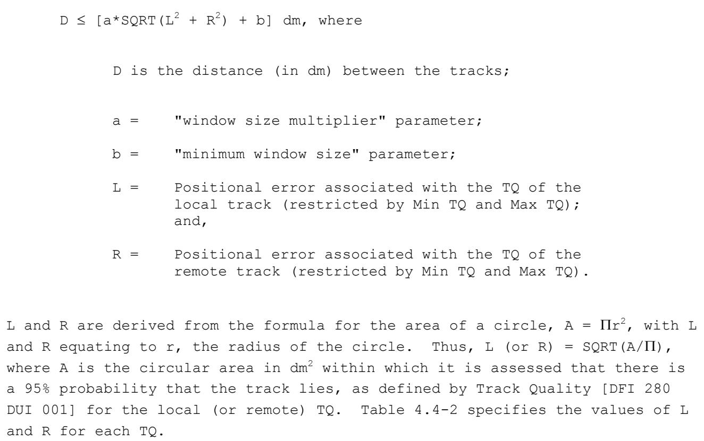
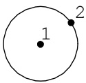
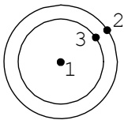
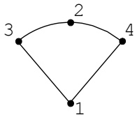
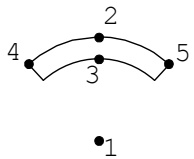
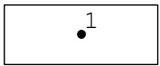
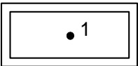
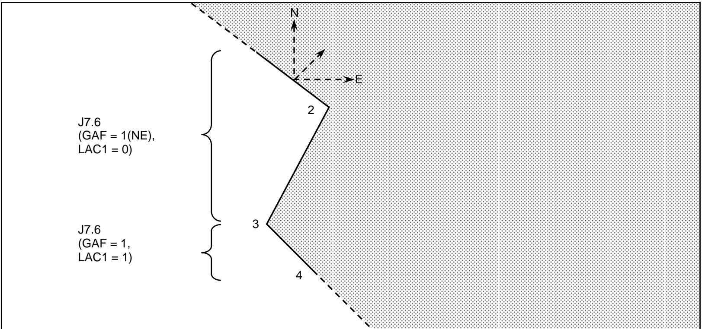

## 4.4 SURVEILLANCE

There is a requirement to exchange surveillance information on the Link 16 network. This section describes the exchange of surveillance information using fixed format messages.

C2 JUs participating in the exchange of J3 Surveillance messages shall transmit surveillance information in Network PGs as defined in paragraph 4.2.3.10.5. NonC2 JUs shall receive situational awareness information from the Surveillance NPG including track and Reference Point data necessary to support the platform mission. NonC2 JUs shall not transmit on the Surveillance NPG. The following paragraphs specify the general rules and conventions necessary to satisfy the exchange requirements for surveillance data.

## 4.4.1 SURVEILLANCE DATA

Surveillance information includes the following data:

a. Point surveillance data included in the J3.0 Reference Point message and the J3.1 Emergency Point message.

b. Air and Surface (Maritime) surveillance data included in the J3.2 Air Track message and the J3.3 Surface (Maritime) Track message.

c. Subsurface (Maritime) surveillance data included in the J3.4 Subsurface (Maritime) Track message.

d. Land (Ground) surveillance data included in the J3.5 Land (Ground) Point/Track message.

e. Space and Ballistic Missile surveillance data included in the J3.6 Space Track message.

f. Electronic Warfare surveillance data included in the J3.7 EW Product Information message.

Surveillance information may be amplified by the following data:

a. J5.4 Acoustic Bearing/Range Message.

b. J6.0 Amplification message.

c. J15.0 Threat Warning message.

The following Information Management data are also used to insure correct exchange of surveillance data:

a. J7.0 Track Management (ACT = 0) Drop Track Report message.

b. J7.0 Track Management (ACT = 1) Difference Report message.

c. J7.0 Track Management (ACT = 2) Change Data Order message.

d. J7.0 Track Management (ACT = 3) Emergency Status Change message.

e. J7.0 Track Management (ACT = 4) Force Tell Status Change message.

f. J7.0 Track Management (ACT = 5) Strength Change message.

g. J7.0 Track Management (ACT = 6) Exercise Status Order message.

h. J7.1 Data Update Request (ACT = 0) Data Update Request by Request Indicator message.

i. J7.1 Data Update Request (ACT = 1) Data Update Request by Track Number message.

j. J7.1 Data Update Request (ACT = 2) Ballistic Missile Update Request message.

k. J7.2 Correlation message.

l. J7.4 Track Identifier message.

m. J7.5 IFF/SIF Management (ACT = 0) Clear IFF/SIF message.

n. J7.5 IFF/SIF Management (ACT = 1) IFF/SIF Difference Report message.

o. J7.5 IFF/SIF Management (ACT = 2) IFF/SIF Update Request message.

p. J7.5 IFF/SIF Management (ACT = 3) Special Code message.

q. J7.6 Filter Management (ACT = 0) Filter Implementation Request message.

r. J7.6 Filter Management (ACT = 1) Filter Description Report message.

s. J7.6 Filter Management (ACT = 2) Delete Filter Request/Report message.

t. J7.7 Association (ACT = 0) Associate Data message.

u. J7.7 Association (ACT = 1) Terminate Association message.

Paragraph 5.7.1 describes the requirement for initial transmission and

explains the way message redundancy is specified. Each message contains the

special rules required for the transmission and reception of that message.

The general rules and conventions common to the entire Surveillance function

are defined in paragraph 4.4.2. Subsequent paragraphs describe the rules and

conventions for reporting Point surveillance data (paragraph 4.4.3), Air,

Surface (Maritime), and Land (Ground) surveillance data (paragraph 4.4.4),

Subsurface (Maritime) surveillance data (paragraph 4.4.5), Space and

Ballistic Missile surveillance data (paragraph 4.4.6), and EW surveillance

data (paragraph 4.4.7).

4.4.2 GENERAL RULES AND CONVENTIONS

The general rules and conventions for reporting surveillance data are described in the following paragraphs.

4.4.2.1 IDENTITY

Standard identity is provided in terms of the following definitions:

a. Pending - A track which has not been subjected to the identification process.

b. Unknown - An evaluated track which has not been identified.

c. Assumed Friend - A track which is assumed to be a friend because of its characteristics, behavior, or origin.

d. Friend - A track belonging to a declared friendly nation.

e. Neutral - A track whose characteristics, behavior, origin, or nationality indicate that it is neither supporting nor opposing friendly forces.

f. Suspect - A track which is potentially hostile because of its characteristics, behavior, origin or nationality.

g. Hostile - A track declared to belong to any opposing nation, party, group, or entity, which by virtue of its behavior or information collected on it such as characteristics, origin or nationality contributes to the threat to friendly forces.

These standard identity terms are further amplified by the Special Interest Indicator, Exercise Indicator and Identity Amplifying Descriptor, Specific Type, Platform, Platform Activity, and Identity Confidence fields.

## 4.4.2.1.1 EXERCISE TRACKS

There is a requirement to distinguish between live tracks that are involved in an exercise and other live tracks being reported. This is accomplished by setting the Exercise Indicator in the J3 track messages. Only tracks with standard identity of Friend can be modified by the exercise identity. When the Exercise Indicator is set to value 0, Non-Exercise Track, the standard identity of the track shall be specified in the Identity field. When the

Exercise Indicator is set to value 1, Exercise Track, the standard identity of the track shall be Friend and the exercise identity shall be specified in the Identity Amplifying Descriptor field. The Identity Amplifying Descriptor field shall not be set unless the Exercise Indicator field is set to value 1, Exercise Track. In particular, a track with the Exercise Indicator set to value 1, Exercise Track, and the Identity Amplifying Descriptor set to value 6, FAKER, shall be identified as a friendly track acting as a hostile for exercise purposes. Also, a track with the Exercise Indicator set to value 1, Exercise Track, and the Identity Amplifying Descriptor set to value 5, JOKER, shall be identified as a friendly track acting as a suspect for exercise purposes. For any track with Exercise Indicator set to value 1, Exercise Track, data concerning the track must be considered artificial, for exercise purposes, except that the following shall not be artificial:

a. Track Number.

b. Tracking Data: Latitude, Longitude, Altitude/Elevation/Depth, Course, Speed, Minute, Hour, and Track Quality.

c. Simulation Indicator.

d. Environment/Category.

e. Status Data on Air Tracks: Fuel Function, Fuel, Time Report Function, Minute, and Hour.

f. Status Data on Surface (Maritime) Tracks: Flight Deck Status, Landing/Approach Condition, and associated Time Report Function, Minute and Hour.

## 4.4.2.1.2 SPECIAL INTEREST TRACKS

A track's identity can be further amplified by designating it as a track of special interest. This is accomplished by setting the identity field as appropriate and by setting the special interest indicator. Examples of employment of this indicator are:

a. Kilo/Yoke - A friendly track of special interest.

b. Zombie - A SUSPECT air track conforming to ATC rules or outside NATO airspace following a recognized traffic pattern.

c. Traveller - A SUSPECT surface track following a recognized traffic route.

## 4.4.2.1.3 PLATFORM AND PLATFORM ACTIVITY

The Platform and Platform Activity fields are Environment/Category dependent and serve to further amplify the identity of the reported track in specific terms, such as fighter, close air support.

## 4.4.2.1.4 IDENTITY CONFIDENCE

Identity Confidence (ID CON) criteria are yet to be determined (baseline to be determined by common agreement between Allied Nations).

## 4.4.2.1.5 SPECIFIC TYPE

Specific type is Environment/Category dependent and serves to further amplify platforms in each Environment/Category. Specific type is normally provided by status report from interface units or by intelligence amplification reports on surveillance tracks, or in the J3.2, J3.3, J3.4, J3.5, and J3.6 messages.

## 4.4.2.1.6 SHIPBORNE MISSILE SYSTEMS

The surface-to-air (SAM) and/or surface-to-surface (SSM) missile systems fitted in surface (maritime) units may be reported in the J3.3 Surface (Maritime) Track message or the J6.0 Amplification message.

## 4.4.2.2 REPORTING RESPONSIBILITY

Surveillance data reporting is initiated by the JU which first detects or initiates a track/point and makes it available for reporting on the interface. Each track/point initiated and reported shall be assigned a TN from the JU's allocated block. At that time, the JU shall have $\mathtt { R } ^ { 2 }$ for the track/point. $\mathbb { R } ^ { 2 }$ procedures for Air, Surface (Maritime), and Land (Ground)

surveillance tracks are discussed in paragraph 4.4.4.11. The general $\mathtt { R } ^ { 2 }$ rules for points are discussed in paragraph 4.4.3.2, the $\mathbb { R } ^ { 2 }$ rules for Ballistic Missile surveillance tracks are discussed in paragraph 4.4.6.15, and the $\mathtt { R } ^ { 2 }$ rules for EW Surveillance are discussed in paragraph 4.4.7.2.

## 4.4.2.2.1 INTEGRATION OF PPLI REPORTS WITH SURVEILLANCE DATA

PPLI data available from J2 messages shall be used by $\mathrm { C } ^ { 2 }$ JUs to reduce the redundancy of surveillance track reporting.

a. A surveillance JU will accept the PPLI information into its surveillance database and perform the applicable correlation and conflict processing necessary to ensure that duplicative information is not being transmitted on the Surveillance Network PG.

b. A $\mathrm { C } ^ { 2 }$ JU participating on the Surveillance Network PG shall attempt to correlate received PPLI reports with data being received from local sensors. If a correlation is found with a track for which the $\mathrm { C } ^ { 2 }$ JU has $\mathtt { R } ^ { 2 }$ the J7.2 Correlation message shall be transmitted with the Response Value (RV) field set to value 1 (Reverse Correlation Not Acceptable), and with the Source TN in the Header word of the J2 PPLI message as the Retained TN and the surveillance TN as the Dropped TN. The $\mathrm { C } ^ { 2 }$ JU shall cease reporting the track and transmit a J7.0 (ACT = 0) Drop Track message on the surveillance TN.

c. If a correlation is found with a track for which another $\mathrm { C } ^ { 2 }$ JU has $\mathbb { R } ^ { 2 }$ and the TNs are different, the J7.2 (RV = 1) Correlation message shall be transmitted, with the Source TN in the Header word of the J2 PPLI message as the Retained TN and the surveillance TN as the Dropped TN.

d. If a correlation is found with a track for which another $\mathrm { C } ^ { 2 }$ JU has $\mathbb { R } ^ { 2 }$ and the TNs are the same, the JU receiving the J2 shall accept the PPLI information into its surveillance database and shall disregard the J3 surveillance data on the specified track except when Geodetic Position Quality in the PPLI message is set to value $0 ,$ in which case the surveillance track is accepted and the PPLI message shall be discarded.

e. Subsurface tracks shall not be correlated with IUs.

f. If a correlation is not found, the $\mathrm { C } ^ { 2 }$ JU shall integrate the received J2 PPLI report into its surveillance database as part of the surveillance picture. If J2 messages are not received subsequent to this action and the receiving $\mathrm { C } ^ { 2 }$ JU still has no local data, the $\mathrm { C } ^ { 2 }$ JU assumes no responsibility for reporting the subject JU on the Surveillance Network PG.

g. If the position or other data in a PPLI meet a system's decorrelation criteria, the PPLI and local track data shall be decorrelated. After decorrelation, the $\mathrm { C } ^ { 2 }$ JU shall initiate a surveillance track report with locally held data using a new track number. The PPLI Track Number and Identity Indicator field and the PPLI IFF/SIF Indicator field shall both be reported as No Statement.

## 4.4.2.2.2 REPORTING OF INACTIVE AND LIMITED STATUS INTERFACE UNITS

A $\mathrm { C } ^ { 2 }$ JU shall assume $\mathbb { R } ^ { 2 }$ of an IU (including $\mathrm { C } ^ { 2 }$ and nonC2 JUs and forwarded PUs and RUs) in accordance with the reporting rules for a real-time track if the $\mathrm { C } ^ { 2 }$ JU has correlated local sensor data, when:

## a. A J2 PPLI message is not received for 40 to 60 seconds, or

b. A J2 PPLI message, other than J2.0, is received with the NPS Indicator set to Inactive or Conditional Radio Silence, or

c. A J7.0 (ACT = 0) Drop Track message is received from the FJU for a PU, RU, or other IU, or

d. The Geodetic Position Quality in the J2 PPLI message is set to value 0.

A $\mathrm { C } ^ { 2 }$ JU assuming $\mathtt { R } ^ { 2 }$ of an IU reports it as a track or point on the Surveillance Network PG. The type of surveillance message will depend upon the Environment/Category of the IU being reported. The Identity shall be reported as Friend. The Track Number, Platform and Platform Activity values received in previous PPLI messages shall be reported. The PPLI Track Number and Identity Indicator shall be reported as value 1, and shall be maintained if another $\mathrm { C } ^ { 2 }$ JU assumes $\mathtt { R } ^ { 2 }$ of the IU.

The PPLI Track Number and Identity Indicator, when set to value 1, serves several useful purposes. For example, in addition to the uses defined in Paragraph 4.7, it may displayed to operators to give an extra measure of confidence in the track identification data being reported.

The most current IFF/SIF data shall be reported. If all IFF/SIF nonzero mode

codes were obtained from or are the same as the codes received in the J2

message for the subject TN, the PPLI IFF/SIF Indicator in the J3 message

shall be reported as value 2. Otherwise, if the Mode II code was obtained

from or is the same as the Mode II code received in the J2 message, the PPLI

IFF/SIF Indicator shall be reported as value 1. Otherwise, the PPLI IFF/SIF

Indicator shall be reported as value 0. The Mode IV Indicator value reported

shall be based on actual responses received and shall not be based on the

fact that the TN was previously received in a PPLI message.

If locally derived IFF/SIF data differs from IFF/SIF data that was being

reported in the PPLI message, the locally derived data shall be reported.

## 4.4.2.3 SIMULATED TRACKS

There is also a requirement for a capability to indicate that a surveillance track is not derived from any sensor data but is a simulated track being provided solely for training or test. This is accomplished by setting the Simulation Indicator in the appropriate J3 message as well as in the J2 message when applicable. JUs have the option of implementing simulated tracks. JUs also have the option of filtering simulated tracks. The Simulation Indicator in the J2 and J3 messages shall be set on all simulated tracks when both live and simulated tracks are simultaneously being exchanged on the interface. Simulated tracks may be originated from simulated video mixed with live video, from message input provided by previously recorded or generated messages, or from a TDS's internal simulation program. When the Simulation Indicator is set in a J2 or J3 message, all data associated with that track are simulated and should not be associated with a live track. Simulated tracks will not be correlated with live tracks. Prior coordination with all interface participants is required when transmitting simulated tracks on the interface to insure that simulated tracks are not assigned TNs from other systems' TN blocks. If a system displays both simulated and live tracks simultaneously, the tracks should be readily distinguishable from each

other. The Simulation Indicator shall not change. If for any reason, such   
as operator error, it is desired to change the simulation status of a track,   
the track shall be dropped using the J7.0 (ACT = 0) message, and a new track   
shall be reported. The one exception to this rule is that a change from live   
to simulated shall be accepted if the track is being received from an FJU.

## 4.4.2.4 SPECIAL PROCESSING AND HANDLING OF SURVEILLANCE DATA

Special processing of surveillance data may be required in accordance with paragraph 4.1.6.

## 4.4.2.5 TRACK ALERTS

Track alerts consist of force tell and emergency alerts. Force Tell and   
Emergency Indicators are provided in the J3 messages to indicate force tell   
and/or emergency conditions. These indicators, when set, allow these   
messages to override all operator controllable data filters. A system with a   
limited track capacity (e.g., F-15) should manage its database to insure that   
it shall not be saturated by force tell and emergency alerts. These   
indicators are set and cleared as specified in paragraph 4.7.1.4.

## 4.4.2.6 PURGING

A JU may have the capability to purge remote tracks/points, i.e.,   
automatically drop a remote track/point after a specified time interval has   
elapsed since the track's/point's last report. The JU shall not transmit a   
J7.0 (ACT = 0) message on a purged remote track/point. See paragraph 4.4.3.7   
Purging of Reference and Land (Ground) Points, paragraph 4.4.3.8 Purging of   
Emergency Points, paragraph 4.4.4.13.2 Purging of Remote Tracks for   
additional information on purging of points and tracks, and paragraph 4.4.7.6   
Termination of Electronic Warfare Surveillance Data, which explains purging   
of EW product information.

## 4.4.2.7 RULES FOR "NO STATEMENT" AND "RESET TO NO STATEMENT" VALUES

Various fields in the J-series messages contain both No Statement and Reset to No Statement values. No Statement means the report includes no data for that field. It implies nothing about the validity of previously reported

non-No Statement data for that field. The Reset value provides a means to specifically declare that the currently reported value is incorrect, but the correct specific value has not been ascertained. The following rules apply:

a. When a JU implements the No Statement value and at least one other defined value for a field that has a Reset to No Statement value, the Reset to No Statement value must also be implemented.

b. A message reporting the Reset to No Statement value shall be transmitted one time.

c. When a system receives a No Statement value for a field which has a Reset to No Statement value and for which a value other than No Statement is locally held, the locally held value shall be retained regardless of whether it was locally or remotely derived.

d. When a system receives a Reset to No Statement value, it shall automatically revert the locally held value of that field to No Statement.

e. The Reset to No Statement value may be originated automatically or by operator action.

f. Paragraph 4.6.2 contains amplifying rules for use of the Reset to No Statement value in the J6.0 Amplification message.

## 4.4.2.8 TRACK NUMBER CONTINUITY

A particular surveillance entity may be eligible to retain its original Track Number on change of report type, Table 4.7-1 specifies those cases when the same TN is to be retained and those when a new TN is to be assigned. In cases when a new TN is required, the JU with R2 shall transmit a Drop Track Report on the old TN.

## 4.4.3 POINT SURVEILLANCE DATA

Point surveillance data are exchanged as follows:

a. J3.0 - Used to exchange tactical information about geographic references. (Nonphysical points such as waypoints, Combat Air Patrol (CAP) stations, Forward Edge of the Battle Area (FEBA), etc.)

b. J3.1 - Used to report the existence of an emergency condition that requires search and rescue efforts.

c. J3.5 - Used to report the location of fixed ground units or objects. (Physical points such as troop concentrations, bridges, airbases, etc.)

## 4.4.3.1 POINT, LINE, AND AREA REPORTING

The J3.0 Reference Point, J3.1 Emergency Point, and the J3.5 Land (Ground) Point/Track messages are used to report points, e.g., waypoints, downed aircraft, SAM sites, etc. Each point, line, or area reported on the interface shall be assigned a TN(s) by the reporting JU, and the position shall be reported using geodetic latitude/longitude values. Also, the J3.0 and J3.5 messages provide the capability to report the altitude/elevation of the point, line, or area if required. The capability to report the time associated with a reported point, line, or area is provided in all three point messages. Time is reported in hours/minutes, and the time meaning is defined by the Time Function field. The J3.5 message also provides the capability to describe a circle/ellipse about a ground point. This would normally be used in reporting a SAM site, but could be used with any J3.5 point. In addition to reporting points, the capability is provided for the J3.0 message to transmit lines such as FEBAs, roads, etc.; areas such as search areas, exercise areas, etc.; and volumes such as corridors, etc. Protocols for use of the time and Time Function fields for moving points, lines, and areas are contained in paragraph 4.4.3.1.3.

The J3.0 message word sequences required for support of various point type values are provided in the ASW point reporting procedures and associated message T/R rules (see paragraph 4.4.5.2.3).

It is a system option to retain the TN and last reported position of a fixed land (ground) IU that has reverted to an inactive status. If the point is

required for tactical situation reporting, the JU shall transmit a J3.5

message on the IU, using the assigned address of the inactive IU.

There is no interface track-to-point or point-to-point correlation and the

J7.2 message shall not be used to correlate one track/point with any other

point. The J7.7 message shall be used to indicate any association between a

track/point and another track/point.

It is illegal to change a reference or emergency point to any other type of

surveillance entity; i.e., the Reference TN used to identify a particular

reference or emergency point shall not be used for any other type of entity

reported on the interface except in the normal course of TN reuse. Moreover,

it is illegal to change the Point Type and/or Point Amplification value of a

reference point while retaining the same Reference TN. As an exception to

this rule a Point Amplification value of No Statement may be changed to a

non-No Statement value and retain the same Reference TN.

Emergency points are transmitted as J3.1 messages. Emergency points may be

related to a previously reported track/point. In these cases the J3.1

message shall contain, as amplifying information, the TN, Previously Reported

that is associated with the emergency point. The emergency point shall have

a TN, Reference different from the TN, Previously Reported. When the

Exercise Indicator is set to value 1 in the J3.1 message, the report is for

exercise purposes and is not an actual emergency.

When the J3.0 message is used to report a point, the Point/Line/Area

Descriptor, 1 field shall be set to value 0, Point, in the initial word.

## 4.4.3.1.1 ALTITUDE REPORTING

When altitude is specified, Altitude, 100 Ft 1 and, if appropriate Altitude, 100 Ft 2, shall be reported in each J3.0E0 word transmitted. If only one altitude is to be reported, the Altitude, 100 Ft 1 shall be used and Altitude, 100 Ft 2 shall be set to value 1023, No Statement. When only one altitude is provided it is a designated altitude and not at or below and not at or above. An altitude range is reported with both Altitude, 100 Ft 1 and Altitude, 100 Ft 2. For example, if the altitude to be reported is at or

below 10,000 feet, then Altitude, 100 Ft 1 is set to value 0, 0 Altitude and Altitude, 100 Ft 2 is set to value 100, 10,000 Feet. If the altitude to be reported is at or above 20,000 feet, then Altitude, 100 Ft 1 is set to value 200, 20,000 Feet and Altitude, 100 Ft 2 is set to value 1022, 102,200 Feet (the maximum setting). Altitudes and altitude ranges apply only to a single word sequence, i.e., a single track number. This is to allow different altitudes to be applied to different segments of the same line.

## 4.4.3.1.2 LINES AND AREAS

The J3.0 message provides for the description of segmented lines, multisided areas, squares, rectangles, circles, or ellipses. Volumes are obtained by including maximum and minimum altitude values when describing multisided areas, squares, rectangles, circles, or ellipses in the J3.0 message.

a. Segmented Line and Multisided Area Definition. A single J3.0 message is used to define a segmented line with either 2 or 3 points. Multiple J3.0 messages, each with a unique TN, are used to define segmented lines or multisided areas described by more than 3 points. In either case a J3.0I/J3.0E0/J3.0C1 word sequence is used for each message. A J3.0C2 word is added to the first message if the line or area is moving.

(1) When 2 or 3 points are joined together to form a segmented line, the following conditions are used:

(a) The Line/Area Continuation Indicator is set to No Statement in the initial word of the word sequence.

(c) The Point/Line/Area Descriptor, 1 field is set to value 2, Line, in the initial word.

(d) The designated reference point from which Delta Latitude 1, Delta Longitude 1, Delta Latitude 2, and Delta Longitude 2 are measured is that given by the Latitude and Longitude fields in the J3.0E0 word.

(2) When more than 3 points are joined together to form a segmented line or a multisided area, the following conditions are used:

(a) The second and all subsequent messages transmitted have the Line/Area Continuation Indicator in the initial word set to value 1, Line/Area Continuation.

(b) The point location described in the extension word of the second and all subsequent messages must be the same point location as the last point location described in the previous message. This assures a receiving unit that it, in fact, received all messages and did not miss a transmission.

(c) The appropriate end point field in the continuation word will be set to value 1 to indicate the associated point is the last point to be transmitted.

(d) When describing a multisided area, the last point location transmitted must be the same location as the initial point transmitted in the first word sequence. This, in effect, closes the figure to form an area.

(e) The designated reference point from which Delta Latitude 1, Delta Longitude 1, Delta Latitude 2, and Delta Longitude 2 are measured is that given by the Latitude and Longitude fields in the J3.0E0 word.

(f) When joining three or more points to form a segmented line, the points are first plotted as specified above, then the segments are connected in sequence, i.e., the first segment is drawn from the point described in the Latitude and Longitude fields in the J3.0E0 word, to the point established by the Delta Latitude, 1 and Delta Longitude, 1 fields in the J3.0C1 word. The second segment is drawn between the point established by the Delta Latitude, 1 and Delta Longitude, 1 fields to that established by the Delta Latitude, 2 and Delta Longitude, 2 fields. This process is

repeated to connect multiple segments.

(g) To prevent confusion and possible misunderstanding,

any change to data concerning any point comprising a portion of a segmented

line or multisided area, shall cause the entire line or area to be

transmitted by the reporting JU. Receiving units shall purge the previously

held segmented line or multisided area and replace it with the new report.

(h) The TNs used to initiate the segmented line or

multisided area shall be transmitted for every report of the segmented line

or multisided area, including a change of R2.

(i) The Reference TN of the first J3.0 message with Line/Area Continuation Indicator set to value 0 shall be used as the only legal identifier for all subsequent references to the segmented line or multisided area, except when dropping the line or area (refer to paragraph 4.4.3.6), setting/clearing the Force Tell Indicator (refer to paragraph 4.7.1.4.3), or responding to a Data Update Request by TN (refer to paragraph 4.7.2.1.1).

(j) The Point/Line/Area Descriptor, 1 field in the initial

word shall be set to value 2, Line, when describing a segmented line and

shall be set to value 3, Multi-point Area, when describing a multisided area.

b. Square, Rectangle, Circles and Ellipse Definition. When defining an area that is a square, rectangle, circle, or ellipse a J3.0I/ J3.0E0/J3.0C2, J3.5I/J3.5E0/J3.5C3, or a J3.7I/J3.7C1/J3.7C2 word sequence is used. The Point/Line/Area Descriptor, 1 field in the J3.0I word shall be set to value 1, Single Point Area. The Square/Circle Switch field indicates that either a square or rectangle is being described when set to value 1 or indicates either a circle or ellipse is being described when set to value 2. A square or circle is being described, depending on the value of the Square/Circle Switch, when the Area Major Axis and Area Minor Axis fields are equal. When the axes are not equal, a rectangle or ellipse is described, depending on the value of the Square/Circle Switch. The orientation of the major axis with respect to True North is provided by the Axis Orientation Field.

When defining EW AOPs (refer to paragraph 4.4.7.1.3) the J3.7I/J3.7C1/J3.7C2 word sequence, as a minimum, is used. The same procedures described above are used to define AOPs.

c. Corridor and Low Level Transit Route (LLTR) Definition. Corridors are reported using Point Type value 4, Line and Point Amplification value 3, Corridor. LLTRs are reported using Point Type value 4, Line and Point Amplification value 6, Low Level Transit Route. Both of these lines are center lines and may be single or segmented with altitude(s) associated with each segment. Width is reported in the Area Major Axis, 4 field in the J3.0C5 word. All other fields in the J3.0C5 word shall be set to No Statement.

## 4.4.3.1.3 SLAVED POINTS AND AREAS

a. Certain reference points and areas may be slaved in a constant position in relation to a Related TN. The position of a slaved point or area is established as Delta Latitude, 1/Delta Longitude, 1 from the Related TN at the time of the report when the Slaved Indicator is set to value 1. This establishes the constant true or relative bearing and range of the slaved point or area from the Related TN. The absence or presence of the J3.0C4 word indicates whether slaving is on a true or relative bearing, as described in paragraph 4.4.3.1.2e below. If the J3.0E0 word is included in a report of a slaved point or area, Latitude, 0.0103 Minute and Longitude, 0.0103 Minute shall be set to No Statement. An example of a slaved point is a marshall point used during aircraft recovery operations aboard an aircraft carrier.

b. When a square or rectangle (Square/Circle Switch = 1) or a circle or ellipse (Square/Circle Switch = 2) is slaved, the position established by the Delta Latitude, 1/Delta Longitude, 1 is the center of that area.

c. Lines and irregular multisided areas, i.e. other than squares, rectangles, circles, and ellipses, shall not be slaved.

d. The slaved point or area center is plotted as the difference in Latitude and Longitude from the position of Related TN at the time of the report, regardless of whether slaved true or relative, and regardless of the course of Related TN. If slaved true, the constant true bearing is then

determined as the azimuth between True North and the position of the slaved point or area center, measured clockwise from the position of Related TN. If slaved relative, the constant relative bearing is determined as the angle between the course of Related TN and the position of the slaved point or area center, measured clockwise from the position of Related TN. For relative slaving, the azimuth (true bearing) of the point or area center from the Related TN changes by an amount identical to any reported change of course of the Related TN subsequent to receipt of the slaved point or area message. For slaved ellipses, squares, and rectangles, the Axis Orientation shall also change by an amount identical to the course change of Related TN (-180 degrees if the Axis Orientation exceeds 179 degrees).

e. The absence or presence of the J3.0C4 continuation word indicates whether a point or area center reported in a J3.0 message with Slaved Indicator = 1 is slaved by true or relative bearing to the Related TN. For both true and relative slaving, the range between the slaved point or area center and Related TN remains constant. If the J3.0C4 word is not included, the bearing established by Delta Latitude, 1/Delta Longitude, 1 is a constant true bearing from the J3.0C2 Related TN. If the J3.0C4 word is included, the bearing is relative to the course of the J3.0C4 Related 1 TN. When the J3.0C4 word is transmitted, either the J3.0C2 Related TN field shall be set to No Statement for a slaved area, or the J3.0C2 word shall not be transmitted for a slaved point.

f. ASW Areas of Probability (AOP) reported in a J3.0 message with Point Type = 7 and Point Amplification = 12 shall not be slaved. To relate or associate an ASW AOP to a track or point, e.g., a subsurface track for which contact has been lost, a J7.7 Association message may be transmitted.

## 4.4.3.1.4 NONSLAVED MOVING POINTS, LINES, AND AREAS

The rules for nonslaved moving points, lines, and areas are provided as follows:

a. Moving points, lines, and areas are reported by setting Course and Speed in the J3.0C2 word to other than No Statement. Moving points, lines, and areas shall be extrapolated by the host to the time of transfer to the terminal. Time (Hour and Minute) and Time Function may also be reported as amplifying information, independent of the reported position, Course, and Speed. If time is reported as other than No Statement, Time Function shall also be other than No Statement. The Axis Orientation field is not affected by changes in Course.

b. A point, line, or area shall not be reported as moving if it has an Activation Time in the future, i.e., if Time Function = Activation Time and the Time has not yet arrived, Course and Speed shall be set to No Statement. To cause a point, line, or area to commence moving at the Activation Time, Course, and Speed may be reported commencing at Activation Time.

c. Position and Intended Movement (PIM) and Submarine Position and Intended Movement (SIM) points (Point Type = 1, Point Amplification = 4 and 9, respectively) which are not yet active are exceptions to the above rules. Such future PIM and SIM points shall be reported with the position, Course, and Speed that will be effective at the Activation Time.

d. Land (Ground) Points shall not move, i.e., Course and Speed shall be set to No Statement in a J3.5 (PTI = 0) message. The J3.5 (PTI = 0) Track Quality field shall be set to 0. Course, Speed, and Track Quality shall not be processed upon receipt of a J3.5 (PTI = 0) message.

## 4.4.3.2 REPORTING RESPONSIBILITY FOR POINTS, LINES, AND AREAS

The following subparagraphs amplify the general $\mathbb { R } ^ { 2 }$ rules specified in paragraph 4.4.2.2. Both the general rules and the amplification of those rules for points, lines, and areas, detailed below, shall be followed.

## 4.4.3.2.1 REPORTING RESPONSIBILITY FOR REFERENCE POINTS, LINES, AND AREAS AND GROUND POINTS

The originator of a J3.0 or J3.5 (PTI = 0) point, line, or area retains $\mathtt { R } ^ { 2 }$ as long as the originator remains active and reports the point, line, or area. However, if a J7.0 (ACT = 0) message is received, the $\mathbb { R } ^ { 2 }$ unit is declared inactive, or if no periodic update is received for three consecutive update intervals, another JU may, by operator action onl $. \ y ,$ assume $\mathtt { R } ^ { 2 }$ for the point, line, or area using the same Reference TN(s). The latest IU to report on a reference or land (ground) point, line, or area has $\mathtt { R } ^ { 2 }$ for the point, line, or area. If a JU without $\mathtt { R } ^ { 2 }$ desires that a specific point, line, or area be transmitted immediately without awaiting the next periodic update, it should transmit a J7.1 (ACT = 1) Data Update Request for the desired TN.

## 4.4.3.2.2 REPORTING RESPONSIBILITY FOR EMERGENCY POINTS

Any JU may report, through operator action onl $. \ y ,$ on a previously reported emergency point when that JU has additional or more current information on the point. In addition, if a J7.0 (ACT = 0) message is received on an emergency point, the unit with $\mathtt { R } ^ { 2 }$ is declared inactive, or if no periodic update is received for three consecutive update intervals, another JU may, by operator action only, assume $\mathtt { R } ^ { 2 }$ for the point. A JU assuming $\mathtt { R } ^ { 2 }$ for an emergency point shall use the same TN Reference and the same value of TN Previously Reported as those reported by the previous reporting unit. The latest JU to report a point has $\mathtt { R } ^ { 2 }$ for that point.

## 4.4.3.3 DATA UPDATE REQUESTS FOR POINTS, LINES, AND AREAS

Paragraphs 4.7.2 through 4.7.2.3 provide information on Data Update Requests for points, lines, and areas.

## 4.4.3.4 TRACK ALERTS FOR POINTS, LINES, AND AREAS

Paragraphs 4.7.1.4.3, 4.7.1.4.4, and 4.7.1.4.6 provide information on track alerts for Reference Points, Emergency Points, and Land (Ground) Points, respectively.

## 4.4.3.5 REPORTING TRANSPONDER DATA ON POINTS

IFF/SIF data (Modes I, II, and III Codes) are transmitted in the J3.1 and J3.5 (PTI = 0) messages when available. The IFF/SIF data in the J3.1 message shall contain the IFF/SIF modes and codes of the previously reported track for which the emergency point was initiated.

## 4.4.3.6 TERMINATION OF A POINT, LINE, OR AREA

When a JU ceases reporting a point, line, or area for which it had reporting responsibility, it shall transmit a J7.0 (ACT = 0) message. To drop a

segmented line or multisided area defined by more than one Reference TN, a   
J7.0 (ACT = 0) message shall be transmitted for each Reference TN.

A JU shall not transmit a J7.0 (ACT = 0) message on a point when the point becomes an Active IU on the interface with the same TN.

A JU receiving a J7.0 (ACT = 0) message on a point, line, or area shall not be required to purge the point, line, or area. However, if the JU does not purge a point, line, or area on which it has received a J7.0 (ACT = 0) message, it shall assume R2 for the point, line, or area to ensure that it remains active on the interface.

## 4.4.3.7 PURGING OF REFERENCE POINTS, LINES, AND AREAS AND LAND(GROUND) POINTS

JUs may purge remote reference points, lines, and areas and land (ground)   
points if they are no longer required. When a remote point, line, or area is   
purged from a system by local options, a J7.0 (ACT = 0) message shall not be   
transmitted.

## 4.4.3.8 PURGING OF EMERGENCY POINTS

Emergency points are periodically updated and are normally terminated via the J7.0 (ACT = 0) message when the emergency ceases. If a JU fails to receive the J7.0 (ACT = 0) message and further updates are not received, the JU may purge those points after a specified time period has elapsed with no updates.

## 4.4.3.9 TIME

Time may be associated with the reported point, line, or area. This "time" may represent establishment, acquisition, activation, deactivation, etc. For segmented lines and multi-sided areas defined by more than one Reference TN, time and Time Function, if applicable, shall be reported for the first Reference TN, and shall be considered to apply to the entire line or area. If time and Time Function are transmitted with any of the subsequent line segments or area sides, they shall be the same as the time and Time Function transmitted in the first line segment or area side. In those cases when more than one time is required (i.e., activation, deactivation) for the same

reported point, line or area, additional J3.0 messages shall be transmitted for that point, line or area with the appropriate Time Function value set.

## 4.4.3.10 EXERCISE INDICATOR IN THE REFERENCE POINT MESSAGE

The Exercise Indicator in the J3.0 message is only used to amplify J3.0 messages with the Point Type field set to value 6, Area (Hazard), and the Point Amplification field set to value 3, Allied Missile Engagement Zone (MEZ), or value 4, Hostile MEZ. An exercise MEZ is one which is being reported for exercise purposes only, i.e., the IU, track, or point to which the MEZ is related may not be able to actually engage targets in that MEZ, nor is it necessary to remain clear of the exercise MEZ for actual operational purposes. For all other values of the Point Type and Point Amplification fields in the J3.0 message the Exercise Indicator field shall be set to value 0.

## 4.4.3.11 PERIODIC REPORT INDICATOR FOR POINTS

When a JU transmits a J3.0 or J3.5 (PTI = 0) original message or a retransmission due to data change, the Periodic Report Indicator (PER IND) shall be set to value 1. Periodic updates following the original or retransmitted message shall be transmitted with the Periodic Report Indicator set to value 2 thereby providing each JU with the option to process the periodic updates of points. Responses to Data Update Requests for multipoint areas or multi-segmented lines (defined by more than one J3.0 message) shall be transmitted with the PER IND set to value 0 and the Response Indicator set to value 1. A change of positional information for a point, line, or area with independent course and speed does not, in itself, constitute a change of data for the purpose of setting the Periodic Report Indicator to value 1.

The rules and conventions applicable to reporting Air, Surface (Maritime), and Land (Ground) surveillance information are based upon the requirements for exchanging these data among JUs. Since the requirements are similar for Air, Surface (Maritime), and Land (Ground) surveillance reporting, these

subfunctions are discussed within this subsection. Specific differences, when applicable, are included in the appropriate paragraphs.

The specific messages used to report Air, Surface (Maritime), and Land (Ground) surveillance data are the J3.2, J3.3, and J3.5 (PTI = 1) messages, respectively. These messages are monitored by nonC2 JUs, such as fighter aircraft, for situational awareness and early warning information.

Discussed in this subsection are the various requirements associated with Air, Surface (Maritime), and Land (Ground) surveillance data exchange. The topics covered are:

a. Track Reporting Criteria.

b. Track Reporting.

c. Track Correlation.

d. Positional Data.

e. Velocity.

f. Identity/Identity Confidence/Strength.

g. Transponder Data.

h. Track Quality.

i. Nonreal-time Reports.

j. Reporting Inactive Sites as Air and Surface (Maritime) Tracks and Land (Ground) Track Data.

k. Reporting Responsibility.

l. Information Difference Recognition and Resolution.

m. Termination of Air, Surface (Maritime), and Land (Ground) Track Data.

## 4.4.4.1 TRACK REPORTING CRITERIA

Track reporting criteria are based on the requirements for the exchange of surveillance information and data usable in providing threat warning information among systems involved in joint operations. The reporting of surveillance track information on the interface shall insure that:

a. The information on the track is as complete, accurate, and timely as possible.

b. Data are correlated and dual designation is minimized.

c. The proper rules for reporting a track are followed.

## 4.4.4.2 TRACK REPORTING

Track reporting requires a set of rules which are general in nature and which may be adapted to a specific interface configuration to provide an optimum exchange of data. The rules are:

a. The source of track data shall be provided (Source TN).

b. $\mathrm { C } ^ { 2 }$ JUs that have the capability to automatically initiate tracks for release to the interface without operator action shall also have the capability to deactivate this automatic capability.

c. A JU reporting a real-time track shall report the position of the track extrapolated to the time of transmission.

d. Nonreal-time data shall be identified as such and time tags shall be provided. Nonreal-time track positions shall not be extrapolated.

Procedures for reporting J3.2, J3.3, and J3.5 (PTI = 1) messages are provided in the following paragraphs. Section 5 provides the detailed message transmission rules.

## 4.4.4.3 COMMON TRACKING

a. Common tracking is defined as sharing of a common track number and shifting $\mathbb { R } ^ { 2 }$ between $\mathrm { C } ^ { 2 }$ JUs. Each air, surface (maritime), land (ground), and space tracked object normally will be reported by one $\mathrm { C } ^ { 2 }$ JU while other $\mathrm { C } ^ { 2 }$ JUs withhold their reports to prevent cluttering the tactical plot. Determination of the $\mathrm { C } ^ { 2 }$ JU responsible for reporting the tracked object shall be in accordance with the procedures in the Air, Surface, Land, and Space Surveillance sections. In this section and in section 4.7.3, Resolution of Air and Surface Track Dual Designations, a track for which positional data has been locally derived by a $\mathrm { C } ^ { 2 }$ JU but is currently being reported by another $\mathrm { C } ^ { 2 }$ JU is referred to as a "common local track", and a track for which pos $\dot { \beth } \dot { \tau } \dot { \beth }$ onal data has been locally derived and is not currently being reported by another $\mathrm { C } ^ { 2 }$ JU is referred to only as a "local track". In order for common tracking to function properly, all C2 JUs shall perform correlation and decorrelation of their local track data with respect to the remote data which they are receiving. Failure to properly correlate can result in a dual designation. The protocols in this section are to be followed in order to minimize occurrences and duration of dual designations.

b. Each $\mathrm { C } ^ { 2 }$ JU which has a capability to originate and report real-time air, surface (maritime), land (ground), or space tracks shall have a capability to perform common tracking in accordance with the correlation and decorrelation procedures and criteria which follow. The rules for correlation and decorrelation differ depending on the E/C of the tracks. The rules in paragraphs 4.4.4.3.1, 4.4.4.3.2, and 4.7.3 apply to the correlation and decorrelation of both air tracks and surface tracks, unless otherwise stated. The rules for correlation of land and space tracks are to be determined.

## 4.4.4.3.1 AIR AND SURFACE TRACK CORRELATION

The correlation process commences with comparing locally derived sensor data (position, velocity, and altitude) with the data received on the interface, in order to prevent or eliminate dual designations. All $\mathrm { C } ^ { 2 }$ JUs that originate real-time air or surface tracks shall have an automatic correlation capability. The following subparagraphs apply to the correlation of any two air tracks and any two surface tracks unless otherwise specified.

a. Local Correlation. The method used for internal correlation of local sensor data is a system design option, irrespective of any of the rules herein.

b. New Local Tracks. New local tracks shall not be reported to the interface until an automatic correlation has been attempted and failed on an initial correlation test or on the next test following an initial tentative correlation (see paragraph 4.4.4.3.1h). If no tentative correlation is found on the initial test, the new local track shall be transmitted. If the new local track tentatively correlates on the initial test but fails correlation on the next test, the new local track shall be transmitted. A new local track that correlates with another track on each of the first two correlation tests shall be correlated and held as a common local track. Thereafter, the decorrelation rules (see paragraph 4.4.4.3.2) apply to the track. Correlation tests shall include active IUs, remote real-time tracks, and other local tracks. If an operator action has been taken which selectively released a new local track for reporting, it shall be transmitted, regardless of the results of correlation testing.

## c. Automatic Correlation.

(1) $\mathrm { C } ^ { 2 }$ JUs shall make an automatic correlation test either:

(a) Upon receipt of each remote real-time J3.2 or J3.3 track or J2.0 (Originator E/C = 0 or 3), J2.2, or J2.3 PPLI report which is not confirmed to have an existing correlation to a local track. Such tests shall compare the received remote track or IU to local tracks of the same E/C, including previously common local tracks for which own unit has $\mathtt { R } ^ { 2 }$

TN is determined, it shall be reported in a J7.2 message in accordance with paragraph 4.7.3.1.

d. Manual Correlation. A manual capability shall be provided to initiate the correlation of any two tracks irrespective of the correlation test criteria in paragraph 4.4.4.3.1f, the correlation restrictions in paragraph 4.4.4.3.1g, or the requirements in paragraph 4.4.4.3.1h, except that two tracks shall not be manually correlated if they are of a different E/C, or one is simulated and the other is live, or both are remote.

e. Response to Correlation Request. C2 JUs shall perform correlation tests in response to correlation requests from other units in accordance with the requirements of paragraph 4.7.3.2.

f. Correlation Tests. Correlation testing shall consist of the position, velocity, and altitude tests specified in this paragraph. These tests are summarized in Table 4.4-1 and specified in detail in the remainder of this paragraph. Positions of all tracks and IUs tested for correlation shall be extrapolated to the same time. The correlation test shall occur no more than 6 seconds after the extrapolation time. A local track shall be considered to correlate to the closest remote track or IU that meets all of the correlation tests, subject to the correlation restrictions in paragraph 4.4.4.3.1g and the requirement to pass two correlation tests in paragraph 4.4.4.3.1h.

Table 4.4-1. Summary of Correlation Tests  
Positional Test   
D ≤ [a\*SQRT $( \overline { { \mathbb { L } ^ { 2 } + \mathbb { R } ^ { 2 } } } )$ +b]dm, where:   
D = Distance in dm between two tracks;   
a = "window size multiplier" parameter;   
L = MIN $\left( \begin{array} { c } { \left[ \mathrm { M A X } \left( \mathrm { E } \left( \mathrm { T Q } _ { \mathrm { L } } \right) , \mathrm { E } \left( \mathrm { d } \right) \right) \right] , \mathrm { E } \left( \mathrm { c } \right) } \end{array} \right) ;$   
R = MIN([MAX(E(TQ ),E(d))],E(c));   
E(TQ ) = positional error associated with local track quality $\mathrm { T Q } _ { \mathtt { L } } ,$ from   
Table 4.4-2;   
E(TQR) = positional error associated with remote track quality TQR,   
from Table $4 . 4 \mathrm { - } 2 ,$ or remote geodetic position quality $\mathsf { Q } _ { \mathtt { p g } }$ from Table 4.4-4;   
E(c) = positional error associated with $\mathbb { T } \mathbb { Q } \ = \ \mathbb { c } ,$ "MIN $\mathbb { T } \mathbb { Q } ^ { \mathfrak { n } }$ parameter,   
from Table 4.4-2, or $\mathsf { Q } _ { \mathsf { p g } } \ = \ \dot { \mathsf { J } }$ , "MIN $\mathsf { Q } _ { \mathsf { p } \mathsf { g } } \ "$ parameter, from Table 4.4-4;   
E(d) = positional error associated with $\mathbb { T } \mathbb { Q } \ = \ \mathbb { d } ,$ "MAX TQ" parameter,   
from Table 4.4-2, or $\mathsf { Q } _ { \mathtt { p g } } \ = \ \mathrm { k } , \ \mathsf { \Omega } ^ { \mathsf { w } } \mathrm { M } \mathrm { a } \mathrm { X } \ \mathsf { Q } _ { \mathtt { p g } } ^ { \mathsf { m } }$ parameter, from Table 4.4-4;   
b = "minimum window $\mathtt { s i z e " }$ parameter.   
Course Test   
If both tracks have speed ≥ 10 dmh:   
MIN $( \mathbf { \nabla } | \mathsf { C } _ { \mathtt { R } } { - } \mathsf { C } _ { \mathtt { L } } |$ $3 6 0 - \mid { \mathsf { C } } _ { \mathtt { R } } { - } { \mathsf { C } } _ { \mathtt { I } } \mid { \ } \mid \ \leq \ \mathtt { f } ,$ where:   
$\mathrm { C _ { I } } =$ local course in degrees;   
$\mathrm { C _ { R } } =$ remote course in degrees;   
f = "course differential" parameter;   
Otherwise course is not used in the correlation test.   
Speed Test   
$\overline { { | 1 - S _ { \mathrm { S } } / S _ { \mathrm { F } } | } }$ X 100% ≤ MAX(g,[g(k/S )]), where:   
S = speed of slower track in dmh;   
S = speed of faster track in dmh;   
g = "speed differential" parameter;   
k = alternate speed test factor:   
= 200 dmh for air tracks;   
= 20 dmh for surface tracks.   
Altitude Test   
For air tracks, if both tracks have an Altitude $\mathsf { S o u r c e } ~ = ~ 1$ or 3, or if the   
local track Altitude Source is 1 or 3 and the remote track is an IU reported   
in a PPLI message:   
$| \mathbb { A } _ { \mathtt { R } } - \mathbb { A } _ { \mathtt { L } } | \quad \le$ h, where:   
AL = local altitude in kft;   
$\tt { A _ { R } } = $ remote altitude in kft;   
h = "altitude differential" parameter;   
Otherwise altitude is not used in the correlation test.

b = 0.5(0-2.0, .25) dm

"Window size multiplier". Allows increasing   
or decreasing the standard TQ-based window   
sizes to be used by all IUs in an interface.

(1) Correlation Test Prohibitions: The following shall not be tested for correlation:

(a) A track with TQ ≤ e (see paragraph 4.4.4.3.1f(2)), or a JU with ${ \sf Q } _ { \sf p g } = 0$ (see paragraph 4.4.4.3.1f(8)(b)). This prohibition does not apply to new local real-time tracks, but does apply to nonreal-time (TQ=0) tracks.

(b) Tracks of different E/C, and tracks with existing E/C

conflicts.

(c) Simulated tracks with live tracks, and live tracks with simulated tracks.

(2) Variable Parameters: Variable parameters are used to   
specify the default, range, and increments of values to be used in   
correlation tests. They are expressed in the form "default (range,   
increment)". The intent is to enable rapid change of the standard   
correlation tests as experience and conditions dictate. It is anticipated   
that the parameters to be used will be specified in the OPTASK LINK. Systems   
shall be capable of using any value within the specified range and increments   
upon system initialization, and shall set the parameter to the default value   
if no other value is specified. The default values are the same for air and   
surface track correlation. However, the actual value to be used for air   
tracks may be specified differently than that used for surface tracks. The   
variable correlation parameters are defined as follows:

"Minimum window size". A value applied to all calculated windows to insure that windows are not so small as to prevent valid correlations, e.g., due to minor errors introduced by extrapolation.

<table><tr><td>c = 7(3-7, 1)</td><td></td><td>&quot;Min TQ&quot;. The minimum TQ to be used in positional correlation calculations. Lower TQs shall be treated as if they were c. This</td><td></td></tr><tr><td></td><td>value used for e.</td><td>prevents correlation windows from being unrealistically large. Note: The value used for c can never be less than or equal to the</td><td></td></tr><tr><td>d = 10(8-15, 1)</td><td>prevents correlation windows from being</td><td>&quot;Max TQ&quot;. The maximum TQ to be used in positional correlation calculations. Higher TQs shall be treated as if they were d. This</td><td></td></tr><tr><td>e = 4(2-6, 1)</td><td>unrealistically small. equal to e are not eligible for correlation,</td><td>&quot;Restricted TQ&quot;. Tracks with TQ less than or</td><td></td></tr><tr><td>f = 45(15-90, 15) degrees:</td><td>4.4.4.3.1f(4)).</td><td>except for new local real-time tracks (see paragraphs 4.4.4.3.1f(1)(a) and</td><td></td></tr><tr><td></td><td></td><td>&quot;Course Differential&quot;. The maximum difference between the reported course of the</td><td></td></tr><tr><td></td><td></td><td></td><td></td></tr><tr><td></td><td></td><td></td><td></td></tr><tr><td></td><td></td><td></td><td></td></tr><tr><td></td><td></td><td>local track allowable for correlation. If the</td><td></td></tr><tr><td></td><td></td><td></td><td></td></tr><tr><td></td><td></td><td>remote track and the calculated course of the</td><td></td></tr><tr><td></td><td></td><td></td><td></td></tr><tr><td></td><td></td><td></td><td></td></tr><tr><td></td><td></td><td></td><td></td></tr><tr><td></td><td></td><td>speed of either track is less than 10 dmh,</td><td></td></tr><tr><td></td><td>the correlation test.</td><td>&quot;course differential&quot; shall not be applied in</td><td></td></tr><tr><td>g = 40(10-100, 10) percent</td><td></td><td></td><td></td></tr><tr><td></td><td></td><td></td><td></td></tr><tr><td></td><td></td><td>&quot;Speed Differential&quot;. The maximum percentage</td><td></td></tr><tr><td></td><td></td><td>by which the speed of the faster track may</td><td></td></tr><tr><td>h = 10(5-50, 5) thousand feet</td><td>correlation.</td><td>differ from the speed of the slower track for</td><td></td></tr><tr><td>(kft)</td><td></td><td></td><td></td></tr><tr><td></td><td></td><td>&quot;Altitude Differential&quot;. The maximum</td><td></td></tr><tr><td></td><td></td><td>altitude difference between two air tracks</td><td></td></tr><tr><td></td><td></td><td>allowable for correlation. (Not applicable</td><td></td></tr><tr><td>j = 2(1-5, 1)</td><td></td><td>to surface track correlation.)</td><td></td></tr><tr><td></td><td></td><td></td><td></td></tr><tr><td></td><td></td><td>&quot;Min Qpg&quot;. The minimum value of Qpg to be</td><td></td></tr><tr><td></td><td></td><td>used in positional correlation calculations.</td><td></td></tr><tr><td></td><td></td><td>Lower values shall be treated as if they were</td><td></td></tr><tr><td></td><td></td><td>j. This prevents correlation windows used in</td><td></td></tr><tr><td></td><td></td><td>testing correlation of PPLI positions from</td><td></td></tr><tr><td></td><td></td><td></td><td></td></tr><tr><td></td><td></td><td>being unrealistically large.</td><td></td></tr><tr><td>k = 11(1-15, 1)</td><td></td><td></td><td></td></tr><tr><td></td><td></td><td></td><td></td></tr><tr><td></td><td></td><td>&quot;Max Qpg&quot;. The maximum value of Qpg to be</td><td></td></tr><tr><td></td><td></td><td></td><td></td></tr><tr><td></td><td></td><td>used in positional correlation calculations.</td><td></td></tr><tr><td></td><td></td><td></td><td></td></tr><tr><td></td><td></td><td>Higher values shall be treated as if they</td><td></td></tr><tr><td></td><td></td><td></td><td></td></tr><tr><td></td><td></td><td>were k. This prevents correlation windows</td><td></td></tr><tr><td></td><td></td><td></td><td></td></tr><tr><td></td><td></td><td></td><td></td></tr><tr><td></td><td></td><td></td><td></td></tr><tr><td></td><td></td><td>used in testing correlation of PPLI positions</td><td></td></tr><tr><td></td><td></td><td></td><td></td></tr><tr><td></td><td></td><td></td><td></td></tr><tr><td></td><td></td><td></td><td></td></tr><tr><td></td><td></td><td></td><td></td></tr><tr><td></td><td></td><td></td><td></td></tr><tr><td></td><td></td><td></td><td></td></tr><tr><td></td><td></td><td></td><td></td></tr><tr><td></td><td></td><td></td><td></td></tr><tr><td></td><td></td><td></td><td></td></tr><tr><td></td><td></td><td></td><td></td></tr><tr><td></td><td></td><td></td><td></td></tr><tr><td></td><td></td><td></td><td></td></tr><tr><td></td><td></td><td></td><td></td></tr><tr><td></td><td></td><td></td><td></td></tr><tr><td></td><td></td><td></td><td></td></tr><tr><td></td><td></td><td></td><td></td></tr><tr><td></td><td></td><td></td><td></td></tr><tr><td></td><td></td><td></td><td></td></tr><tr><td></td><td></td><td></td><td></td></tr><tr><td></td><td></td><td>from being unrealistically small.</td><td></td></tr><tr><td></td><td></td><td></td><td></td></tr><tr><td></td><td></td><td></td><td></td></tr><tr><td></td><td></td><td></td><td></td></tr><tr><td></td><td></td><td></td><td></td></tr><tr><td></td><td></td><td></td><td></td></tr><tr><td></td><td></td><td></td><td></td></tr><tr><td></td><td></td><td></td><td></td></tr><tr><td></td><td></td><td></td><td></td></tr><tr><td></td><td></td><td></td><td></td></tr><tr><td></td><td></td><td></td><td></td></tr><tr><td></td><td></td><td></td><td></td></tr><tr><td></td><td></td><td></td><td></td></tr><tr><td></td><td></td><td></td><td></td></tr><tr><td></td><td></td><td></td><td></td></tr><tr><td></td><td></td><td></td><td></td></tr></table>

(3) Position Test: Two tracks shall be eligible for correlation, subject to the other tests, prohibitions, and limitations of this paragraph, if they pass the following positional test:

Table 4.4-2. Positional Errors Represented by TQ
<table><tr><td rowspan=1 colspan=1>TQ</td><td rowspan=1 colspan=1>L, R</td></tr><tr><td rowspan=1 colspan=1>15</td><td rowspan=1 colspan=1>0.003dm</td></tr><tr><td rowspan=1 colspan=1>14</td><td rowspan=1 colspan=1>0.006 dm</td></tr><tr><td rowspan=1 colspan=1>13</td><td rowspan=1 colspan=1>0.01dm</td></tr><tr><td rowspan=1 colspan=1>12</td><td rowspan=1 colspan=1>0.02dm</td></tr><tr><td rowspan=1 colspan=1>11</td><td rowspan=1 colspan=1>0.05dm</td></tr><tr><td rowspan=1 colspan=1>10</td><td rowspan=1 colspan=1>0.10dm</td></tr><tr><td rowspan=1 colspan=1>9</td><td rowspan=1 colspan=1>0.59dm</td></tr><tr><td rowspan=1 colspan=1>8</td><td rowspan=1 colspan=1>1.18dm</td></tr><tr><td rowspan=1 colspan=1>7</td><td rowspan=1 colspan=1>2.93dm</td></tr><tr><td rowspan=1 colspan=1>6</td><td rowspan=1 colspan=1>5.92dm</td></tr><tr><td rowspan=1 colspan=1>5</td><td rowspan=1 colspan=1>8.87dm</td></tr><tr><td rowspan=1 colspan=1>4</td><td rowspan=1 colspan=1>11.82dm</td></tr><tr><td rowspan=1 colspan=1>3</td><td rowspan=1 colspan=1>14.78dm</td></tr><tr><td rowspan=1 colspan=1>2</td><td rowspan=1 colspan=1>29.61dm</td></tr></table>

(4) TQ Limitations: Tracks with TQ less than or equal to the restricted TQ value e shall not be automatically correlated, since their positional accuracy is not sufficient to support valid correlation decisions. Furthermore, the range of TQs used in determining correlation windows may be limited, since use of lower TQs could result in excessively large windows, and use of higher TQs could result in unrealistically small windows. Therefore, TQs less than c shall be treated the same as TQ c, and TQs greater than d shall be treated the same as d, for purposes of calculating D, the correlation window.

(5) Default Correlation Windows: For the default values of Min TQ = 7, Max TQ = 10, minimum window size = 0.5 dm, and restricted TQ = 4, the values of L and R in Table 4.4-2 result in the correlation windows shown in Table 4.4-3.

Table 4.4-3. Correlation Windows (Value of D in dm) for Default Parameter Values
<table><tr><td rowspan=1 colspan=2></td><td rowspan=1 colspan=4>Remote TQ</td></tr><tr><td rowspan=5 colspan=1>LocalTQ</td><td rowspan=1 colspan=1></td><td rowspan=1 colspan=1>≥10</td><td rowspan=1 colspan=1>9</td><td rowspan=1 colspan=1>8</td><td rowspan=1 colspan=1>5-7</td></tr><tr><td rowspan=1 colspan=1>≥10</td><td rowspan=1 colspan=1>0.64</td><td rowspan=1 colspan=1>1.10</td><td rowspan=1 colspan=1>1.68</td><td rowspan=1 colspan=1>3.43</td></tr><tr><td rowspan=1 colspan=1>9</td><td rowspan=1 colspan=1>1.10</td><td rowspan=1 colspan=1>1.33</td><td rowspan=1 colspan=1>1.82</td><td rowspan=1 colspan=1>3.49</td></tr><tr><td rowspan=1 colspan=1>8</td><td rowspan=1 colspan=1>1.68</td><td rowspan=1 colspan=1>1.82</td><td rowspan=1 colspan=1>2.17</td><td rowspan=1 colspan=1>3.66</td></tr><tr><td rowspan=1 colspan=1>5-7</td><td rowspan=1 colspan=1>3.43</td><td rowspan=1 colspan=1>3.49</td><td rowspan=1 colspan=1>3.66</td><td rowspan=1 colspan=1>4.64</td></tr></table>

(6) Velocity Test: The reported course of the remote track shall be within f degrees of the calculated course of the local track. The speed of the slower track shall be within g percent of the speed of the faster track, or within g\*200/S percent for air tracks or $\mathsf { g } ^ { \star } 2 0 / \mathsf { S } _ { \mathtt { F } }$ percent for surface tracks, whichever is greater. Velocity comparisons shall use the last reported course and speed of remote tracks and the course and speed calculated for local tracks at the common time to which the tracks are extrapolated at the time of comparison.

(7) Altitude Test: If the Altitude Source of both air tracks is either 1 (Sensor) or 3 (Aircraft Automatic Altitude Report), or if the local track Altitude Source is 1 or 3 and the remote track is an IU reported in a PPLI message, the altitude differential between the two tracks shall not be greater than h. If the Altitude Source of either track is 0 (No Statement/Estimated) or 2 (Aircraft Report), Altitude shall not be used in the correlation test.

(8) PPLI Tests:

(a) When the remote report being tested for correlation is a J2.2 Air or J2.3 Surface PPLI message, the maximum positional error associated with the reported Geodetic Position Quality $( \mathsf { Q } _ { \mathsf { p g } } )$ shall be used for the value of R in the position test. $\mathsf { Q } _ { \mathtt { p g } }$ less than j shall be treated as $\begin{array} { r l } { \mathsf { Q } _ { \mathsf { p g } } } & { { } = } \end{array}$ j, and $\mathsf { Q } _ { \mathtt { p g } }$ greater than k shall be treated as $Q _ { \tt p g } \ = \ { \tt k }$ The values of R for JUs are shown in Table 4.4-4, and the resultant correlation windows for the default Max $\mathsf { Q } _ { \mathtt { p g } }$ value 11 and the default Min $\mathsf { Q } _ { \mathtt { p g } }$ value 2 are shown in Table 4.4-5. (The positional errors associated with each $\mathsf { Q } _ { \mathtt { p g } }$ specified in the Data Element Dictionary are calculated by the JTIDS/MIDS terminal at the .39 level of probability. They have been converted to the .95 level of probability in the tables below, for consistency with the requirements for correlation and TQ calculation.)

Table 4.4-4. Values of R for PPLI
<table><tr><td rowspan=1 colspan=1> $\underline { { \mathsf { Q } } } _ { \mathtt { p g } }$ </td><td rowspan=1 colspan=1>R</td></tr><tr><td rowspan=1 colspan=1>15</td><td rowspan=1 colspan=1>0.02 dm</td></tr><tr><td rowspan=1 colspan=1>14</td><td rowspan=1 colspan=1>0.03 dm</td></tr><tr><td rowspan=1 colspan=1>13</td><td rowspan=1 colspan=1>0.04 dm</td></tr><tr><td rowspan=1 colspan=1>12</td><td rowspan=1 colspan=1>0.06 dm</td></tr><tr><td rowspan=1 colspan=1>11</td><td rowspan=1 colspan=1>0.08 dm</td></tr><tr><td rowspan=1 colspan=1>10</td><td rowspan=1 colspan=1>0.12 dm</td></tr><tr><td rowspan=1 colspan=1>9</td><td rowspan=1 colspan=1>0.16 dm</td></tr><tr><td rowspan=1 colspan=1>8</td><td rowspan=1 colspan=1>0.23 dm</td></tr><tr><td rowspan=1 colspan=1>7</td><td rowspan=1 colspan=1>0.33 dm</td></tr><tr><td rowspan=1 colspan=1>6</td><td rowspan=1 colspan=1>0.46 dm</td></tr><tr><td rowspan=1 colspan=1>5</td><td rowspan=1 colspan=1>0.65 dm</td></tr><tr><td rowspan=1 colspan=1>4</td><td rowspan=1 colspan=1>0.92 dm</td></tr><tr><td rowspan=1 colspan=1>3</td><td rowspan=1 colspan=1>1.85 dm</td></tr><tr><td rowspan=1 colspan=1>2</td><td rowspan=1 colspan=1>3.69 dm</td></tr><tr><td rowspan=1 colspan=1>1</td><td rowspan=1 colspan=1>7.38 dm</td></tr></table>

Table 4.4-5. Correlation Windows (Value of D in dm)  
when Remote Track is a JU for Default Parameter Values
<table><tr><td rowspan=1 colspan=2></td><td rowspan=1 colspan=10>Remote PPLI  $\underline { { \mathsf { Q } _ { \mathtt { p q } } } }$ </td></tr><tr><td rowspan=5 colspan=1>LocalTQ</td><td rowspan=1 colspan=1></td><td rowspan=1 colspan=1>≥11</td><td rowspan=1 colspan=1>10</td><td rowspan=1 colspan=1>9</td><td rowspan=1 colspan=1>8</td><td rowspan=1 colspan=1>7</td><td rowspan=1 colspan=1>6</td><td rowspan=1 colspan=1>5</td><td rowspan=1 colspan=1>4</td><td rowspan=1 colspan=1>3</td><td rowspan=1 colspan=1>2</td></tr><tr><td rowspan=1 colspan=1>≥10</td><td rowspan=1 colspan=1>0.63</td><td rowspan=1 colspan=1>0.66</td><td rowspan=1 colspan=1>0.69</td><td rowspan=1 colspan=1>0.75</td><td rowspan=1 colspan=1>0.84</td><td rowspan=1 colspan=1>0.97</td><td rowspan=1 colspan=1>1.16</td><td rowspan=1 colspan=1>1.43</td><td rowspan=1 colspan=1>2.35</td><td rowspan=1 colspan=1>4.13</td></tr><tr><td rowspan=1 colspan=1>9</td><td rowspan=1 colspan=1>1.10</td><td rowspan=1 colspan=1>1.10</td><td rowspan=1 colspan=1>1.11</td><td rowspan=1 colspan=1>1.13</td><td rowspan=1 colspan=1>1.18</td><td rowspan=1 colspan=1>1.25</td><td rowspan=1 colspan=1>1.38</td><td rowspan=1 colspan=1>1.59</td><td rowspan=1 colspan=1>2.44</td><td rowspan=1 colspan=1>4.18</td></tr><tr><td rowspan=1 colspan=1>8</td><td rowspan=1 colspan=1>1.68</td><td rowspan=1 colspan=1>1.69</td><td rowspan=1 colspan=1>1.69</td><td rowspan=1 colspan=1>1.70</td><td rowspan=1 colspan=1>1.73</td><td rowspan=1 colspan=1>1.77</td><td rowspan=1 colspan=1>1.85</td><td rowspan=1 colspan=1>2.00</td><td rowspan=1 colspan=1>2.69</td><td rowspan=1 colspan=1>4.32</td></tr><tr><td rowspan=1 colspan=1>5-7</td><td rowspan=1 colspan=1>3.43</td><td rowspan=1 colspan=1>3.43</td><td rowspan=1 colspan=1>3.43</td><td rowspan=1 colspan=1>3.44</td><td rowspan=1 colspan=1>3.45</td><td rowspan=1 colspan=1>3.47</td><td rowspan=1 colspan=1>3.50</td><td rowspan=1 colspan=1>3.57</td><td rowspan=1 colspan=1>3.97</td><td rowspan=1 colspan=1>5.16</td></tr></table>

(b) If the received J2.2 or J2.3 $\begin{array} { r } { Q _ { \mathrm { p g } } \ = \ 0 , } \end{array}$ the PPLI shall not be correlated automatically. However, if a J2.2 or J2.3 with $\mathrm { ~ Q _ { p g } ~ = ~ 0 ~ i } s$ received for a JU held as a common local track, $\mathbb { R } ^ { 2 }$ for the common local track may be assumed in accordance with paragraph 4.4.2.2.2d.

(c) When the remote report being tested for correlation is

a J2.0 Indirect PPLI message with the Originator E/C field set to value 0

(Surface) or 3 (Air), it shall be processed for correlation like a J3.2 air

or J3.3 surface (maritime) track with TQ = 7.

g. Correlation Restrictions. $\mathrm { C } ^ { 2 }$ JUs shall not automatically correlate two tracks if local/remote data held indicates any of the following conditions exist. The restrictions do not apply to manual correlation. No other correlation restrictions shall be applied for two tracks which pass the correlation tests specified in paragraph 4.4.4.3.1f.

(1) The two tracks have an Identity (ID) difference which constitutes a conflict (see paragraph 4.4.4.3.1i). Systems shall have an initialization parameter and an operator selectable capability to inhibit this automatic restriction. (Use of this capability will be subject to interface coordination and must be promulgated to all C2 IUs. If the use of this capability changes, all participating C2 IUs will be informed through voice communication or other communications media. In lieu of specific interface direction, all IUs will restrict automatic correlation by default.)

(2) The two tracks have different Mode II codes, and the local Mode II code is current. Systems shall have an initialization parameter and an operator selectable capability to inhibit this automatic restriction. (Use of this capability will be subject to interface coordination and must be promulgated to all $\mathrm { C } ^ { 2 }$ IUs. If the use of this capability changes, all participating $\mathrm { C } ^ { 2 }$ IUs will be informed through voice communication or other communications media. In lieu of specific interface direction, all IUs will restrict automatic correlation by default.)

(3) Both tracks are locally derived real-time tracks, i.e.,

being updated with local positional data.

(4) Either track has the Strength field set to a value greater than 1. Systems shall not inhibit correlation if either track has Strength set to No Statement.

(5) One track is a common local track and the other is a remote,

and the same unit has R2 for both tracks.

(6) Either track is currently the subject of a dual designation

resolution action involving another TN.

(7) Each track is subject to one or more (not necessarily the

same) of the below operational contingency constraints (OCC).

(a) The TN is the subject of a current engagement status

message; i.e., the TN is the same TN appearing in a J10.2 Engagement Status

message Target TN or Reference TN field.

(b) The TN is the subject of a pending J9.0 Command

message originated by or addressed to own unit or a J12.0 Mission Assignment

message originated by own unit for which a reply is required and has not been

transmitted or received.

(c) The TN is currently a controlled track, i.e., a J10.5

Controlling Unit Report message has been transmitted or received.

(d) The TN is an active or inactive IU.

(8) JUs may apply one exception to the restriction in paragraphs 4.4.4.3.1g(1) and 4.4.4.3.1g(7)(a) above. If either subject track is the Target TN in a J10.2 Engagement Status message originated by the unit attempting correlation, and that track has an ID of Unknown or Hostile, and the other subject track has an ID of Friend, then automatic correlation may be allowed. The Unknown/Hostile track shall be the dropped Track Number (TN-2). This exception allows breaking the engagement and/or destroying missile(s) in flight. This exception shall not be applied by any JU upon receipt of a J7.2 Correlation message. Thus, any JU receiving a J7.2 Correlation message and also holding OCCs on both tracks or conflicting IDs on the two tracks (if the ID conflict correlation restriction is enabled (see paragraph 4.4.4.3.1g(1)) shall reject the correlation in accordance with paragraph 4.7.3.2a(1).

h. Number of Correlation Tests. Two tracks shall pass the correlation tests and restrictions in paragraphs 4.4.4.3.1f and 4.4.4.3.1g 2(1-2,1) times before the correlation is executed. When two tracks pass the correlation tests and restrictions once, they shall be deemed a tentative correlation. The same two tracks shall be tested again upon the next correlation stimulus (see paragraph 4.4.4.3.1c). If the two tracks successfully pass the second correlation test and there is no correlation restriction, they shall be processed for dual designation resolution in accordance with paragraphs 4.4.4.3.1j and k.

i. Correlation of Tracks With Conflicting IDs.

(1) Two tracks shall be considered to have conflicting IDs for correlation processing if:

(a) The ID difference is indicated by the code "1" in

Table 4.7-2.

(b) The ID difference is indicated by the code "1\*" in

Table 4.7-2 and the system processes these differences as conflicts, except that Hostile vs. Pending shall not be considered a conflict for correlation processing.

(c) One track has the Exercise Indicator set to value 0 and the other has it set to value 1.

(2) If conflicting IDs is the only correlation restriction, the operator shall be alerted. The purpose of this alert is to cue the operator to take one of the following actions:

(a) Change the local ID or the Exercise Indicator and ID, thereby allowing automatic correlation, or

(b) Transmit an ID Difference Report, thereby allowing automatic correlation if the remote ID or Exercise Indicator and ID is changed, or

(c) Confirm the restriction, thereby inhibiting the correlation, or

(d) Conduct voice coordination to resolve the situation.

(3) If the above actions result in resolution of the ID conflict, the TN to be retained shall be tested for decorrelation in accordance with paragraph 4.4.4.3.2a before executing the correlation, except the test shall be conducted only once.

j. Dropped Track Number Selection. C2 JUs shall not automatically select as the TN to be dropped a TN which has any of the OCCs listed in paragraph 4.4.4.3.1g(6 7). In the absence of such a selection constraint, JUs shall select the higher TN as the TN to be dropped. For a track that has both a TN greater than 07777 and a TN less than 07777, as reported in a J7.4 message, the track with TN greater than 07777 shall be used in this comparison.

k. Execution of the Correlation. The following rules apply to the disposition of the Dropped TN and the retention of data from the Dropped TN upon origination or receipt of a J7.0 (ACT = 0) message for the Dropped TN. The correlation shall be deemed to have failed if no J7.0 (ACT = 0) is received for the dropped TN after a period of 60 seconds from the transmission of the correlation request and all associated processing for the correlation shall be cancelled.

(1) Disposition of the Dropped Track Number:

(a) If own unit holds the Dropped TN as a local or common local track, the Retained TN shall be designated as a common local track.

(b) If own unit has R2 for the Dropped TN, a J7.0 (ACT = 0)

Drop Track message shall be transmitted for the Dropped TN. If the Dropped TN is reported by another IU after transmission of the J7.0, own unit shall retain the Dropped TN as a remote track and shall not reattempt to correlate the Retained TN and the Dropped TN for a period of 60 seconds after transmission of the J7.0.

(c) When a J7.2 message is initiated by own unit and a

Drop Track message has not yet been received for the Dropped TN, it shall be

retained as a remote track.

(2) Dropped TN Data Retention: Data specified below shall be

transferred from the Dropped TN to the Retained TN when the correlation is

executed. No other Dropped TN data shall be transferred to the Retained TN.

It is expected that normal reporting protocols will result in the

establishment of the appropriate data for the Retained TN.

(a) Kinematic Data. If the Dropped TN is a local or

common local track, the Dropped TN Latitude, Longitude, Course, Speed,

Altitude, Altitude Source, TQ, and Strength shall be transferred to the

Retained TN.

(b) Identification Data. Retention of identification data

is dependent upon whether the ID conflict correlation restriction is

inhibited (see paragraph 4.4.4.3.1g(1)):

1 Restriction Not Inhibited: If the Identity (ID)

(or Identity Amplifying Descriptor (IAD) of two exercise tracks) of retained

TN and Dropped TN are different and the difference would result in automatic

acceptance of the Dropped TN ID/IAD in accordance with Table 4.7-2, the

Dropped TN ID/IAD and Special Interest Indicator, Platform, Platform

Activity, and Specific Type shall be transferred to Retained TN.

2 Restriction Inhibited: When the Identity of Retained TN and Dropped TN are the same, associated identification data (Platform, Platform Activity, Specific Type, Exercise Indicator, and Special Interest Indicator) reported for the Retained TN shall be retained. When the Identity of Retained TN and Dropped TN are different, the last Identity reported for Dropped TN shall be considered equivalent to a J7.0 (ACT = 1) Identity Difference Report for the Retained TN. It shall be processed in accordance with paragraph 4.7.1.2.2 immediately after the correlation is executed.

(c) IFF/SIF Data. Any Dropped TN nonzero Mode I, II, or

III IFF/SIF data for a mode for which the Retained TN data is zero shall be transferred to the Retained TN. If the Dropped TN Mode IV data is a higher value than the Retained TN Mode IV data, it shall be transferred to the Retained TN.

(d) Force Tell and Emergency Indicators. If the Dropped TN had the Force Tell Indicator set to value 1, the Retained TN shall have the Force Tell Indicator set to value 1. If the Dropped TN had the Emergency Indicator set to value 1, the Retained TN shall have the Emergency Indicator set to value 1.

## 4.4.4.3.2 AIR AND SURFACE TRACK DECORRELATION

The following subparagraphs apply to the decorrelation of any two air tracks or any two surface tracks.

a. Decorrelation Requirements. All C2 JUs that initiate real-time air or surface tracks shall have an automatic decorrelation capability. C2 JUs may also perform manual decorrelation, and may have a capability to require manual confirmation of automatic decorrelations. Implementation of automatic and manual functions shall adhere to the following requirements:

(1) Automatic decorrelation tests shall be performed for each common local track upon receipt of each J2 or J3 message on the track.

(2) Common local tracks shall be decorrelated if, on receipt of 2(1-5, 1) consecutive remote track reports, the remote track falls outside a distance of 1.5(1.0-2.0, 0.1) times the maximum correlation distance calculated in accordance with paragraph 4.4.4.3.1f(3).

b. Execution of the Decorrelation. After it has been determined that a common local track (TN A) satisfies the criteria of an automatic or manual decorrelation, the decorrelation shall be executed as follows:

(1) The local track shall be automatically tested once for correlation against remote tracks (not common local tracks) in accordance with paragraphs 4.4.4.3.1f and g. If the automatic correlation test fails, assign a new TN (TN B) to the local track and report TN B in a J3.2 or J3.3 message, with an initial ID of Pending. For manual decorrelation the Pending ID may be overridden by operator action.

## (2) Establish TN A as a remote track.

c. Decorrelation Considerations. If local or remote data held indicates one of the following conditions exist, action shall be taken as indicated:

(1) TN A is the Target TN of a J10.2 Engagement Status message

for a current engagement reported and conducted by own unit, or is the

Reference TN or Target TN of a J10.2 message for a current engagement

reported by own unit and conducted by another unit. Decorrelate and alert an

operator as a cue to transmit the J10.2 message with the Weapon Engagement

Status field set to value 8 (Engagement Broken) if appropriate. Another

J10.2 message with the new TN shall be transmitted only if initiated by

operator action, by a WILCO response to a J12.0 Mission Assignment against TN

B, or by receipt of a J12.6 Target Sorting message reporting an engagement

against TN B.

(2) TN A is the subject of a pending J9.0 Command message

which own unit originated or to which own unit is preparing a reply. Execute

the decorrelation and provide operator display of new track status on TNs A

and B before release of the J9.0 reply. The reply shall be relative to TN A

(3) TN A is controlled by own unit; i.e., is the subject of own unit reported J10.5 Controlling Unit Report message. Do not automatically decorrelate. If manually decorrelated, alert the operator as a cue to report termination of control TN A if appropriate. Report commencement of control of TN B using the J10.5 message only if initiated by operator action. If the controlled track is a nonC2 JU, then decorrelate and continue reporting control of TN A.

(4) TN A has been paired by own unit; i.e., is the subject of own unit originated J10.6 message. Decorrelate and alert an operator as a cue to terminate the pairing on TN A and initiate the pairing on TN B if appropriate.

(5) TN A has been correlated with an Index Number by own unit, i.e., is the subject of own unit originated J12.5 message. Assess whether the Index Number should remain with TN A or B, and transmit J12.5 messages as appropriate.

(6) TN A is the subject of a handover which is in progress; i.e., a TN in a J10.3 Handover message. The decorrelation shall be delayed until the handover process is completed or terminated, then the decorrelation shall be executed and an operator alerted as a cue to report control in the J10.5 Controlling Unit Report message as appropriate. Operator display of the pending decorrelation shall be provided.

## 4.4.4.4 POSITIONAL DATA

The geodetic latitude and longitude for each Air, Surface (Maritime), and Land (Ground) track shall be reported in the respective Air, Surface (Maritime), and Land (Ground) Point/Track messages. In addition, Air surveillance reporting shall include Altitude and Altitude Source when available.

## 4.4.4.5 VARIANCE AND TIME STAMP ON NEEDLINE PGs

The J12.6C7 Kinematic Data 1 continuation word is used by nonC2 JUs on Needline PGs to report kinematics estimated errors on the track when it is necessary to have more accurate data than the target position quality indicator.

## 4.4.4.5.1 VARIANCE EVALUATION ON NEEDLINE PGs

The estimation of error is needed independently on each measurement axis. For instance for a BEARING, ELEVATION, and DISTANCE independent measurement and estimation, the variance of error in bearing, elevation and distance is required. This is described with a diagonal covariance matrix of estimation error (three elements). Seeing that the transmitted track or target position is in geodetic reference axes it is logical to transmit the location error in the same coordinates. In that case the errors are no longer independent and the transmission of the cross terms of error is necessary too. This is described with a symmetric 3D matrix with 6 relevant data elements.

In what follows X = LATITUDE, Y = LONGITUDE, Z = ALTITUDE.   
If Xe (or Ye, Ze) designates the estimated location, X (or Y, Z) the actual   
location and E the mathematical mean then:   
Var XX = E (Xe - X)2   
Var YY = E (Ye - Y)2   
Var ZZ = E (Ze - Z)2   
Var XY = E (Xe - X) (Ye - Y)   
Var XZ = E (Xe - X) (Ze - Z)   
Var YZ = E (Ye - Y) (Ze - Z)   
Those data are the results of common filters (Kalman, mean square   
filter, ...).

## 4.4.4.5.2 VARIANCE MATRIX

The variance matrix shall be used when accurate data on the track quality (or   
target position quality) is available in the transmitting center. The matrix   
elements which can not or are not computed by the transmitting center shall   
be set to NO STATEMENT. Each diagonal element can be set to a significant   
value or to NO STATEMENT independently of one another. It is useful to set   
the cross elements only if the diagonal elements are set (for instance Var XY   
shall be set only if Var XX and Var YY are set to a significant value).

Elements of the covariance matrix of error in estimated track or target location defined as follows:

$$
\left[ \begin{array} { l l l l l l } { } & { } & { } & { } & { } & { } \\ { } & { } & { } & { \mathrm { V a r ~ \mathrm { ~ X X } ~ } } & { } & { \mathrm { V a r ~ \mathrm { ~ Y X } ~ } } & { } & { \mathrm { V a r ~ \mathrm { ~ X Z } ~ } } \\ { \mathrm { V a r ~ \mathrm { ~ Y X } ~ } } & { } & { \mathrm { V a r ~ \mathrm { ~ Y Y } ~ } } & { } & { \mathrm { V a r ~ \mathrm { ~ Y Z } ~ } } \\ { \mathrm { V a r ~ \mathrm { ~ Z X } ~ } } & { } & { \mathrm { V a r ~ \mathrm { ~ Z Y } ~ } } & { } & { \mathrm { V a r ~ \mathrm { ~ Z Z } ~ } } \\ { } & { } & { } & { } & { } & { } \end{array} \right]
$$

4.4.4.5.3 TIME STAMP ON NEEDLINE PGs

The SECOND, HUNDREDTHS fields shall be used to specify the best estimated date of kinematics elements (LATITUDE, LONGITUDE, ALTITUDE, VELOCITY) transmitted in the J12.6I and J12.6E0 basic Words. In case the accuracy

cannot be better than 500 ms, a NO STATEMENT shall be set in the HUNDREDTHS field. In case the accuracy cannot be better than a minute, a NO STATEMENT shall be set in the SECOND field.

## 4.4.4.6 VELOCITY

The velocity of Air, Surface (Maritime), and Land (Ground) tracks shall be reported as course and speed. The speed shall be reported in data miles per hour of ground speed. The course shall be reported in degrees with respect to true north.

## 4.4.4.7 IDENTITY DATA

Track identity as defined in paragraph 4.4.2.1 is exchanged. The platform and platform activity fields are defined in the message section of this volume.

For each of the Platform, Platform Activity, Specific Type, and Special Interest Indicator fields which are implemented by a C2 JU, the JU shall accept all defined field values for retransmission and operator appreciation, in the event of assuming R2 for a previously-reported track. This requirement is independent of the actual values implemented by the C2 JU for transmission origination.

Values accepted for retransmission shall be retransmitted if the JU assumes R2, unless the JU holds locally derived data other than No Statement (non-NS) for the field which differs from the value accepted for retransmission. In the latter case, the JU shall report the locally derived data. As an exception, non-NS data for the Platform, Platform Activity, and Specific Type fields received from the controlling unit for the track shall be retransmitted regardless of locally derived data. If the Special Interest Indicator is set to value 1, it shall be retransmitted as value 1 by any JU assuming $\mathbb { R } ^ { 2 }$

## 4.4.4.8 STRENGTH

The strength of the reported Air, Surface (Maritime), or Land (Ground) track shall be exchanged to indicate the number of aircraft, ships, ground units, or objects comprising the reported track.

For Land (Ground) tracks, when the J3.5C3 word is implemented, the J3.5I word Strength field shall be computed from the Strength, Total Number of Vehicles field. The J3.5C3 Strength, Total Number of Vehicles; Strength, Percent of Tracked Vehicles (Vehicle Strength fields); and the J3.5I word Strength field are all transmitted. For reception, the J3.5C3 Vehicle Strength fields and the J3.5I word Strength field are received as sent. If the J3.5C3 word is not implemented, then only the J3.5I word Strength field is transmitted or received.

When the Strength field is computed from the Strength, Total Number of Vehicles field, the following translation shall be used:

<table><tr><td></td><td></td><td></td><td>Strength, Total Number of Vehicles</td><td>Strength</td></tr><tr><td>NS</td><td></td><td></td><td></td><td>NS</td></tr><tr><td>1 Vehicle</td><td></td><td></td><td></td><td>1 Unit</td></tr><tr><td>2 Vehicle</td><td></td><td></td><td></td><td>2 Units</td></tr><tr><td>3 Vehicle</td><td></td><td></td><td></td><td>3 Units</td></tr><tr><td>4 - 5 Vehicles</td><td></td><td></td><td></td><td>5 Units</td></tr><tr><td>6 - 7 Vehicles</td><td></td><td></td><td></td><td>7 Units</td></tr><tr><td>8 - 10 Vehicles</td><td></td><td></td><td></td><td>10 Units</td></tr><tr><td>11 - 15 Vehicles through Greater Than</td><td></td><td></td><td></td><td>Greater Than 12 Units</td></tr></table>

4.4.4.9 IFF/SIF DATA EXCHANGE

The exchange of IFF/SIF modes and codes consists of five functional areas:

a. IFF/SIF Surveillance Data Reporting (this paragraph).

b. Unique Mode II Code Protection (paragraph 4.7.6.1).

c. Clearing IFF/SIF Data (paragraph 4.7.6.2).

d. IFF/SIF Difference Resolution (paragraph 4.7.6.3).

e. IFF/SIF Update Request (paragraph 4.7.6.4).

Each of the functional areas are described in the paragraphs indicated above. The J2.XC1, J3.XC1, and J7.5 messages are used for this purpose as summarized in Table 4.4-6.

TAB LE 4 . 4 - 6 . I F F / S I F Me s s age / Fun c t i o n S umma r y
<table><tr><td rowspan=1 colspan=1>FUNCTIONMESSAGE</td><td rowspan=1 colspan=1>SURVEILLANCE DATAREPORTING</td><td rowspan=1 colspan=1>DIFFERENCERESOLUTION</td><td rowspan=1 colspan=1>DATA UPDATING</td><td rowspan=1 colspan=1>CLEARING IFF/SIFDATA</td></tr><tr><td rowspan=1 colspan=1>PPLI J2.0C1, J2.2C1J2.3C1, J2.4C1 IUsOWN UNIT IFF/SIFDATA</td><td rowspan=1 colspan=1>TRANSMITTED PERIODICALLYWITH J2.XB MESSAGE</td><td rowspan=1 colspan=1>NA</td><td rowspan=1 colspan=1>NA</td><td rowspan=1 colspan=1>NA</td></tr><tr><td rowspan=1 colspan=1>J3.XC1 TRANSMITTED ONLYBY JU WITH R²</td><td rowspan=1 colspan=1>TRANSMITTED AT NEXTOPPORTUNITY FOR NEWTRACKS WHEN ASSUMING R²OR WHEN DATA CHANGE.PERIODICALLY - AT 1/8 THEBASIC MESSAGE RATE FORREALTIME TRACKS ANDWITH EACH NRT TRACKREPORT</td><td rowspan=1 colspan=1>TRANSMITTED AT NEXTOPPORTUNITY AFTERACCEPTING OR REJECTINGREMOTE DATA RECEIVEDIN J7.5 (ACT = 1)MESSAGE.</td><td rowspan=1 colspan=1>TRANSMITTED AT NEXTOPPORTUNITY INRESPONSE TO J7.1(ACT = 1) DATAUPDATE REQUEST ANDTO A J7.5 (ACT = 2)IFF/SIF UPDATEREQUEST.</td><td rowspan=1 colspan=1>NA</td></tr><tr><td rowspan=1 colspan=1>J7.5 (ACT = 0) CLEAR IFF/SIFTRANSMITTED BY ANY JU</td><td rowspan=1 colspan=1>NA</td><td rowspan=1 colspan=1>NA</td><td rowspan=1 colspan=1>NA</td><td rowspan=1 colspan=1>INITIATED BYOPERATOR ACTION</td></tr><tr><td rowspan=1 colspan=1>J7.5 (ACT = 1) DIFFERENCEREPORT TRANSMITTED ONLYBY NONR² JUs</td><td rowspan=1 colspan=1>WHEN LOCALLY ENTEREDDATA CHANGES FROM ZEROTO NONZERO OR NONZERO TOANOTHER NONZERO VALUE.IN RESPONSE TO A J3.XC1&quot;NO DATA&quot; REPORT ON ONEOR MORE MODE/CODE WHENLOCAL NONZERO IFF/SIF ISHELD.</td><td rowspan=1 colspan=1>TRANSMITTED TO REPORTA DIFFERENCE INACCORDANCE WITHTABLE 4.7-5 IFF/SIF,DIFFERENCE RESOLUTIONMATRIX.MAY BEINITIATED BY OPERATORACTION ANYTIME.</td><td rowspan=1 colspan=1>TRANSMITTED INRESPONSE TORECEIVED J7.5(ACT = 2) FROM THER² JU.</td><td rowspan=1 colspan=1>NA</td></tr><tr><td rowspan=1 colspan=1>J7.5 (ACT = 2) IFF/SIFUPDATE REQUESTTRANSMITTED BY ANY JU</td><td rowspan=1 colspan=1>NA</td><td rowspan=1 colspan=1>NA</td><td rowspan=1 colspan=1>INITIATED BYOPERATOR ACTION</td><td rowspan=1 colspan=1>NA</td></tr></table>

## 4.4.4.9.1 IFF/SIF SURVEILLANCE DATA REPORTING

The reporting of IFF/SIF surveillance data in the J3.2C1 and J3.3C1 words for

Air and Surface tracks, respectively, is the responsibility of the JU with $\mathtt { R } ^ { 2 }$

while all other JUs without $\mathtt { R } ^ { 2 }$ are responsible for monitoring such data and

only reporting if they hold different data with the J7.5 message. In this

way the JU with $\mathtt { R } ^ { 2 }$ can be assumed to be reporting the most current data

available in the interface. Surveillance reporting rules are as follows:

a. $\mathtt { R } ^ { 2 }$ units shall report all IFF/SIF valid data locally held for that

track in accordance with the transmit rules for the J3 messages. Validity of

codes for established tracks will be determined as either "Valid Data" or "No

Data" using the following criteria:

(1) No Data: No valid code is currently held for the subject

local or remote track/mode. (This condition is reported as zeroes in the

applicable Mode Code field of the J3 continuation word.)

(2) Valid Data: Valid code responses are those codes which have

been received from own sensors on two or more successive interrogations for

Modes I, II, and III with the same value, one interrogation for Mode IV,

manually entered codes, or codes accepted in accordance with the IFF/SIF

Difference Resolution Matrix, Table 4.7-5. This condition will be reported

by entering the nonzero code in the applicable Mode Code field of the J3

continuation word.

b. Any change in the IFF/SIF code values from a No Data status to

Valid Data or changes from Valid Data to other Valid Data will be reported as

occurring. Changes from a Valid Data value to a No Data status as a result

of the clearing function (J7.5 (ACT = 0)) will not cause the transmission of

a change report. Changes derived from both local and remote sources shall be

considered for reporting in accordance with this rule.

c. Tracks with Valid Data which subsequently fail to respond to

interrogations shall not be changed to the No Data status unless a Clear

action is taken.

## 4.4.4.10 TRACK QUALITY

a. Track Quality is a measure of the reliability of the positional information of a reported Air, Surface (Maritime), or Land (Ground) track determined by the unit transmitting the track. It is a numerical value of 0 through 15 which is included in the J3.2, J3.3, and J3.5 (PTI = 1) messages. A value of 0 indicates a nonreal-time report and the values 1 through 15 indicate different degrees of reliability of the positional data, with 15 being the most reliable.

b. The reliability of the positional information is expressed in terms of the positional accuracy associated with each TQ value. The positional accuracy associated with each TQ value is defined as the area (dm2) within which there is a 0.95 probability that the track is actually located at the time of the report.

c. TQ algorithms shall be designed to ensure that reported TQ accurately reflects the reporting unit's best estimate of positional accuracy, at the 0.95 level of probability, in conformance with the positional accuracy values associated with each TQ. TQ computations shall take the following factors into account, as a minimum:

(1) Design accuracy of the sensor which is tracking the reported

track.

track.

(2) Elapsed time since the last sensor update on the reported

(3) Most recently calculated velocity of the track.

(4) Own unit's current geodetic position quality as supplied by the JTIDS/MIDS terminal.

d. A JU shall not report a TQ value which has an associated positional accuracy better than the design accuracy of the JU'S tracking sensor and processing gain.

e. A JU shall not report a TQ value which has an associated positional accuracy which is better than that associated with own unit's current geodetic position quality.

## f. A JU shall not artificially increase TQ between sensor inputs.

g. When reported on the Surveillance NPG by a C² JU, a TQ value as specified in Table 4.4-7 shall be initially assigned to a track not locally acquired but obtained via a J12.6 Target Sorting message from a nonC² JU. The C2 JU shall extrapolate the received target's position to the time of transmission. If the C² JU has correlated local sensor data for the track, this paragraph need not be applied with regard to TQ.

Table 4.4-7. Target Position Quality (TPQ) to TQ Translation
<table><tr><td rowspan=1 colspan=1>TPQ</td><td rowspan=1 colspan=1>NOTES</td><td rowspan=1 colspan=1>TQ</td></tr><tr><td rowspan=1 colspan=1>0</td><td rowspan=1 colspan=1>No Statement</td><td rowspan=1 colspan=1>6</td></tr><tr><td rowspan=1 colspan=1>1</td><td rowspan=1 colspan=1>&lt; or = 4.4 Square Data Miles</td><td rowspan=1 colspan=1>8</td></tr><tr><td rowspan=1 colspan=1>2</td><td rowspan=1 colspan=1>&lt; or = 1.10 Square Data Miles</td><td rowspan=1 colspan=1>9</td></tr><tr><td rowspan=1 colspan=1>3</td><td rowspan=1 colspan=1>&lt; or = 0.0281 Square Data miles</td><td rowspan=1 colspan=1>10</td></tr></table>

## 4.4.4.11 VARIANCES AND COVARIANCES

Following transformations are elaborated for track or target data issuing from needline PGs.

## 4.4.4.11.1 TRANSFORMATION OF VARIANCES AND COVARIANCES TO TPQ

a. If S is the area within which there is a 95% probability that a   
target is actually located at time of report, we get the following   
relationship between S and variances/covariances:

$$
\begin{array} { r c l } { \textsf { S } = } & { - 2 . \pi . \ln { ( 0 . 0 5 ) } \quad \mathrm { k } \quad ( \mathtt { v a r ~ \mathrm { X X ~ + ~ } ~ \mathtt { v a r ~ \mathrm { Y Y } ~ } ) } / ( 1 + \mathtt { k } ^ { 2 } ) } \\ { \textsf { S } \cong } & { 1 8 . 8 2 2 7 \quad \mathrm { k } \quad ( \mathtt { v a r ~ \mathrm { X X ~ + ~ } ~ \mathtt { v a r ~ \mathrm { Y Y } ~ } ) } / ( 1 + \mathtt { k } ^ { 2 } ) } \end{array}
$$

b. The relationship between S and TPQ is the following:

<table><tr><td rowspan=1 colspan=1>S (sdm)</td><td rowspan=1 colspan=1>S  $( \mathrm { k m } ^ { 2 } )$ </td><td rowspan=1 colspan=1>TPQ</td></tr><tr><td rowspan=1 colspan=1>&gt; 4.4</td><td rowspan=1 colspan=1>&gt; 14.7</td><td rowspan=1 colspan=1>0</td></tr><tr><td rowspan=1 colspan=1>∈ 11.1, 4.4]</td><td rowspan=1 colspan=1>∈ ]3.7, 14.7]</td><td rowspan=1 colspan=1>1</td></tr><tr><td rowspan=1 colspan=1>∈ 10.0281, 1.1]</td><td rowspan=1 colspan=1>∈ 10.094, 3.7]</td><td rowspan=1 colspan=1>2</td></tr><tr><td rowspan=1 colspan=1>&lt; or = 0.0281</td><td rowspan=1 colspan=1>&lt; or = 0.094]</td><td rowspan=1 colspan=1>3</td></tr></table>

## 4.4.4.11.2 TRANSFORMATION OF TPQ TO VARIANCES AND COVARIANCES

The variance matrix in cartesian referential (x, y, z) is the following:

$$
\mathrm { { P } = \left( \begin{array} { c c c } { { \bf { S } / 1 8 . 8 2 2 7 } } & { { 0 } } & { { 0 } } \\ { { 0 } } & { { { \bf { S } / 1 8 . 8 2 2 7 } } } & { { 0 } } \\ { { 0 } } & { { 0 } } & { { \mathrm { { v a r ~ Z Z } } } } \end{array} \right) }
$$

where:

S is the maximal area within there is a 95% probability that a target is actually located at time of report and var ZZ takes into account source of altitude:

\- var ZZ = 685.9 sdm (2294\*106 m2) if information about altitude is unknown, - var ZZ = S/18.8227 if information about altitude is provided by a sensor.

## 4.4.4.12 VARIABLE TRACK QUALITY

A variable track quality (VTQ) function may be implemented by individual units to override normal TQ processing. If this function is implemented, the operator shall be able to manually enter a TQ value of 3 through 6 to be used as the maximum TQ reported by the unit while VTQ is activated. Once VTQ is activated, TQ values shall be calculated normally but any calculated value exceeding the entered value shall be reported as the entered value. Using the entered value as the maximum TQ value shall continue until VTQ is deactivated or a new value is entered. When VTQ is deactivated, normal TQ processing shall resume.

## 4.4.4.13 NONREAL-TIME REPORTS

A track report is identified as a nonreal-time report with the TQ field set to value 0 if any of the following conditions are true:

a. The track data originate from other than a TDS or JTIDS/MIDS equipped aircraft.

b. The track data have been relayed from another system by other than a real-time data link interface.

c. The track data have been derived from other than integrated sensors.

## 4.4.4.13.1 TIME

The time reported shall be the time the positional data reported on the interface are valid. This time shall be reported in the hour and minute fields of the J3 Amplification continuation word.

## 4.4.4.14 REPORTING RESPONSIBILITY

R2 procedures for Air, Surface (Maritime), and Land (Ground) tracks are contained in this paragraph. These rules are designed to ensure that only the JU having the best positional data available is reporting the track on the interface. The $\mathtt { R } ^ { 2 }$ rules are as follows:

a. The first JU to report the track has $\mathbb { R } ^ { 2 }$ on that track.

b. A JU transmits a track report for an Air, Surface (Maritime) or Land (Ground) track only when it has $\mathtt { R } ^ { 2 }$ for that track.

c. A JU assumes $\mathtt { R } ^ { 2 }$ on a common track if its local TQ at the time of transmission exceeds the received TQ by 2 or more.

d. A JU assumes $\mathtt { R } ^ { 2 }$ if it has local real-time data and nonreal-time data were received.

e. A JU assumes $\mathtt { R } ^ { 2 }$ if it has not received a remote report on a locally held Air or Surface (Maritime) track for approximately 40 seconds, or on a locally held Land (Ground) track for approximately 120 seconds.

f. A JU receiving a J7.0 (ACT = 0) message on a locally held track shall assume $\mathtt { R } ^ { 2 }$ at the next opportunity to transmit the track if local reporting eligibility remains and a remote report has not been received on that track. Immediately prior to assuming $\mathtt { R } ^ { 2 }$ for an air or surface track after receipt of a Drop Track message, a JU shall test the track for correlation in accordance with paragraphs 4.4.4.3.1f and g, except the test shall be conducted only once.

g. A JU without $\mathtt { R } ^ { 2 }$ for a nonreal-time track with the TQ field set to value 0 shall assume $\mathtt { R } ^ { 2 }$ for that track when the track is locally updated by a new nonreal-time report. A JU reporting a nonreal-time track has R2 regardless of the time value in the track report. The time value in the track report is not a criterion for an $\mathbb { R } ^ { 2 }$ shift.

h. A JU receiving a J2 PPLI message (with the NPS Indicator set to Inactive, Conditional Radio Silence, or TDS Failure) from a JU that has R2 of a locally held track, may assume $\mathbb { R } ^ { 2 }$ at the next opportunity to transmit the track if local reporting eligibility remains and a remote report has not been received on that track.

i. A JU relinquishes $\mathtt { R } ^ { 2 }$ for a real-time Air, Surface (Maritime) or Land (Ground) track upon reception of a remote track report in which remote TQ is greater than the local TQ, or upon reception of a remote track report for the track which contains a TQ equal to the local TQ from a JU whose STN is greater than the local STN.

j. A JU with $\mathtt { R } ^ { 2 }$ on a track retains the responsibility until it is relinquished in accordance with the above rules or until the track is dropped.

## 4.4.4.15 INFORMATION DIFFERENCE RECOGNITION AND RESOLUTION

The exchange of Air, Surface (Maritime), and Land (Ground) surveillance information on the interface requires procedures to recognize and resolve detected information differences between local data and data being reported on the interface. Detection and resolution of Identity, Special Interest Indicator, Exercise Indicator, Platform, Platform Activity, Environment/ Category, IFF/SIF, and Strength differences are resolved by transmitting the appropriate J7 message. The specific procedures applicable to the resolution of those differences are discussed in paragraph 4.7, Information Management.

## 4.4.4.15.1 SURVEILLANCE DATA DIFFERENCE (POSITION/VELOCITY/ALTITUDE OR ELEVATION)

Differences in position, velocity, or altitude/elevation recognized by a JU   
are not resolved through conflict processing and shall not generate a J7.0   
(ACT = 2) message. However, differences in these elements may cause a JU to   
assume that one TN represents two different tracks or different TNs are being   
used to report the same track. (Refer to Resolution of Duplicate Track   
Number, paragraph 4.1.3.7.)

4.4.4.16 TERMINATION OF AIR, SURFACE (MARITIME), AND LAND (GROUND) TRACK DATA

The following subparagraphs describe the termination of Air, Surface (Maritime), and Land (Ground) tracks.

## 4.4.4.16.1 TRANSMISSION OF THE DROP TRACK REPORT MESSAGE

The J7.0 (ACT = 0) message is transmitted when a JU ceases reporting a track for which it currently has R2, except in the following cases:

a. When a JU ceases reporting a track because it has relinquished $\mathtt { R } ^ { 2 }$ to another JU.

b. When that track becomes an Active IU on the network with the same TN.

## 4.4.4.16.2 PURGING OF REMOTE TRACKS

There may be cases when a system does not receive a J7.0 (ACT = 0) message and receives no further updates on the remote track. Each system should have

the capability to automatically purge those tracks after a specific time   
interval. The time interval is a system-selected parameter and should   
consider the irregular reporting of nonreal-time tracks. Under this   
condition, a J7.0 (ACT = 0) message shall not be transmitted.

## 4.4.4.17 MINIMUM WAIT BEFORE TRANSMITTING TRACKS

After initially achieving Active status, or after returning to Active status from Inactive status or TDS Failure, $\mathrm { C } ^ { 2 }$ JUs capable of assuming $\mathtt { R } ^ { 2 }$ for air, surface, or land tracks shall not transmit air, surface, or land tracks until sufficient reporting responsibility checks, correlation, and data registration are performed (this also applies to a $\mathrm { C } ^ { 2 }$ JU that is deactivating a receive filter). The minimum wait before reporting air and surface tracks is 12 seconds and for land tracks is 48 seconds. This may be either an automatic or manual function. System design should allow for longer wait times as well as an override in cases where operational necessity requires a shorter wait time or none at all.

## 4.4.5 SUBSURFACE (MARITIME) SURVEILLANCE

The rules and conventions applicable to reporting Subsurface (Maritime) surveillance information are based upon the requirements for exchanging these data between JUs but differ from those for Air, Surface (Maritime), and Land (Ground) reporting due to the nature of the source of the information. The specific message used to report Subsurface surveillance tracks is the J3.4 Subsurface (Maritime) Track message. The relationship of acoustic and ASW point to Subsurface track reports is described in paragraphs 4.8.4 and 4.8.4.2. Discussed in this subsection are the various requirements associated with Subsurface surveillance data exchange.

## 4.4.5.1 TRACK REPORTING CRITERIA

Track reporting criteria are based on the requirements for the exchange of Subsurface surveillance information and data useable in providing threat warning information between systems involved in joint operations. The reporting of Subsurface surveillance track information on the interface shall ensure that:

a. The information on the track is as complete, accurate, and timely as possible.

b. The proper rules for reporting a track are followed.

## 4.4.5.2 SUBSURFACE (MARITIME) SURVEILLANCE REPORTING

The J3.0, J3.4, and J5.4 messages are used to exchange tactically significant information that has been derived from ASW sensors. Within the Subsurface surveillance function these messages are used to report bearings, ranges, and tracks.

4.4.5.2.1 SUBSURFACE (MARITIME) TRACK REPORTING

The rules for Subsurface surveillance track reporting are:

a. The source of track data shall be provided (Source TN).

b. Established local tracks shall be reported with all known parameters at the next reporting opportunity.

c. All data shall be time tagged.

## 4.4.5.2.2 ACOUSTIC BEARING/RANGE REPORTING

The J5.4 Acoustic Bearing/Range message shall be used to exchange information on bearings (ambiguous and resolved) and/or range derived from ASW sensors. The source frequency is not required to report acoustic information. Bearings shall be reported from the detecting sensor origin.

a. The J5.4E0 Latitude and Longitude fields shall be set to the position of the acoustic bearing origin.

b. If the detecting sensor is integral to the reporting JU, the J5.4C2 Origin TN field shall contain the TN of the reporting JU. A towed array is considered integral to the ship. If the detecting sensor is integral to another unit, track, or point (e.g., non-IU, sonobuoy) being reported, the Origin TN field shall contain the TN of the detecting unit, track, or point.

Otherwise, the Origin TN field shall be set to value zero (No Statement) to indicate the detecting sensor is neither integral to the reporting JU nor to another reported unit, track, or point (e.g., unreported sonobuoy).

c. The position of a bearing origin need not be the same as the position of Origin TN. The origin of a bearing detected by a towed array shall be reported as the actual position based on the length of the array.

When reporting ambiguous passive bearings, Bearing Report Type (BRT) set to value 1, JUs shall report bearings using both the Bearing 1, ASW and Bearing 2, ASW fields of the J5.4E0 and J5.4C1 words, respectively. The origins of both bearings must be the same. When reporting a resolved bearing, BRT set to value 2, JUs shall report the resolved passive bearing in the Bearing 1, ASW field. Upon receipt of a BRT set to value 2, JUs shall not process the Bearing 2, ASW field.

When reporting range to an ASW contact without a bearing, JUs shall set the BRT field to value 3, Range Only. When reporting a bearing and range, JUs shall set the BRT field to value 0, Bearing and Range, the Bearing 1, ASW field to the bearing, and the Range field to the range. The Sensor Indicator field may be set to the sensor holding contact, and the Bearing Accuracy, ASW and Range Accuracy, ASW fields may be set to the accuracies of the reported bearing and range. Upon receipt of a J5.4 message with BRT set to value 0, JUs shall not process the Bearing 2, ASW field. JUs shall discard a message with BRT set to value 0 or 3 if the Range field is received as No Statement.

## 4.4.5.2.3 REPORTING ASW POINTS, LINES, AND AREAS

The J3.0 Reference Point message with the point type field set to value 7 (ASW) or value 8 (ASW, 1) is used to report ASW points, lines, or areas as specified in paragraph 4.4.3.1. The definitions and use of various ASW point types are provided in appropriate operational doctrine, and they may be reported on the surveillance net.

The following ASW point amplification types are reported to provide a position or approximate location of a possible target of interest when no sensor measurement of course/speed is available for reporting in a J3.4 message:

a. Sinker.

b. Brief Contact.

c. Search Center (ASW).

d. Estimated Position (EP).

e. Fix (ASW).

f. Area of Probability.

Other ASW point amplification types are used in the coordination of ASW assets and mission planning and include the following:

a. NOTACK Area.

b. Moving Haven.

c. Sonobuoy Position.

d. Sonobuoy Pattern Reference Position.

e. Limiting Line of Approach.

f. Friendly Weapon Danger Area (FWDA).

For these ASW points, the time of activation and/or the time of deactivation may be reported. NOTACK Area, Moving Haven, and FWDA will be reported with both times. If both times are not received, the default period for NOTACK Areas is 2 hours and for FWDAs is 155 minutes. For Sonobuoy Position and Sonobuoy Pattern Reference Position, time of deactivation will be reported to specify the time of expiration of deployed assets, or time of activation will be reported to specify the time for the deployment of future assets. Additionally, the sonobuoy RF channel number, depth indicator and transducer depth (optional), sonobuoy type, and holding contact status will be reported as appropriate for a sonobuoy position. For Sonobuoy Pattern Reference position, the pattern type, number of sonobuoys, sonobuoy spacing, sonobuoy

row spacing, pattern radius, and/or bearing may be reported as necessary. For Limiting Line of Approach the bearing and time of activation will be reported. For ASW Station, the time of activation will be reported.

Minimum implementation requirements for each ASW point amplification value is specified in Appendix A. Word sequence requirements are specified in T/R rules and message maps.

## 4.4.5.2.4 ESTABLISHMENT OF SUBSURFACE SURVEILLANCE TRACKS AND POINTS AND FIXES

Further refined information concerning a subsurface fix or one of the other ASW points reported as specified in paragraph 4.4.5.2.3 above may result in a Subsurface surveillance track which would then be reported with a new TN, or the reported Subsurface surveillance fix or other ASW point may be associated with an existing track.

## 4.4.5.2.5 REPORTING SUBSURFACE SURVEILLANCE TRACK DATUM

C² JUs that report subsurface tracks shall have the capability to report a track as a DATUM when contact is lost. The following protocols apply:

a. The decision to report a DATUM shall be an operator function.

b. The DATUM shall be reported in a J3.4 message with the same Reference TN as the track for which contact has been lost, and the other J3.4 fields set as follows:

(1) Data Report Type (DRT) = 4 (DATUM).

(2) ASW Time Function = 3 (Time Contact Lost) or 1 (Time Datum Established).

(3) Hour and Minute: Time (truncated) that contact was lost or DATUM established.

(4) Latitude, Longitude, 15 Meters Depth, and Depth Contact: Last known position.

(5) Course and Speed: Last calculated course and speed.

(6) Sensor: The sensor that held contact.

(7) All other fields: Same as values held before contact was lost unless changed by operator action.

c. Although the last known course and speed are reported, the DATUM shall not move. Last known course and speed are reported only for calculation of the DATUM Error and other data related to ASW search.

d. DATUM Error shall be reported in the J3.4 if calculated. The J3.4 DATUM Error field is used only when DRT = 4.

e. DATUMs shall be updated in accordance with the J3.4 Transmit Rules. However, all data except DATUM Error shall remain the same as reported in the initial DATUM report, unless changed by operator action.

f. A DATUM shall only be dropped or purged by operator action.

g. If contact is regained, a J3.4 with DRT set to value 0, 1 or 2 shall be reported with the same TN as the DATUM, or a new TN depending on operator action.

## 4.4.5.3 TRACK ASSOCIATION

Because Subsurface (Maritime) surveillance is performed using different information sources than those used for Air, Surface (Maritime), or Land (Ground) surveillance (e.g., Radar or IFF/SIF transponder), the correlation procedures which are specified for Air, Surface (Maritime), or Land (Ground) tracks are not applied to Subsurface tracks. Instead, it is the function of the operator to perform manual correlation of Subsurface surveillance data. In order to provide for a complete compilation of the subsurface situation, the J7.7 Track Association message is used whenever it is determined that two Track Numbers (TNs) are being used to report information for the same target. Procedures to recognize and resolve remote and local track information differences are covered in paragraph 4.4.5.12.

## 4.4.5.4 POSITIONAL DATA

The geodetic latitude and longitude for each Subsurface surveillance track shall be reported in the J3.4 message. In addition, Subsurface surveillance reporting shall include the capability for specifying depth when available.

## 4.4.5.5 VELOCITY

The velocity of Subsurface surveillance tracks shall be reported as course and speed. The speed shall be reported in data miles per hour of ground speed. The course shall be reported in degrees with respect to true north.

## 4.4.5.6 IDENTITY DATA

Track identity, as defined in paragraph 4.4.2.1, is exchanged using the Identity field. Platform and Platform Activity may also be reported in the J3.4I message to further amplify the identity of the reported track in accordance with paragraph 4.4.2.1.3.

## 4.4.5.7 DISCRETE IDENTIFIER CODE (SPECIAL)

Discrete Identifier Codes (Special) shall be reported in the J7.5 message in accordance with paragraph 4.7.6.5.

## 4.4.5.8 TRACK QUALITY

Track quality is not applicable to Subsurface surveillance (See paragraph 4.4.5.10.).

## 4.4.5.9 TIME

The time shall be the time contact was first acquired/time datum established, the time of current positional data, or the time contact was lost. This time shall be reported in the Hour; Minute; and Time Function, ASW fields of the J3.4C1 word.

## 4.4.5.10 SUBSURFACE TRACK REPORTING RESPONSIBILITY

Subsurface track reporting responsibility procedures are different from those for Air, Surface (Maritime), and Land (Ground) tracks. It is often desirable that more than one JU report the same Subsurface contact using different TNs. This is to ensure continuity of reporting when contact is frequently lost/regained, and to allow comparison of different JUs' data to localize and identify contacts. The following are the $\mathbb { R } ^ { 2 }$ rules for Subsurface tracks:

a. The first JU to report a contact assumes reporting responsibility for that Track Number. No other JU shall report the contact using that track number, unless one of the following occurs:

(1) A J7.0 (ACT = 0) Drop Track message is received containing the TN.

(2) A J3.4 message containing the TN is not received for two consecutive periodic updates.

b. Any other JU may report what it believes to be the same contact using a different TN. When this is done, only locally derived data shall be reported in the J3.4 message, i.e., the J3.4 messages shall not contain data derived only by the reception of remote data from other IU(s) reporting the same contact.

## 4.4.5.11 REPORTING INACTIVE INTERFACE UNITS AS SUBSURFACE SURVEILLANCE TRACKS

When a JU determines that a Subsurface IU is no longer active on the interface and the JU also holds local data on the IU, it shall assume $\mathtt { R } ^ { 2 }$ by reporting a J3.4 Subsurface (Maritime) Track message using the inactive IU address as the reference TN. No other JU shall report the inactive IU using other than the inactive IU address as the reference TN. Should the inactive IU return to the interface as an Active IU, the JU holding $\mathtt { R } ^ { 2 }$ shall cease reporting the $\mathbb { T } \mathbb { U } ,$ but a J7.0 (ACT = 0) message shall not be transmitted. If a TN has been previously reported on the IU, using other than the IU's address, the J7.2 message may be used to resolve the dual designation to the IU's address.

## 4.4.5.12 INFORMATION DIFFERENCE RECOGNITION AND RESOLUTION

The exchange of subsurface surveillance information on the interface requires   
procedures to recognize and resolve detected information differences between   
local data and data being reported on the interface. Differences are   
resolved by transmitting the appropriate J7 message. The specific procedures   
applicable to resolution of those differences are discussed in paragraph 4.7,   
Information Management. Differences in position, velocity, or depth   
recognized by a JU are not resolved through automated conflict processing and   
shall not generate a J7.0 (ACT = 1 or 2) message.

## 4.4.5.13 TERMINATION OF SUBSURFACE TRACK DATA

The following subparagraphs describe the termination of Subsurface tracks.

## 4.4.5.13.1 TRANSMISSION OF THE DROP TRACK REPORT MESSAGE

The J7.0 (ACT = 0) message is transmitted when a JU ceases reporting a track except when that track becomes an active IU on the network with the same address as was previously being used as the reference TN. For NOTACK areas, Moving Havens, and FWDAs, a J7.0 (ACT=0) message shall be transmitted at time of deactivation.

## 4.4.5.13.2 PURGING OF REMOTE TRACKS

There may be cases when a system does not receive a J7.0 (ACT = 0) message   
and receives no further updates on the remote track. Each system will have   
the capability to automatically purge those tracks (DRT = 0-3) after a   
specific time interval. The time interval is a system-selected parameter and   
should consider the irregular reporting of Subsurface surveillance tracks.   
Under this condition a J7.0 (ACT = 0) message shall not be transmitted.   
DATUMS (DRT = 4) shall not be purged automatically.

## 4.4.6 SPACE AND BALLISTIC MISSILE SURVEILLANCE

The rules and conventions applicable to reporting Ballistic Missile surveillance information are based upon system requirements for exchanging these data between JUs. The J3.6 Space Track message is used to report

Ballistic Missile surveillance tracks. The various requirements associated with Ballistic Missile surveillance data exchange are discussed with the following topics:

a. Track Reporting Criteria.

b. Track Reporting.

c. Launch Point Reporting.

d. Impact Point Reporting.

e. Error Reporting.

f. Track Correlation.

g. Positional Data.

h. Velocity.

i. Covariance Data.

j. Identity.

k. Track Quality.

l. Lost Track Indicator.

m. Time.

n. Reporting Responsibility.

o. Information Difference Recognition and Resolution.

p. Termination of Ballistic Missile Track Data.

## 4.4.6.1 BALLISTIC MISSILE TRACK/POINT REPORTING CRITERIA

Ballistic missile track/point reporting criteria are based on requirements for exchanging surveillance information to provide targeting and threat warning information among systems involved in joint operations. JUs reporting Ballistic Missile surveillance information on the interface shall ensure the following:

a. The information on the ballistic missile track/point is as complete, accurate, and timely as possible.

b. Data are correlated and dual designation is minimized.

c. The proper rules for reporting a ballistic missile track/point are followed.

## 4.4.6.2 BALLISTIC MISSILE TRACK/POINT REPORTING

Ballistic missile track/point reporting requires a set of rules that are general in nature and adaptable to a specific interface configuration which provides for optimum exchange of data. The rules are as follows:

a. The source of ballistic missile track/point data shall be provided (Source TN).

b. Established local ballistic missile tracks/points that cannot be correlated with a remote track/point received by the detecting JU shall be reported with all known parameters, except covariance, at the next reporting opportunity.

c. Ballistic missile data shall be time tagged.

d. A JU reporting a real-time ballistic missile track shall report the position and associated parameters of the track valid at the time tagged.

e. If reported, friendly interceptor missile tracks shall be reported on the interface using the J3.2 Air Track message for missiles capable only of endoatmospheric intercepts, and the J3.6 Space Track message for

interceptors capable of exoatmospheric intercepts. When reporting an interceptor missile in the J3.2 message, Platform and Platform Activity shall be reported.

f. A JU with $\mathtt { R } ^ { 2 }$ of a ballistic missile track shall maintain $\mathtt { R } ^ { 2 }$ on the related Impact Point.

g. Upon transmission or reception of a Drop Track Report for a ballistic missile, the JU with $\mathtt { R } ^ { 2 }$ of the Launch Point or Impact Point shall transmit the Impact Point and/or Launch Point messages with the Connect/Disconnect field set to value 1, Disconnect. Any subsequent reports of the Impact Point or Launch Point shall be transmitted with the Related 2 Track Number field Of the J3.0C5 message set to value 0, No Statement.

h. A JU shall not transmit an initial surveillance report on a ballistic missile if the predicted time to impact is less than 16 seconds. Similarly, if the altitude of the descending ballistic missile is less than 8 data miles, an initial Ballistic Missile surveillance report shall not be transmitted. Impact points are not subject to this constraint.

## 4.4.6.3 BALLISTIC MISSILE LAUNCH POINT REPORTING

a. The J3.0 Reference Point message is used to report the actual or expected Launch Point of a ballistic missile. The Launch Point will normally be derived via back azimuth from a missile track or by sensor detection of a launch. The time of the launch is reported to the nearest second with the Time Function field set to value 4, Departure Time. An early warning indication of an expected launch shall be reported by setting the Time Function field to Departure Time and setting the Hour, Minute, and Second fields to either No Statement or to the expected time of launch. If a missile launch point is related to a specific ballistic missile track it shall be identified in the J3.0C5 Related 2 Track Number field. If the actual launcher is detected by sensors, a J3.2, J3.3, J3.4, or J3.5 message shall be transmitted. If the actual launcher is associated with a launch point, it shall be associated using the J7.7 Association message.

b. The originator of a J3.0 Ballistic Missile Launch Point retains $\mathbb { R } ^ { 2 }$ as long as the originator remains active and reports the point. However, if a J7.0 (ACT = 0) Drop Track Report message is received, the $\mathbb { R } ^ { 2 }$ unit is declared inactive, or if no periodic update is received for three consecutive update intervals, another IU may, by operator action only, assume $\mathbb { R } ^ { 2 }$ for the point using the same Reference TN. The latest IU to report on a ballistic missile launch point has $\mathtt { R } ^ { 2 }$ for the point.

## 4.4.6.4 BALLISTIC MISSILE IMPACT POINT REPORTING

The J3.0 Reference Point message is used to report the actual or expected Impact Point of a ballistic missile. The type of warhead, if known, shall be reported in the J3.0C5 Space Amplification field with a measure of the certainty reported in the Amplification Confidence field. The actual or expected time of impact is reported to the nearest second with the Time Function field set to value 3, Arrival Time. A pre-launch indication of an expected Impact Point shall be reported by setting the Time Function field to Arrival Time and the Hour, Minute, and Second fields to either No Statement or to the expected time of impact. If the Impact point is related to a specific ballistic missile track it shall be identified in the J3.0C5 Related 2 Track Number field. A related TN for Impact Point will be used only by the $\mathrm { C } ^ { 2 }$ JU with $\mathtt { R } ^ { 2 }$ for the related missile track. Therefore a change in $\mathtt { R } ^ { 2 }$ of the ballistic missile track also causes a change in $\mathbb { R } ^ { 2 }$ for the related Impact Point. There is no requirement to continue transmitting a missile impact point after predicted impact.

## 4.4.6.5 BALLISTIC MISSILE LAUNCH/IMPACT POINT ERROR REPORTING

The reliability of ballistic missile launch/impact information is expressed in terms of location accuracy associated with the J3.0C5 Square/Circle Switch, Axis Orientation, Area Major Axis 4, and Area Minor Axis 4 fields. The positional accuracy associated with these fields is defined as the area (dm2) within which there is a .95 probability that the point is located within the area reported in the Reference Point Message. The Probability estimate shall include the effects of measurement errors, systematic errors, and known maneuvering capabilities used to project launch or impact points.

## 4.4.6.6 BALLISTIC MISSILE TRACK CORRELATION

Track correlation prevents/eliminates dual designations. The process of correlation consists of comparing locally derived sensor data, e.g., position, velocity, boost indication, etc., with the data received on the interface. In order to eliminate dual designations, it is imperative that each ballistic missile track reported on the interface represent a single data point. Conversely, track decorrelation should occur when it is determined more than one data point exists for a ballistic missile track currently being reported.

The situations most likely to lead to dual ballistic missile designations are as follows:

a. Initial report on ballistic missile contacts.

b. Track merging.

c. Simultaneous multiple launches.

d. Existence of registration errors.

e. Time of observation differences.

f. High velocity contacts.

The implementation of specific ballistic missile track correlation techniques

depends on the system capabilities, i.e., manual versus automatic track

initiation systems, two-dimensional versus three-dimensional radars, etc.

The considerations that must be taken into account in order to

reduce/eliminate ballistic missile dual designations are as follows:

a. Position, time, velocity, boost, and lost track data.

b. Data registration procedures.

c. Periodic correlations on all ballistic missile tracks.

d. Track reporting procedures when entering, departing, and reentering the interface.

Each $\mathrm { C } ^ { 2 }$ JU has the responsibility to determine whether the data points being detected by its local sensors are currently reported on the interface and if there are any conflicts between locally derived information and information reported on the interface. To accomplish this, each $\mathrm { C } ^ { 2 }$ JU must continuously correlate locally derived ballistic missile tracks with ballistic missile tracks reported on the Surveillance NPG. Each $\mathrm { C } ^ { 2 }$ JU shall report on all uncorrelated local ballistic missile tracks and shall assume $\mathtt { R } ^ { 2 }$ for those tracks in accordance with the $\mathbb { R } ^ { 2 }$ rules as specified in paragraph 4.4.6.15. In the event of conflict, the $\mathrm { C } ^ { 2 }$ JU shall resolve the difference by transmitting the appropriate J7 message, by operator procedure, or by voice coordination.

## 4.4.6.7 BALLISTIC MISSILE POSITIONAL DATA

The positional data for ballistic missile tracks are reported in the Space Track message as $\mathrm { X } ,$ Y, Z position in earth-centered, earth-fixed (ECF) Cartesian coordinates defined by the World Geodetic System-84 (WGS-84) Reference Frame.

## 4.4.6.8 BALLISTIC MISSILE VELOCITY

The velocity of ballistic missile tracks shall be reported as the rate of change along the X, Y, Z axis.

## 4.4.6.9 BALLISTIC MISSILE COVARIANCE DATA

The ballistic missile covariance data related to the reported state vector (consisting of the three position coordinates followed by the three velocity values) shall be reported in accordance with the transmit/receive rules for the Space Track Message. When reported, ballistic missile covariance data shall include the best estimate of both tracking errors and statistical estimates of biases produced by emplacement errors, alignment errors, and other systematic errors. Instead of transmitting the covariance matrix directly, ballistic missile covariance data shall be transmitted with the root variances $\cot$ the covariance matrix and elements of the Cholesky decomposition of the precompensated correlation matrix as defined and

discussed in the following paragraphs. Depending on the sequence of transmitted words, either the covariance matrix, or the spatial covariance submatrix and the velocity covariance submatrix can be constructed from the received data as described in paragraphs 4.4.6.9.10 and 4.4.6.9.11.

The error estimate information of the ballistic missile track, the covariance information, is contained in the J3.6 continuation words. The covariance information can be passed as either full or partial covariance. Full covariance requires the transmitter to perform an encoding process of the full covariance matrix P into the J3.6C1, J3.6C2, J3.6C3, and J3.6C4 words. Partial covariance requires the transmitter to perform two separate encoding processes: (1) The spatial covariance information is encoded into the J3.6C1 word; (2) the velocity information is separately encoded into the J3.6C5 word.

Details of the encoding and decoding process are contained in the follow-on paragraphs. An overview of the encoding/decoding process is as follows (the matrix variables used in the overview are consistent with those used in the detailed explanation):

Overview of Transmitter Encoding.

a. The covariance matrix P is derived from a ballistic missile tracking and error estimation process. Matrix P can be either the full covariance (6 x 6) terms, or a partial covariance matrix (3 x 3). In the case of the partial covariance, this process is applied separately to the spatial covariance information (the 3 x 3 upper left submatrix of P) or the velocity covariance information (the 3 x 3 lower right submatrix of P). The only difference between the full and partial process is in the number of terms in the matrices.

b. The covariance matrix P is converted to the correlation matrix C. This is done by first taking the square root of each diagonal element, that is the root variance, and dividing each element in the same row and column by that value.

c. The correlation matrix C is converted to a precompensated

correlation matrix C'. This is done by multiplying each off-diagonal element

by a constant slightly less than one. Precompensation is performed to

"compensate" for small round-off errors introduced by the transmitting unit

during message encoding, which might otherwise result in decoding of

physically implausible covariance values at the receiving unit. C' is

different from C in that the off-diagonal elements have been multiplied by a

constant, 1-ε, where ε is a very small number.

d. The precompensated correlation matrix C' is converted by Cholesky

decomposition to matrix U. Matrix U is the upper triangular Cholesky factor

(or "matrix square root") of C'.

e. Matrix U is then encoded into the J3.6 continuation words. The

root variances are logarithmically encoded, and the elements of U are

linearly encoded into the appropriate continuation word fields. For elements

in the top row of U, only the signs of the number are transmitted.

Overview of Receiver Decoding.

The receiver reverses the transmitter encoding process except for

precompensation. The steps to decoding are as follows:

a. The receiver reconstructs matrix U from the J3.6 continuation

words. This is done by reversing the linear encoding to reconstruct all but

the first row of an approximate Cholesky factor, matrix U. The first row is

calculated using the known vector length of each column of matrix U, together

with the transmitted signs, to solve for the elements of the first row.

Matrix U is now approximately equal to the transmit matrix U, with some

round-off induced by the encoding process into the message fields.

b. An approximate correlation matrix C is then constructed. This is

done by multiplying matrix U by its transpose. Note that the decoding

process does not attempt to reverse precompensation. Reversing

precompensation might make matrix C nonpositive definite, the problem

precompensation is adjusting for. This correlation matrix C is therefore

approximately equal to the transmitter's correlation matrix C and the

transmitter's precompensation correlation matrix C'.

c. The covariance matrix P is then constructed from the correlation matrix C. This is done by reversing the logarithmic encoding to find the root variances, and multiplying each row and column of C by the corresponding root variances to get a covariance matrix P. The resulting matrix P is approximate to the covariance matrix P sent by the transmitter due to truncation and round-off errors from the encoding and decoding process.

## 4.4.6.9.1 DEFINITION OF A COVARIANCE MATRIX

The covariance matrix P is a symmetric $6 \ \mathrm { ~ x ~ } \ 6$ matrix in the form:

$$
\mathsf { P } = [ \begin{array} { l }  \mathsf { p } _ { \mathrm { x x } } \mathsf { p } _ { \mathrm { x y } } \mathsf { p } _ { \mathrm { x z } } | \begin{array} { l } { \mathsf { p } _ { \mathrm { x u } } \mathsf { p } _ { \mathrm { x v } } \mathsf { p } _ { \mathrm { x w } } } \\ { \mathsf { p } _ { \mathrm { y x } } \mathsf { p } _ { \mathrm { y y } } \mathsf { p } _ { \mathrm { y z } } | \begin{array} { l } { \mathsf { p } _ { \mathrm { y u } } \mathsf { p } _ { \mathrm { y v } } \mathsf { p } _ { \mathrm { y w } } } \\ { \mathsf { p } _ { \mathrm { z x } } \mathsf { p } _ { \mathrm { z y } } \mathsf { p } _ { \mathrm { z z } } } \end{array} | \mathsf { p } _ { z \mathrm { u } } \mathsf { p } _ { \mathrm { z v } } \mathsf { p } _ { \mathrm { z w } } } \\  \mathsf { p } _ { \mathrm { u x } } \mathsf { p } _ { \mathrm { u y } } \mathsf { p } _ { \mathrm { u z } } | \begin{array} { l l l } { \mathsf { p } _ { \mathrm { u u } } \mathsf { p } _ { \mathrm { u v } } \mathsf { p } _ { \mathrm { u w } } } \\ { \mathsf { p } _ { \mathrm { v x } } \mathsf { p } _ { \mathrm { v y } } \mathsf { p } _ { \mathrm { v z } } | \begin{array} { l l l } { \mathsf { p } _ { \mathrm { v u } } \mathsf { p } _ { \mathrm { v v } } } & { \mathsf { p } _ { \mathrm { v w } } } \\ { \mathsf { p } _ { \mathrm { w x } } \mathsf { p } _ { \mathrm { w y } } \mathsf { p } _ { \mathrm { w z } } | \mathsf { p } _ { \mathrm { w u } } \mathsf { p } _ { \mathrm { w v } } } & { \mathsf { p } _ { \mathrm { w w } } } \end{array} | } \end{array}   \end{array} \end{array}
$$

P is symmetric about the diagonal. The upper left 3 x 3 quadrant is the "spatial covariance submatrix," where the subscripts x, y, z indicate positions in the X, Y, Z directions in the ECF WGS-84 coordinate system. The lower right $3 \ \mathrm { ~ x ~ } \ 3$ quadrant is the "velocity covariance submatrix" where the subscripts u, v, w indicate the velocities in the X, Y, Z directions in the ECF $\mathtt { W G S - 8 4 }$ coordinate system.

The elements of P include tracking errors and statistical estimates of biases produced by emplacement errors, alignment errors and other systematic errors. The size, shape and orientation of the error ellipsoid for the target reported in the J3.6 Space Track message are defined by a six dimensional error ellipsoid.

Let Ra be the actual target state vector $( \mathrm { R _ { a } ^ { \ t } = \left[ X , Y , Z , V _ { X } , V _ { Y } , V _ { Z } \right] ) , R _ { e } }$ be the tracker's estimate of the target state, and $\mathrm { ~ X ~ } = \mathrm { ~ \mathbb { R } _ { e } - \mathbb { R } _ { a } ~ }$ be the track error. Then P shall be a symmetric, positive definite matrix such that the track error is within the following six-dimensional ellipsoid with probability no less than 95 percent:

$$
\mathrm { X ^ { T } P ^ { - 1 } X } \ = \ 1 2 \cdot 5 9 1 6
$$

The value 12.5916 corresponds to the 0.95 quantile of the Chi-squared statistic with six degrees of freedom. Therefore, for normally distributed errors, P is the usual covariance matrix.

If errors are not normally distributed (e.g., if a contribution to the error is uniformly distributed) then P may differ from the covariance matrix (e.g., by linear scaling in the appropriate direction). If the receiver of the message requires a high-confidence region for the target state, it should use an ellipsoid calculated from $\mathbb { P }$ under the assumption of normally distributed errors. The intent ${ \scriptscriptstyle \bigcirc } \mathbf { \underline { { f } } }$ the above is that the result will be correct for a confidence of 95 percent.

## 4.4.6.9.2 DEFINITION OF THE BALLISTIC MISSILE ROOT VARIANCES

The ballistic missile root variances are defined as the square roots of diagonal elements of the ballistic missile covariance matrix defined as follows:

$$
\sigma _ { \mathrm { { i } } } = \sqrt { p _ { i i } }
$$

## 4.4.6.9.3 DETERMINATION OF THE BALLISTIC MISSILE CORRELATION MATRIX

## FROM THE BALLISTIC MISSILE COVARIANCE MATRIX

The ballistic missile correlation matrix is a $6 \ \mathrm { ~ x ~ } \ 6$ matrix describing the correlation between the errors of position and velocity. The elements ${ \scriptscriptstyle \bigcirc } \mathbf { \underline { { f } } }$ the ballistic missile correlation matrix are defined as follows:

$$
\mathsf C _ { \mathrm { i j } } ~ = ~ \mathsf P _ { \mathrm { i j } } / \sigma _ { \mathrm { i } } \sigma _ { \mathrm { j } }
$$

where $\mathrm { P _ { i j } }$ are the elements of the ballistic missile covariance matrix and $\sigma _ { \mathrm { i } }$ and $\sigma _ { \mathrm { j } }$ are the ballistic missile root variances.

CORRELATION MATRIX FROM THE BALLISTIC MISSILE CORRELATION MATRIX

The ballistic missile precompensated correlation matrix C' is defined as follows:

$$
\begin{array} { l l l } { { \mathsf { C } ^ { \textsf { \textsf { \textsf { \textsf { \textsf { \textsf { \textsf { C } } } } } } } } } } & { { = } } & { { ( 1 \ . \ 0 - 2 ^ { - 2 2 } ) \ { \mathsf { C } } + 2 ^ { - 2 2 } { \bar { \mathsf { I } } } } } \end{array}
$$

where C is the 6 x 6 ballistic missile correlation matrix, I is the $6 \ \mathrm { ~ x ~ } \ 6$ Identity matrix, and ${ \boldsymbol { \mathrm { ~ C ~ } } } ^ { \prime }$ is the ballistic missile precompensated correlation matrix.

## 4.4.6.9.5 DEFINITION OF THE CHOLESKY DECOMPOSITION OF THE

## PRECOMPENSATED CORRELATION MATRIX

Cholesky decomposition is an algorithm which takes the precompensated correlation matrix C' and returns an upper triangular matrix U such that

$$
{ \bf { C } } ^ { \prime } = { \bf { U } } ^ { \mathrm { { T } } } { \bf { U } }
$$

where $\boldsymbol { \mathrm { U } } ^ { \mathrm { T } }$ is the transpose of U. The matrix U has the form

$$
\begin{array} { r } { \sqcup = \left[ \begin{array} { l l l l l l l l } { \mathbf { u } _ { 1 1 } } & & { \mathbf { u } _ { 1 2 } } & & { \mathbf { u } _ { 1 3 } } & & { \mathbf { u } _ { 1 4 } } & & { \mathbf { u } _ { 1 5 } } & & { \mathbf { u } _ { 1 6 } } \\ { 0 } & & { \mathbf { u } _ { 2 2 } } & & { \mathbf { u } _ { 2 3 } } & & { \mathbf { u } _ { 2 4 } } & & { \mathbf { u } _ { 2 5 } } & & { \mathbf { u } _ { 2 6 } } \\ { 0 } & & { 0 } & & { \mathbf { u } _ { 3 3 } } & & { \mathbf { u } _ { 3 4 } } & & { \mathbf { u } _ { 3 6 } } & & { \mathbf { u } _ { 3 6 } } \\ { 0 } & & { 0 } & & { 0 } & & { \mathbf { u } _ { 4 4 } } & & { \mathbf { u } _ { 4 6 } } & & { \mathbf { u } _ { 4 6 } } \\ { 0 } & & { 0 } & & { 0 } & & { 0 } & & { \mathbf { u } _ { 5 6 } } & & { \mathbf { u } _ { 5 6 } } \\ { 0 } & & { 0 } & & { 0 } & & { 0 } & & { 0 } & & { \mathbf { u } _ { 6 6 } } \end{array} \right] } \end{array}
$$

4.4.6.9.6 CONSTRUCTION OF A CORRELATION MATRIX FROM THE INFORMATION CONTAINED IN THE J3.6C1, J3.6C2, J3.6C3, AND J3.6C4

Cholesky decomposition takes a precompensated correlation matrix ${ \boldsymbol { \mathsf { C } } } ^ { \textsf { I } }$ and returns a matrix U such that

$$
{ \mathrm { ~  ~ C ~ } } ^ { \prime } { \mathrm { ~  ~ \Gamma ~ } } = { \mathrm { ~  ~ U ^ { T } U ~ } }
$$

J3.6C1 through J3.6C4 contain the encoded values of rows 2 through 6 of U, and the signs of elements 2 through 6 of the first row of U. This information is sufficient to reconstruct U. Once U is determined, the correlation matrix can be reconstructed using this equation.

The elements $\mathfrak { U } _ { 1 \mathrm { j } } \quad ( \mathrm { j } = 1 , 2 , \dots 6 )$ of the first row of U are found by using the fact that the sum of the squares of the elements in each column of U are equal to one:

$$
\mathrm { { C _ { j j } } = \sum _ { i = 1 } ^ { j } \mathbf { u } _ { i j } ^ { 2 } = 1 . }
$$

Solving for $\mathtt { U } _ { 1 , \mathtt { j } }$

$$
{ \sf u } _ { 1 1 } = 1 . 0
$$

$$
\mathbf { u } _ { \mathrm { 1 j } } = \mathrm { s i g n } ( \mathbf { u } _ { \mathrm { 1 j } } ) \sqrt { 1 - \mathbf { s } _ { \mathrm { j } } } , \mathbf { j } > 1
$$

where

$$
\mathrm {  ~ s _ { j } = \sum _ { i = 2 } ^ { j } \bf { u } _ { i j } ^ { \it 2 } . }
$$

If the expression under the square root is negative for the jth column, then u1j is set to zero and the remaining elements of the column are "renormalized":

$$
\mathbf { u } _ { \mathrm { i j } }  \mathbf { u } _ { \mathrm { i j } } / \sqrt { \mathbf { s } _ { \mathrm { j } } } .
$$

The Cholesky decomposition is an algorithm that returns an upper triangular matrix, U, as follows:

$$
{ \mathrm { ~  ~ C ~ } } ^ { \prime } { \mathrm { ~  ~ \Gamma ~ } } = { \mathrm { ~  ~ U ^ { T } U ~ } }
$$

where ${ \boldsymbol { \mathrm { ~ C ~ } } } ^ { \prime }$ is the ballistic missile precompensated correlation matrix defined above. The matrix U is in the following form:

$$
\begin{array} { r } { \sqcup = \left[ \begin{array} { l l l l l l l l } { \mathbf { u } _ { 1 1 } } & & { \mathbf { u } _ { 1 2 } } & & { \mathbf { u } _ { 1 3 } } & & { \mathbf { u } _ { 1 4 } } & & { \mathbf { u } _ { 1 5 } } & & { \mathbf { u } _ { 1 6 } } \\ { 0 } & & { \mathbf { u } _ { 2 2 } } & & { \mathbf { u } _ { 2 3 } } & & { \mathbf { u } _ { 2 4 } } & & { \mathbf { u } _ { 2 5 } } & & { \mathbf { u } _ { 2 6 } } \\ { 0 } & & { 0 } & & { \mathbf { u } _ { 3 3 } } & & { \mathbf { u } _ { 3 4 } } & & { \mathbf { u } _ { 3 6 } } & & { \mathbf { u } _ { 3 6 } } \\ { 0 } & & { 0 } & & { 0 } & & { \mathbf { u } _ { 4 4 } } & & { \mathbf { u } _ { 4 6 } } & & { \mathbf { u } _ { 4 6 } } \\ { 0 } & & { 0 } & & { 0 } & & { 0 } & & { \mathbf { u } _ { 5 6 } } & & { \mathbf { u } _ { 5 6 } } \\ { 0 } & & { 0 } & & { 0 } & & { 0 } & & { 0 } & & { \mathbf { u } _ { 6 6 } } \end{array} \right] } \end{array}
$$

## 4.4.6.9.8 DEFINITION OF THE SPATIAL AND VELOCITY COVARIANCE SUBMATRICES

The spatial covariance submatrix is the upper left 3 x 3 quadrant of the covariance matrix P below. The velocity covariance submatrix is the lower right $3 \ \mathrm { ~ x ~ } \ 3$ quadrant of P. The covariance matrix follows:

<table><tr><td rowspan=4 colspan=1>P =</td><td rowspan=1 colspan=1>Pxx Pxy Pxz</td><td rowspan=1 colspan=1>Pxu Pxv Pxw</td></tr><tr><td rowspan=1 colspan=1>Pyx Pyy Pyz</td><td rowspan=1 colspan=1>Pyu Pyv Pyw</td></tr><tr><td rowspan=1 colspan=1>Pzx Pzy Pzz</td><td rowspan=1 colspan=1>Pzu Pzv Pzw</td></tr><tr><td rowspan=1 colspan=1>Pux Puy PuzPvx Pvy PvzPwx Pwy Pwz</td><td rowspan=1 colspan=1>Puu Puv PuwPvu Pw PvwPwu Pwv Pww</td></tr></table>

## 4.4.6.9.9 DEFINITION OF THE SPATIAL AND VELOCITY CORRELATION

The spatial correlation submatrix $\mathsf { C } _ { \mathrm { x } }$ is the upper left $3 \ \mathrm { ~ x ~ } \ 3$ quadrant of the correlation matrix C below. The velocity correlation submatrix $\complement _ { \mathrm { v } }$ is the lower right $3 \ \mathrm { ~ x ~ } \ 3$ quadrant $\begin{array} { r l } { \mathrm { O } \Sigma } & { { } \mathrm { C } } \end{array}$ . The correlation matrix follows:

$$
\begin{array}{c} \mathsf { C } = [ \begin{array} { l } { \mathsf { C } _ { \mathrm { x x } } \mathsf { C } _ { \mathrm { x y } } \mathsf { \Pi } \mathsf { C } _ { \mathrm { x z } } } \\ { \mathsf { C } _ { \mathrm { y x } } \mathsf { \Pi } \mathsf { C } _ { \mathrm { y y } } \mathsf { \Pi } \mathsf { C } _ { \mathrm { y z } } } \\ { \mathsf { C } _ { \mathrm { z x } } \mathsf { \Pi } \mathsf { C } _ { \mathrm { z y } } \mathsf { \Pi } \mathsf { C } _ { \mathrm { z z } } } \\ { \mathsf { C } _ { \mathrm { u x } } \mathsf { \Pi } \mathsf { C } _ { \mathrm { u y } } \mathsf { \Pi } \mathsf { C } _ { \mathrm { u z } } } \\ { \mathsf { C } _ { \mathrm { v x } } \mathsf { \Pi } \mathsf { C } _ { \mathrm { v y } } \mathsf { \Pi } \mathsf { C } _ { \mathrm { v z } } } \\ { \mathsf { C } _ { \mathrm { w x } } \mathsf { \Pi } \mathsf { C } _ { \mathrm { w y } } \mathsf { \Pi } \mathsf { C } _ { \mathrm { v z } } } \end{array} ] \mathsf { C } _ { \mathrm { v u } } \mathsf { \Pi } \mathsf { C } _ { \mathrm { v v } } \mathsf { \Pi } \mathsf { C } _ { \mathrm { x w } }  \\ { \mathsf { C } _ { \mathrm { w x } } \mathsf { \Pi } \mathsf { C } _ { \mathrm { w y } } \mathsf { \Pi } \mathsf { C } _ { \mathrm { w z } } } \end{array} ]
$$

4.4.6.9.10 DETERMINATION OF THE PRECOMPENSATED VELOCITY CORRELATION SUBMATRIX FROM THE VELOCITY CORRELATION SUBMATRIX

The precompensated velocity correlation submatrix is defined as follows:

$$
\mathrm { C } _ { \mathrm { v } } ^ { ' } = ( 1 ~ - ~ 2 ^ { - 2 2 } ) \mathrm { C } _ { \mathrm { v } } + 2 ^ { - 2 2 } \mathbb { I }
$$

where $\mathrm { C } _ { \mathrm { v } }$ is the $3 \ \mathrm { ~ x ~ } \ 3$ velocity correlation submatrix defined above, and I is the $3 \ \mathrm { ~ x ~ } \ 3$ identity matrix.

## 4.4.6.9.11 DEFINITION OF THE CHOLESKY FACTOR OF THE PRECOMPENSATED POSITION AND VELOCITY CORRELATION SUBMATRICES

The Cholesky factor of the precompensated position correlation submatrix, ${ \mathrm { ~ C ~ } ^ { \bullet } } _ { \mathrm { ~ x ~ } }$ is the upper left 3 x 3 submatrix of the U matrix which was defined in paragraph 4.4.6.9.5.

To determine the Cholesky factor of the precompensated velocity correlation submatrix, ${ \mathrm { ~ C ~ } ^ { \bullet } \mathrm { ~ } _ { \mathtt { v } } } ,$ an upper triangular matrix $\mathtt { U _ { v } }$ is constructed such that:

$$
\dot { \mathbf { C } _ { \mathrm { v } } } = \mathbf { U } _ { \mathrm { v } } ^ { \mathrm { T } } \mathbf { U } _ { \mathrm { v } }
$$

where ${ \mathrm { ~ \textsf ~ { ~ C ~ } ~ } ^ { \prime } } _ { \mathrm v }$ is the precompensated velocity correlation submatrix defined above. $\mathrm { { U _ { v } } }$ is in general different from the lower right 3 x 3 submatrix of U. $\mathrm { { U _ { v } } }$ is of the form:

$$
\mathsf { U } _ { \mathsf { v } } = \left| \begin{array} { l l l l } { \mathsf { u } \mathsf { v } _ { 1 1 } } & { } & { \mathsf { u } \mathsf { v } _ { 1 2 } } & { } & { \mathsf { u } \mathsf { v } _ { 1 3 } } \\ { } & { } & { } & { } \\ { 0 } & { } & { \mathsf { u } \mathsf { v } _ { 2 2 } } & { } & { \mathsf { u } \mathsf { v } _ { 2 3 } } \\ { } & { } & { } & { } \\ { 0 } & { } & { 0 } & { } & { \mathsf { u } \mathsf { v } _ { 3 3 } } \end{array} \right.
$$

4.4.6.9.12 CONSTRUCTION OF THE SPATIAL AND VELOCITY CORRELATION

J3.6C1 contains the encoded values of rows 2 and 3 of the Cholesky factor $\mathrm { U } _ { \mathrm { x } }$ of the precompensated spatial correlation $\complement _ { \mathrm { x } } ,$ and the signs of elements 2 and 3 of the first row of Ux. (Ux is the same as the upper left 3 x 3 submatrix of U.) This information is sufficient to reconstruct $\mathrm { U } _ { \mathrm { x } }$

J3.6C5 contains the encoded values of rows 2 and 3 of the Cholesky factor $\mathrm { { U _ { v } } }$ of the precompensated velocity correlation submatrix $\Gamma _ { \mathrm { v } } ,$ and the signs of elements 2 and 3 of the first row of Uv. This information is sufficient to reconstruct $\mathrm { U _ { v } }$

The same procedure is used to reconstruct either submatrix. Cholesky decomposition takes a precompensated correlation submatrix C and returns a matrix U such that:

$$
{ \mathsf { C } } \approx { \mathsf { U } } ^ { \mathrm { T } } { \mathsf { U } } ,
$$

where $\boldsymbol { \mathrm { U } } ^ { \mathrm { T } }$ is the transpose of U. Once U is determined, the correlation submatrix can be reconstructed using this equation.

The elements $\mathtt { u } _ { 1 , \mathtt { j } }$ (j=1,2,3) of the first row of U are found by using the fact that the sum of the squares of the elements in each column of U are equal to one:

$$
\mathrm { { C _ { j j } } = \sum _ { i = 1 } ^ { j } \mathbf { u } _ { i j } ^ { 2 } = 1 . }
$$

Solving for $\mathtt { U } _ { 1 , \mathtt { j } }$

$$
{ \sf u } _ { 1 1 } = 1 . 0
$$

$$
\mathbf { u } _ { \mathrm { 1 j } } = \mathrm { s i g n } ( \mathbf { u } _ { \mathrm { 1 j } } ) \sqrt { 1 - \mathbf { s } _ { \mathrm { j } } } , \mathbf { j } > 1
$$

where

$$
s _ { \mathrm { j } } = \sum _ { \mathrm { i } = 2 } ^ { \mathrm { j } } { \sf u } _ { \mathrm { i j } } ^ { 2 } .
$$

If the expression under the square root is negative for the jth column, then $\mathtt { u } _ { 1 , \mathtt { j } }$ is set to zero and the remaining elements of the column are "renormalized":

$$
\mathbf { u } _ { \mathrm { i j } }  \mathbf { u } _ { \mathrm { i j } } / \sqrt { \mathbf { s } _ { \mathrm { j } } } .
$$

## 4.4.6.10 BALLISTIC MISSILE IDENTITY DATA

Ballistic Missile identity is exchanged as defined in paragraph 4.4.2.1. The Space Platform Activity and Space Specific Type fields are defined in the message section of this volume. Operational Commander defined values within the Space Specific Type field are defined at initialization via the OPTASK LINK.

## 4.4.6.11 BALLISTIC MISSILE TRACK QUALITY

Ballistic missile track quality (TQ) is a measure of the reliability of the kinematic data reported on a ballistic missile track determined by the unit reporting the track. It is a numerical value of 0 through 15 indicating

different degrees of reliability of the kinematic data. A value of 0 indicates a nonreal-time report and the values 1 through 15 indicate degrees of reliability with 15 being the most reliable. The algorithm used to derive ballistic missile TQ is as follows:

$$
\mathbf { B } = \sum _ { i = 1 } ^ { 3 } \left[ \sigma _ { { p } _ { i } } ^ { 2 } \left( t \right) + \sigma _ { { \nu } _ { i } } ^ { 2 } \left( t \right) \left( \Delta t \right) ^ { 2 } \right]
$$

where $\sigma _ { \mathrm { \ p i } } ^ { 2 } \left( \mathrm { t } \right)$ represents the positional variance contained in the ballistic missile covariance matrix, $\sigma ^ { 2 } \sigma { \overset { . } { \underset { \mathrm { 1 } } { } } } \left( \ t \right)$ represents the velocity variance in the ballistic missile covariance matrix, and $( \Delta \ t ) ^ { 2 }$ is a factor that varies the dependence of the computed TQ on the velocity errors of the reported ballistic missile track. The variable Δt is an arbitrary scaling factor expressed in units of seconds and is specified as an OPTASK LINK variable. The default value of Δt is 6 (0-24,1) seconds. B is the table look-up value.

## 4.4.6.12 LOST TRACK INDICATOR

A ballistic missile track is considered lost when the JU with $\mathtt { R } ^ { 2 }$ does not receive any local sensor data since the last transmitted update, or the JU determines that the track is lost by other system criteria. Subsequent reports on the ballistic missile track will include data held at the time of last sensor contact, and the Lost Track Indicator field will be set to value 1, Lost Track. Ballistic missile track data will not be extrapolated except as specified in accordance with paragraph 4.4.6.13.

## 4.4.6.13 TIME FOR BALLISTIC MISSILE TRACKS

Ballistic missile tracks are not extrapolated to time of transmission. All ballistic missile tracks will be time tagged to the integer second nearest to the measurement time, and all position, velocity, and covariance data shall be extrapolated or interpolated to the referenced time. The time accuracy of the extrapolation or interpolation shall be at the limit of system performance with an intent to achieve an accuracy of 0.3 milliseconds or less. Truncation of time without extrapolation or interpolation is not

acceptable. Systems must be prepared to accept data that may have time fields set to future values.

## 4.4.6.14 NONREAL-TIME BALLISTIC MISSILE TRACK REPORT

A ballistic missile track report is identified as a nonreal-time report with TQ field set to value 0, Non-real Time Track.

## 4.4.6.15 BALLISTIC MISSILE REPORTING RESPONSIBILITY

$\mathbb { R } ^ { 2 }$ procedures for ballistic missile tracks are contained in this paragraph. These rules are designed to ensure that only the JU having the best positional and velocity data is reporting the track on the interface. The $\mathtt { R } ^ { 2 }$ rules are as follows:

a. The first JU to report the ballistic missile track has $\mathtt { R } ^ { 2 }$ on that track.

b. A JU transmits a track report for a ballistic missile only when it has $\mathtt { R } ^ { 2 }$ for that track. A JU with $\mathtt { R } ^ { 2 }$ for a nonreal-time ballistic missile track will relinquish $\mathtt { R } ^ { 2 }$ upon receiving a remote real-time track report for that track.

c. A JU assumes $\mathtt { R } ^ { 2 }$ on a ballistic missile track if its local TQ at or before the time of the remote track time tag exceeds the received TQ by 1 or more.

d. A JU reporting a ballistic missile track with the Lost Track Indicator field set to value 1, Lost Track, is assumed to have a TQ of 5 (1- 15,1) less than that being reported, i.e., if a JU is reporting "Lost Track" data with a TQ of 15, a JU holding "Tracking" data may assume $\mathtt { R } ^ { 2 }$ with a TQ of 11 (regardless of the time tag on the remote track).

e. A JU assumes $\mathtt { R } ^ { 2 }$ if it has not received a remote report on a locally held track for 25 seconds. This rule only applies when the last remote report was received with Lost Track Indicator set to value 0, Tracking.

f. A JU receiving a J7.0 message with the Track Management Action field set to value 0, Drop Track Report, on a locally held track shall assume R2 at the next opportunity to transmit the track if local reporting eligibility remains and a remote report has not been received on that track.

g. A JU without R2 for a nonreal-time track, i.e., TQ field set to value 0, shall assume R2 for that track when the track is locally updated by a new nonreal-time report. A JU reporting a nonreal-time track has R2 regardless of the time value in the track report. The time value in a nonreal-time report is not a criterion for an R2 shift.

h. A JU relinquishes R2 for a real-time track upon reception of a remote track report with TQ greater than local TQ.

i. A JU with R2 on a track retains the responsibility until it is relinquished in accordance with the above rules or until the track is dropped.

j. After applying all the above rules, a JU relinquishes R2 for a realtime track upon reception of a remote track report with TQ equal to the local TQ from a JU whose Source TN is greater than the local Source TN.

k. A unit assuming R2 for a ballistic missile track need not assume R2 for the associated launch point. The unit no longer holding R2 on the ballistic missile track may continue to report the launch point in accordance with the transmit/receive rules.

## 4.4.6.16 BALLISTIC MISSILE INFORMATION DIFFERENCE RECOGNITION AND RESOLUTION

The exchange of Ballistic Missile surveillance information on the interface requires procedures to recognize and resolve detected information differences between local data and data being reported on the interface. Detection and resolution of Identity, Exercise Indicator, Platform, Platform Activity, and Environment/Category differences are resolved by transmitting the appropriate J7 message. The specific procedures applicable to the resolution of those differences are discussed in paragraph 4.7, Information Management.

## 4.4.6.16.1 BALLISTIC MISSILE SURVEILLANCE DATA DIFFERENCE (POSITION AND VELOCITY)

Differences in ballistic missile position or velocity recognized by a JU are not resolved through conflict processing and shall not generate a J7.0 message with the Track Management Action field set to value 1, Difference Report. However, differences in these elements may cause a JU to assume that one TN represents two different tracks or different TNs are being used to report the same track. (Refer to Resolution of Duplicate Track Number, paragraph 4.1.3.7)

## 4.4.6.17 TERMINATION OF BALLISTIC MISSILE TRACK DATA

The following subparagraphs describe the termination of ballistic missile tracks.

## 4.4.6.17.1 TRANSMISSION OF THE DROP TRACK REPORT MESSAGE FOR BALLISTIC MISSILES

The J7.0 message with the Track Management Action field set to value 0, Drop Track Report, is transmitted when a JU ceases reporting a ballistic missile track for which it currently has $\mathbb { R } ^ { 2 }$ , except when a JU ceases reporting a track because it has relinquished $\mathtt { R } ^ { 2 }$ to another JU.

## 4.4.6.17.2 PURGING OF REMOTE BALLISTIC MISSILE TRACKS

There may be cases when a system does not receive a J7.0 message with the Track Management Action field set to value 0, Drop Track Report, and receives no further updates on the remote ballistic missile track. Each system should have the capability to automatically purge those tracks after a specific time interval. The time interval is a system-selected parameter.

## 4.4.7 ELECTRONIC WARFARE SURVEILLANCE

Electronic warfare surveillance is the process of developing tactically significant information through the monitoring of the electromagnetic spectrum. The products of the EW surveillance process are lines ${ \scriptscriptstyle \bigcirc } \mathbf { \underline { { f } } }$ bearing (LOBs), fixes, and areas of probability (AOPs). LOBs, fixes, and AOPs are reported via the J3.7 EW Product Information message on the Surveillance Network PG. LOBs, fixes, and AOPs may be amplified by the J6.0 Amplification message on the Surveillance Network PG. This subsection contains the rules and protocols associated with the exchange of EW surveillance information.

a. EW Reporting.

b. EW Reporting Responsibility.

c. Time Data.

d. Information Management.

e. EW Product Information Correlation.

f. Termination of EW Surveillance Data.

## 4.4.7.1 ELECTRONIC WARFARE REPORTING

EW-capable C2 JUs and JUs capable of generating and managing track numbers shall determine which EW detections are eligible for transmission on the Surveillance Network PG. This may be done either manually or through automatic association with predetermined reporting criteria. EW detections may result in the transmission of LOBs, AOPs, or fixes.

The word sequences presented to describe EW reporting are the minimum required. Additional continuation words may be added to these word sequences to amplify EW reports if data are available.

## 4.4.7.1.1 LINE OF BEARING (LOB) REPORTING

The J3.7 EW Product Information Message shall be used to report LOBs derived from various sources such as ES, jam strobes, or radio direction finding (RDF) equipment. The Fix or Bearing Descriptor (FIX BRG) field in the J3.7I word shall be set as follows:

a. Value 2 - Bearing, Type Not Specified - An LOB for which the reporting JU is unable to specify the bearing as ES, EA, or RDF.

b. Value 3 - Bearing, ES - An LOB of an intercept obtained from ES sources other than RDF.

c. Value 4 - Bearing, EA - An LOB specifying a jam strobe.

d. Value 5 - Bearing, Radio Direction Finding - An LOB of an intercept obtained from RDF sources with no associated parametric data.

e. Value 7 - Bearing, Unknown - The direction of arrival of the signal is unknown.

LOB reports include the time of the intercept in the J3.7I word. Elevation angles shall only be reported by units who are reporting their PPLI.

If the 2 sigma bearing accuracy (95% probability) of the passive system is available, it should be included in the J3.7C1 word to allow receiving systems to generate AOPs. If an LOB results from an evaluated ES intercept (FIX BRG field set to value 3), the Emitter Number and the Emitter Confidence fields should be set.

## 4.4.7.1.2 ELECTRONIC WARFARE FIX REPORTING

An EW fix results from the crossing of two or more LOBs and is reported using a J3.7I/J3.7C1/J3.7C2 word sequence as a minimum with FIX BRG field set to value 0 in the J3.7I word. The location of the fix is specified by the latitude and longitude fields in the J3.7C2 word. An EW fix may be derived either automatically or manually. An EW fix resulting from previously reported LOBs shall be assigned a new TN, not one of the TNs assigned to the LOBs. The new TN shall be used for all subsequent updates of the fix. However, when an AOP is changed to a fix, the TN of the previously reported AOP shall be used for the new fix.

## 4.4.7.1.3 AREA OF PROBABILITY REPORTING

A $\mathrm { C } ^ { 2 }$ JU or a JU capable of generating and maintaining track numbers may report an AOP based either on organic data, exchange of LOBs, analysis of EW fix data, or a combination of the above. An AOP is defined as that area in which there is a 95% probability (2 sigma) of a particular emitter being located. An AOP is reported using a J3.7I/J3.7C1/J3.7C2 word sequence as a minimum. The J3.7I word shall be transmitted with FIX BRG field set to value 1. The J3.7I word contains the time the AOP was valid and the J3.7C2 word defines the AOP. Refer to paragraph 4.4.3.1.2b for the procedures and the fields used to describe AOPs with the J3.7 message. An AOP resulting from previously reported LOBs shall be assigned a new TN, not one of the TNs assigned to the LOBs. An AOP resulting from two or more previously reported fixes of differing TNs shall be assigned a new TN, not one of the TNs assigned to the fixes. The new TN shall be used for all subsequent updates of the AOP. However, when a fix is changed to an AOP, the TN of the previously reported fix shall be used for the new AOP.

## 4.4.7.1.4 PLATFORM EVALUATION CONFIDENCE

The Platform Evaluation Confidence field of the J3.7C1 word reports the degree of confidence that the emitter's platform is as reported in the Environment/Category and/or Platform fields.

## 4.4.7.2 ELECTRONIC WARFARE PRODUCT INFORMATION REPORTING RESPONSIBILITY

The unit originating a J3.7 EW Fix, AOP, or LOB report always retains reporting responsibility. It is illegal to assume reporting responsibility for another unit's J3.7 EW Fix, AOP, or LOB report. Each unit initiating a J3.7 EW Fix, AOP, or LOB report shall assign a TN not known to be in use on the interface even if it is believed that such a report may concern the same emitter currently being reported in another J3.7 EW Fix, AOP, or LOB report by another unit. The exception is a unit originating a J3.7 EW Fix, AOP, or LOB report on a Fix, AOP, or LOB currently reported by the same unit or received from another unit in a J14.0 message shall assign the same TN, Reference in the J3.7 message as contained in the J14.0 message. The Source TN of these J3.7 messages shall be the Source TN of the unit transmitting the

J3.7 message. J3.7 messages transmitted by nonR2 JUs with the Response Indicator set to value 1 shall not affect reporting responsibility.

## 4.4.7.3 TIME DATA

The J3.7I word contains the time the EW product information reported on the interface was valid; time is expressed in hours, minutes, and seconds.

## 4.4.7.4 ELECTRONIC WARFARE INFORMATION MANAGEMENT

Upon receipt of a J7.1 (ACT = 1) message or upon receipt of a J7.1 (ACT = 0) message with an EA, ES, or EW Fixes Data Request Indicator set, addressed JUs shall respond as follows (see also paragraph 4.7.2.1.5 and Table 4.7-4):

a. If the J7.1 Addressee TN is set to value 00177, JUs with R2 transmit all J3.7 EW data on the TN or as specified by the Request Indicator set to value 1.

b. If the J7.1 Addressee TN is set to own JU, transmit all J3.7 EW data on the TN or as specified by the Request Indicators, with the J3.7 Response Indicator set to value 1.

EW association shall be reported using the J7.7 message. The J7.2 message may be used to correlate EW AOPs with surveillance tracks, but shall not be used to correlate EW LOBs and fixes with surveillance tracks.

Paragraph 4.7.1.2, Difference Report, may be used for E/C, Identity, and Exercise Indicator data reported in J3.7 messages.

## 4.4.7.5 ELECTRONIC WARFARE PRODUCT INFORMATION CORRELATION

EW AOPs that are reported to the interface may require correlation when they are known or suspected to be detections of a surveillance track. If the EW AOP can be correlated with a surveillance track, a J7.2 correlation message may be transmitted with the Retained TN set to the TN of the track and the Dropped TN set to the TN of the EW AOP.

## 4.4.7.6 TERMINATION OF ELECTRONIC WARFARE SURVEILLANCE DATA

The transmission of EW product information shall be terminated when the information is no longer valid or time-related update requirements are not met. The information may be purged in accordance with system design.

When a JU drops or ceases reporting EW information, that it has been reporting on the interface, it shall transmit a J7.0 (ACT = 0) message. The J7.0 (ACT = 0) message shall not be transmitted on remote reports. Remote reports may be automatically purged based on system criteria.

## 4.4.7.7 BEARING ORIGIN

The origin of an EW LOB may be reported in the following ways:

a. Own Unit: The Bearing Origin field shall be set to value 0; the Origin TN field shall be set to own unit's assigned TN; and the J3.7C2 word shall be transmitted containing the latitude and longitude of the bearing origin.

b. Another existing IU, track, or point: The Bearing Origin field shall be set to value 0; the Origin TN field shall be set to the TN of the designated IU, track, or point; and the J3.7C2 word shall be transmitted containing the latitude and longitude of the bearing origin.

c. A designated position: The Bearing Origin field shall be set to value 1; the Origin TN field shall be set to value 0; and the J3.7C2 word shall be transmitted containing the latitude and longitude of the designated bearing origin.

## 4.4.8 NONC2 JU USE OF SURVEILLANCE NPG

To support their missions, nonC2 JUs shall monitor the Surveillance NPG;   
however, they are prohibited from transmitting on this NPG.

Remote surveillance track and point data available in the J3 series messages shall provide nonC2 JUs situational awareness and early warning information.

NonC2 JUs shall process J7.0 messages with the Track Management Action field set to value 0, Drop Track Report, for locally held remote tracks. Additionally, nonC2 JUs may have the capability to automatically purge locally held remote tracks, after a specified time interval, when these tracks are no longer being updated. The time interval is a system selected parameter.

## 4.7 INFORMATION MANAGEMENT

Data management procedures are required to insure that all systems can properly exchange information when operationally interfaced. These procedures are accomplished through the use of Information Management messages. These messages are provided to clarify, correct, and control the flow of data when necessary. The Information Management messages are:

a. J7.0 Track Management message.

b. J7.1 Data Update Request message.

c. J7.2 Correlation message.

d. J7.3 Pointer message.

e. J7.4 Track Identifier message.

f. J7.5 IFF/SIF Management message.

g. J7.6 Filter Management message.

h. J7.7 Association message.

i. J8.0 Unit Designator message.

j. J8.1 Mission Correlator Change message.

4.7.1 TRACK MANAGEMENT

The J7.0 message is used to effect the following management actions on the interface:

a. Dropping or ceasing to report a track.

b. Reporting differences in Environment/Category and/or ID.

c. Changing Environment/Category and/or ID.

d. Setting or changing the alert indicators.

e. Changing the Strength fields.

f. Changing of Exercise status.

4.7.1.1 DROP TRACK REPORT

The J7.0 (ACT = 0) Drop Track Report message is transmitted by the JU with R2 to indicate that the JU with R2 specified in the Source TN field has dropped or has ceased reporting the track specified in the Reference TN field. A J7.0 (ACT = 0) message shall not be sent when a track is no longer being reported due to a shift in R2.

## 4.7.1.2 IDENTITY (ID) AND ENVIRONMENT/CATEGORY (E/C) DIFFERENCE REPORT

The exchange of Surveillance data requires procedures to recognize and

resolve differences in ID and Environment/Category. The J7.0 (ACT = 1)

Difference Report message indicates that the JU specified in the Source TN

field has local Environment/Category, ID, Identity Amplifying Descriptor, or

Exercise Indicator data information different from that currently being

reported on the track specified in the Reference TN field. The J7.0 (ACT =

1) Difference Report may also indicate that the transmitting JU has different

data in the Platform and/or Platform Activity fields; however, differences in

these fields shall be included only when differences in the

Environment/Category, Identity, Exercise Indicator, or Special Interest

Indicator are also being reported for the specified track.

When a JU receives a Surveillance message or a J7.0 (ACT = 1) message in

which the air, surface (maritime), or land (ground) Environment/Category and

ID are different from the local Environment/Category and ID, the

Environment/Category conflict shall be processed and resolved prior to the

resolution of the ID conflict. That is, if an Environment/Category conflict

is detected, no further processing to detect an ID conflict need occur.

When a JU receives a Surveillance message in which the Exercise Indicator is

different from local Exercise Indicator data or a J7.0 (ACT = 1) message in

which the Exercise Indicator is different from the local Exercise Indicator,

a conflict exists and the operator shall be alerted for manual resolution.

Exercise Indicator conflicts will be resolved prior to ID or Identity

Amplifying Descriptor Conflict resolution. Identity Amplifying Descriptor

conflicts are processed in the same manner as ID conflicts.

## 4.7.1.2.1 ENVIRONMENT/CATEGORY CONFLICTS

Only the following Environment/Category changes/differences shall be reported on the interface:

a. Space to air.

b. Air to space, surface (maritime), land (ground).

c. Surface to air, subsurface (maritime).

d. Subsurface (maritime) to surface (maritime).

e. Land (ground) to air, surface (maritime).

f. Unknown to space, air, surface (maritime), subsurface (maritime),

land (ground) (applicable to EW reports only).

When a JU changes the Environment/Category of a track, as specified above, or

when a difference report is rejected by an operator action, the information

shall be reported as follows:

a. If a JU has R2, the local Environment/Category shall be transmitted

in the appropriate Surveillance report.

b. If a JU does not have R2, the local information shall be transmitted

in the J7.0 (ACT = 1) message for conflicts.

When an R2 JU changes the Environment/Category of a surveillance entity,

either as a result of operator initiative or acceptance of a J7.0 (ACT=1)

Difference Report or (ACT=2) Change Data Order, the decision to retain the

original TN or report the entity with a new TN shall be in accordance with

paragraph 4.4.2.8 and the rules specified in Table 4.7-1.

If the locally held Environment/Category of a track is different from the Environment/Category received in a J3.X or a J7.0 (ACT = 1) message for that track, the operator shall be alerted (see Table 4.7-1). This alert shall be provided even in those cases where the received Environment/Category is not implemented.

If the local data and the received data differ as to whether the TN is assigned to a point or to a track, the operator shall be alerted.

## 4.7.1.2.2 IDENTITY DIFFERENCE RESOLUTION

ID differences occur when a JU holds a local ID on a track (local data) which differs from the ID being reported on the interface (remote data). Interface procedures are required to recognize and resolve these ID differences. All IUs should hold the same ID (common ID) for a given track, and any evaluated change by an operator to this common ID should be accommodated by the interface. Table 4.7-2 presents the framework for processing these Identity differences. An ID conflict exists when the ID difference cannot be automatically accepted or rejected. In the case of ID conflicts, these differences must be presented to the operators for their evaluation. These conflicts may also require voice coordination for final resolution. Operator alerts and actions not specifically required by procedures included in this section are system options at any time. Receipt of ID data on a TN for which the receiving JU does not have R2 and local positional data is not held will automatically be accepted and the remote ID placed in the database for retention.

TAB LE 4 . 7 - 1 . E nv i r o nme n t / C a t e go r y D i f fe re n c e Re s o l u t i o n an d T r a c k Numb e r C o n t i nu i t y o n Change o f E n t i t y T ype
<table><tr><td rowspan=1 colspan=1>NewCurrent</td><td rowspan=1 colspan=1>SPACETRK</td><td rowspan=1 colspan=1>AIRTRK</td><td rowspan=1 colspan=1>SURFTRK</td><td rowspan=1 colspan=1>SUBTRK</td><td rowspan=1 colspan=1>LANDTRK</td><td rowspan=1 colspan=1>LANDPT</td><td rowspan=1 colspan=1>EW FIX(1)</td><td rowspan=1 colspan=1>EW AOP(1)</td><td rowspan=1 colspan=1>ASWR/B</td><td rowspan=1 colspan=1>ASWPOINTS</td></tr><tr><td rowspan=1 colspan=1>SPACE TRK</td><td rowspan=1 colspan=1>N/A</td><td rowspan=1 colspan=1>S</td><td rowspan=1 colspan=1>X</td><td rowspan=1 colspan=1>X</td><td rowspan=1 colspan=1>X</td><td rowspan=1 colspan=1>X</td><td rowspan=1 colspan=1>N</td><td rowspan=1 colspan=1>N</td><td rowspan=1 colspan=1>X</td><td rowspan=1 colspan=1>X</td></tr><tr><td rowspan=1 colspan=1>AIR TRK</td><td rowspan=1 colspan=1>S</td><td rowspan=1 colspan=1>N/A</td><td rowspan=1 colspan=1>S</td><td rowspan=1 colspan=1>X</td><td rowspan=1 colspan=1>S</td><td rowspan=1 colspan=1>X</td><td rowspan=1 colspan=1>N</td><td rowspan=1 colspan=1>N</td><td rowspan=1 colspan=1>X</td><td rowspan=1 colspan=1>X</td></tr><tr><td rowspan=1 colspan=1>SURFTRK</td><td rowspan=1 colspan=1>X</td><td rowspan=1 colspan=1>S</td><td rowspan=1 colspan=1>N/A</td><td rowspan=1 colspan=1>S</td><td rowspan=1 colspan=1>S</td><td rowspan=1 colspan=1>X</td><td rowspan=1 colspan=1>N</td><td rowspan=1 colspan=1>N</td><td rowspan=1 colspan=1>N</td><td rowspan=1 colspan=1>N(3)</td></tr><tr><td rowspan=1 colspan=1>SUBTRK</td><td rowspan=1 colspan=1>X</td><td rowspan=1 colspan=1>X</td><td rowspan=1 colspan=1>S</td><td rowspan=1 colspan=1>N/A(4)</td><td rowspan=1 colspan=1>X</td><td rowspan=1 colspan=1>X</td><td rowspan=1 colspan=1>N</td><td rowspan=1 colspan=1>N</td><td rowspan=1 colspan=1>N</td><td rowspan=1 colspan=1>N(3)</td></tr><tr><td rowspan=1 colspan=1>LANDTRK</td><td rowspan=1 colspan=1>X</td><td rowspan=1 colspan=1>S</td><td rowspan=1 colspan=1>S</td><td rowspan=1 colspan=1>X</td><td rowspan=1 colspan=1>N/A</td><td rowspan=1 colspan=1>N</td><td rowspan=1 colspan=1>N</td><td rowspan=1 colspan=1>N</td><td rowspan=1 colspan=1>X</td><td rowspan=1 colspan=1>X</td></tr><tr><td rowspan=1 colspan=1>LANDPT</td><td rowspan=1 colspan=1>N</td><td rowspan=1 colspan=1>N</td><td rowspan=1 colspan=1>N</td><td rowspan=1 colspan=1>N</td><td rowspan=1 colspan=1>N</td><td rowspan=1 colspan=1>N/A</td><td rowspan=1 colspan=1>N</td><td rowspan=1 colspan=1>N</td><td rowspan=1 colspan=1>X</td><td rowspan=1 colspan=1>X</td></tr><tr><td rowspan=1 colspan=1>EW FIX(1)</td><td rowspan=1 colspan=1>N</td><td rowspan=1 colspan=1>N</td><td rowspan=1 colspan=1>N</td><td rowspan=1 colspan=1>N</td><td rowspan=1 colspan=1>N</td><td rowspan=1 colspan=1>S</td><td rowspan=1 colspan=1>N/A</td><td rowspan=1 colspan=1>(2)</td><td rowspan=1 colspan=1>X</td><td rowspan=1 colspan=1>X</td></tr><tr><td rowspan=1 colspan=1>EWAOP(1)</td><td rowspan=1 colspan=1>S</td><td rowspan=1 colspan=1>S</td><td rowspan=1 colspan=1>S</td><td rowspan=1 colspan=1>S</td><td rowspan=1 colspan=1>S</td><td rowspan=1 colspan=1>S</td><td rowspan=1 colspan=1>S</td><td rowspan=1 colspan=1>N/A</td><td rowspan=1 colspan=1>X</td><td rowspan=1 colspan=1>X</td></tr><tr><td rowspan=1 colspan=1>ASW R/B</td><td rowspan=1 colspan=1>X</td><td rowspan=1 colspan=1>X</td><td rowspan=1 colspan=1>S</td><td rowspan=1 colspan=1>S</td><td rowspan=1 colspan=1>X</td><td rowspan=1 colspan=1>X</td><td rowspan=1 colspan=1>X</td><td rowspan=1 colspan=1>X</td><td rowspan=1 colspan=1>N/A</td><td rowspan=1 colspan=1>N</td></tr><tr><td rowspan=1 colspan=1>ASW POINTS</td><td rowspan=1 colspan=1>X</td><td rowspan=1 colspan=1>X</td><td rowspan=1 colspan=1>N(3)</td><td rowspan=1 colspan=1>N(3)</td><td rowspan=1 colspan=1>X</td><td rowspan=1 colspan=1>X</td><td rowspan=1 colspan=1>X</td><td rowspan=1 colspan=1>X</td><td rowspan=1 colspan=1>N</td><td rowspan=1 colspan=1>N/A</td></tr></table>

LE GEND

S = SAME TN . LE GAL CHANGE O F ENV / CAT ; OR I G I NAL TN I S RE TA I NE D AND ENT I T Y I S RE PORTE D I N T HE AP PRO PR I ATE J3 . X S URVE I L LANCE ME S SAGE . RE CE I V I NG JU S S HAL L ALE RT T HE O PE RAT OR T O T HE ENV / CAT CHANGE . I F A CHANGE O F ENV / CAT I S PRO PO S E D BY J7 . 0 ( AC T = 1 ) ME S SAGE AC CE P TANCE OR RE JE C T I ON O F T HE RE CE IVE D DATA BY T HE R2 JU S HALL BE BY MANUAL AC T I ON A JU ' S DATA S HALL NOT BE CHANGE D UNT I L AFTER AC CE P TANCE BY T HE R JU O PERAT OR .

N = NEW TN LE GAL CHANGE O F ENV / CAT ; NEW TN MANDAT ORY I F T HE ENV / CAT CHANGE HAD BE EN PRO PO S E D BY J7 0 ( AC T = 1 ) ME S SAGE AC CE P TANCE OR RE JE C T I ON O F T HE DATA BY T HE R2 JU S HAL L BE BY MANUAL AC T I ON I F T HE PRO PO S E D ENV / CAT CHANGE I S AC CE P TE D BY T HE R2 JU I T S HAL L TRAN SMI T A J7 0 ( AC T = 0 ) DRO P TRACK ME S SAGE FOR T HE OR I G I NAL TN AND RE PORT T HE ENT I T Y AS A NEW TN I N T HE AP PRO PR I ATE J3 X S URVE I L LANCE ME S SAGE OR J5 4 ME S SAGE A JU ' S DATA S HAL L NO T BE CHANGE D UNT I L AFTE R AC CE P TANCE BY T HE R2 JU ' S O PERATOR

X = I L LE GAL ENV / CAT CHANGE S PE C I F I E D BY PARAGRAPH 4 7 1 2 1 I F RE CE I VE D RE JE C T DATA

## NO TE S

1 T HE EW ENT I T I E S I N T HE TAB LE RE FE R ONLY T O EW PRO DUC T S TRAN SMI T TE D I N T HE J3 7 ME S SAGE

2 . I F AN AO P I S FORME D FROM A S I NGLE F I X T HE SAME TN S HAL L BE RE TA I NE D ; I F AN AO P I S FORME D FROM 2 OR MORE F I XE S A NEW TN S HAL L BE AS S I GNE D

3 AP P L I CAB LE ONLY T O ASW PO I NT S / PO I NT AMP AS FOL LOWS : PO I NT T Y PE 7 PO I NT AMP L I F I CAT I ON 1 ( S I NKE R ) 2 ( BR I E F CONTAC T ) 4 ( E S T I MATE D PO S I T I ON ( E P ) ) 5 ( F I X ( ASW ) ) AND 1 2 ( AREA O F PROBAB I L I T Y ( ASW ) ) ; O T HE RW I S E X .

4 FOR DATA RE PORT TY PE 4 ( DATUM ) T HE SAME TN MAY BE U S E D BY O PERAT OR AC T I ON

a. Reporting of Local ID data Changes. Changes to local ID data will

be reported on the interface in accordance with the following rules.

(1) The R2 unit will transmit the changed identity in the

appropriate surveillance message at the next transmit opportunity. The

Identity Difference Indicator shall be set to value 0.

(2) All other interface units will report the changed ID in a

J7.0 (ACT = 1) Difference Report message. If the interface unit is in

control but does not have R2 for the Reference TN the resultant J7.0 (ACT = 1)

will have the Controlling Unit Indicator field set to value 1.

b. Processing of ID Difference Reported in a Surveillance Message.

When the ID reported in a surveillance message is different from local data,

interface units shall take the following actions:

(1) Controlling Unit. The controlling unit of the track shall

automatically reject the received ID data and transmit a J7.0 (ACT = 1)

message with own unit data, and with the Controlling Unit Indicator field set

to value 1. These actions are taken without regard to the setting of the

Identity Difference Indicator in the surveillance message.

(2) Other NonR2 Units.

(a) If the Identity Difference Indicator is set to value

0, the difference shall be resolved in accordance with Table 4.7-2. If

directed to automatically accept the remote ID, the system shall update the

local ID with the remote ID. If directed to automatically reject the remote

ID, the system shall transmit a J7.0 (ACT = 1) with local data. In all other

cases the nonR2 unit's operator shall be alerted and the ID conflict will be

resolved by operator action.

(b) If the Identity Difference Indicator is set to value

1, the nonR2 unit may either:

1 Follow the actions in Table 4.7-2, but where a

conflict is indicated the unit shall inhibit transmission of the J7.0 (ACT =

1) message until the surveillance message is received with the Identity Difference Indicator reset to value 0, or

2 Take no action with respect to the reported ID; an operator alert may be provided as a system option.

c. Processing of ID Differences Reported in the J7.0 (ACT = 1) Message.

(1) Controlling Unit. A controlling unit receiving a J7.0 (ACT = 1) message which reports an ID of a locally-controlled track different from the local ID data shall automatically reject the received ID and originate a J7.0 (ACT = 1) message containing the local ID data and with the Controlling Unit Indicator field set to value 1. If the controlling unit also has R2, the next scheduled track update by the appropriate surveillance message shall contain local data and the Identity Difference Indicator shall be set to value 0.

(2) Other Interface Units. All interface units receiving a J7.0 (ACT = 1) message from the controlling unit (Controlling Unit Indicator field set to value 1) shall automatically accept the remote data for database update. The JU with R2 for the track shall report the updated track information in the appropriate surveillance message at the next transmit opportunity and shall set the Identity Difference Indicator to value 0. The ID received in the J7.0 (ACT = 1) message, with the Controlling Unit Indicator field set to value 0, shall be processed in accordance with Table 4.7-2. Actions by interface units shall be as follows:

(a) R2 JU.

1 If the R2 JU is directed to automatically accept the remote ID, the system shall update the local database and the new track data shall be reported in the appropriate surveillance message at the next transmit opportunity.

2 If the R2 JU is directed to automatically reject the remote ID, the system shall discard the message and the track shall continue to be reported with local data.

3 If the R2 JU identifies that an ID conflict exists, the operator shall be alerted and the local ID data shall continue to be reported in the appropriate surveillance message, with the Identity Difference Indicator set to value 1. The conflict will be resolved by manual means.

(b) NonR2 JUs. NonR2 JUs may either:

1 Follow the actions in Table 4.7-2, but where a conflict is indicated the unit shall inhibit transmission of the J7.0 (ACT = 1) until the surveillance message is received with the Identity Difference Indicator set to value 0, or

2 Take no action with respect to the reported ID; an operator alert may be provided as a system option.

TABLE 4.7-2. Identity Difference Resolution
<table><tr><td rowspan=1 colspan=1></td><td rowspan=1 colspan=7>REMOTE DATA</td></tr><tr><td rowspan=1 colspan=1>LOCALDATA</td><td rowspan=1 colspan=1>PENDING</td><td rowspan=1 colspan=1>UNKNOWN</td><td rowspan=1 colspan=1>ASSUMEDFRIEND</td><td rowspan=1 colspan=1>FRIEND</td><td rowspan=1 colspan=1>NEUTRAL</td><td rowspan=1 colspan=1>SUSPECT</td><td rowspan=1 colspan=1>HOSTILE</td></tr><tr><td rowspan=1 colspan=1>PENDING</td><td rowspan=1 colspan=1>0</td><td rowspan=1 colspan=1>2</td><td rowspan=1 colspan=1>2</td><td rowspan=1 colspan=1>2</td><td rowspan=1 colspan=1>2</td><td rowspan=1 colspan=1>2</td><td rowspan=1 colspan=1>1*</td></tr><tr><td rowspan=1 colspan=1>UNKNOWN</td><td rowspan=1 colspan=1>3</td><td rowspan=1 colspan=1>0</td><td rowspan=1 colspan=1>2</td><td rowspan=1 colspan=1>2</td><td rowspan=1 colspan=1>2</td><td rowspan=1 colspan=1>2</td><td rowspan=1 colspan=1>1*</td></tr><tr><td rowspan=1 colspan=1>ASSUMEDFRIEND</td><td rowspan=1 colspan=1>3</td><td rowspan=1 colspan=1>3</td><td rowspan=1 colspan=1>0</td><td rowspan=1 colspan=1>2</td><td rowspan=1 colspan=1>2</td><td rowspan=1 colspan=1>1</td><td rowspan=1 colspan=1>1</td></tr><tr><td rowspan=1 colspan=1>FRIEND</td><td rowspan=1 colspan=1>3</td><td rowspan=1 colspan=1>3</td><td rowspan=1 colspan=1>3</td><td rowspan=1 colspan=1>0</td><td rowspan=1 colspan=1>1</td><td rowspan=1 colspan=1>1</td><td rowspan=1 colspan=1>1</td></tr><tr><td rowspan=1 colspan=1>NEUTRAL</td><td rowspan=1 colspan=1>3</td><td rowspan=1 colspan=1>1</td><td rowspan=1 colspan=1>1</td><td rowspan=1 colspan=1>1</td><td rowspan=1 colspan=1>0</td><td rowspan=1 colspan=1>1</td><td rowspan=1 colspan=1>1</td></tr><tr><td rowspan=1 colspan=1>SUSPECT</td><td rowspan=1 colspan=1>3</td><td rowspan=1 colspan=1>3</td><td rowspan=1 colspan=1>1</td><td rowspan=1 colspan=1>1</td><td rowspan=1 colspan=1>1</td><td rowspan=1 colspan=1>0</td><td rowspan=1 colspan=1>1*</td></tr><tr><td rowspan=1 colspan=1>HOSTILE</td><td rowspan=1 colspan=1>3</td><td rowspan=1 colspan=1>1</td><td rowspan=1 colspan=1>1</td><td rowspan=1 colspan=1>1</td><td rowspan=1 colspan=1>1</td><td rowspan=1 colspan=1>1</td><td rowspan=1 colspan=1>0</td></tr></table>

0 = NO ACTION: Take no action on the data link.

1 = OPERATOR ALERT: An Alert requiring the operator to take a MANUAL action to accept or reject the received ID.

2 = ACCEPT: Automatically accept received ID as LOCAL ID.

3 = REJECT: Automatically reject received ID.

\* IN THESE THREE CASES ABOVE, SYSTEMS MAY HAVE A FEATURE TO AUTOMATICALLY ACCEPT RECEIVED ID AS LOCAL ID.

RESOLUTION OF ENVIRONMENT/CATEGORY, IDENTITY AND EXERCISE INDICATOR

DIFFERENCE RESOLUTION

Notwithstanding the requirements of paragraph 4.7.1.2.1 and 4.7.1.2.2, a C2 JU may elect to accept, automatically, changes in Environment/Category, Identity or Exercise Indicator received in a track report with the PPLI Track Number and Identity Indicator set to value 1, provided the new identity is Friend and the locally held identity is not Hostile.

## 4.7.1.2.4 PLATFORM/PLATFORM ACTIVITY/SPECIFIC TYPE AND SPECIAL INTEREST INDICATOR DIFFERENCE RESOLUTION

Difference resolution of the Platform/Platform Activity/Specific Type and   
Special Interest Indicator field values is not mandatory. A change in the ID   
of a given track shall include the appropriate evaluation of the   
Platform/Platform Activity/Specific Type and Special Interest Indicator   
fields, and shall be included in the J3.X or J7.0 (ACT = 1) message. When   
accepting a remote ID change, C2 JUs shall also retain the received values of   
the Platform, Platform Activity, Specific Type, and Special Interest   
Indicator fields, where those fields are implemented, for retransmission and   
operator appreciation. The only exceptions to this rule during the   
resolution of differences are:

a. For controlling units, see paragraphs 4.7.1.2.2b and c.

b. When a Platform, Platform Activity or Specific Type value of 0, No Statement, is received and a non-zero value is held locally.

c. When an Air Platform value of 6, Tanker, 7, Tanker (Boom Only), or 8, Tanker (Drogue Only) is held locally and a different value is received. An operator alert in this situation is optional.

## 4.7.1.3 CHANGE DATA ORDER

Differences in the Environment/Category, ID, Platform, Platform Activity, Specific Type, Exercise Indicator and Special Interest Indicator field values may also be resolved with the use of the J7.0 (ACT = 2) message. The J7.0

(ACT = 2) message is mandatory for reception and the data must be displayed

to the operator. The received data, if implemented, must be accepted for

retransmission except as indicated in rule e below. The use of the J7.0 (ACT

= 2) message requires the following rules:

a. Transmission of the J7.0 (ACT = 2) message is initiated only by

operator action. When a JU transmits this message, the JU shall reject any

received data on that track that differ for a 30-second lock-out period,

except for ID data from the controlling unit of the track and for processing

an Exercise Status Order.

b. Except for processing an Exercise Status Order, once the J7.0 (ACT

= 2) message has been received and accepted, a JU shall not transmit or

accept any data on the track which differs from the data received in the J7.0

(ACT = 2) message until a 30-second lock-out has elapsed. At that time,

normal track position and information conflict message transmission and

reception procedures apply. There are two exceptions to the above rule as

follows:

(1) After reception of the J7.0 (ACT = 2) message, JUs shall

accept different data prior to the completion of the 30-second lockout period

provided the different data from the same source that originated the previous

J7.0 (ACT =2) message.

(2) After reception of the J7.0 (ACT = 2) message, JUs shall

accept different ID data prior to the completion of the 30-second lockout

period provided the different ID data from the controlling unit.

c. JUs shall not transmit a J7.0 (ACT = 2) message containing an ID of

Pending.

d. Units receiving a J7.0 (ACT = 2) Change Data Order message

containing an ID of Pending shall not accept that order.

e. Receiving JUs which do not implement the changed

Environment/Category and have R2 on the track must cease reporting the track

and transmit a J7.0 (ACT = 0) message.

f. Controlling units receiving a J7.0 (ACT = 2) message need not accept that order if the data is different from that on the locally controlled aircraft. Rejection of the J7.0 (ACT = 2) message is discussed in paragraph 4.7.1.3.1 below.

## 4.7.1.3.1 CONTROLLING UNIT RESPONSE TO CHANGE DATA ORDERS ON CONTROLLED TRACKS

Changes in data need not be accepted on tracks by the JU that is controlling the track. If these changes are not accepted, the controlling unit shall transmit its locally held data in a J7.0 (ACT = 1) message with the Controlling Unit Indicator field set. In addition, if the controlling unit has $\mathbb { R } ^ { 2 } .$ , it shall continue to transmit the locally held ID data in a J3.X message.

## 4.7.1.4 ALERT INDICATORS

Two types of alert indicators are used on the interface:

a. Force Tell Indicator (FT IND). This indicator provides the capability to designate certain IUs, tracks, points, and EW data as being of particular interest on the interface, and the capability to override all operator controllable filters, including security filters.

b. Emergency Indicator (EMG IND). This indicator provides the same capabilities as the FT IND and also defines a condition which requires immediate attention or assistance, e.g., an aircraft with an emergency or a distressed vehicle.

The use of these alert indicators depends upon the type of message to which they apply, as shown in Table 4.7-3.

TABLE 4.7-3. Alert Indicators
<table><tr><td rowspan=1 colspan=1>MESSAGETYPE/IU/         INDTRACK/POINT</td><td rowspan=1 colspan=1>MESSAGETYPE</td><td rowspan=1 colspan=1>MESSAGECONTAINSEMG IND</td><td rowspan=1 colspan=1>EMG INDSET TO 1BY J7.0(ACT = 3)</td><td rowspan=1 colspan=1>EMG INDSET TO OBY J7.0(ACT = 3)1</td><td rowspan=1 colspan=1>MESSAGECONTAINSFT IND</td><td rowspan=1 colspan=1>FT INDSET TO 1BY J7.0(ACT = 4)</td><td rowspan=1 colspan=1>FT INDSET TO OBY J7.0(ACT = 4)²</td></tr><tr><td rowspan=1 colspan=1>PU/RU</td><td rowspan=1 colspan=1>J2.0</td><td rowspan=1 colspan=1>X</td><td rowspan=1 colspan=1>X</td><td rowspan=1 colspan=1>X</td><td rowspan=1 colspan=1>X</td><td rowspan=1 colspan=1>X</td><td rowspan=1 colspan=1>X</td></tr><tr><td rowspan=1 colspan=1>JU</td><td rowspan=1 colspan=1>J2.2J2.3J2.4J2.5J2.6</td><td rowspan=1 colspan=1>XXXXX</td><td rowspan=1 colspan=1>33333</td><td rowspan=1 colspan=1>33333</td><td rowspan=1 colspan=1>XXXXX</td><td rowspan=1 colspan=1>XXXXX</td><td rowspan=1 colspan=1>XXXXX</td></tr><tr><td rowspan=1 colspan=1>REFERENCEPOINT</td><td rowspan=1 colspan=1>J3.0</td><td rowspan=1 colspan=1>4</td><td rowspan=1 colspan=1>4</td><td rowspan=1 colspan=1>4</td><td rowspan=1 colspan=1>X</td><td rowspan=1 colspan=1>X</td><td rowspan=1 colspan=1>X</td></tr><tr><td rowspan=1 colspan=1>AIR TRACK</td><td rowspan=1 colspan=1>J3.2</td><td rowspan=1 colspan=1>X</td><td rowspan=1 colspan=1>X</td><td rowspan=1 colspan=1>X</td><td rowspan=1 colspan=1>X</td><td rowspan=1 colspan=1>X</td><td rowspan=1 colspan=1>X</td></tr><tr><td rowspan=1 colspan=1>SURFACE(MARITIME)TRACK</td><td rowspan=1 colspan=1>J3.3</td><td rowspan=1 colspan=1>X</td><td rowspan=1 colspan=1>X</td><td rowspan=1 colspan=1>X</td><td rowspan=1 colspan=1>X</td><td rowspan=1 colspan=1>X</td><td rowspan=1 colspan=1>X</td></tr><tr><td rowspan=1 colspan=1>SUBSURFACE(MARITIME)TRACK</td><td rowspan=1 colspan=1>J3.4</td><td rowspan=1 colspan=1>X</td><td rowspan=1 colspan=1>X</td><td rowspan=1 colspan=1>X</td><td rowspan=1 colspan=1>X</td><td rowspan=1 colspan=1>X</td><td rowspan=1 colspan=1>X</td></tr><tr><td rowspan=1 colspan=1>LAND(GROUND)POINT/TRACK</td><td rowspan=1 colspan=1>J3.5</td><td rowspan=1 colspan=1>X</td><td rowspan=1 colspan=1>X</td><td rowspan=1 colspan=1>X</td><td rowspan=1 colspan=1>X</td><td rowspan=1 colspan=1>X</td><td rowspan=1 colspan=1>X</td></tr><tr><td rowspan=1 colspan=1>SPACE TRACK</td><td rowspan=1 colspan=1>J3.6</td><td rowspan=1 colspan=1>4</td><td rowspan=1 colspan=1>4</td><td rowspan=1 colspan=1>4</td><td rowspan=1 colspan=1>X</td><td rowspan=1 colspan=1>X</td><td rowspan=1 colspan=1>X</td></tr><tr><td rowspan=1 colspan=1>EW PRODUCTINFORMATION</td><td rowspan=1 colspan=1>J3.7</td><td rowspan=1 colspan=1>X</td><td rowspan=1 colspan=1>X</td><td rowspan=1 colspan=1>X</td><td rowspan=1 colspan=1>X</td><td rowspan=1 colspan=1>X</td><td rowspan=1 colspan=1>X</td></tr><tr><td rowspan=1 colspan=1>ACOUSTICBEARING/RANGE</td><td rowspan=1 colspan=1>J5.4</td><td rowspan=1 colspan=1>X</td><td rowspan=1 colspan=1>X</td><td rowspan=1 colspan=1>X</td><td rowspan=1 colspan=1>X</td><td rowspan=1 colspan=1>X</td><td rowspan=1 colspan=1>X</td></tr></table>

NOTES  
1. AN EMG IND SET TO 1 IS RESET TO 0 THROUGH THE USE OF A J7.0 (ACT = 3) EMERGENCY STATUS CHANGE MESSAGE.  
2. AN FT IND SET TO 1 IS RESET TO 0 THROUGH THE USE OF A J7.0 (ACT = 4) FORCE TELL STATUS CHANGE MESSAGE.  
3. EMG IND SET/CLEARED BY JU ON ITSELF ONLY IN APPROPRIATE J2 MESSAGE.  
4. EMERGENCY ON REFERENCE POINTS OR SPACE/BALLISTIC MISSILE TRACKS SHALL NOT BE INITIATED.

The paragraphs below explain how the EMG IND and FT IND are set and cleared for each message when the appropriate condition exists.

## 4.7.1.4.1 ALERT INDICATORS FOR PARTICIPATING UNITS/REPORTING UNITS

An FJU shall indicate that an emergency or force tell alert exists on a PU/RU by setting the appropriate indicator in the J2.0 Indirect Interface Unit PPLI message. All receiving JUs shall accept the alert in their databases. The FJU shall terminate an emergency or force tell alert on a PU/RU by

transmitting a J7.0 (ACT = 3 or 4) message clearing the alert indicator and   
forwarding subsequent J2.0 messages with the appropriate EMG IND or FT IND   
set to 0. All receiving JUs shall clear the alert in their databases upon   
receipt of the J7.0 (ACT = 3 or 4). Optionally, alerts may be cleared by   
reception of a J2.0 message with the EMG IND and/or FT IND set to value 0.   
A JU shall initiate/terminate an alert on a PU/RU being forwarded onto Link   
16 by setting/clearing the alert indicator with a J7.0 (ACT = 3 or 4)   
message. Upon receipt, the FJU shall accept and report the condition in the   
J2.0 message. Other receiving JUs shall initiate/terminate the alert in   
their databases upon receipt of the J7.0 (ACT = 3 or 4) message. Optionally,   
alerts may be cleared by reception of a J2.0 message with the EMG IND and/or   
FT IND set to value 0.

## 4.7.1.4.2 ALERT INDICATORS FOR JTIDS/MIDS UNITS

Each JU shall initiate an emergency alert on itself by setting the EMG IND in its J2 messages. All receiving C2 JUs shall accept the alert in their databases.

Each JU shall terminate an emergency alert on itself by setting the EMG IND   
to value 0 in its subsequent J2 messages. All receiving JUs shall clear the   
alert in their databases, if set, upon receipt of a J2 message with the EMG   
IND set to value 0.

A JU shall not initiate or terminate an emergency alert on another Active JU.

A C2 JU shall have the capability to initiate/terminate a force tell alert on another JU by setting/clearing the FT IND in a J7.0 (ACT = 4) message. Upon receipt, the JU whose force tell status is being changed shall accept and report the change in its J2 message. The other JUs shall set/clear the alert indicator in their databases upon receipt of the J7.0 (ACT = 4) message. Optionally, other JUs may clear the alert indicator upon reception of a J2 message with FT IND set to value 0.

A JU with R2 shall initiate a force tell alert on a reference point, line, or

area by setting the FT IND in the J3.0 Reference Point message. All

receiving JUs shall accept the alert.

The JU with R2 shall terminate a force tell alert by transmitting a J7.0

(ACT = 4) message terminating the alert and setting the FT IND in subsequent

J3.0 messages to value 0. All receiving JUs shall terminate the alert upon

receipt of the J7.0 (ACT = 4) message. Optionally, alerts may be cleared by

reception of a J3.0 message with FT IND set to value 0.

When another JU assumes R2 for the point, line, or area, it shall transmit the

appropriate FT IND value as previously received in the J3.0 message.

A JU without R2 shall initiate/terminate a force tell alert by setting/

clearing the FT IND in a J7.0 (ACT = 4) message. Upon receipt, the JU with R2

shall set/clear the FT IND in the J3.0 message. Other receiving JUs without

R2 shall set/clear the FT IND upon receipt of the J7.0 (ACT = 4) message.

Optionally, alerts may be cleared by reception of a J3.0 message with the FT

IND set to value 0.

The JU with R2 shall initiate a force tell alert on a segmented line or

multisided area by transmitting the FT IND set to value 1 in all J3.0

messages used to report the line or area. The JU with R2 shall terminate a

force tell alert by transmitting a J7.0 (ACT = 4) message terminating the

alert for each Reference TN which has been used to report the line or area

and setting the FT IND to value 0 in subsequent J3.0 messages.

A JU without R2 shall initiate/terminate a force tell alert on a segmented

line or multisided area by setting/clearing the FT IND in a J7.0 (ACT = 4)

message for each Reference TN which has been used to report the line or area.

Upon receipt, the JU with R2 shall set/clear the FT IND in all J3.0 messages

used to report the line or area.

All receiving JUs shall set the FT IND to value 1 in their database for all

TNs in a segmented line or multisided area if a J3.0 message with the FT IND

field set to value 1 or a J7.0 (ACT = 4) message with the Alert Status Change

field set to value 1 is received for any TN in the line or area. All   
receiving JUs shall terminate the force tell alert on all TNs in a segmented   
line or multisided area on receipt of a J7.0 (ACT = 4) message clearing the   
force tell on any TN in the line or area.

A JU initiating a force tell alert on a slaved reference point or area shall also initiate an alert on the Related TN, as specified above, if Related TN does not already have the FT IND set. When the alert is terminated for the reference point or area, the JU terminating the alert shall also terminate the alert for Related TN, unless Related TN had the FT IND set prior to the slaved point or area alert being initiated. A JU terminating a force tell alert on a track shall also terminate the force tell alert on any reference point or area that is slaved to the track.

Emergency alerts are not used on reference points, lines, or areas.

## 4.7.1.4.4 ALERT INDICATORS FOR EMERGENCY POINTS

Alerts are not used for the J3.1 Emergency Point message since these points cannot be filtered.

## 4.7.1.4.5 ALERT INDICATORS FOR TRACKS

A JU with $\mathtt { R } ^ { 2 }$ shall initiate an emergency or force tell alert on tracks by setting the appropriate EMG IND or FT IND in the J3.2 Air Track, J3.3 Surface (Maritime) Track, J3.4 Subsurface (Maritime) Track, or J3.5 Land (Ground) Point/Track message. All receiving JUs shall accept the alert in their databases.

The JU with $\mathbb { R } ^ { 2 }$ shall terminate an emergency or force tell alert by transmitting a J7.0 (ACT = 3 or 4) message terminating the alert and setting the appropriate EMG IND field or FT IND field in subsequent J3.2, J3.3, J3.4, or J3.5 messages to 0. All receiving JUs shall terminate the alert in their databases upon receipt of the J7.0 (ACT = 3 or 4) message. Optionally, alerts may be cleared by reception of a J3.X message with the EMG IND and/or FT IND set to value 0.

A JU with $\mathtt { R } ^ { 2 }$ shall initiate an emergency or force tell alert on a land   
(ground) point or subsurface contact by setting the EMG IND or FT IND in the   
J3.5 (PTI = 0) Land (Ground) Point message or J5.4 Acoustic Bearing/Range   
message. All receiving JUs shall accept the alert.

When another JU assumes $\mathtt { R } ^ { 2 }$ for a track, it shall transmit the appropriate EMG IND or FT IND which was received in previous J3.2, J3.3, J3.4, or J3.5 messages.

A JU without $\mathtt { R } ^ { 2 }$ shall initiate/terminate an emergency or force tell alert by setting/clearing the appropriate EMG IND or FT IND in a J7.0 (ACT = 3 or 4) message. Upon receipt, the JU with $\mathbb { R } ^ { 2 }$ shall set/clear the appropriate EMG IND or FT IND in the J3.2, J3.3, J3.4, or J3.5 message. Other receiving JUs without $\mathtt { R } ^ { 2 }$ shall set/clear the appropriate EMG IND or FT IND in their databases upon receipt of the J7.0 (ACT = 3 or 4) message. Optionally, alerts may be cleared by reception of a J3.X message with the EMG IND or FT IND set to value 0.

## 4.7.1.4.6 ALERT INDICATORS FOR LAND (GROUND) POINTS OR SUBSURFACE

CONTACTS

The JU with $\mathbb { R } ^ { 2 }$ shall terminate an emergency or force tell alert by   
transmitting a J7.0 (ACT = 3 or 4) message terminating the alert and setting   
the EMG IND or FT IND in subsequent J3.5 or J5.4 messages to value 0. All   
receiving JUs shall terminate the alert upon receipt of the J7.0 (ACT = 3 or   
4) message. Optionally, alerts may be cleared by reception of a J3.5 or J5.4   
message with the EMG IND and/or FT IND set to 0.

(Note: The remainder of this paragraph does not apply to subsurface contacts.)

When another JU assumes $\mathtt { R } ^ { 2 }$ for the point, it shall transmit the appropriate

EMG IND or FT IND value as previously received in the J3.5 message.

A JU without $\mathtt { R } ^ { 2 }$ shall initiate/terminate an emergency or force tell alert by setting/clearing the EMG IND or FT IND in a J7.0 (ACT = 3 or 4) message. Upon receipt, the JU with $\mathtt { R } ^ { 2 }$ shall set/clear the EMG IND or FT IND in the J3.5 message. Other receiving JUs without $\mathbb { R } ^ { 2 }$ shall set/clear the EMG IND or FT IND upon receipt of the J7.0 (ACT = 3 or 4) message. Optionally, alerts may be cleared by reception of a J3.5 message with the EMG IND and/or FT IND set to value 0.

## 4.7.1.4.7 ALERT INDICATORS FOR ELECTRONIC WARFARE PRODUCT INFORMATION

A JU with $\mathtt { R } ^ { 2 }$ shall initiate an emergency or force tell alert on EW Product

information by setting the appropriate EMG IND or FT IND in the J3.7 message.

All receiving JUs shall accept the alert in their databases.

The JU with $\mathbb { R } ^ { 2 }$ shall terminate an emergency or force tell alert by

transmitting a J7.0 (ACT = 3 or 4) message terminating the alert and setting

the appropriate EMG IND or FT IND in subsequent J3.7 messages to 0. All

receiving JUs shall terminate the alert in their databases upon receipt of

the J7.0 (ACT = 3 or 4) message. Optionally, alerts may be cleared by

reception of a J3.7 message with the EMG and/or FT IND set to value 0.

A JU without $\mathtt { R } ^ { 2 }$ shall initiate/terminate an emergency or force tell alert by

setting/clearing the appropriate EMG IND or FT IND in a J7.0 (ACT = 3 or 4)

message. Upon receipt, the JU with $\mathbb { R } ^ { 2 }$ shall set/clear the appropriate EMG IND

or FT IND in the J3.7 message. Other receiving JUs without $\mathbb { R } ^ { 2 }$ shall set/clear

the appropriate EMG IND or FT IND in their databases upon receipt of the J7.0

(ACT = 3 or 4) message. Optionally, alerts may be cleared by reception of a

J3.7 message with the EMG IND and/or FT IND set to value 0.

## 4.7.1.5 STRENGTH CHANGE

The J7.0 (ACT = 5) Strength Change message is used to change the Strength field as reported in the J3 messages or to make a Vehicle Strength change by changing the Strength, Total Number of Vehicles and/or Strength, Percent of Tracked Vehicles field(s) in the J3.5C3 word. The J7.0 (ACT = 5) message is initiated as a result of operator action by a JU without $\mathbb { R } ^ { 2 }$ to indicate a known Strength or Vehicle Strength change. All JUs that implement the J3.5C3 word shall accept Vehicle Strength changes when received or indicate to the operator that a Vehicle Strength change has been received. All JUs shall accept Strength changes when received or indicate to the operator that a Strength change has been received.

When the J7.0 (ACT = 5) message is implemented for reception, and the Strength field in the J7.0I word and the J3.5C3 word are implemented, both the Strength, Total Number of Vehicles and the Strength, Percent of Tracked Vehicles fields in the J7.0E0 must be processed.

## 4.7.1.6 EXERCISE STATUS ORDER

a. The J7.0 (ACT = 6) Exercise Status Order message is used to rapidly clear the Exercise Indicator and all artificial data from exercise tracks.

b. Upon receipt of a J7.0 (ACT = 6) message, all JUs shall take the following actions on all tracks in their database which have the Exercise Indicator set to value 1:

(1) Automatically set the Identity Amplifying Descriptor to Exercise Friend.

(2) Automatically set all data fields that may contain artificial information (as specified for each message in the appropriate paragraphs of this Volume) to the No Statement, default value, or actual values if held in database, and set the Exercise Indicator to value 0.

(3) Break any locally originated engagement involving the TN by transmitting a J10.2 (WES = 8) message to report the engagement broken.

(4) Terminate any locally originated Command message with Command values 2, 3, 5, or 7 involving the TN, by transmitting a J9.0 message with the Command field set to value 4, Cease Engage, or value 5, Hold Fire, if the Engagement Status field is set to value 4, Firing.

c. All data fields set No Statement or default values, as specified in paragraph 4.7.1.6b(2) above, shall remain so set until an operator action is taken to change them or a remote report with the Exercise Indicator set to value 0 is received which changes them.

d. After receipt of a J7.0 (ACT = 6) message, all subsequent messages received with the Exercise Indicator set to value 1 shall be discarded, and no messages with the Exercise Indicator set to value 1 shall be originated

until local operator action is taken to reenable the JU to accept and originate exercise tracks.

## 4.7.1.7 EXERCISE INDICATOR

The Exercise Indicator and the Identity Amplifying Descriptor field in the J7.0 message always refer to the Reference TN.

## 4.7.2 DATA UPDATE REQUEST

The J7.1 message consists of the J7.1I Data Update Request initial word and J7.1C1 Data Update Request Additional Addresses continuation word and is used to request:

a. Data on a specific TN by setting the Action, Data Update Request field to value 1,

b. Data by specific request indicator values by setting the Action, Data Update Request field to value 0, or

c. Space track state vector or covariance data by setting the Action, Data Update Request field to value 2.

## 4.7.2.1 DATA UPDATE REQUEST BY TRACK NUMBER

The J7.1 (ACT = 1) Data Update Request by TN or (ACT = 2) Ballistic Missile Update Request message has the capability to request update information on a specific TN. When used for this purpose, the requesting JU initiates the J7.1 (ACT = 1 or 2) message with the specific TN in the Reference TN field and addressed to a specific Addressee TN(s) or to the collective address of 00177 octal. The responding JU(s), whether a specific address or collective addressee, shall then reply as described below.

## 4.7.2.1.1 SURVEILLANCE DATA FROM A JU WITH REPORTING RESPONSIBILITY IN RESPONSE TO A DATA UPDATE REQUEST

The JU with $\mathbb { R } ^ { 2 }$ shall respond with surveillance information upon receipt of a J7.1 (ACT = 1) message on a specific TN. This JU shall transmit all data

held in the appropriate J3 message, except that covariance data will not be   
included on ballistic missile tracks. A JU with $\mathtt { R } ^ { 2 }$ for a line or area shall   
transmit the entire line or area upon receipt of a J7.1 (ACT = 1) for any TN   
used to define the line or area.

## 4.7.2.1.2 SURVEILLANCE AMPLIFICATION DATA FROM A JU IN RESPONSE TO DATA UPDATE REQUESTS

Upon receipt of a J7.1 (ACT = 1) message on a specific TN, the JU(s) that have originated surveillance amplification data on the track shall respond with the J6.0 Amplification message containing all available data.

## 4.7.2.1.3 CONTROLLING UNIT RESPONSE TO DATA UPDATE REQUESTS

Upon receipt of a J7.1 (ACT = 1) message on a specific TN, the JU controlling   
the TN shall transmit the appropriate J10 Weapons Coordination and Management   
messages and J13 Platform and System Status messages to include the J10.5   
Controlling Unit Report message, the J10.2 Engagement Status message, and the   
appropriate J13 Platform and System Status messages.

## 4.7.2.1.4 C2 JU RESPONSE TO DATA UPDATE REQUESTS FOR OWN TN

$\mathbb { A } \bot \bot \mathrm { ~ \normalfont ~ C ^ { 2 } ~ }$ JUs receiving a J7.1 (ACT = 1) message containing their own TN shall transmit J10.2 Engagement Status messages to report the status of all engagements they are conducting and a J13 Platform and System Status message to report their own status.

## 4.7.2.1.5 ELECTRONIC WARFARE DATA IN RESPONSE TO DATA UPDATE REQUESTS

If the Reference TN is being reported in a J3.7 message, the reporting JU shall transmit all data held in a J3.7 message. Also, if the request is collectively addressed, any JU which has initiated an EW evaluation or association on the Reference TN in a J14.2 message shall transmit a J14.2 message with EW Action Value field set to values 7, 8, or 9 addressed to the requesting unit with the R/C field set to value 1. If the request is specifically addressed, the addressee shall transmit all locally held EW evaluations and associations in the J14.2 message with EW Action Value field set to values 7, 8, or 9 addressed to the requesting unit with R/C field set to value 1.

## 4.7.2.1.6 BALLISTIC MISSILE DATA IN RESPONSE TO DATA UPDATE REQUESTS

The $\mathrm { C } ^ { 2 }$ JU with $\mathbb { R } ^ { 2 }$ for the Reference TN shall respond with a J3.6 Space Track message upon receipt of a J7.1 message with the Data Update Request Action field set to value 2, Ballistic Missile Update Request, on a specific TN. The JU shall transmit the data held in the appropriate J3.6 word sequence. NonR2 JUs shall not respond to a J7.1 (ACT = 2) Ballistic Missile Update Request. If an $\mathtt { R } ^ { 2 }$ shift occurs during execution of a DUR response, where the Number/Frequency of Updates field is set to value 2 or 3, the JU assuming $\mathbb { R } ^ { 2 }$ shall not respond to any prior Data Update Request.

## 4.7.2.2 DATA UPDATE REQUEST BY REQUEST INDICATOR VALUES

The J7.1 (ACT = 0) Data Update Request by Request Indicator message has the capability to request information by request indicator values. The message is addressed to a specific Addressee TN(s) or to the collective address $\cot$ 00177 octal. The desired request indicator values are selectable by the requesting JU setting the appropriate request indicator value. Table 4.7-4 lists the various request indicator information categories available and the response messages required by the $\mathrm { C } ^ { 2 }$ JU which originated the data, or by a $\mathrm { C } ^ { 2 }$ JU which has $\mathtt { R } ^ { 2 }$ for a J3.0 multi-point area or multi-segmented line (defined by more than one J3.0 message) if the Reference Point Data Request Indicator is set to value 1.

## 4.7.2.3 RESPONSE INDICATORS

When a JU responds with a J3.0, J3.7 and/or a J6.0 Amplification message, the Response Indicator field in these messages shall be set to value 1. This field shall provide each JU with the option to process reference point and/or electronic warfare/amplification messages that are in response to a J7.1 (ACT = 0) message. This reduces the processing required by each JU to clear the displays on previously purged points.

The specific words containing the Response Indicator field are as follows:

a. J3.0I Reference Point initial word.

b. J3.7I EW Product Information initial word.

c. J6.0I Amplification initial word.

TABLE 4.7-4. Response Messages to Request Indicator Values
<table><tr><td rowspan=1 colspan=1>REQUEST INDICATOR INFORMATIONCATEGORY</td><td rowspan=1 colspan=1>RESPONSE MESSAGE(S)</td></tr><tr><td rowspan=1 colspan=1>REFERENCE POINT</td><td rowspan=1 colspan=1>J3.0 (Note 1)</td></tr><tr><td rowspan=1 colspan=1>EA DATA</td><td rowspan=1 colspan=1>J3.7, J14.2 (Note 2)</td></tr><tr><td rowspan=1 colspan=1>ES DATA</td><td rowspan=1 colspan=1>J3.7, J14.2 (Note 2)</td></tr><tr><td rowspan=1 colspan=1>EW FIXES</td><td rowspan=1 colspan=1>J3.7, J14.2 (Note 2)</td></tr><tr><td rowspan=1 colspan=1>WEAPON STATUS</td><td rowspan=1 colspan=1>J10.2, J13.3, J13.5</td></tr><tr><td rowspan=1 colspan=1>WEATHER DATA</td><td rowspan=1 colspan=1>TBD</td></tr><tr><td rowspan=1 colspan=1>AMPLIFICATION</td><td rowspan=1 colspan=1>J6.0</td></tr><tr><td rowspan=1 colspan=1>FILTER</td><td rowspan=1 colspan=1>J7.6 (Note 3)</td></tr></table>

## NOTES

1 RESPOND ONLY WITH J3.0 LINES AND AREAS DEFINED BY MORE THAN ONE J3.0MESSAGE.

2 ONLY EXISTING EW ACTION VALUE = 7, 8, OR 9 EVALUATIONS AND ASSOCIATIONS CONCERNING THE APPLICABLE REQUESTED DATA TYPE (EA, ES, EW FIX), WHICH OWN JU HAS INITIATED IF THE REQUEST IS COLLECTIVELY ADDRESSED, OR LOCALLY HELD IF THE REQUEST IS SPECIFICALLY ADDRESSED. THESE J14.2 MESSAGES SHALL BE ADDRESSED TO THE REQUESTING UNIT, WITH R/C = 1.

3 TRANSMITTED TO A SPECIFIC ADDRESS ONLY.

## 4.7.3 RESOLUTION OF AIR AND SURFACE TRACK DUAL DESIGNATIONS

a. The recognition and resolution of dual designations require all IUs

to periodically compare remote tracks to local tracks (and, optionally, to

common local tracks) to determine if a dual designation has occurred. The

frequency of such comparisons the criteria for determining that two tracks

represent the same object, and the correlation rules shall be in accordance

with section 4.4.4.3.1, Air and Surface Track Correlation. The rules for

land (ground) and space track dual designation resolution are TBD.

b. When a $\mathrm { C } ^ { 2 }$ JU recognizes that two tracks which are being reported to

the interface are eligible for correlation, that JU shall initiate action,

either automatically or manually, to resolve the dual designation. The

recognizing JU shall transmit the J7.2 Correlation message requesting all

other $\mathrm { C } ^ { 2 }$ IUs to perform a correlation of the two tracks. The message

identifies the TN to be retained and the TN to be dropped. The receiving IUs

shall accept the requested correlation unless certain prespecified conditions

exist which require or allow the receiving IU to reject the requested

correlation or respond with a reverse correlation request. The originating

JU indicates in the J7.2 message if it has any constraint which would

prohibit accepting a reverse correlation. The Response Value (RV) field is

provided for this purpose. When the RV field is set to value 0 it indicates

a reverse correlation would be acceptable, and when the RV field is set to

value 1 it indicates a reverse correlation request would be rejected.

Receiving IUs desiring to reverse the requested correlation use the RV field

to determine if a reverse correlation request should be originated or if the

original correlation request should be rejected. Whenever a correlation

request is rejected the J7.2 message with the RV field set to value 2 shall

be transmitted to report the rejection. When the RV field is set to value 3,

it indicates the correlation was manually initiated and shall be accepted

unless certain conditions apply which require rejection (see paragraph

4.7.3.2.c). The rules for the resolution of dual designations are provided

in the following paragraphs.

c. All $\mathrm { C } ^ { 2 }$ JUs capable of reporting air or surface tracks shall have the

capability to transmit and receive all the response values of the J7.2

message for real-time air and/or surface tracks, which are held locally by

## 4.7.3.1 RULES FOR A $\mathrm { C } ^ { 2 }$ JU ORIGINATING A J7.2 CORRELATION MESSAGE

a. Whenever a TN pair is determined, to be a dual designation, the recognizing JU shall initiate transmission of the J7.2 message with the Retained TN/Dropped TN selection in accordance with paragraph 4.4.4.3.1j. If a selection conflict occurs due to OCCs on both the Retained TN and the Dropped TN the correlation shall be abandoned until the next correlation check. The RV field shall be set to:

value if

0 there is no OCC on the Retained TN.

1 the Retained TN has an OCC.

3 the correlation was manually initiated.

b. Transmission of a J7.2 message with the RV field set to value 0 or 1 shall be discontinued upon receipt of a J7.2 message containing one or both of the same TNs.

c. If the originating $\mathrm { C } ^ { 2 }$ JU holds $\mathtt { R } ^ { 2 }$ for the Dropped TN, it shall drop the Dropped TN and transmit the J7.0 (ACT = 0) message. The J7.0 (ACT = 0) message shall be transmitted after the J7.2 message.

d. $\mathrm { C } ^ { 2 }$ JUs capable of transmitting the J7.2 message shall have an operator selectable capability to deactivate automatic transmission of the message.

## 4.7.3.2 RULES FOR $\mathrm { C } ^ { 2 }$ JUs RECEIVING A CORRELATION MESSAGE

The rules to be followed by $\mathrm { C } ^ { 2 }$ JUs receiving a J7.2 correlation request are as follows:

a. $\mathrm { C } ^ { 2 }$ JUs receiving a J7.2 message with the RV field set to value 0 or 1 shall not accept the requested correlation when local or remote data held indicates one or more of the following conditions exist:

(1) There is a correlation restriction as listed in paragraph 4.4.4.3.1g. In this case the correlation shall be rejected.

(2) The Retained TN and the Dropped TN will decorrelate, i.e., when subjected to the decorrelation criteria once, the tracks would decorrelate. In this case the correlation shall be rejected.

(3) There is an OCC on the Dropped TN as listed in paragraph 4.4.4.3.1g(7) and the received RV field is set to value 0. The reverse correlation shall be transmitted if the new Dropped TN has no correlation constraint. If both the Retained TN and Dropped TN have an OCC, the correlation shall be rejected.

(4) There is an OCC on the Dropped TN as listed in paragraph 4.4.4.3.1g(7) and the received RV field is set to value 1. In this case, the correlation shall be rejected.

b. C2 JUs receiving or generating a J7.2 message with the RV field set to value 2, Correlation Rejection, shall not automatically originate a request with the same Retained TN and Dropped TN for a period of 2(1-10,1) minutes. When a correlation request is rejected for a manual correlation, the JU originating the request shall provide an operator alert as a cue to conduct voice coordination. An operator alert in the event of the rejection of an automatic correlation shall be a system option.

c. C2 JUs receiving a J7.2 message with the RV field set to value 3 shall automatically accept the requested correlation unless one of the following restrictions applies, in which case the correlation shall be rejected:

(1) The two tracks are of a different E/C, or either track has an existing E/C conflict.

(2) One track is simulated and the other is live.

(3) Both tracks are locally derived real-time tracks.

Note: After acceptance of a manual correlation the resulting track shall not be the subject of automatic decorrelation processing for a period of 5 minutes.

d. C2 JUs rejecting the requested correlation shall initiate

transmission of a J7.2 message with the Retained TN/Dropped TN set as

received and RV field set to value 2.

e. C2 JUs responding with a reverse correlation shall transmit the J7.2

message with the originally received Retained TN and Dropped TN reversed and

the RV field set to value 1.

f. C2 JUs not holding the Dropped TN shall not take any further action.

g. If the Retained TN is not held but the Dropped TN is held, the

correlation request shall be processed as follows:

(1) If the Dropped TN has an OCC, the following action shall be

taken:

(a) If RV is set to 0, transmit a reverse correlation with

RV set to 1.

(b) If RV is set to 1, transmit a correlation rejection

with RV set to 2.

(c) If RV is set to 3, execute the correlation using

Dropped TN data and Retained TN track number.

(2) If the Dropped TN does not have an OCC, execute the

correlation using Dropped TN data and Retained TN track number.

h. C2 JUs rejecting a J7.2 message and holding the Dropped TN as a

local or common local track shall not interpret the J7.2 message as a Drop

Track message for the purpose of determining R2.

i. If the received J7.2 message contains one or both of the same TNs,

as contained in the transmission of the own unit J7.2 message sequence in

progress, the following actions shall be taken:

(1) If the own unit RV field is set to value 0, 1, or 3, discontinue transmission of the own unit J7.2 message and process the received message in accordance with rules 4.7.3.2 a through h.

(2) If the own unit RV field is set to value 2, complete the transmission of the message sequence in progress.

## 4.7.4 POINTERS

A J7.3 message provides the capability for $\mathrm { C } ^ { 2 }$ JUs to designate a geographic position and up to twenty characters of text on one or more C2 JU's displays. In the absence of textual clarification the J7.3 message is used in conjunction with voice communications. The J7.3 message can be addressed to one, multiple, or all IUs. When it is addressed to one JU, the J7.3I Pointer initial word contains the specific address. When it is addressed to multiple JUs, the J7.3I word contains one address and the J7.3C1 Pointer Additional Addresses continuation word can contain up to four additional addresses. Multiple J7.3C1 words can be sent to accommodate more than five addresses. The J7.3C2 and J7.3C3 words are used to provide amplifying textual information of up to twenty characters. When a J7.3 message is addressed to all JUs, the J7.3I word contains the collective address. The J7.3 message can be used to specify one or more operator positions by function within a JU through the use of the pointer action data element. There is no TN assigned to the pointer; therefore, it must be displayed and dropped by local procedure.

## 4.7.5 TRACK IDENTIFIER MANAGEMENT

The J7.4 message is used to provide the North Atlantic Treaty Organization (NATO) Link 1 TN, the Army Tactical Data Link-1 (ATDL-1) TN, the Link 11/11B TN, or the IJMS System Reference Number (SRN) associated with a TN that is being reported on Link 16. The J7.4 message can be used to report (Report/Request TN field set to value 0) or request (Report/Request TN field set to value 1) these TNs individually, collectively, or in any combination.

A J7.4 message which reports one or more TNs, uses the Track Number Applicability indicators to indicate which TN(s) is/are being reported and which TN field(s) of the message is/are to be interpreted. A J7.4 message which requests TNs, uses the Track Number Applicability indicator to indicate which TN(s) is/are being requested.

The J7.4 report message is transmitted initially by any JU which assigns Link 11/11B, NATO Link 1, ATDL-1 TNs, or IJMS SRNs and by those JUs which forward tracks from Link 11/11B, NATO Link 1, ATDL-1 or IJMS to Link 16. The J7.4 report message may also be transmitted by any JU in response to a J7.4 request message or as the result of operator action. The J7.4 request message may be originated by any JU as a result of operator action. After any JU responds to the request, other JUs need not respond unless additional TNs for different links have been requested and are held for the track. There is no other management of track identifier data. The latest Link 11/11B, NATO Link 1 TN, ATDL-1 TN, or IJMS SRN received on a track shall supersede previously received data.

## 4.7.6 IFF/SIF DATA MANAGEMENT AND SPECIAL CODE REPORTING

Management of IFF/SIF data is required to insure commonality of data between the IUs. The J7.5 message with the following action values is used to perform this function:

a. J7.5 (ACT = 0) Clear IFF/SIF message.

b. J7.5 (ACT = 1) IFF/SIF Difference Report message.

c. J7.5 (ACT = 2) IFF/SIF Update Request message.

d. J7.5 (ACT = 3) Special Code message.

The reporting of IFF/SIF data in conjunction with periodic surveillance data is the responsibility of the JU with R2, while all other JUs without R2 are responsible for monitoring such data and only reporting different data with the J7.5 message. In this way the JU with R2 can be assumed to be reporting the most current data available on the interface.

A code of all zeroes (00 or 0000) is illegal for use as an assigned operational IFF/SIF Mode I, II, or III code. Any IFF/SIF Mode I, II, or III Code field set to all zeroes indicates that the reporting unit has no data

for that mode for transmission. This condition is referred to as the No Data status.

## 4.7.6.1 UNIQUE MODE II CODE PROTECTION

The Mode II code requires special consideration because it is a unique

identifier which can deter erroneous track correlations and alert

systems/operators to erroneous entries. Therefore, the maintenance of a

clear tactical picture is dependent, to a certain extent, upon the protection

and utilization of the Mode II code uniqueness. The following rules apply

for this purpose:

a. Software shall inhibit any change to a valid Mode II code for the

specific local track. However, the initiation or receipt of the J7.5 (ACT =

0) Clear IFF/SIF message, designating all modes or Mode II code of the

specified track to be cleared, shall cause the Mode II code status to be

returned to a No Data status. Automatic tracking systems may maintain the

Mode II code data, for tracking purposes, until the next Mode II code

interrogation. When local sensors detect a Mode II code change, it shall be

treated as a new track.

b. Operators may be alerted when two or more tracks have the same Mode II code.

c. All unique Mode II codes should be treated as unique tracks.

## 4.7.6.2 CLEARING IFF/SIF DATA

When erroneous codes are detected and there are no other valid codes

available or changes are inhibited, as in Mode II code reporting, a

capability to delete or clear the erroneous codes is necessary so that the

interface can return to a No Data status for the specified track and its

corresponding mode(s). Accordingly, any JU capable of originating a J3

message that includes a continuation word containing IFF/SIF data shall also

have a capability to manually originate the J7.5 (ACT = 0) message.

Additionally, any JU capable of maintaining IFF/SIF data in its database

shall have a capability, upon initiation or receipt of a J7.5 (ACT = 0)

message, to automatically set the designated mode(s) for the specified track to the No Data status (except for Mode IV as stated below). The following rules apply for this function:

a. Any JU may originate, by operator action only, the J7.5 (ACT = 0) message for the clearing of one or more modes on the specified track.

b. All JUs, upon receipt of the J7.5 (ACT = 0) message, shall automatically set the designated mode(s) for the specified track to the No Data status (except that acceptance or rejection of a received J7.5 (ACT=0) Mode IV Clear message may be automatic or by operator determination). The No Data status, if accepted, should be used for all subsequent interface functions and data link messages until updated by valid code responses from local or remote sources. The operator display shall indicate that a J7.5 (ACT = 0) message was received.

c. A JU with $\mathbb { R } ^ { 2 }$ , upon receiving or initiating a J7.5 (ACT = 0) message that results in no IFF/SIF data being held on the track, shall not continue transmitting the periodic J3 message that includes the continuation word containing IFF/SIF data.

d. Any JU may change a local mode to a No Data status without transmitting a J7.5 (ACT = 0) message.

## 4.7.6.3 IFF/SIF DIFFERENCE RESOLUTION

Each JU without $\mathtt { R } ^ { 2 }$ shall compare locally held data with IFF/SIF data reported by the JU with $\mathbb { R } ^ { 2 }$ and report any valid data that are different, in accordance with the rules below. The JU without $\mathbb { R } ^ { 2 }$ shall report current valid changes.

a. Any JU receiving a J3 message that includes a continuation word with remote IFF/SIF data or J7.5 (ACT = 1) message differing from locally held data shall respond as indicated in Table 4.7-5.

REJECT THE DATA3 AND TRANSMIT LOCAL DATA IN A J7.5 (ACT = 1) MESSAGE.

AC2 = IF THIS IS AN UPGRADE1, ACCEPT THE DATA. IF THIS IS A DOWNGRADE2, TAKE NO ACTION3.

TABLE 4.7-5. IFF/SIF Difference Resolution Matrix
<table><tr><td rowspan=4 colspan=3>OWN UNIT DATAREMOTE DATA</td><td rowspan=1 colspan=3>R²UNIT</td><td rowspan=1 colspan=4>UNIT WITHOUT R²</td></tr><tr><td rowspan=3 colspan=1>NODATA</td><td rowspan=1 colspan=2>VALID DATA</td><td rowspan=3 colspan=1>NODATA</td><td rowspan=1 colspan=3>VALID DATA</td></tr><tr><td rowspan=2 colspan=1>NON-CURRENTDATA</td><td rowspan=2 colspan=1>CURRENTDATA</td><td rowspan=1 colspan=2>LOCAL</td><td rowspan=2 colspan=1>REMOTE</td></tr><tr><td rowspan=1 colspan=1>NON-CURRENTDATA</td><td rowspan=1 colspan=1>CURRENTDATA</td></tr><tr><td rowspan=1 colspan=1>J7.5(ACT=1)</td><td rowspan=1 colspan=2>MODE I OR IIIMODE IIMODE IV</td><td rowspan=1 colspan=1>ATATAT</td><td rowspan=1 colspan=1>ATCAC1</td><td rowspan=1 colspan=1>NTCAC1</td><td rowspan=1 colspan=1>NA or ANA or ANA or A</td><td rowspan=1 colspan=1>NA or ANAAC2</td><td rowspan=1 colspan=1>NANAAC2</td><td rowspan=1 colspan=1>NA or ANANA or A</td></tr><tr><td rowspan=4 colspan=1>J3.XC1</td><td rowspan=1 colspan=2>NO DATA(ZEROS)MODE I, II,III, OR IV</td><td rowspan=1 colspan=1>NA</td><td rowspan=1 colspan=1>NA</td><td rowspan=1 colspan=1>NA</td><td rowspan=1 colspan=1>NA</td><td rowspan=1 colspan=1>T1</td><td rowspan=1 colspan=1>T1</td><td rowspan=1 colspan=1>A</td></tr><tr><td rowspan=3 colspan=1>VALIDDATA</td><td rowspan=1 colspan=1>MODE IOR III</td><td rowspan=1 colspan=1>NA</td><td rowspan=1 colspan=1>NA</td><td rowspan=1 colspan=1>NA</td><td rowspan=1 colspan=1>A</td><td rowspan=1 colspan=1>A</td><td rowspan=1 colspan=1>TC or C</td><td rowspan=1 colspan=1>A</td></tr><tr><td rowspan=1 colspan=1>MODE II</td><td rowspan=1 colspan=1>NA</td><td rowspan=1 colspan=1>NA</td><td rowspan=1 colspan=1>NA</td><td rowspan=1 colspan=1>A</td><td rowspan=1 colspan=1>C</td><td rowspan=1 colspan=1>C</td><td rowspan=1 colspan=1>A</td></tr><tr><td rowspan=1 colspan=1>MODE IV</td><td rowspan=1 colspan=1>NA</td><td rowspan=1 colspan=1>NA</td><td rowspan=1 colspan=1>NA</td><td rowspan=1 colspan=1>A</td><td rowspan=1 colspan=1>AC3</td><td rowspan=1 colspan=1>AC3</td><td rowspan=1 colspan=1>A</td></tr><tr><td rowspan=1 colspan=1>J2.XC1</td><td rowspan=1 colspan=2>ALL    MODE I,DATA   II, ORIII</td><td rowspan=1 colspan=1>NA</td><td rowspan=1 colspan=1>NA</td><td rowspan=1 colspan=1>NA</td><td rowspan=1 colspan=1>A</td><td rowspan=1 colspan=1>A</td><td rowspan=1 colspan=1>AC</td><td rowspan=1 colspan=1>A</td></tr></table>

## LEGEND

= ACCEPT.

AC = ACCEPT DATA, ALERT OPERATOR.

AC3 = IF THIS IS AN UPGRADE1, ACCEPT THE DATA. IF THIS IS A DOWNGRADE2,

AT = ACCEPT DATA AND TRANSMIT RECEIVED DATA IN A J3.XC1 WORD AT THE NEXT TRANSMIT OPPORTUNITY.

C = THIS IS A CONFLICT. DO NOT ACCEPT DATA AND ALERT OPERATOR.

NA = NON APPLICABLE. NO ACTION ALLOWED EXCEPT AS STATED IN PARAGRAPH 4.7.6.3.C.

NT = DO NOT ACCEPT DATA AND TRANSMIT LOCAL DATA IN A J3.XC1 WORD AT NEXT TRANSMIT OPPORTUNITY.

b. Any JU without R2 entering a change of nonzero to nonzero or zero to nonzero value to its locally held Mode I, III or IV IFF/SIF data, or a change from zero to nonzero Mode II data, shall automatically report the new data in a J7.5 (ACT = 1) message.

c. Operator alerts, in addition to those specified in Table 4.7-5, may be implemented in individual JUs on an optional basis. An example would be a JU using manual IFF/SIF inputs that may desire to alert an operator whenever its data have been changed by accepting remote data.

d. When an operator receives an IFF/SIF data conflict alert as required in Table 4.7-5, he shall have the following manual actions at his disposal for attempting resolution of the difference:

(1) Update local data manually or verify automatic inputs.

(2) Initiate J7.5 (ACT = 0) Clear IFF/SIF message (any mode).

(3) Initiate J7.5 (ACT = 1) IFF/SIF Difference Report message (any mode).

(4) Change local data to agree with remote data except in the case of Mode II code.

(5) Decorrelate the local data from the remote data, causing the assignment of a new track number to local data.

(6) Clear operator alert (any mode).

## 4.7.6.3.1 CURRENT/NONCURRENT DATA

Current IFF/SIF data, as defined for use in Table 4.7-5, are those valid code responses that are no more than 40 seconds old since entry into the database by automatic or manual inputs. However, systems need not time-tag IFF/SIF data for purposes of determining currency. When remote IFF/SIF data is accepted in accordance with the difference resolution matrix, Table 4.7-5, such remote data will be entered as valid noncurrent data. Systems not maintaining currency indicators will assume local track/mode is current if

the track/mode is currently being received automatically from own sensors. All other code data shall be assumed to be noncurrent. Processing of Mode IV codes is exempt from all current/noncurrent indications.

## 4.7.6.4 IFF/SIF UPDATE REQUESTS

Data updating can occur spontaneously as a result of the $\mathbb { R } ^ { 2 }$ unit reporting a No Data status (value 0) for one or more modes in a required IFF/SIF Surveillance data report, J3.XC1. Receiving units which hold valid nonzero data will respond as required by the IFF/SIF Difference Resolution Matrix, Table 4.7-5. Data updating can also occur as a result of an operator action wherein the update request is transmitted in a J7.5 (ACT = 2) IFF/SIF Update Request message. Units receiving the J7.5 (ACT = 2) message will respond by transmitting their local data codes. Rules for the IFF/SIF update function are as follows:

a. The J7.5 (ACT = 2) message shall be manually initiated by $\mathtt { R } ^ { 2 }$ and nonR2 units with the applicable mode indicators set when requesting update of IFF/SIF data.

b. $\mathtt { R } ^ { 2 }$ units receiving the J7.5 (ACT = 2) message will respond by initiating a J3.XC1 message regardless of the No Data status.

c. NonR2 units receiving the J7.5 (ACT = 2) message from the $\mathtt { R } ^ { 2 }$ unit will respond by initiating a J7.5 (ACT = 1) message if valid local data (nonzero codes) are held for the requested mode(s). If the requested data has been transmitted by another JU, the remaining JUs need not respond with their local data.

d. NonR2 units receiving the J7.5 (ACT = 2) message from other nonR2 units will not respond to the request.

## 4.7.6.5 SPECIAL CODE REPORTING

The J7.5 (ACT = 3) message is used to exchange codes that have special meaning for implementing JUs. The following rules are applicable:

a. JUs implementing the special codes capability shall provide nonambiguous displays for both IFF/SIF code responses and the special code responses. Also, JUs implementing more than one of the special code fields shall provide nonambiguous displays which clearly distinguish each type of special code from all other types of special codes.

b. The rules for reporting and managing the J7.5 (ACT = 3) message shall be as stated in this paragraph and are not governed by the rules for IFF/SIF data.

c. Any JU may report special codes using the J7.5 (ACT = 3) message to initiate, change, or clear such codes.

d. Any JU clearing one or more of the special codes shall transmit the J7.5 (ACT = 3) message with the special code applicability indicator fields set and the associated special code fields set to value 0.

e. JUs implementing the special code capability shall accept all zero or nonzero special code values as received.

f. A JU shall transmit special code information only if data are held.

g. The JU originating or changing a special code shall assume J7.5 (ACT = 3) reporting responsibility for retransmission until such time as a special code message is received for that track from another unit, or the track is dropped, or a clear special code is received.

h. The JU having or assuming reporting responsibility for the track surveillance report shall also have reporting responsibility for nonzero special codes if that system implements the J7.5 (ACT = 3) message.

i. When a JU transmits a J7.5 (ACT = 3) Special Code message all nonzero special codes for that track will be reported.

## 4.7.7 FILTERS

Two types of filters are used by a JU, message label/sublabel filters and data filters, as described below.

a. Message label/sublabel filters may be used to inhibit overloading

of the terminal-to-host interface, or to reduce demands for TDS processor

time, on a JU. The message label/sublabel filter shall be considered a

separate category of filter from data filters, and its use shall not be

restricted by the data filter rules described in paragraph 4.7.7.8. However,

use of these filters is restricted to receive only filtering for those

messages which the JU does not implement due to the mission or particular

capabilities/restrictions of that platform. The message label/ sublabel

filter will select messages to be filtered by the Link 16 label and sublabel

fields, and therefore will not be forwarded to the Host TDS. The J7.6

message shall not be used to request implementation/deletion or status of

message label/sublabel filters, and this type of filter will not be reported

in the J7.6 Filter Description Report. If implemented, the message label/

sublabel filter shall only be used for the purposes described above, i.e. it

shall not be used as a data filter. All subsequent subparagraphs of 4.7.7

refer to data filters and not to the message label/sublabel filter. (A

message label/sublabel filter shall not be used to avoid the data forwarding

requirements as set forth in Appendix C, Data Forwarding.)

b. Data filters may be used to inhibit the flow of data on a data

link. A data filter that inhibits data from being transmitted on a data link

is a transmit filter. A data filter that deletes data received on a data

link prior to entry into an IU database is a receive filter. Interfacing

systems have certain defined filter capabilities in order to prevent data

link overload conditions, overload of a system database, and/or undesired

data from entering a system database. Data filter implementation is optional

and system constraints may dictate the type of filters used.

## 4.7.7.1 DATA FILTER TYPES

There are five broad filter types as follows:

a. Environment/Category.

(1) Unknown.

(2) Space.

(3) Air.

(4) Surface (Maritime).

(5) Subsurface (Maritime).

(6) Land (Ground).

(7) Reference Point.

(8) Electronic Warfare.

b. Identity.

(1) Pending.

(2) Unknown.

(3) Assumed Friend.

(4) Friend.

(5) Neutral.

(6) Suspect.

(7) Hostile.

c. Special Processing.

d. Simulation.

e. Geographic Area.

(1) Circle/Ellipse.

(2) Annulus.

(3) Circular Sector.

(4) Sector of Annulus.

(5) Rectangle/Square.

(6) Nested Rectangle.

(7) Line.

(8) Other multisided figures.

## 4.7.7.2 ENVIRONMENT/CATEGORY FILTERS

An environment/category filter allows a JU to filter tracks and nonC2 IUs from the space, air, surface (maritime), subsurface (maritime), and land (ground) environment/categories, as well as reference points and electronic warfare product information.

## 4.7.7.3 IDENTITY FILTERS

An ID filter allows a JU to filter tracks and nonC2 IUs based on their IDs. Exercise Indicator settings have no influence on ID filters. Identity and Identity Amplifying Descriptor are filtered in the same manner e.g., a Friend filter would filter both Friend and Exercise Friend, a Hostile filter would filter both Hostile and Faker, etc.

## 4.7.7.4 GEOGRAPHIC FILTERS

A geographic filter allows a JU to filter tracks and nonC2 IUs based on their geographic location. Maximum and minimum altitude values may also be defined for each filter that make it possible to describe volumes. Filters can be fixed geographically, slaved to the filtering JU or some other moving reference point, or move independently. (See Table 4.7-6.)

a. A circle filter is defined by a center point, a major and minor axis that are equal, and an axis orientation. When a second set of major and minor axes that are equal and a second axis orientation are used, an annulus

filter is defined, e.g., a ring-shaped area.

b. A circular sector filter is defined by a center point, a major and

minor axis that are equal, an axis orientation, a beginning bearing, and an

ending bearing. When a second set of major and minor axes that are equal and

a second axis orientation are used with the same beginning and ending

bearing, a sector of an annulus filter is defined.

c. A line filter is defined by two or more points with an indication

of the direction of filtering from the line. The direction is indicated as

the true compass quadrant in which a normal to the line in the direction to

be filtered lies. The entire area extending outward and from both ends of

the line infinitely will be filtered. For a segmented line, the direction is

indicated as it applies to the first segment, i.e., the segment described by

the Latitude; Longitude; and Delta Latitude, 1; Delta Longitude, 1 fields of

the J7.6 message that has the Line/Area Continuation Indicator, 1 set to

value 0. Figure 4.7-1 illustrates the method of specifying line filters. The

shaded area will be filtered. Note that a multisided figure that is not a

square, rectangle, circle, or ellipse is just a special case of a

multisegmented line with the first and last points being coincident.

d. A rectangular filter is defined by a center point, a major and

minor axes, and an axis orientation. When a second set of major and minor

axes and a second axis orientation are used, a nested rectangular filter is

defined.

e. The area filters also require an indication of whether the

filtering is being done inside or outside the defined area.

T ab l e 4 . 7 - 6 . Ge o g r aph i c F i l t e r De s c r ip t i o n ( S he e t 1 o f 2 )
<table><tr><td rowspan=1 colspan=1>NAME</td><td rowspan=1 colspan=1>DIAGRAM</td><td rowspan=1 colspan=1>DESCRIPTION</td><td rowspan=1 colspan=1>CONTAINEDIN WORD</td><td rowspan=1 colspan=1>WORDSEQUENCE</td></tr><tr><td rowspan=1 colspan=1>CIRCLE</td><td rowspan=1 colspan=1></td><td rowspan=1 colspan=1>1.  LATITUDE/LONGITUDE – ORIGIN OF THE CIRCLE2. AREA MAJOR AXIS, 1/AREA MINOR AXIS, 1/AXISORIENTATION, 1/SQUARE/CIRCLE SWITCH, 1.</td><td rowspan=1 colspan=1>J7.6E0J7.6C1</td><td rowspan=1 colspan=1>J7.6I/J7.6E0/J7.6C1</td></tr><tr><td rowspan=1 colspan=1>ANNULUS</td><td rowspan=1 colspan=1></td><td rowspan=1 colspan=1>1. LATITUDE/LONGITUDE – ORIGIN OF THE ANNULUS.2.  AREA MAJOR AXIS, 1/AREA MINOR AXIS, 1/AXISORIENTATION, 1/SQUARE/CIRCLE SWITCH, 1.3.  AREA MAJOR AXIS, 2/AREA MINOR AXIS, 2/AXISORIENTATION, 2/SQUARE/CIRCLE SWITCH, 2.</td><td rowspan=1 colspan=1>J7.6E0J7.6C1J7.6C1</td><td rowspan=1 colspan=1>J7.6I/J7.6E0/J7.6C1</td></tr><tr><td rowspan=1 colspan=1>CIRCULARSECTOR</td><td rowspan=1 colspan=1></td><td rowspan=1 colspan=1>1. LATITUDE/LONGITUDE – ORIGIN OF THE CIRCLE.2.  AREA MAJOR AXIS, 1/AREA MINOR AXIS, 1/AXISORIENTATION, 1/SQUARE/CIRCLE SWITCH, 1.3.  BEARING 1 – START BEARING4.  BEARING 2 – END BEARING (CLOCKWISE ROTATION).</td><td rowspan=1 colspan=1>J7.6E0J7.6C1J7.6C1J7.6C1</td><td rowspan=1 colspan=1>J7.6I/J7.6E0/J7.6C1</td></tr><tr><td rowspan=1 colspan=1>SECTOR OFANNULUS</td><td rowspan=1 colspan=1></td><td rowspan=1 colspan=1>1. LATITUDE/LONGITUDE – ORIGIN OF THE CIRCLE.2.  AREA MAJOR AXIS, 1/AREA MINOR AXIS, 1/AXISORIENTATION, 1/SQUARE/CIRCLE SWITCH, 1.3.  AREA MAJOR AXIS, 2/AREA MINOR AXIS, 2/AXISORIENTATION, 2/SQUARE/CIRCLE SWITCH, 2.4.  BEARING 1 – START BEARING5. BEARING 2 – END BEARING (CLOCKWISE ROTATION).</td><td rowspan=1 colspan=1>J7.6E0J7.6C1J7.6C1J7.6C1J7.6C1</td><td rowspan=1 colspan=1>J7.6I/J7.6E0/J7.6C1</td></tr><tr><td rowspan=1 colspan=1>RECTANGLE</td><td rowspan=1 colspan=1></td><td rowspan=1 colspan=1>1.  LATITUDE/LONGITUDE – ORIGIN OF THE RECTANGLE.2.  AREA MAJOR AXIS, 1/AREA MINOR AXIS, 1/AXISORIENTATION, 1/SQUARE/CIRCLE SWITCH, 1.</td><td rowspan=1 colspan=1>J7.6E0J7.6C1</td><td rowspan=1 colspan=1>J7.6l/J7.6E0/J7.6C1</td></tr></table>

T ab l e 4 7 - 6 Ge o g r aph i c F i l t e r De s c r ip t i o n ( S he e t 2 o f 2 )
<table><tr><td>NAME</td><td>DIAGRAM 1. LINE/AREA CONTINUATION – SET TO THE NO STATEMENT</td><td>DESCRIPTION</td><td>CONTAINED IN WORD</td><td>WORD SEQUENCE</td></tr><tr><td rowspan="3">LINE</td><td>VALUE FOR THE FIRST WORD SEQUENCE DEFINING THE SEGMENTED LINE; SET TO THE LINE/AREA CONTINUATION VALUE FOR ALL WORD SEQUENCES FOLLOWING THE FIRST WORD SEQUENCE. 2. LATITUDE/LONGITUDE – DESCRIBE THE INITIAL POINT IN A SEGMENTED LINE. THE LATITUDE/LONGITUDE FIELDS ARE CONTAINED IN THE FIRST WORD SEQUENCE. IN ALL WORD</td><td>J7.6I J7.6E0</td><td rowspan="3">MULTIPLE J7.6I/ J7.6E0/ J7.6C2 SEQUENCES</td></tr><tr><td>SEQUENCES FOLLOWING THE FIRST, THE POSITION DESCRIBED BY THESE FIELDS IS COINCIDENT WITH THE LAST POINT DESCRIBED IN THE PREVIOUS WORD SEQUENCE. 3. DELTA LATITUDE/DELTA LONGITUDE – DESCRIBE THE ADDITIONAL POINTS THAT SHOULD BE JOINED TO FORM A</td><td>J7.6C2</td></tr><tr><td>SEGMENTED LINE. 4. END POINT – WHEN SET, IDENTIFIES THE ASSOCIATED POINT AS BEING THE END POINT OF A SEGMENTED LINE. THIS POINT SHOULD BE COINCIDENT WITH POINT 3 IF DESCRIBING</td><td>J7.6C2</td></tr><tr><td>NESTED RECTANGLE </td><td>1. LATITUDE/LONGITUDE – ORIGIN OF BOTH RECTANGLES. 2. AREA MAJOR AXIS, 1/AREA MINOR AXIS, 1/AXIS ORIENTATION, 1/SQUARE/CIRCLE SWITCH, 1. 3. AREA MAJOR AXIS, 2/AREA MINOR AXIS, 2/AXIS ORIENTATION, 2/SQUARE/CIRCLE SWITCH, 2.</td><td>J7.6E0 J7.6C1 J7.6C1</td><td>J7.6l/ J7.6E0/ J7.6C1</td></tr></table>

  
F I GURE 4 . 7 - 1 . Mu l t i s e gme n t e d L i n e F i l t e r

## 4.7.7.5 SPECIAL PROCESSING FILTERS

A special processing filter allows a JU to filter data based on the setting of the Special Processing Indicator field.

## 4.7.7.6 SIMULATION FILTERS

A simulation filter allows a JU to filter data and IUs based on the setting of the Simulation Indicator field.

## 4.7.7.7 DATA FILTER RULES

The data filtering rules at sub-paragraphs a. through i. below apply to $\mathrm { C } ^ { 2 }$ JUs and those at sub-paragraphs a. through j. apply to nonC2 JUs operating on Needline PGs:

a. The use of interface filters shall be coordinated with all IUs to minimize track management problems. Coordination of filtering requests may be done by voice or other communications media.

b. Any system which filters tracks/IUs on receipt must establish a transmit filter which duplicates the receive filter. In addition, when a receive filter is geographically defined, the transmit filter must, where possible, be defined to permit the area filtered for transmission to be slightly larger than the area filtered for reception so that tracks entering or leaving the filtered area may be displayed to the operator to prevent dual designations.

c. If the storage files of a JU are filled and all applicable filters have been used, acceptance of the new data shall not be required, regardless of its ID or priority. This procedure applies to both real-time and nonrealtime data.

d. Any track or nonC2 IU with an EMG IND or FT IND set to the value of 1 shall not be filtered. A J3.1 message shall not be filtered.

e. Active nonsimulated C2 IUs cannot be filtered. In other words, C2 IUs with the Simulation Indicator field set in their J2 PPLI message may be filtered.

f. All filters are identified by filter number for coordination with other JUs.

g. Tracks are eligible for transmission on the interface only if they are not inhibited from transmission by any of the transmission filters currently set.

h. Filters shall apply to tracks initiated prior to filter activation as well as to tracks initiated while the filter is active. When a transmit filter is activated by a unit, the unit shall cease reporting any track for which it has R2 and which meets the filter criteria, and shall comply with the rules for terminating transmission of the applicable track data of the applicable Environment/Category.

i. The J7.2 Correlation message shall not be inhibited by any filter.

j. Targets reported in J12.7 messages shall be processed as EW Product information for the purposes of environment/category filtering.

4.7.7.8 FILTER MESSAGE

Management and reporting of Link 16 transmit filters are accomplished using the following messages:

a. J7.6 (ACT = 0) Filter Implementation Request message.

b. J7.6 (ACT = 1) Filter Description Report message.

c. J7.6 (ACT = 2) Delete Filter Request/Report message.

d. J7.1 (ACT = 0) Data Update Request by Request Indicator message.

The J7.6 message only applies to transmit filters as defined in paragraph 4.7.7, i.e., it is only used to request or report the insertion or deletion of transmit filters including data forwarding filters. The Filter Unit Type field indicates whether the filter applies to individual JU transmissions or forwarding unit transmissions of forwarded data. The use of receive filters is neither requested nor reported via Link 16. Forwarding unit filters requested or reported are only those used for filtering transmissions originating on Link 16. Filters for forwarding data from any other link to Link 16 are neither requested nor reported via Link 16.

Voice coordination is required in addition to the filter message to ensure filter management on the interface.

## 4.7.7.8.1 FILTER IMPLEMENTATION REQUEST

The J7.6 (ACT = 0) message is used by a JU to request that a filter be implemented by another JU. The implementation request consists of specifying the filter types and the parameters for each type and whether to filter inside or outside the defined area, with Filter Number field set to value 0. If specific filters have been prearranged, then an implementation request may consist of specifying the filter number with all Filter Indicator fields of the J7.6 (ACT = 0) set to value 0.

## 4.7.7.8.2 FILTER DESCRIPTION REPORT

The J7.6 (ACT = 1) message is used by a JU to report a filter which the JU has inserted into its TDS or to respond to a J7.1 (ACT = 0) message. The filter number shall be set to a value between 1 and 14. When used in response to a J7.1 (ACT = 0) message, the filter message(s) shall be addressed to the JU requesting the filter information.

A new filter report on a previously received filter number from a JU shall supersede prior filter data for that number. In the case of a line or area filter requiring multiple messages all with the same filter number to describe the line or area, all of the messages must be treated as a single filter report.

## 4.7.7.8.3 INTERPRETATION OF FILTER REQUEST/REPORTS

The following rules specify the interpretation and interrelationships of the various Filter Indicators in the J7.6I word. The phrase "are filtered" used below means "shall be filtered" in J7.6 (ACT = 0) Request, or "is being filtered" in a J7.6 (ACT = 1) Report. All of the below listed rules are subject to the restrictions in paragraphs 4.7.7.8d and e.

a. Transmit filters requested or reported in the J7.6 message apply to four classes of data as follows:

(1) Tracks - Tracks reported in J3.2 through J3.5 messages and nonC2 IUs reported in J2.0 and J2.2 through J2.6 messages if Friends are filtered. The term "tracks" used herein includes nonC2 IUs unless otherwise indicated.

(2) Reference Points - Reference points, lines, and areas reported in J3.0 messages.

(3) Electronic Warfare Product Information - Reported in J3.7 messages.

(4) Targets - Targets reported in J12.6 and J12.7 messages on Needline PG.

b. Filters requested or reported in the J7.6 messages do not apply to any messages other than the J2, J3, and J12 (on Needline PG) series messages listed above, e.g., J2 series PPLI data for C2 IUs, J6.0 Amplification data, J14.0 EW Parametric data, etc., except a simulation filter applies to C2 IUs.

c. Track filters shall be requested/reported in separate J7.6 messages from reference point and EW product filters, with the following exception: if in a track filter message the Unknown E/C Filter Indicator is set to value 1, then EW product data with Unknown E/C shall be filtered in addition to any other valid filter combination contained within that message. Valid combinations of filter indicators for tracks, together with their meanings, are given in Table 4.7-7.

d. Since reference points have no E/C or ID, point filters shall be requested/reported in separate J7.6 messages from tracks and EW product information, i.e., if the Reference Point Filter Indicator is set, the only other Filter Indicators that may be set are the SPI and Simulation Filter Indicators and, if required, a Geographic Area Filter. Valid combinations of filter indicators for reference points, together with their meanings, are given in Table 4.7-8.

e. EW product information filters shall be requested/reported in separate J7.6 messages from tracks and points except that if the Unknown E/C filter is set, then Unknown EW product information are filtered regardless of the setting of the EW Filter Indicator. When the EW Filter Indicator is set, then all other Filter Indicators set in the same message apply only to EW product information data. Valid combinations of filter indicators for EW products, together with their meanings, are given in Table 4.7-9.

f. If a Geographic Area Filter is set and the EW Filter Indicator is set, then all EW Fixes within/out the area and all EW AOPs having their center within/out the area and all EW LOBs with origin within/out the area are filtered.

g. If a Geographic Area Filter is set and the Reference Point Filter Indicator is set, then all points within/out the area, all lines with all points within/out the area, and all areas completely within/out the area are filtered.

## 4.7.7.8.4 MOVING FILTERS

Moving filters are specified using the J7.6I Slaved Indicator and the J7.6C3 continuation word. The Slaved Indicator must be set to value 1 if the J7.6C3 word is included. If the filter is slaved to an existing TN, the TN shall be reported as TN, Related with Course and Speed set to No Statement. If Latitude and Longitude in the J7.6EO are set to No Statement, then the position of TN, Related shall be used instead of the J7.6E0 Latitude and Longitude. If the filter is to move independently of any other TN, then TN, Related shall be set to No Statement with Course and Speed specified. Movement of the filter shall begin at the time of transmission of the J7.6 (ACT = 1) filter description report. If fixed geographic points are used in the initial filter description, they shall be updated in any subsequent reports of the same filter based on the movement of TN, Related or the filter's course and speed.

## 4.7.7.8.5 DELETE FILTER REQUEST/REPORT

The J7.6 (ACT = 2) message is used by a JU to request that a filter or all filters be deleted by an addressed JU. A JU may also report the deletion of one or all of its filters with this message. A TN address of 00177 octal shall be used when a JU deletes a filter. A filter number of 15 shall be used to indicate all of a JU's filters.

## 4.7.7.8.6 DATA UPDATE REQUEST

The J7.1 (ACT = 0) message shall be used by a JU requesting information on a filter. When used, the J7.1 (ACT = 0) message shall be addressed to a specific JU; i.e., the collective address of 00177 octal shall not be used. The JU receiving the request shall transmit either all locally inserted filters in response to Filter Number equal to 15 or parameters on a specific filter as specified by the Filter Number field in the J7.1 (ACT = 0) message. The J7.1 (ACT = 0) Filter Number field shall not be set to value 0 when the Filter Data Request Indicator is set to value 1.

## 4.7.7.8.7 TERMINATION OF FILTERS

When a JU deletes a filter which it had reported, it should transmit a J7.6 (ACT = 2) message. Remote filters shall be dropped when a J7.6 (ACT = 2) message is received.

## 4.7.7.8.8 PURGING OF FILTER REQUESTS

Filter messages are nonredundant messages, and each JU should have the capability to drop remote filter reports from its own system.

## 4.7.8 DATA ASSOCIATION

The J7.7 message provides the capability to indicate that two TNs or the information defining two TNs is associated with the same contact. For

example, the association of an air track with an ES report could indicate that the designated air track is the source of the ES data. The association of a ballistic missile track with a missile launcher is another example of data association. The J7.7 message shall not be used to correlate two TNs or to pair a TN to any other TN. The J7.7 message is totally independent of the J6.0, J10.6, J7.2, and J10.2 messages and may be transmitted concurrently with those messages.

## 4.7.8.1 TERMINATING ASSOCIATION

An association shall be terminated by the JU which had originated the association when it is determined that the association no longer exists.

## 4.7.8.2 PURGING ASSOCIATION DATA

The J7.7 message is transmitted periodically and JUs should purge received data if data have not been updated after a specified time. This time interval is optional.

## 4.7.9 UNIT DESIGNATOR MANAGEMENT

The J8.0 message provides the capability to relate a unit designator with an IU TN. In an NCS community where changes in Needline PGs can occur after initialization, an NCS must manage, drop, or add unit designators to be associated with JU or RU TNs.

## 4.7.10 MISSION CORRELATOR MANAGEMENT

The J8.1 message provides the controlling unit the capability to add, delete, or change the mission correlator (MC) of TNs under its control. (See paragraph 4.10.1.1, Mission Correlator, for information concerning the tactical application of mission correlator.)

## 4.7.10.1 MISSION CORRELATOR CHANGE FIELD

The Mission Correlator Change field allows for:

a. The assignment of one MC.

## MIL-STD-6016B

b. The deletion of the assigned MC.

c. The change of the assigned MC to another MC.

## 4.7.10.2 USE OF THE J8.1 MISSION CORRELATOR FIELDS

When initially assigning or deleting a mission correlator, the Mission Correlator field in the J8.1 message contains the MC number to be assigned or deleted, and the Mission Correlator, New field is set to No Statement. When changing a previously assigned mission correlator, the Mission Correlator field contains the previously assigned MC number, and the Mission Correlator, New field contains the new MC number.

Table 4.7-7. Transmission Filter Interpretation For Tracks (Sheet 1 of 3)
<table><tr><td rowspan=1 colspan=1>ENV1</td><td rowspan=1 colspan=1>ID</td><td rowspan=1 colspan=1>GEO</td><td rowspan=1 colspan=1>SP</td><td rowspan=1 colspan=1>SIM</td><td rowspan=1 colspan=1>INHIBIT FROM TRANSMISSION</td></tr><tr><td rowspan=1 colspan=1>0²</td><td rowspan=1 colspan=1>0</td><td rowspan=1 colspan=1>0</td><td rowspan=1 colspan=1>0</td><td rowspan=1 colspan=1>0</td><td rowspan=1 colspan=1>No tracks being filtered.</td></tr><tr><td rowspan=1 colspan=1>1</td><td rowspan=1 colspan=1>0</td><td rowspan=1 colspan=1>0</td><td rowspan=1 colspan=1>0</td><td rowspan=1 colspan=1>0</td><td rowspan=1 colspan=1>Any track of defined Environment categories.</td></tr><tr><td rowspan=1 colspan=1>0</td><td rowspan=1 colspan=1>1</td><td rowspan=1 colspan=1>0</td><td rowspan=1 colspan=1>0</td><td rowspan=1 colspan=1>0</td><td rowspan=1 colspan=1>Any track of defined Identity categories.</td></tr><tr><td rowspan=1 colspan=1>1</td><td rowspan=1 colspan=1>1</td><td rowspan=1 colspan=1>0</td><td rowspan=1 colspan=1>0</td><td rowspan=1 colspan=1>0</td><td rowspan=1 colspan=1>Any track of defined Environment andIdentity categories.</td></tr><tr><td rowspan=1 colspan=1>0</td><td rowspan=1 colspan=1>0</td><td rowspan=1 colspan=1>1</td><td rowspan=1 colspan=1>0</td><td rowspan=1 colspan=1>0</td><td rowspan=1 colspan=1>Any track within/out defined geographicarea.</td></tr><tr><td rowspan=1 colspan=1>1</td><td rowspan=1 colspan=1>0</td><td rowspan=1 colspan=1>1</td><td rowspan=1 colspan=1>0</td><td rowspan=1 colspan=1>0</td><td rowspan=1 colspan=1>Any track of defined Environment categorieswithin/out defined geographic area.</td></tr><tr><td rowspan=1 colspan=1>0</td><td rowspan=1 colspan=1>1</td><td rowspan=1 colspan=1>1</td><td rowspan=1 colspan=1>0</td><td rowspan=1 colspan=1>0</td><td rowspan=1 colspan=1>Any track of defined Identity categorieswithin/out defined geographic area.</td></tr><tr><td rowspan=1 colspan=1>1</td><td rowspan=1 colspan=1>1</td><td rowspan=1 colspan=1>1</td><td rowspan=1 colspan=1>0</td><td rowspan=1 colspan=1>0</td><td rowspan=1 colspan=1>Any track of defined Environment andIdentity categories within/out definedgeographic area.</td></tr><tr><td rowspan=1 colspan=1>0</td><td rowspan=1 colspan=1>0</td><td rowspan=1 colspan=1>0</td><td rowspan=1 colspan=1>1</td><td rowspan=1 colspan=1>0</td><td rowspan=1 colspan=1>Any track with Special Processing status.</td></tr><tr><td rowspan=1 colspan=1>1</td><td rowspan=1 colspan=1>0</td><td rowspan=1 colspan=1>0</td><td rowspan=1 colspan=1>1</td><td rowspan=1 colspan=1>0</td><td rowspan=1 colspan=1>Any track of defined Environment categorieswith Special Processing status.</td></tr><tr><td rowspan=1 colspan=1>0</td><td rowspan=1 colspan=1>1</td><td rowspan=1 colspan=1>0</td><td rowspan=1 colspan=1>1</td><td rowspan=1 colspan=1>0</td><td rowspan=1 colspan=1>Any track of defined Identity categorieswith Special Processing status.</td></tr><tr><td rowspan=1 colspan=1>1</td><td rowspan=1 colspan=1>1</td><td rowspan=1 colspan=1>0</td><td rowspan=1 colspan=1>1</td><td rowspan=1 colspan=1>0</td><td rowspan=1 colspan=1>Any track of defined Environment andIdentity categories with Special Processingstatus.</td></tr><tr><td rowspan=1 colspan=1>0</td><td rowspan=1 colspan=1>0</td><td rowspan=1 colspan=1>1</td><td rowspan=1 colspan=1>1</td><td rowspan=1 colspan=1>0</td><td rowspan=1 colspan=1>Any track within/out defined geographic areawith Special Processing status.</td></tr><tr><td rowspan=1 colspan=1>1</td><td rowspan=1 colspan=1>0</td><td rowspan=1 colspan=1>1</td><td rowspan=1 colspan=1>1</td><td rowspan=1 colspan=1>0</td><td rowspan=1 colspan=1>Any track of defined Environment categorieswithin/out defined geographic area withSpecial Processing status.</td></tr><tr><td rowspan=1 colspan=1>0</td><td rowspan=1 colspan=1>1</td><td rowspan=1 colspan=1>1</td><td rowspan=1 colspan=1>1</td><td rowspan=1 colspan=1>0</td><td rowspan=1 colspan=1>Any track of defined Identity categorieswithin/out defined geographic area withSpecial Processing status.</td></tr><tr><td rowspan=1 colspan=1>1</td><td rowspan=1 colspan=1>1</td><td rowspan=1 colspan=1>1</td><td rowspan=1 colspan=1>1</td><td rowspan=1 colspan=1>0</td><td rowspan=1 colspan=1>Any track of defined Environment andIdentity categories within/out definedgeographic area with Special Processingstatus.</td></tr></table>

Table 4.7-7. Transmission Filter Interpretation For Tracks (Sheet 2 of 3)
<table><tr><td rowspan=1 colspan=1>ENV¹</td><td rowspan=1 colspan=1>ID</td><td rowspan=1 colspan=1>GEO</td><td rowspan=1 colspan=1>SP</td><td rowspan=1 colspan=1>SIM</td><td rowspan=1 colspan=1>INHIBIT FROM TRANSMISSION</td></tr><tr><td rowspan=1 colspan=1>0</td><td rowspan=1 colspan=1>0</td><td rowspan=1 colspan=1>0</td><td rowspan=1 colspan=1>0</td><td rowspan=1 colspan=1>1</td><td rowspan=1 colspan=1>Any track with Simulation status.</td></tr><tr><td rowspan=1 colspan=1>1</td><td rowspan=1 colspan=1>0</td><td rowspan=1 colspan=1>0</td><td rowspan=1 colspan=1>0</td><td rowspan=1 colspan=1>1</td><td rowspan=1 colspan=1>Any track of defined Environment categories withSimulation status.</td></tr><tr><td rowspan=1 colspan=1>0</td><td rowspan=1 colspan=1>1</td><td rowspan=1 colspan=1>0</td><td rowspan=1 colspan=1>0</td><td rowspan=1 colspan=1>1</td><td rowspan=1 colspan=1>Any track of defined Identity categories withSimulation status.</td></tr><tr><td rowspan=1 colspan=1>1</td><td rowspan=1 colspan=1>1</td><td rowspan=1 colspan=1>0</td><td rowspan=1 colspan=1>0</td><td rowspan=1 colspan=1>1</td><td rowspan=1 colspan=1>Any track of defined Environment and Identitycategories with Simulation status.</td></tr><tr><td rowspan=1 colspan=1>0</td><td rowspan=1 colspan=1>0</td><td rowspan=1 colspan=1>1</td><td rowspan=1 colspan=1>0</td><td rowspan=1 colspan=1>1</td><td rowspan=1 colspan=1>Any track within/out defined geographic area withSimulation status.</td></tr><tr><td rowspan=1 colspan=1>1</td><td rowspan=1 colspan=1>0</td><td rowspan=1 colspan=1>1</td><td rowspan=1 colspan=1>0</td><td rowspan=1 colspan=1>1</td><td rowspan=1 colspan=1>Any track of defined Environment categorieswithin/out the defined geographic area withSimulation status.</td></tr><tr><td rowspan=1 colspan=1>0</td><td rowspan=1 colspan=1>1</td><td rowspan=1 colspan=1>1</td><td rowspan=1 colspan=1>0</td><td rowspan=1 colspan=1>1</td><td rowspan=1 colspan=1>Any track of defined Identity categories within/outthe defined geographic area with Simulation status.</td></tr><tr><td rowspan=1 colspan=1>1</td><td rowspan=1 colspan=1>1</td><td rowspan=1 colspan=1>1</td><td rowspan=1 colspan=1>0</td><td rowspan=1 colspan=1>1</td><td rowspan=1 colspan=1>Any track of defined Environment and Identitycategories within/out the defined geographic areawith Simulation status.</td></tr><tr><td rowspan=1 colspan=1>0</td><td rowspan=1 colspan=1>0</td><td rowspan=1 colspan=1>0</td><td rowspan=1 colspan=1>1</td><td rowspan=1 colspan=1>1</td><td rowspan=1 colspan=1>Any track with Simulation status or SpecialProcessing status.</td></tr><tr><td rowspan=1 colspan=1>1</td><td rowspan=1 colspan=1>0</td><td rowspan=1 colspan=1>0</td><td rowspan=1 colspan=1>1</td><td rowspan=1 colspan=1>1</td><td rowspan=1 colspan=1>Any track of defined Environment categories withSimulation status or Special Processing status.</td></tr><tr><td rowspan=1 colspan=1>0</td><td rowspan=1 colspan=1>1</td><td rowspan=1 colspan=1>0</td><td rowspan=1 colspan=1>1</td><td rowspan=1 colspan=1>1</td><td rowspan=1 colspan=1>Any track of defined Identity categories withSimulation status or Special Processing status.</td></tr><tr><td rowspan=1 colspan=1>1</td><td rowspan=1 colspan=1>1</td><td rowspan=1 colspan=1>0</td><td rowspan=1 colspan=1>1</td><td rowspan=1 colspan=1>1</td><td rowspan=1 colspan=1>Any track of defined Environment and Identitycategories with Simulation status or SpecialProcessing status.</td></tr><tr><td rowspan=1 colspan=1>0</td><td rowspan=1 colspan=1>0</td><td rowspan=1 colspan=1>1</td><td rowspan=1 colspan=1>1</td><td rowspan=1 colspan=1>1</td><td rowspan=1 colspan=1>Any track within/out the defined geographic areawith Simulation status or Special Processing status.</td></tr></table>

Table 4.7-7. Transmission Filter Interpretation For Tracks (Sheet 3 of 3)
<table><tr><td rowspan=1 colspan=1>ENV¹</td><td rowspan=1 colspan=1>ID</td><td rowspan=1 colspan=1>GEO</td><td rowspan=1 colspan=1>SP</td><td rowspan=1 colspan=1>SIM</td><td rowspan=1 colspan=1>INHIBIT FROM TRANSMISSION</td></tr><tr><td rowspan=1 colspan=1>1</td><td rowspan=1 colspan=1>0</td><td rowspan=1 colspan=1>1</td><td rowspan=1 colspan=1>1</td><td rowspan=1 colspan=1>1</td><td rowspan=1 colspan=1>Any track of defined Environment categorieswithin/out the defined geographic area withSimulation status or Special Processingstatus.</td></tr><tr><td rowspan=1 colspan=1>0</td><td rowspan=1 colspan=1>1</td><td rowspan=1 colspan=1>1</td><td rowspan=1 colspan=1>1</td><td rowspan=1 colspan=1>1</td><td rowspan=1 colspan=1>Any track of defined Identity categorieswithin/out the defined geographic area withSimulation status or Special Processingstatus.</td></tr><tr><td rowspan=1 colspan=1>1</td><td rowspan=1 colspan=1>1</td><td rowspan=1 colspan=1>1</td><td rowspan=1 colspan=1>1</td><td rowspan=1 colspan=1>1</td><td rowspan=1 colspan=1>Any track of defined Environment and Identitycategories within/out the defined geographicarea with Simulation status or SpecialProcessing status.</td></tr></table>

## Notes

1. Environment/Category of “Unknown” applies only to EW Product data, see paragraph 4.7.7.8.3c.

2. In this table "0" indicates that no filter indicator(s) are set from the corresponding filter type, and "1" indicates that one or more filter indicators are set from the filter type.

## Legend

<table><tr><td>ENV 一</td><td>Environment/Category Filter</td></tr><tr><td>ID 一</td><td>Identity Filter</td></tr><tr><td>GEO 一</td><td>Geographic Area Filter</td></tr><tr><td>SP 一</td><td>Special Processing Filter</td></tr><tr><td>SIM 一</td><td>Simulation Filter</td></tr></table>

Table 4.7-8. Transmission Filter Interpretation For Reference Points
<table><tr><td rowspan=1 colspan=1>GEO</td><td rowspan=1 colspan=1>SP</td><td rowspan=1 colspan=1>SIM</td><td rowspan=1 colspan=1>INHIBIT FROM TRANSMISSION</td></tr><tr><td rowspan=1 colspan=1>0</td><td rowspan=1 colspan=1>0</td><td rowspan=1 colspan=1>0</td><td rowspan=1 colspan=1>Any Reference Point or when requestingestablishment/modification of a prearranged filter.</td></tr><tr><td rowspan=1 colspan=1>1</td><td rowspan=1 colspan=1>0</td><td rowspan=1 colspan=1>0</td><td rowspan=1 colspan=1>Any Reference Point within/out defined geographicarea.</td></tr><tr><td rowspan=1 colspan=1>0</td><td rowspan=1 colspan=1>1</td><td rowspan=1 colspan=1>0</td><td rowspan=1 colspan=1>Any Reference Point with Special Processing status.</td></tr><tr><td rowspan=1 colspan=1>1</td><td rowspan=1 colspan=1>1</td><td rowspan=1 colspan=1>0</td><td rowspan=1 colspan=1>Any Reference Point within/out the definedgeographical area with Special Processing status.</td></tr><tr><td rowspan=1 colspan=1>0</td><td rowspan=1 colspan=1>0</td><td rowspan=1 colspan=1>1</td><td rowspan=1 colspan=1>Any Reference Point with Simulation status.</td></tr><tr><td rowspan=1 colspan=1>1</td><td rowspan=1 colspan=1>0</td><td rowspan=1 colspan=1>1</td><td rowspan=1 colspan=1>Any Reference Point within/out the definedgeographic area with Simulation status.</td></tr><tr><td rowspan=1 colspan=1>0</td><td rowspan=1 colspan=1>1</td><td rowspan=1 colspan=1>1</td><td rowspan=1 colspan=1>Any Reference Point with Simulation status orSpecial Processing status.</td></tr><tr><td rowspan=1 colspan=1>1</td><td rowspan=1 colspan=1>1</td><td rowspan=1 colspan=1>1</td><td rowspan=1 colspan=1>Any Reference Point within/out the definedgeographic area with Simulation status or SpecialProcessing status.</td></tr></table>

## Note

In this table "0" indicates that no filter indicator(s) are set from the corresponding filter indicator category, and "1" indicates that one or more filter indicators are set from the filter indicator category.

## Legend

GEO Geographic Area Filter

SP Special Processing Filter

SIM Simulation Filter

Table 4.7-9. Transmission Filter Interpretation For EW Products (Sheet 1 of 2)
<table><tr><td rowspan=1 colspan=1>ENV</td><td rowspan=1 colspan=1>ID</td><td rowspan=1 colspan=1>GEO</td><td rowspan=1 colspan=1>SP</td><td rowspan=1 colspan=1>SIM</td><td rowspan=1 colspan=1>INHIBIT FROM TRANSMISSION</td></tr><tr><td rowspan=1 colspan=1>0</td><td rowspan=1 colspan=1>0</td><td rowspan=1 colspan=1>0</td><td rowspan=1 colspan=1>0</td><td rowspan=1 colspan=1>0</td><td rowspan=1 colspan=1>Any EW Product or when requestingestablishment/modification of a prearrangedfilter.</td></tr><tr><td rowspan=1 colspan=1>1</td><td rowspan=1 colspan=1>0</td><td rowspan=1 colspan=1>0</td><td rowspan=1 colspan=1>0</td><td rowspan=1 colspan=1>0</td><td rowspan=1 colspan=1>Any EW Product of defined Environment categories.</td></tr><tr><td rowspan=1 colspan=1>0</td><td rowspan=1 colspan=1>1</td><td rowspan=1 colspan=1>0</td><td rowspan=1 colspan=1>0</td><td rowspan=1 colspan=1>0</td><td rowspan=1 colspan=1>Any EW Product of defined Identity categories.</td></tr><tr><td rowspan=1 colspan=1>1</td><td rowspan=1 colspan=1>1</td><td rowspan=1 colspan=1>0</td><td rowspan=1 colspan=1>0</td><td rowspan=1 colspan=1>0</td><td rowspan=1 colspan=1>Any EW Product of defined Environment and Identitycategories.</td></tr><tr><td rowspan=1 colspan=1>0</td><td rowspan=1 colspan=1>0</td><td rowspan=1 colspan=1>1</td><td rowspan=1 colspan=1>0</td><td rowspan=1 colspan=1>0</td><td rowspan=1 colspan=1>Any EW Product within/out defined geographic area.</td></tr><tr><td rowspan=1 colspan=1>1</td><td rowspan=1 colspan=1>0</td><td rowspan=1 colspan=1>1</td><td rowspan=1 colspan=1>0</td><td rowspan=1 colspan=1>0</td><td rowspan=1 colspan=1>Any EW Product of defined Environment categorieswithin/out defined geographic area.</td></tr><tr><td rowspan=1 colspan=1>0</td><td rowspan=1 colspan=1>1</td><td rowspan=1 colspan=1>1</td><td rowspan=1 colspan=1>0</td><td rowspan=1 colspan=1>0</td><td rowspan=1 colspan=1>Any EW Product of defined Identity categorieswithin/out defined geographic area.</td></tr><tr><td rowspan=1 colspan=1>1</td><td rowspan=1 colspan=1>1</td><td rowspan=1 colspan=1>1</td><td rowspan=1 colspan=1>0</td><td rowspan=1 colspan=1>0</td><td rowspan=1 colspan=1>Any EW Product of defined Environment and Identitycategories within/out defined geographic area.</td></tr><tr><td rowspan=1 colspan=1>0</td><td rowspan=1 colspan=1>0</td><td rowspan=1 colspan=1>0</td><td rowspan=1 colspan=1>1</td><td rowspan=1 colspan=1>0</td><td rowspan=1 colspan=1>Any EW Product with Special Processing status.</td></tr><tr><td rowspan=1 colspan=1>1</td><td rowspan=1 colspan=1>0</td><td rowspan=1 colspan=1>0</td><td rowspan=1 colspan=1>1</td><td rowspan=1 colspan=1>0</td><td rowspan=1 colspan=1>Any EW Product of defined Environment categorieswith Special Processing status.</td></tr><tr><td rowspan=1 colspan=1>0</td><td rowspan=1 colspan=1>1</td><td rowspan=1 colspan=1>0</td><td rowspan=1 colspan=1>1</td><td rowspan=1 colspan=1>0</td><td rowspan=1 colspan=1>Any EW Product of defined Identity categories withSpecial Processing status.</td></tr><tr><td rowspan=1 colspan=1>1</td><td rowspan=1 colspan=1>1</td><td rowspan=1 colspan=1>0</td><td rowspan=1 colspan=1>1</td><td rowspan=1 colspan=1>0</td><td rowspan=1 colspan=1>Any EW Product of defined Environment and Identitycategories with Special Processing status.</td></tr><tr><td rowspan=1 colspan=1>0</td><td rowspan=1 colspan=1>0</td><td rowspan=1 colspan=1>1</td><td rowspan=1 colspan=1>1</td><td rowspan=1 colspan=1>0</td><td rowspan=1 colspan=1>Any EW Product within/out defined geographic areawith Special Processing status.</td></tr><tr><td rowspan=1 colspan=1>1</td><td rowspan=1 colspan=1>0</td><td rowspan=1 colspan=1>1</td><td rowspan=1 colspan=1>1</td><td rowspan=1 colspan=1>0</td><td rowspan=1 colspan=1>Any EW Product of defined Environment categorieswithin/out defined geographic area with SpecialProcessing status.</td></tr><tr><td rowspan=1 colspan=1>0</td><td rowspan=1 colspan=1>1</td><td rowspan=1 colspan=1>1</td><td rowspan=1 colspan=1>1</td><td rowspan=1 colspan=1>0</td><td rowspan=1 colspan=1>Any EW Product of defined Identity categorieswithin/out defined geographic area with SpecialProcessing status.</td></tr><tr><td rowspan=1 colspan=1>1</td><td rowspan=1 colspan=1>1</td><td rowspan=1 colspan=1>1</td><td rowspan=1 colspan=1>1</td><td rowspan=1 colspan=1>0</td><td rowspan=1 colspan=1>Any EW Product of defined Environment and Identitycategories within/out defined geographic area withSpecial Processing status.</td></tr></table>

Table 4.7-9. Transmission Filter Interpretation For EW Products (Sheet 2 of 2)
<table><tr><td rowspan=1 colspan=1>ENV</td><td rowspan=1 colspan=1>ID</td><td rowspan=1 colspan=1>GEO</td><td rowspan=1 colspan=1>SP</td><td rowspan=1 colspan=1>SIM</td><td rowspan=1 colspan=1>INHIBIT FROM TRANSMISSION</td></tr><tr><td rowspan=1 colspan=1>0</td><td rowspan=1 colspan=1>0</td><td rowspan=1 colspan=1>0</td><td rowspan=1 colspan=1>0</td><td rowspan=1 colspan=1>1</td><td rowspan=1 colspan=1>Any EW Product with Simulation status.</td></tr><tr><td rowspan=1 colspan=1>1</td><td rowspan=1 colspan=1>0</td><td rowspan=1 colspan=1>0</td><td rowspan=1 colspan=1>0</td><td rowspan=1 colspan=1>1</td><td rowspan=1 colspan=1>Any EW Product of defined Environment categories withSimulation status.</td></tr><tr><td rowspan=1 colspan=1>0</td><td rowspan=1 colspan=1>1</td><td rowspan=1 colspan=1>0</td><td rowspan=1 colspan=1>0</td><td rowspan=1 colspan=1>1</td><td rowspan=1 colspan=1>Any EW Product of defined Identity categories withSimulation status.</td></tr><tr><td rowspan=1 colspan=1>1</td><td rowspan=1 colspan=1>1</td><td rowspan=1 colspan=1>0</td><td rowspan=1 colspan=1>0</td><td rowspan=1 colspan=1>1</td><td rowspan=1 colspan=1>Any EW Product of defined Environment and Identitycategories with Simulation status.</td></tr><tr><td rowspan=1 colspan=1>0</td><td rowspan=1 colspan=1>0</td><td rowspan=1 colspan=1>1</td><td rowspan=1 colspan=1>0</td><td rowspan=1 colspan=1>1</td><td rowspan=1 colspan=1>Any EW Product within/out defined geographic areawith Simulation status.</td></tr><tr><td rowspan=1 colspan=1>1</td><td rowspan=1 colspan=1>0</td><td rowspan=1 colspan=1>1</td><td rowspan=1 colspan=1>0</td><td rowspan=1 colspan=1>1</td><td rowspan=1 colspan=1>Any EW Product of defined Environment categorieswithin/out the defined geographic area withSimulation status.</td></tr><tr><td rowspan=1 colspan=1>0</td><td rowspan=1 colspan=1>1</td><td rowspan=1 colspan=1>1</td><td rowspan=1 colspan=1>0</td><td rowspan=1 colspan=1>1</td><td rowspan=1 colspan=1>Any EW Product of defined Identity categorieswithin/out the defined geographic area withSimulation status.</td></tr><tr><td rowspan=1 colspan=1>1</td><td rowspan=1 colspan=1>1</td><td rowspan=1 colspan=1>1</td><td rowspan=1 colspan=1>0</td><td rowspan=1 colspan=1>1</td><td rowspan=1 colspan=1>Any EW Product of defined Environment and Identitycategories within/out the defined geographic areawith Simulation status.</td></tr><tr><td rowspan=1 colspan=1>0</td><td rowspan=1 colspan=1>0</td><td rowspan=1 colspan=1>0</td><td rowspan=1 colspan=1>1</td><td rowspan=1 colspan=1>1</td><td rowspan=1 colspan=1>Any EW Product with Simulation status or SpecialProcessing status.</td></tr><tr><td rowspan=1 colspan=1>1</td><td rowspan=1 colspan=1>0</td><td rowspan=1 colspan=1>0</td><td rowspan=1 colspan=1>1</td><td rowspan=1 colspan=1>1</td><td rowspan=1 colspan=1>Any EW Product of defined Environment categories withSimulation status or Special Processing status.</td></tr><tr><td rowspan=1 colspan=1>0</td><td rowspan=1 colspan=1>1</td><td rowspan=1 colspan=1>0</td><td rowspan=1 colspan=1>1</td><td rowspan=1 colspan=1>1</td><td rowspan=1 colspan=1>Any EW Product of defined Identity categories withSimulation status or Special Processing status.</td></tr><tr><td rowspan=1 colspan=1>1</td><td rowspan=1 colspan=1>1</td><td rowspan=1 colspan=1>0</td><td rowspan=1 colspan=1>1</td><td rowspan=1 colspan=1>1</td><td rowspan=1 colspan=1>Any EW Product of defined Environment and Identitycategories with Simulation status or SpecialProcessing status.</td></tr><tr><td rowspan=1 colspan=1>0</td><td rowspan=1 colspan=1>0</td><td rowspan=1 colspan=1>1</td><td rowspan=1 colspan=1>1</td><td rowspan=1 colspan=1>1</td><td rowspan=1 colspan=1>Any EW Product within/out the defined geographicarea with Simulation status or Special Processingstatus.</td></tr><tr><td rowspan=1 colspan=1>1</td><td rowspan=1 colspan=1>0</td><td rowspan=1 colspan=1>1</td><td rowspan=1 colspan=1>1</td><td rowspan=1 colspan=1>1</td><td rowspan=1 colspan=1>Any EW Product of defined Environment categorieswithin/out the defined geographic area withSimulation or Special Processing status.</td></tr><tr><td rowspan=1 colspan=1>0</td><td rowspan=1 colspan=1>1</td><td rowspan=1 colspan=1>1</td><td rowspan=1 colspan=1>1</td><td rowspan=1 colspan=1>1</td><td rowspan=1 colspan=1>Any EW Product of defined Identity categorieswithin/out the defined geographic area withSimulation status or Special Processing status.</td></tr><tr><td rowspan=1 colspan=1>1</td><td rowspan=1 colspan=1>1</td><td rowspan=1 colspan=1>1</td><td rowspan=1 colspan=1>1</td><td rowspan=1 colspan=1>1</td><td rowspan=1 colspan=1>Any EW Product of defined Environment and Identitycategories within/out the defined geographic areawith Simulation status or Special Processing status.</td></tr></table>

## Note

In this table "0" indicates that no filter indicator(s) are set from the corresponding filter indicator category, and "1" indicates that one or more filter indicators are set from the filter indicator category.

## Legend

ENV Environment/Category Filter

ID - Identity Filter

GEO Geographic Area Filter

SP Special Processing Filter

SIM Simulation Filter

MIL-STD-6016B

THIS PAGE INTENTIONALLY LEFT BLANK