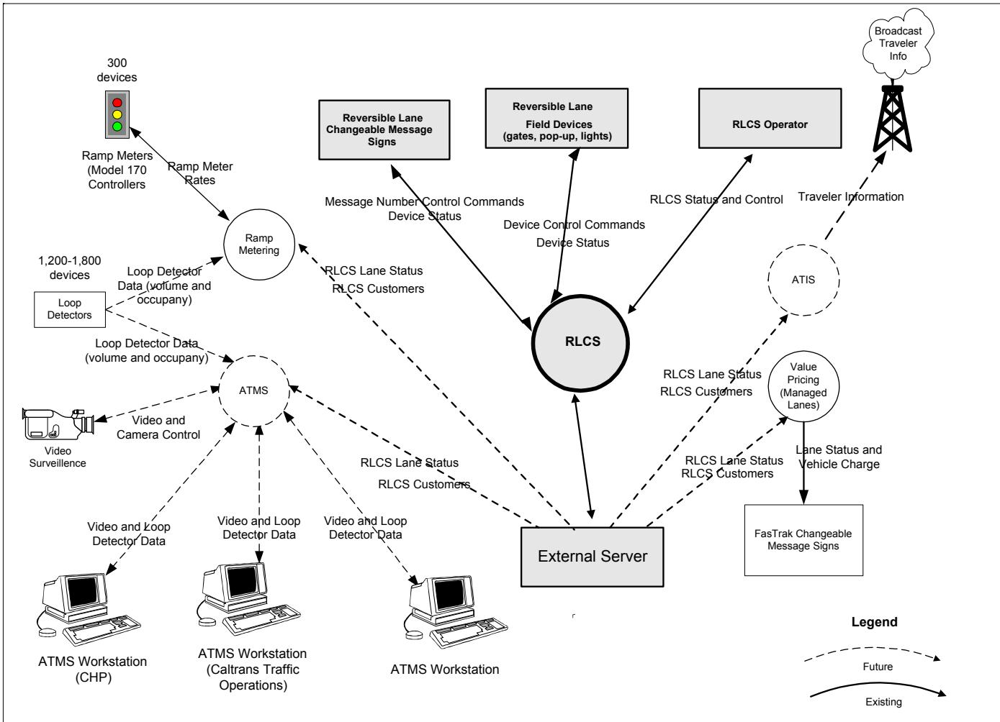
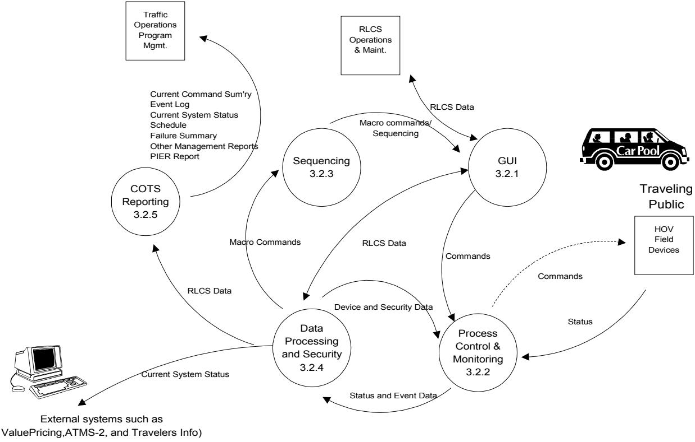
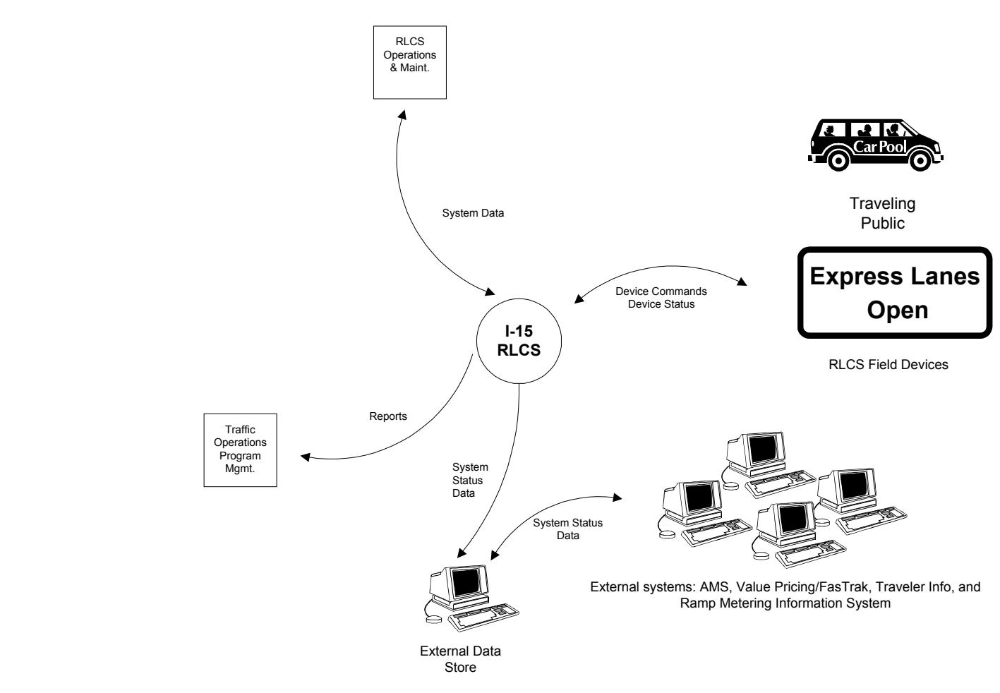
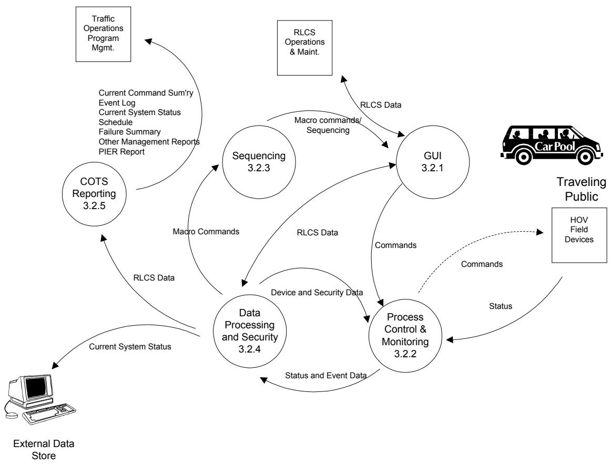
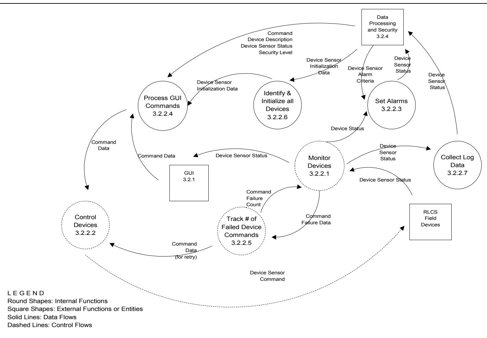
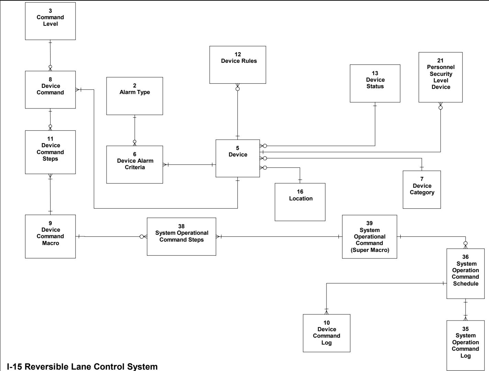
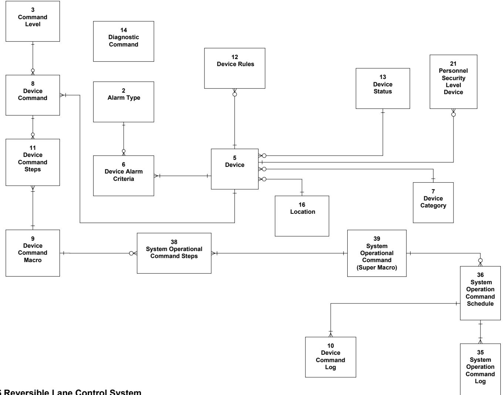
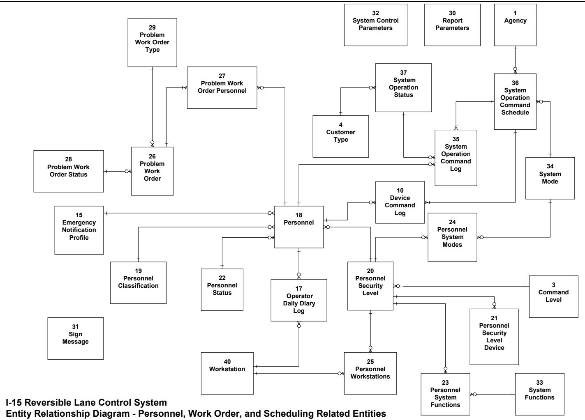

# RFP DOT-2040 Section VI.D

Caltrans

State of California Department of Transportation District 11

# I-15 Reversible Lane Control System (I-15 RLCS) Application Software Requirements Specification

\*\*\* to be finalized by contractor \*\*\*

April 21, 2004

## I-15 RLCS Software Requirements Specification

## Modification History

After the baseline version of this document is approved, any changes made to the document must be approved in accordance with the provisions of the established Change Management Plan.

## I-15 RLCS Software Requirements Specification

## Table of Contents

1. INTRODUCTION ....   
1.1. PURPOSE. .. 5   
1.2. SCOPE. .. 5   
1.2.1. Objectives .6   
1.3. DEFINITIONS, ACRONYMS, AND ABBREVIATIONS ..   
1.4. REFERENCES. .. 6   
1.5. OVERVIEW .6   
2. OVERALL DESCRIPTION..   
2.1. PRODUCT PERSPECTIVE .7   
2.1.1. External System Interfaces. 7   
2.1.2. User Interface 9   
2.1.3. Hardware Interfaces . 9   
2.1.4. Software Interfaces   
2.1.5. Communications Interfaces . .9   
2.1.6. Memory constraints .... .9   
2.1.7. Operations . .. 9   
2.1.8. Site Adaptation. .. 9   
2.2. PRODUCT FUNCTIONS . ..10   
2.3. USER CHARACTERISTICS. .11   
2.4. CONSTRAINTS. .11   
2.5. ASSUMPTIONS AND DEPENDENCIES ... 12   
2.6. APPORTIONING OF THE REQUIREMENTS .13   
3. SPECIFIC REQUIREMENTS .................. ..... 14   
3.1. EXTERNAL INTERFACE REQUIREMENTS ..14   
3.1.1. Hardware Interfaces . ... 14   
3.1.2. External System Interfaces. ..18   
3.1.3. Communications interfaces.. ..18   
3.2. FUNCTIONAL REQUIREMENT.. ..19   
3.2.1. Graphical User Interface (GUI) .19   
3.2.2. Process Monitoring and Control ..24   
3.2.3 Sequencing... ..27   
3.2.4 Data Processing and Security. .29   
3.2.5 Reporting .31   
3.3 PERFORMANCE ..33   
3.3.1 External Interfaces. ..33   
3.3.2 User Interface (GUI). ..33   
3.3.3 Process Monitoring and Control . ..33   
3.3.4 Sequencing... ..34   
3.3.5 Data Processing and Security. ..34   
3.3.6 Reporting . ..34   
3.3.7 Communications .34   
3.4 LOGICAL DATABASE REQUIREMENTS. .36   
3.5 DESIGN CONSTRAINTS. .38   
3.5.1 Commercial Off-the-Shelf Software . ..38   
3.5.2 Security . ..38   
3.6 RLCS APPLICATION SOFTWARE ATTRIBUTES . .38   
3.6.2 Availability.. ..39   
3.6.3 Maintainability.. ..39   
APPENDIXES A - TRACEABILITY MATRICES .41   
APPENDIX B – TERMINOLOGY .42   
APPENDIX C – DATA FLOW DIAGRAMS, AND DATA MODEL. ..43   
APPENDIX D – HARDWARE INTERFACE I/O CARD PIN CONFIGURATION.. ..53   
FCU – NORTH EXISTING HARDWARE INTERFACE. ..53   
FCU – SOUTH EXISTING HARDWARE INTERFACE . ..55   
APPENDIX E – TRANSPORTATION ELECTRICAL EQUIPMENT SPECIFICATION (TEES) FOR THE 2070   
CONTROLLER.... ..57   
APPENDIX F – INITIAL SYSTEM CONFIGURATION DATA FOR OPERATIONAL SEQUENCES AND   
SYSTEM MODES. ..58   
F.1 Open Entrances. .58   
F.2 Roadway Closure Device Status. .58   
F.3 Opening Sequences .58   
F.4 Closing Sequences. .59   
F.5 ‘Halted’ Opening and Closing Sequences. .60   
F.6 Multiple Entrances. .60   
F.7 Safety Screening of Commands .60   
F.8 Control System Integrity .61   
F.9 Control System Integrity Verification. .61   
F.10 Access and Safety Characteristics of the I-15 Reversible Roadway .62   
F.11 Normal Operations (Operator is logged on) .63   
F.12 Unattended Operations (No operator is logged on) .65   
APPENDIX G – REQUIREMENTS WORKING GROUP. ..66

I-15 RLCS Software Requirements Specification

## 1. Introduction

## 1.1. Purpose

This document defines the application software requirements for the Interstate -15 Reversible Lane Control System (I-15 RLCS).

The RLCS application software (‘RLCS Application’) will meet all of the software requirements listed in this document, and if any changes are made to the original set of requirements, this document will reflect those changes upon approval of project management and the appropriate stakeholders.

## 1.2. Scope

The purpose of the (I-15 RLCS) is to open and close the reversible lanes for morning and evening peak traffic hours and any special events defined by operators of the system. The software developed from this specification will replace the current aging and non-expandable RLCS Application. In addition, new controller devices, as well as field device interface cards will be provided by the successful bidder, and the software will interface with these new field hardware components via interfaces to driver software.

I-15 RLCS Software Requirements Specification

## 1.2.1. Objectives

The RLCS Application must support the objectives listed in Section 1.2 System Goals, in the System Requirements Specification.

## 1.3. Definitions, acronyms, and abbreviations

See Appendix B for a list of terms used in this document.

## 1.4. References

The reference documents below were used to prepare this requirements document:

<table><tr><td rowspan=1 colspan=1>Title</td><td rowspan=1 colspan=1>Prepared By</td><td rowspan=1 colspan=1>Date</td></tr><tr><td rowspan=1 colspan=1>I-15 Reversible Lane Control SystemExisting Systems Documentation Report</td><td rowspan=1 colspan=1>Caltrans</td><td rowspan=1 colspan=1>June, 1998</td></tr><tr><td rowspan=1 colspan=1>I-15 Reversible Lane Control SystemSystem Requirements Document – Version D</td><td rowspan=1 colspan=1>Caltrans</td><td rowspan=1 colspan=1>March, 2002</td></tr><tr><td rowspan=1 colspan=1>I-15 Reversible Lane Control System Project –User Requirements Document – Version D</td><td rowspan=1 colspan=1>Caltrans</td><td rowspan=1 colspan=1>December, 1998</td></tr><tr><td rowspan=1 colspan=1>I-15 Reversible Lane Control SystemFeasibility Study Report</td><td rowspan=1 colspan=1>VIP</td><td rowspan=1 colspan=1>July, 2001</td></tr><tr><td rowspan=1 colspan=1>IEEE Recommended Practice for SoftwareRequirements Specifications 830-1998</td><td rowspan=1 colspan=1>IEEE</td><td rowspan=1 colspan=1>1998</td></tr><tr><td rowspan=1 colspan=1>IEEE /EIA 12207.1 – 1997: Guide forInformation Technology Software Life CycleProcesses – Life Cycle Data</td><td rowspan=1 colspan=1>IEEE SESC (SoftwareEngineering StandardsCommittee)</td><td rowspan=1 colspan=1>1997</td></tr></table>

Exhibit 1.1 - Reference Documents

Appendix A provides a Traceability Matrix that maps the System Requirements to this document.

## 1.5. Overview

The remainder of this document is divided into two sections.

Section 2 gives a high-level, user- and operationally-oriented view of the software.

Section 3 provides the detailed requirements including explicitly stated and derived functional requirements from which the RLCS Application will be designed.

I-15 RLCS Software Requirements Specification

## 2. Overall description

This section describes the general factors that affect the RLCS Application software requirements. This section does not state specific requirements, instead it provides a background for those requirements, which are defined in detail in Section 3.

The RLCS Application will allow an operator to view system status and issue commands to change device status as well as configure the system and generate reports. The five major functions of the RLCS application software are a Graphical User Interface (GUI), Process Control and Monitoring, Sequencing, Data Processing and Security, and Reporting.

## 2.1. Product perspective

This section describes how the RLCS Application software relates to other systems and software as well as how it functions internally.

## 2.1.1. External System Interfaces

2.1.1.1. In addition to providing data to the system users and traffic operations management, the RLCS Application will provide data to other external systems via an external server data store accessible by other external systems such as ATMS-2, ValuePricing/FasTrak, and ATIS.

2.1.1.2. The RLCS Application will also allow for remote access through a firewall via outside telecommunications networks by authorized users.

I-15 RLCS Software Requirements Specification

The diagram below shows the flow of information to and from the different interfaces.

  
Exhibit 2.3: External RLCS Application Interfaces

I-15 RLCS Software Requirements Specification

## 2.1.2. User Interface

The user will operate the RLCS Application software using a graphical user interface.

## 2.1.3. Hardware Interfaces

RLCS application will seamlessly interface and control hardware devices.

## 2.1.4. Software Interfaces

This section discusses interfaces between the RLCS application and other software, which may include but are not limited to: Workstation O/S, Network O/S, Controller O/S, a database management system, and a reporting tool

## 2.1.5. Communications Interfaces

The RLCS will provide access to system status data, to external systems through a firewall. This will be a one way data transfer to a computer outside of the RLCS network and making it available there for public use. The transfer will occur every 30 seconds. A one way serial data transfer will also be provided.

RLCS workstations and controllers will reside on a private network to communicate field device information.

The RLCS private network communication media will include fiber, Cat 5 wiring Leased lines and dial-up lines

Communications from the TMC to the DCU controllers is through the FCU controller. In addition, wireless connections between the FCU and DCU controllers are not an option due to security and interference considerations

## 2.1.6. Memory constraints

The only memory constraints imposed on the software will depend on constraints associated with the intelligent controller selected for the system. For the 2070 controller, reference the TEES document in Appendix E.

## 2.1.7. Operations

The RLCS Application will support the operations described in ‘Section 2.8 Operational Scenarios’ of the RLCS System Requirements Specification..

## 2.1.8. Site Adaptation

The RLCS Application will operate as a component of the RLCS System, for which physical adaptations are described in ‘Section 3.7 Physical’ of the System Requirements Specification

I-15 RLCS Software Requirements Specification

## 2.2. Product functions

The data flow diagram below shows the five major functions of the RCLCS Application : GUI, Process Control and Monitoring, Sequencing, Data Processing and Security, and Reporting.

  
LEGEND Solid lines indicate data flows between functions. Dashed lines indicate control flows.  
I-15 Reversible Lane Control System Level 1 - Data Flow

Exhibit 2.5: I-15 RLCS Product Functions Data Flow

I-15 RLCS Software Requirements Specification

## 2.3. User characteristics

Several classes of users will access the RLCS Application. A user is defined as anyone who has the ability to ‘log on’ to the RLCS. External entities such as ATMS and ValuePricing, which will retrieve data from a server external to the RLCS network, are not considered users. Also, the driving public will have access to system status via the changeable message signs, and eventually the Traveler Information Network, but are also not considered users of the system.

<table><tr><td rowspan=1 colspan=1>User Class</td><td rowspan=1 colspan=1>Functions</td></tr><tr><td rowspan=1 colspan=1>Operator</td><td rowspan=1 colspan=1>Command control of the system during normal mode. Only one operator&#x27; may belogged onto the system at any given time. Authorized to change system mode.</td></tr><tr><td rowspan=1 colspan=1>Management</td><td rowspan=1 colspan=1>Reporting and status checking capabilities only</td></tr><tr><td rowspan=1 colspan=1>FieldMaintenanceStaff</td><td rowspan=1 colspan=1>Command control of the system only during maintenance mode. Ability to executemaintenance mode control sequences from FCU workstations or remote dial-interminals, as well as from the maintenance building workstation, but not from theTMC workstation. Not able to change system mode.</td></tr><tr><td rowspan=1 colspan=1>ElectricalSystems(Hardware)</td><td rowspan=1 colspan=1>Reporting and status checking.</td></tr><tr><td rowspan=1 colspan=1>SoftwareSystems(Software)</td><td rowspan=1 colspan=1>Reporting and status checking.</td></tr><tr><td rowspan=1 colspan=1>SystemAdministrator</td><td rowspan=1 colspan=1>A member of the District 11 technical staff (usually a Software Systems staffmember) authorized to create and modify system configuration data, including staff,devices, and scheduled operations. Authorized to changed system mode.</td></tr></table>

Security setup capabilities are defined in more detail in Section 3.

## 2.4. Constraints

The following constraints were factors in the development of the detailed requirements for the RLCS Application:

a) Regulatory policies – There were no technical regulatory policies specifically covering the RLCS Application.

b) Hardware limitations – The RLCS Application will reside on a hardware platform compatible with Microsoft Windows NT or Unix-based operating systems.

c) Interfaces to other applications – Other than system level interfaces, such as network, operating system, and database system, there will be no interfaces to other applications.

d) Parallel operation – For a short time, while the RLCS Application is being deployed in the field, the existing system will be left in place and will only be disconnected after a successful, complete system test in the field during hours when the facility is closed to traffic.

e) Audit functions – The RLCS Application will create and store log files which will track all

I-15 RLCS Software Requirements Specification

application activity.

f) Higher-order language requirements – There are no specific high level language requirements, other than that a high level language be used to develop and maintain the RLCS Application for more cost-effective maintenance efforts.

g) Reliability requirements – The RLCS Application must be available 24 hours per day, 7 days per week, 365 days per year.

h) Criticality of the application – The RLCS Application is important to the traffic management goals of the Southern California region. Opening the lanes in the direction of the peak traffic flow to route traffic onto the reversible lanes is a critical operation in meeting these goals.

i) Safety and security considerations – The safety of field maintenance staff and the traveling public is dependent on the correct functioning of the RLCS Application to open and close the facility.

Reversible Lanes facilities, whether operated manually, or by a control system, present a fundamental risk: The risk is the possibility of opening an entrance for one direction of travel, with one or more entrances already open in the opposite direction.

Should this type of event actually occur, it would be nothing less than catastrophic; for the motorists involved; for the traveling public in general, for the system operators, and for the Agency.

Another potential control system risk, lies with the barrier gates used at Locations 1, 2, and 5. Should one of these gates be lowered across an otherwise open entrance, the results could be catastrophic.

There are less serious, but possibly more common control system risks in closure device/sensor failures during the opening or closing of an entrance.

In the absence of full system overrides, if the system allows, or causes, an entrance to be opened in one direction, when an entrance in the opposite direction is open, then the system has failed.

A well designed, carefully implemented, and thoroughly tested control system, can reduce the chance of such an occurrence (due to operator error, control system or sensor failure).

In order to achieve this, the nature of the risk must be understood and continually kept in mind by control system developers and testers.

## 2.5. Assumptions and dependencies

The RLCS will benefit from the deployment of the Fiber Optic Network along I-15 Reversible Lane corridor to include the RLCS lanes. The communications between the FCU and DCU locations will continue to be copper. The primary mode of communication is fiber and secondary is ISDN. The fail over will be transparent to the RLCS application.

I-15 RLCS Software Requirements Specification

A dialup connection will be used for remote access to the RLCS.

## 2.6. Apportioning of the requirements

The RLCS software will not be apportioned, or split between multiple releases. The complete set of requirements will be included in one release.

I-15 RLCS Software Requirements Specification

## 3. Specific Requirements

This section of the SRS contains the RLCS Application software requirements to a level of detail sufficient to enable designers to design the system, and acceptance testers to test that the system satisfies the requirements.

These software requirements will be revised by the contractor to reflect the final approved RLCS architecture design. This will be done before high-level software design phase.

Every stated requirement is externally perceivable by users, operators, or other external systems.

This section describes each input into the software, every output from the software, and all functions performed by the software.

## 3.1. External Interface requirements

## 3.1.1. Hardware Interfaces

Multiple field devices will interface with updated device input/output cards that in turn will interface with an intelligent controller. It is unknown at this time which particular controller will be used to control the field devices, but the software must interface with whichever controller is chosen to interface with the field devices. The field devices and controllers in the table on the following page are currently in use at the facility. See Appendix D for a table of current FCU-DCU and FCU-CMS interface pin configurations.

## 3.1.1.1 Field Device I/O Drivers

The RLCS software shall send to and receive data from the field device I/O cards through I/O driver software.

## I-15 RLCS Software Requirements Specification

The tables below show the description and locations of the field devices currently installed and to be installed at the facility. Appendix D contains a chart with I/O card pin configurations.

<table><tr><td rowspan=2 colspan=1>FieldDevice</td><td rowspan=2 colspan=1>Description</td><td rowspan=1 colspan=3>FCU-S*</td><td rowspan=1 colspan=2>FCU-N*</td><td rowspan=2 colspan=1>Comments</td></tr><tr><td rowspan=1 colspan=1>DCU 1</td><td rowspan=1 colspan=1>DCU 2</td><td rowspan=1 colspan=1>DCU 3</td><td rowspan=1 colspan=1>DCU 4</td><td rowspan=1 colspan=1>DCU 5</td></tr><tr><td rowspan=1 colspan=1>MCU</td><td rowspan=1 colspan=1>Manual Control Unit</td><td rowspan=1 colspan=1>1</td><td rowspan=1 colspan=1>1</td><td rowspan=1 colspan=1>1</td><td rowspan=1 colspan=1>1</td><td rowspan=1 colspan=1>1</td><td rowspan=3 colspan=1>Type ofdevicesControlled byeach FCUcontroller.</td></tr><tr><td rowspan=1 colspan=1>Gate</td><td rowspan=1 colspan=1>Barrier Gate</td><td rowspan=1 colspan=1>1</td><td rowspan=1 colspan=1>1</td><td rowspan=1 colspan=1>0</td><td rowspan=1 colspan=1>0</td><td rowspan=1 colspan=1>1</td></tr><tr><td rowspan=1 colspan=1>DrawLights</td><td rowspan=1 colspan=1>Entrance Street Lights</td><td rowspan=1 colspan=1>1</td><td rowspan=1 colspan=1>1</td><td rowspan=1 colspan=1>0</td><td rowspan=1 colspan=1>0</td><td rowspan=1 colspan=1>1</td></tr><tr><td rowspan=1 colspan=1>WrongWayLights</td><td rowspan=1 colspan=1>Barrier Lights</td><td rowspan=1 colspan=1>1</td><td rowspan=1 colspan=1>0</td><td rowspan=1 colspan=1>1</td><td rowspan=1 colspan=1>1</td><td rowspan=1 colspan=1>0</td><td rowspan=1 colspan=1></td></tr><tr><td rowspan=1 colspan=1>EL-1</td><td rowspan=1 colspan=1>Longitudinal Entrance Pop-Up</td><td rowspan=1 colspan=1>3</td><td rowspan=1 colspan=1>2</td><td rowspan=1 colspan=1></td><td rowspan=1 colspan=1></td><td rowspan=1 colspan=1>5</td><td rowspan=14 colspan=1>Number ofper bank.</td></tr><tr><td rowspan=1 colspan=1>EL-2</td><td rowspan=1 colspan=1>Longitudinal Entrance Pop-Up</td><td rowspan=1 colspan=1>5</td><td rowspan=1 colspan=1>5</td><td rowspan=1 colspan=1></td><td rowspan=1 colspan=1></td><td rowspan=1 colspan=1>6</td></tr><tr><td rowspan=2 colspan=1>EL-3</td><td rowspan=2 colspan=1>Longitudinal Entrance Pop-Up</td><td rowspan=2 colspan=1>4</td><td rowspan=2 colspan=1>9</td><td rowspan=2 colspan=1></td><td rowspan=2 colspan=1></td><td rowspan=2 colspan=1>6</td></tr><tr><td rowspan=1 colspan=1>pop-up</td></tr><tr><td rowspan=1 colspan=1>EL-4</td><td rowspan=1 colspan=1>Longitudinal Entrance Pop-Up</td><td rowspan=1 colspan=1>5</td><td rowspan=1 colspan=1></td><td rowspan=1 colspan=1></td><td rowspan=1 colspan=1></td><td rowspan=1 colspan=1>6</td><td rowspan=1 colspan=1>per bar</td></tr><tr><td rowspan=1 colspan=1>EL-5</td><td rowspan=1 colspan=1>Longitudinal Entrance Pop-Up</td><td rowspan=1 colspan=1>6</td><td rowspan=1 colspan=1></td><td rowspan=1 colspan=1></td><td rowspan=1 colspan=1></td><td rowspan=1 colspan=1>3</td><td rowspan=1 colspan=1></td></tr><tr><td rowspan=1 colspan=1>ET-1</td><td rowspan=1 colspan=1>Transverse Entrance Pop-Up</td><td rowspan=1 colspan=1>7</td><td rowspan=1 colspan=1>9</td><td rowspan=1 colspan=1></td><td rowspan=1 colspan=1></td><td rowspan=1 colspan=1>8</td></tr><tr><td rowspan=1 colspan=1>WL-1</td><td rowspan=1 colspan=1>Longitudinal Wrong Way Pop-Up</td><td rowspan=1 colspan=1>4</td><td rowspan=1 colspan=1></td><td rowspan=1 colspan=1>4</td><td rowspan=1 colspan=1>4</td><td rowspan=1 colspan=1></td></tr><tr><td rowspan=1 colspan=1>WL-2</td><td rowspan=1 colspan=1>Longitudinal Wrong Way Pop-Up</td><td rowspan=1 colspan=1>5</td><td rowspan=1 colspan=1></td><td rowspan=1 colspan=1>5</td><td rowspan=1 colspan=1>7</td><td rowspan=1 colspan=1></td></tr><tr><td rowspan=1 colspan=1>WL-3</td><td rowspan=1 colspan=1>Longitudinal Wrong Way Pop-Up</td><td rowspan=1 colspan=1>5</td><td rowspan=1 colspan=1></td><td rowspan=1 colspan=1>7</td><td rowspan=1 colspan=1></td><td rowspan=1 colspan=1></td></tr><tr><td rowspan=1 colspan=1>WL-4</td><td rowspan=1 colspan=1>Longitudinal Wrong Way Pop-Up</td><td rowspan=1 colspan=1>4</td><td rowspan=1 colspan=1></td><td rowspan=1 colspan=1>7</td><td rowspan=1 colspan=1></td><td rowspan=1 colspan=1></td></tr><tr><td rowspan=1 colspan=1>WL-5</td><td rowspan=1 colspan=1>Longitudinal Wrong Way Pop-Up</td><td rowspan=1 colspan=1></td><td rowspan=1 colspan=1></td><td rowspan=1 colspan=1>7</td><td rowspan=1 colspan=1></td><td rowspan=1 colspan=1></td></tr><tr><td rowspan=1 colspan=1>WT-1</td><td rowspan=1 colspan=1>Transverse Wrong Way Pop-Up</td><td rowspan=1 colspan=1></td><td rowspan=1 colspan=1></td><td rowspan=1 colspan=1>5</td><td rowspan=1 colspan=1>10</td><td rowspan=1 colspan=1></td></tr><tr><td rowspan=1 colspan=1>WT-2</td><td rowspan=1 colspan=1>Transverse Wrong Way Pop-Up</td><td rowspan=1 colspan=1>6</td><td rowspan=1 colspan=1></td><td rowspan=1 colspan=1></td><td rowspan=1 colspan=1>11</td><td rowspan=1 colspan=1></td></tr><tr><td rowspan=1 colspan=1>CMS 1-4</td><td rowspan=1 colspan=1>I-15 northbound RLCSapproach</td><td rowspan=1 colspan=1></td><td rowspan=1 colspan=1></td><td rowspan=1 colspan=1></td><td rowspan=1 colspan=1></td><td rowspan=1 colspan=1></td><td rowspan=1 colspan=1>Controlledfrom FCUSouth</td></tr><tr><td rowspan=1 colspan=1>CMS 5-8</td><td rowspan=1 colspan=1>SR 163 northbound RLCSapproach</td><td rowspan=1 colspan=1></td><td rowspan=1 colspan=1></td><td rowspan=1 colspan=1></td><td rowspan=1 colspan=1></td><td rowspan=1 colspan=1></td><td rowspan=1 colspan=1>Controlledfrom FCUSouth</td></tr><tr><td rowspan=1 colspan=1>CMS 9-12</td><td rowspan=1 colspan=1>I-15 southbound RLCSapproach</td><td rowspan=1 colspan=1></td><td rowspan=1 colspan=1></td><td rowspan=1 colspan=1></td><td rowspan=1 colspan=1></td><td rowspan=1 colspan=1></td><td rowspan=1 colspan=1>Controlledfrom FCUNorth</td></tr></table>

Exhibit 3.1: I-15 RLCS Controllers and Field Devices

\*The controllers at the FCU and DCU will be replaced with modern controllers such as the Department of Transportation 2070 Advanced Transportation Controller (ATC) or a controller with equal or better capabilities.

## I-15 RLCS Software Requirements Specification

RLCS Inputs to and outputs from the FCU and DCU Controllers
<table><tr><td rowspan=1 colspan=1>Field Device</td><td rowspan=1 colspan=1>Device Sensors</td><td rowspan=1 colspan=1>InputsOrOutputs</td><td rowspan=1 colspan=1>FCUS</td><td rowspan=1 colspan=1>FCU-NDCU</td><td rowspan=1 colspan=1>1</td><td rowspan=1 colspan=1>MCU1</td><td rowspan=1 colspan=1>DCU 2</td><td rowspan=1 colspan=1>MCU2</td><td rowspan=1 colspan=1>DCU3</td><td rowspan=1 colspan=1>M CU3</td><td rowspan=1 colspan=1>DCUM4</td><td rowspan=1 colspan=1>CU 4</td><td rowspan=1 colspan=1>DCUMC5</td><td rowspan=1 colspan=1>U5</td><td rowspan=1 colspan=1>Total #ofSensors</td></tr><tr><td rowspan=1 colspan=1>Barrier Lights</td><td rowspan=1 colspan=1>LHS and LHN Light</td><td rowspan=1 colspan=1>Output</td><td rowspan=1 colspan=1>4</td><td rowspan=1 colspan=1>4</td><td rowspan=1 colspan=1>1</td><td rowspan=1 colspan=1>0</td><td rowspan=1 colspan=1>1</td><td rowspan=1 colspan=1>0</td><td rowspan=1 colspan=1>1</td><td rowspan=1 colspan=1>0</td><td rowspan=1 colspan=1>1</td><td rowspan=1 colspan=1>0</td><td rowspan=1 colspan=1>1</td><td rowspan=1 colspan=1>0</td><td rowspan=1 colspan=1>13</td></tr><tr><td rowspan=2 colspan=1>FCUsand DCUs</td><td rowspan=1 colspan=1>Cabinet ID</td><td rowspan=1 colspan=1>Input</td><td rowspan=1 colspan=1>4</td><td rowspan=1 colspan=1>4</td><td rowspan=1 colspan=1>0</td><td rowspan=1 colspan=1>0</td><td rowspan=1 colspan=1>0</td><td rowspan=1 colspan=1>0</td><td rowspan=1 colspan=1>0</td><td rowspan=1 colspan=1>0</td><td rowspan=1 colspan=1>0</td><td rowspan=1 colspan=1>0</td><td rowspan=1 colspan=1>0</td><td rowspan=1 colspan=1>0</td><td rowspan=1 colspan=1>8</td></tr><tr><td rowspan=1 colspan=1>Compressor Pressure</td><td rowspan=1 colspan=1>Input</td><td rowspan=1 colspan=1>1</td><td rowspan=1 colspan=1>1</td><td rowspan=1 colspan=1>0</td><td rowspan=1 colspan=1>0</td><td rowspan=1 colspan=1>0</td><td rowspan=1 colspan=1>0</td><td rowspan=1 colspan=1>0</td><td rowspan=1 colspan=1>0</td><td rowspan=1 colspan=1>0</td><td rowspan=1 colspan=1>0</td><td rowspan=1 colspan=1>0</td><td rowspan=1 colspan=1></td><td rowspan=1 colspan=1>2</td></tr><tr><td rowspan=3 colspan=1>MCU</td><td rowspan=1 colspan=1>Air Tank Press</td><td rowspan=1 colspan=1>Input</td><td rowspan=1 colspan=1>1</td><td rowspan=1 colspan=1>1</td><td rowspan=1 colspan=1>0</td><td rowspan=1 colspan=1>1</td><td rowspan=1 colspan=1>0</td><td rowspan=1 colspan=1>1</td><td rowspan=1 colspan=1>0</td><td rowspan=1 colspan=1>1</td><td rowspan=1 colspan=1>0</td><td rowspan=1 colspan=1>1</td><td rowspan=1 colspan=1>0</td><td rowspan=1 colspan=1>1</td><td rowspan=1 colspan=1>7</td></tr><tr><td rowspan=1 colspan=1>Line Air Press</td><td rowspan=1 colspan=1>Input</td><td rowspan=1 colspan=1>0</td><td rowspan=1 colspan=1>0</td><td rowspan=1 colspan=1>0</td><td rowspan=1 colspan=1>1</td><td rowspan=1 colspan=1>0</td><td rowspan=1 colspan=1>1</td><td rowspan=1 colspan=1>0</td><td rowspan=1 colspan=1>1</td><td rowspan=1 colspan=1>0</td><td rowspan=1 colspan=1>1</td><td rowspan=1 colspan=1>0</td><td rowspan=1 colspan=1>1</td><td rowspan=1 colspan=1>5</td></tr><tr><td rowspan=1 colspan=1>Auto/ Manual</td><td rowspan=1 colspan=1>Input</td><td rowspan=1 colspan=1>0</td><td rowspan=1 colspan=1>0</td><td rowspan=1 colspan=1>0</td><td rowspan=1 colspan=1>1</td><td rowspan=1 colspan=1>0</td><td rowspan=1 colspan=1>1</td><td rowspan=1 colspan=1>0</td><td rowspan=1 colspan=1>1</td><td rowspan=1 colspan=1>0</td><td rowspan=1 colspan=1>1</td><td rowspan=1 colspan=1>0</td><td rowspan=1 colspan=1>1</td><td rowspan=1 colspan=1>5</td></tr><tr><td rowspan=5 colspan=1>Pop-Ups</td><td rowspan=1 colspan=1>Pop-Up Power Enable</td><td rowspan=1 colspan=1>Output</td><td rowspan=1 colspan=1>0</td><td rowspan=1 colspan=1>0</td><td rowspan=1 colspan=1>1</td><td rowspan=1 colspan=1>0</td><td rowspan=1 colspan=1>1</td><td rowspan=1 colspan=1>0</td><td rowspan=1 colspan=1>1</td><td rowspan=1 colspan=1>0</td><td rowspan=1 colspan=1>1</td><td rowspan=1 colspan=1>0</td><td rowspan=1 colspan=1>1</td><td rowspan=1 colspan=1>0</td><td rowspan=1 colspan=1>5</td></tr><tr><td rowspan=1 colspan=1>Pop-Up Entrance Up</td><td rowspan=1 colspan=1>Output</td><td rowspan=1 colspan=1>0</td><td rowspan=1 colspan=1>0</td><td rowspan=1 colspan=1>6</td><td rowspan=1 colspan=1>0</td><td rowspan=1 colspan=1>4</td><td rowspan=1 colspan=1>0</td><td rowspan=1 colspan=1>0</td><td rowspan=1 colspan=1>0</td><td rowspan=1 colspan=1>0</td><td rowspan=1 colspan=1>0</td><td rowspan=1 colspan=1>6</td><td rowspan=1 colspan=1>0</td><td rowspan=1 colspan=1>16</td></tr><tr><td rowspan=1 colspan=1>Pop-Up Entrance Down</td><td rowspan=1 colspan=1>Output</td><td rowspan=1 colspan=1>0</td><td rowspan=1 colspan=1>0</td><td rowspan=1 colspan=1>6</td><td rowspan=1 colspan=1>0</td><td rowspan=1 colspan=1>4</td><td rowspan=1 colspan=1>0</td><td rowspan=1 colspan=1>0</td><td rowspan=1 colspan=1>0</td><td rowspan=1 colspan=1>0</td><td rowspan=1 colspan=1>0</td><td rowspan=1 colspan=1>6</td><td rowspan=1 colspan=1>0</td><td rowspan=1 colspan=1>16</td></tr><tr><td rowspan=1 colspan=1>Pop-Up Wrong Way Up</td><td rowspan=1 colspan=1>Output</td><td rowspan=1 colspan=1>0</td><td rowspan=1 colspan=1>0</td><td rowspan=1 colspan=1>5</td><td rowspan=1 colspan=1>0</td><td rowspan=1 colspan=1>0</td><td rowspan=1 colspan=1>0</td><td rowspan=1 colspan=1>6</td><td rowspan=1 colspan=1>0</td><td rowspan=1 colspan=1>4</td><td rowspan=1 colspan=1>0</td><td rowspan=1 colspan=1>0</td><td rowspan=1 colspan=1>0</td><td rowspan=1 colspan=1>15</td></tr><tr><td rowspan=1 colspan=1>Pop-Up Wrong Way Down</td><td rowspan=1 colspan=1>Output</td><td rowspan=1 colspan=1>0</td><td rowspan=1 colspan=1>0</td><td rowspan=1 colspan=1>5</td><td rowspan=1 colspan=1>0</td><td rowspan=1 colspan=1>0</td><td rowspan=1 colspan=1>0</td><td rowspan=1 colspan=1>6</td><td rowspan=1 colspan=1>0</td><td rowspan=1 colspan=1>4</td><td rowspan=1 colspan=1>0</td><td rowspan=1 colspan=1>0</td><td rowspan=1 colspan=1>0</td><td rowspan=1 colspan=1>15</td></tr><tr><td rowspan=1 colspan=1>CMS</td><td rowspan=1 colspan=1>CMS</td><td rowspan=1 colspan=1>Input/Output</td><td rowspan=1 colspan=1>8</td><td rowspan=1 colspan=1>4</td><td rowspan=1 colspan=1>0</td><td rowspan=1 colspan=1>0</td><td rowspan=1 colspan=1>0</td><td rowspan=1 colspan=1>0</td><td rowspan=1 colspan=1>0</td><td rowspan=1 colspan=1>0</td><td rowspan=1 colspan=1>0</td><td rowspan=1 colspan=1>0</td><td rowspan=1 colspan=1>0</td><td rowspan=1 colspan=1>0</td><td rowspan=1 colspan=1>12</td></tr><tr><td rowspan=5 colspan=1>Gate</td><td rowspan=1 colspan=1>Gate Power Enable</td><td rowspan=1 colspan=1>Output</td><td rowspan=1 colspan=1>0</td><td rowspan=1 colspan=1>0</td><td rowspan=1 colspan=1>1</td><td rowspan=1 colspan=1>0</td><td rowspan=1 colspan=1>1</td><td rowspan=1 colspan=1>0</td><td rowspan=1 colspan=1>1</td><td rowspan=1 colspan=1>0</td><td rowspan=1 colspan=1>0</td><td rowspan=1 colspan=1>0</td><td rowspan=1 colspan=1>1</td><td rowspan=1 colspan=1>0</td><td rowspan=1 colspan=1>4</td></tr><tr><td rowspan=1 colspan=1>Gate Warning Lights</td><td rowspan=1 colspan=1>Output</td><td rowspan=1 colspan=1>0</td><td rowspan=1 colspan=1>0</td><td rowspan=1 colspan=1>1</td><td rowspan=1 colspan=1>0</td><td rowspan=1 colspan=1>1</td><td rowspan=1 colspan=1>0</td><td rowspan=1 colspan=1>1</td><td rowspan=1 colspan=1>0</td><td rowspan=1 colspan=1>0</td><td rowspan=1 colspan=1>0</td><td rowspan=1 colspan=1>1</td><td rowspan=1 colspan=1>0</td><td rowspan=1 colspan=1>4</td></tr><tr><td rowspan=1 colspan=1>Gate Up</td><td rowspan=1 colspan=1>Input/Output</td><td rowspan=1 colspan=1>0</td><td rowspan=1 colspan=1>0</td><td rowspan=1 colspan=1>1</td><td rowspan=1 colspan=1>0</td><td rowspan=1 colspan=1>1</td><td rowspan=1 colspan=1>0</td><td rowspan=1 colspan=1>1</td><td rowspan=1 colspan=1>0</td><td rowspan=1 colspan=1>0</td><td rowspan=1 colspan=1>0</td><td rowspan=1 colspan=1>1</td><td rowspan=1 colspan=1>0</td><td rowspan=1 colspan=1>4</td></tr><tr><td rowspan=1 colspan=1>Gate 15 Deg. Down</td><td rowspan=1 colspan=1>Input/Output</td><td rowspan=1 colspan=1>0</td><td rowspan=1 colspan=1>0</td><td rowspan=1 colspan=1>1</td><td rowspan=1 colspan=1>0</td><td rowspan=1 colspan=1>1</td><td rowspan=1 colspan=1>0</td><td rowspan=1 colspan=1>1</td><td rowspan=1 colspan=1>0</td><td rowspan=1 colspan=1>0</td><td rowspan=1 colspan=1>0</td><td rowspan=1 colspan=1>1</td><td rowspan=1 colspan=1>0</td><td rowspan=1 colspan=1>4</td></tr><tr><td rowspan=1 colspan=1>Gate Down</td><td rowspan=1 colspan=1>Input/Output</td><td rowspan=1 colspan=1>0</td><td rowspan=1 colspan=1>0</td><td rowspan=1 colspan=1>1</td><td rowspan=1 colspan=1>0</td><td rowspan=1 colspan=1>1</td><td rowspan=1 colspan=1>0</td><td rowspan=1 colspan=1>1</td><td rowspan=1 colspan=1>0</td><td rowspan=1 colspan=1>0</td><td rowspan=1 colspan=1>0</td><td rowspan=1 colspan=1>1</td><td rowspan=1 colspan=1>0</td><td rowspan=1 colspan=1>4</td></tr><tr><td rowspan=1 colspan=1></td><td rowspan=1 colspan=1>TOTAL # OF SENSORS:</td><td rowspan=1 colspan=1></td><td rowspan=1 colspan=1>18</td><td rowspan=1 colspan=1>14</td><td rowspan=1 colspan=1>29</td><td rowspan=1 colspan=1>3</td><td rowspan=1 colspan=1>15</td><td rowspan=1 colspan=1>3</td><td rowspan=1 colspan=1>19</td><td rowspan=1 colspan=1>3</td><td rowspan=1 colspan=1>10</td><td rowspan=1 colspan=1>3</td><td rowspan=1 colspan=1>19</td><td rowspan=1 colspan=1>3</td><td rowspan=1 colspan=1>139</td></tr></table>

Exhibit 3.2a: Currently installed I-15 RLCS Field Sensors and Devices

Devices to be added to the RLCS are shown in Exhibit 3.2b.

## I-15 RLCS Software Requirements Specification

RLCS Inputs to and outputs from the FCU and DCU Controllers
<table><tr><td rowspan=1 colspan=1>Field Device</td><td rowspan=1 colspan=1>Device Sensors</td><td rowspan=1 colspan=1>InputsOrOutputs</td><td rowspan=1 colspan=1>FCU-S</td><td rowspan=1 colspan=1>FCU-N</td><td rowspan=1 colspan=1>DCU 1</td><td rowspan=1 colspan=1>DCU 2</td><td rowspan=1 colspan=1>DCU 3</td><td rowspan=1 colspan=1>DCU 4</td><td rowspan=1 colspan=1>DCU 5</td><td rowspan=1 colspan=1>Total #ofSensors</td></tr><tr><td rowspan=1 colspan=1>FCUs</td><td rowspan=1 colspan=1>Watchdog Timer</td><td rowspan=1 colspan=1>Output</td><td rowspan=1 colspan=1>1</td><td rowspan=1 colspan=1>1</td><td rowspan=1 colspan=1>0</td><td rowspan=1 colspan=1>0</td><td rowspan=1 colspan=1>0</td><td rowspan=1 colspan=1>0</td><td rowspan=1 colspan=1>0</td><td rowspan=1 colspan=1>2</td></tr><tr><td rowspan=3 colspan=1>FCUs/DCUs</td><td rowspan=1 colspan=1>Watchdog Status</td><td rowspan=1 colspan=1>Output</td><td rowspan=1 colspan=1>1</td><td rowspan=1 colspan=1>1</td><td rowspan=1 colspan=1>1</td><td rowspan=1 colspan=1>1</td><td rowspan=1 colspan=1>1</td><td rowspan=1 colspan=1>1</td><td rowspan=1 colspan=1>1</td><td rowspan=1 colspan=1>7</td></tr><tr><td rowspan=1 colspan=1>Temp</td><td rowspan=1 colspan=1>Input</td><td rowspan=1 colspan=1>1</td><td rowspan=1 colspan=1>1</td><td rowspan=1 colspan=1>1</td><td rowspan=1 colspan=1>1</td><td rowspan=1 colspan=1>1</td><td rowspan=1 colspan=1>1</td><td rowspan=1 colspan=1>1</td><td rowspan=1 colspan=1>7</td></tr><tr><td rowspan=1 colspan=1>Voltage</td><td rowspan=1 colspan=1>Input</td><td rowspan=1 colspan=1>1</td><td rowspan=1 colspan=1>1</td><td rowspan=1 colspan=1>1</td><td rowspan=1 colspan=1>1</td><td rowspan=1 colspan=1>1</td><td rowspan=1 colspan=1>1</td><td rowspan=1 colspan=1>1</td><td rowspan=1 colspan=1>7</td></tr><tr><td rowspan=11 colspan=1>FCUs</td><td rowspan=1 colspan=1>Yard Gate Sensor</td><td rowspan=1 colspan=1>Input</td><td rowspan=1 colspan=1>1</td><td rowspan=1 colspan=1>2</td><td rowspan=1 colspan=1>0</td><td rowspan=1 colspan=1>0</td><td rowspan=1 colspan=1>0</td><td rowspan=1 colspan=1>0</td><td rowspan=1 colspan=1>0</td><td rowspan=1 colspan=1>3</td></tr><tr><td rowspan=1 colspan=1>Equipment RoomSensor</td><td rowspan=1 colspan=1>Input</td><td rowspan=1 colspan=1>1</td><td rowspan=1 colspan=1>1</td><td rowspan=1 colspan=1>0</td><td rowspan=1 colspan=1>0</td><td rowspan=1 colspan=1>0</td><td rowspan=1 colspan=1>0</td><td rowspan=1 colspan=1>0</td><td rowspan=1 colspan=1>2</td></tr><tr><td rowspan=1 colspan=1>Control Sensor</td><td rowspan=1 colspan=1>Input</td><td rowspan=1 colspan=1>1</td><td rowspan=1 colspan=1>1</td><td rowspan=1 colspan=1>0</td><td rowspan=1 colspan=1>0</td><td rowspan=1 colspan=1>0</td><td rowspan=1 colspan=1>0</td><td rowspan=1 colspan=1>0</td><td rowspan=1 colspan=1>2</td></tr><tr><td rowspan=1 colspan=1>Fire Alarm</td><td rowspan=1 colspan=1>Input</td><td rowspan=1 colspan=1>1</td><td rowspan=1 colspan=1>1</td><td rowspan=1 colspan=1>0</td><td rowspan=1 colspan=1>0</td><td rowspan=1 colspan=1>0</td><td rowspan=1 colspan=1>0</td><td rowspan=1 colspan=1>0</td><td rowspan=1 colspan=1>2</td></tr><tr><td rowspan=1 colspan=1>Back-up AC PowerSensor</td><td rowspan=1 colspan=1>Input</td><td rowspan=1 colspan=1>1</td><td rowspan=1 colspan=1>1</td><td rowspan=1 colspan=1>0</td><td rowspan=1 colspan=1>0</td><td rowspan=1 colspan=1>0</td><td rowspan=1 colspan=1>0</td><td rowspan=1 colspan=1>0</td><td rowspan=1 colspan=1>2</td></tr><tr><td rowspan=1 colspan=1>AC Power Monitor</td><td rowspan=1 colspan=1>Input</td><td rowspan=1 colspan=1>1</td><td rowspan=1 colspan=1>1</td><td rowspan=1 colspan=1>0</td><td rowspan=1 colspan=1>0</td><td rowspan=1 colspan=1>0</td><td rowspan=1 colspan=1>0</td><td rowspan=1 colspan=1>0</td><td rowspan=1 colspan=1>2</td></tr><tr><td rowspan=1 colspan=1>Reset I/P Jack</td><td rowspan=1 colspan=1>Input</td><td rowspan=1 colspan=1>1</td><td rowspan=1 colspan=1>1</td><td rowspan=1 colspan=1>0</td><td rowspan=1 colspan=1>0</td><td rowspan=1 colspan=1>0</td><td rowspan=1 colspan=1>0</td><td rowspan=1 colspan=1>0</td><td rowspan=1 colspan=1>2</td></tr><tr><td rowspan=1 colspan=1>Air Dryer Sensor</td><td rowspan=1 colspan=1>Input</td><td rowspan=1 colspan=1>1</td><td rowspan=1 colspan=1>1</td><td rowspan=1 colspan=1>0</td><td rowspan=1 colspan=1>0</td><td rowspan=1 colspan=1>0</td><td rowspan=1 colspan=1>0</td><td rowspan=1 colspan=1>0</td><td rowspan=1 colspan=1>2</td></tr><tr><td rowspan=1 colspan=1>Air Cooler Sensor</td><td rowspan=1 colspan=1>Input</td><td rowspan=1 colspan=1>1</td><td rowspan=1 colspan=1>1</td><td rowspan=1 colspan=1>0</td><td rowspan=1 colspan=1>0</td><td rowspan=1 colspan=1>0</td><td rowspan=1 colspan=1>0</td><td rowspan=1 colspan=1>0</td><td rowspan=1 colspan=1>2</td></tr><tr><td rowspan=1 colspan=1>Air CompressorMonitor</td><td rowspan=1 colspan=1>Input</td><td rowspan=1 colspan=1>1</td><td rowspan=1 colspan=1>1</td><td rowspan=1 colspan=1>0</td><td rowspan=1 colspan=1>0</td><td rowspan=1 colspan=1>0</td><td rowspan=1 colspan=1>0</td><td rowspan=1 colspan=1>0</td><td rowspan=1 colspan=1>2</td></tr><tr><td rowspan=1 colspan=1>Air Compressor Power</td><td rowspan=1 colspan=1>Input</td><td rowspan=1 colspan=1>1</td><td rowspan=1 colspan=1>1</td><td rowspan=1 colspan=1>0</td><td rowspan=1 colspan=1>0</td><td rowspan=1 colspan=1>0</td><td rowspan=1 colspan=1>0</td><td rowspan=1 colspan=1>0</td><td rowspan=1 colspan=1>2</td></tr><tr><td rowspan=1 colspan=1>DCUs</td><td rowspan=1 colspan=1>Reset DET for I/P files</td><td rowspan=1 colspan=1>Output</td><td rowspan=1 colspan=1>0</td><td rowspan=1 colspan=1>0</td><td rowspan=1 colspan=1>1</td><td rowspan=1 colspan=1>1</td><td rowspan=1 colspan=1>1</td><td rowspan=1 colspan=1>1</td><td rowspan=1 colspan=1>1</td><td rowspan=1 colspan=1>5</td></tr><tr><td rowspan=1 colspan=1></td><td rowspan=1 colspan=1>TOTAL # OFSENSORS:</td><td rowspan=1 colspan=1></td><td rowspan=1 colspan=1>15</td><td rowspan=1 colspan=1>16</td><td rowspan=1 colspan=1>4</td><td rowspan=1 colspan=1>4</td><td rowspan=1 colspan=1>4</td><td rowspan=1 colspan=1>4</td><td rowspan=1 colspan=1>4</td><td rowspan=1 colspan=1>51</td></tr></table>

Exhibit 3.2b: Future Installation I-15 RLCS Field Device and Sensors

I-15 RLCS Software Requirements Specification

## 3.1.2. External System Interfaces

All external systems shall retrieve RLCS status from a server outside the RLCS network. (outside a firewall). A single data file will include the following data elements:

3.1.2.1. Status (e.g.: open northbound, open southbound, closed)

3.1.2.2. Customers (e.g.: RLCS/FasTrak only, all traffic)

3.1.2.3. Access (e.g.: location 1 open, location 2 closed)

3.1.2.4. Signs (e.g.: Sign 1 “Express Lanes Open”, Sign2 “Express Lanes Closed”)

## 3.1.3. Communications interfaces

There are two external communications interfaces with the RLCS Application

3.1.3.1. The first is a connection to a Department of Transportation ISSC resource (possibly a WAN connection) via a firewall. All external systems will access RLCS data through this interface. This interface is a one-way output only interface.

3.1.3.2. The second consists of a secure remote dial-in interface through a firewall via a dial-up modem. This is a two-way interface that allows connection into the RLCS network via a remote computer equipped with the application software, and with a user logon authorized for remote access.

I-15 RLCS Software Requirements Specification

## 3.2. Functional requirements

This section describes the fundamental actions that must occur to accept inputs and produce outputs. It includes explanations of validity checks on inputs, [vendor must complete the validity check information] sequences of operations, and responses to abnormal situations.

See Appendix C for a collection of analysis diagrams that supplement this section.

## 3.2.1. Graphical User Interface (GUI)

The system shall have a Graphical User Interface (GUI) that allows the operator to view system status, issue commands to change device status, configure the system, export log data, and generate reports.

Input Entities (from list of entities and attributes in 3.4 Logical Database Requirements): All entities.

Output Entities: All entities.

## 3.2.1.1. The RLCS software shall have a logon screen for the GUI.

3.2.1.1.1. The logon screen shall request user name and corresponding password.

3.2.1.1.2. The logon screen shall activate command control for the user if the user requests it and has authorization.

3.2.1.1.3. Command control shall be from only specified workstations.

3.2.1.1.4. If command control is enabled by another user, and the logging in user is of higher security, the logging in user shall be requested to accept or deny command control.

3.2.1.1.5. If another user is logged in with command control and the new user takes command control, the other user is notified

## 3.2.1.2. Time Stamp, User, and Workstation ID Window

The GUI shall indicate the current date and time, user’s name, and workstation location name. The GUI shall also show other users currently logged in the other units within the RLCS network.

## 3.2.1.3. Control/Monitor Command Entry Screen

3.2.1.3.1. The GUI shall provide an option that allows the system user to issue commands that monitor and control opening and closing events.

3.2.1.3.2. Based on the user’s security level, the control option shall provide the user with the appropriate level of control.

## I-15 RLCS Software Requirements Specification

3.2.1.3.3. The control option shall provide the user with the capability to set the operational status of failed devices.

3.2.1.3.4. The RLCS software shall display information about active overrides: Which are active, and which devices have no currently active 'rules protection' against erroneous opening/closing.

3.2.1.4. The GUI shall provide a display of the I-15 Reversible Lane Control System facility geographic area, including a layout of the mainline I-15, SR-163 freeway area in the same geographic area as the I-15 Reversible Lane. Screen information includes:

3.2.1.4.1. Facility status (e.g. ‘Open’ or ‘Closed’.)

3.2.1.4.2. Current direction of traffic flow.

3.2.1.4.3. Customer eligibility (e.g. ‘RLCS and FasTrak Only’, ‘All Traffic’)

3.2.1.4.4. Current facility boundaries extending one mile in either direction.

3.2.1.4.5. Device sensor status using dynamic icons for all field device sensors and controllers.

3.2.1.4.6.

For alarm status, the GUI shall also issue an audible alarm, and the icon shall be different from the okay status for that device. The visual alarm shall include a change of color for the affected device.

3.2.1.4.7. There shall be an option to turn off the audible alarm permanently or temporarily for a given period.

3.2.1.4.8. The alarm icon shall change to the normal status icon automatically when the alarm condition is removed. Alarm conditions shall be configurable on the screen.

3.2.1.4.9. When a device status has been overridden, on the screen it shall appear with different color from the normal and alarm status colors.

3.2.1.4.10. Status information shall continue to display when no user is logged on to the workstation and shall continually be updated every 2 seconds.

## 3.2.1.5. System Configuration Screen

3.2.1.5.1. The GUI shall provide an option for “Configuration” that is only accessible by the RLCS Software user with System Administrative privileges. It shall display and allow modification of all database tables with the exception of log tables.

## I-15 RLCS Software Requirements Specification

When the system administrator modifies the database tables, the GUI shall analyze the data before storing in the database and notify the system administrator of any conflicting or redundant entries.

3.2.1.5.2. The configuration option shall allow a security level and password to be assigned to each defined staff member.

3.2.1.5.3. User security levels shall be assigned at the command level, device, mode, workstation, and system function.

3.2.1.5.4. The configuration option shall also allow user accounts l to be changed remotely in the field units.

3.2.1.5.5. When an operator is making changes on the system, the GUI configuration screen shall display to the user which device, controller, or workstation in the RLCS network will be affected by the changes. For example, when the user is making a changes in Pressure Calibration Parameters, it should be made clear which units will be affected.

3.2.1.5.7 The option to configure device rules shall require an additional login password for that option.

3.2.1.5.8 The GUI shall allow devices to be added and removed from the display without requiring programming effort.

3.2.1.5.9 The GUI shall allow the facility map to be modified without requiring programming effort.

## 3.2.1.6. Display/Export System Information Logs

The system shall display information logs and provide the capability to export the logs in common ASCII text for importing to commercial database, spreadsheet, or reporting programs. The following logs are required.

3.2.1.6.1. Device Command Log

3.2.1.6.2. System Operation Command Log

## 3.2.1.6.3. Problem Work Order Log

3.2.1.6.3.1. The Problem Work Order shall be a separate display that allows the user to enter information about a system problem.

3.2.1.6.3.2. The Problem Work Order data shall be editable and exportable to ASCII delimited files by the user.

## 3.2.1.6.4. Alarm Log (Critical and Warning Alarm)

I-15 RLCS Software Requirements Specification

## 3.2.1.6.5. Operator Daily Diary Log

3.2.1.6.5.1. The “Daily Diary” shall be a separate display that allows the user to enter free form text comments.

3.2.1.6.5.2. The user should not be able to update log entries other than for their own login, for the current day and current shift.

3.2.1.6.6. Maintenance Log

3.2.1.6.7. System Operation Schedule log

## 3.2.1.7. Single Device Status Screen

The GUI shall provide the ability to display the status of one device at the detail level, showing all sensor data for that device.

## 3.2.1.8. Device Category Status Screen

The GUI shall provide the ability to display the current status of a category of devices at the detail level, showing all sensor data for all devices of the same category. A category is all devices of the same category, such as gates, pop-ups, and CMS devices.

## 3.2.1.9. Report Screen

The user shall be able to retrieve historic reports from the COTS reporting system based on date range and report name.

3.2.1.9.1. Display/Modify parameters for the “Current Command Summary Report”

3.2.1.9.2. Display/Modify parameters for the “Event Log Report”

3.2.1.9.3. Display/Modify parameters for the “Current System Status Report”

3.2.1.9.4. Display/Modify parameters for the “Schedule Report”

3.2.1.9.5. Display/Modify parameters for the “Failure Summary Report”

3.2.1.9.6. Display/Modify parameters for the “Current Command Report”

3.2.1.9.7. Display/Modify parameters for the “Current User Report”

3.2.1.9.8. Display/Modify parameters for the “Safety Report”

3.2.1.9.9. Display/Modify parameters for the “Operations and Maintenance Report”

3.2.1.9.10. Display/Modify parameters for the “External Systems & Benefits Report“

3.2.1.9.11. Display/Modify parameters for the “System Status Report”

## I-15 RLCS Software Requirements Specification

3.2.1.9.12. Display/Modify parameters for the “Inventory Report”

3.2.1.9.13. Display Report Results

3.2.1.9.14. Display/Modify Printer Setup

3.2.1.9.15. Display/Modify Report Schedule

3.2.1.9.16. Print/Save Report Results

## 3.2.1.10. Emergency Notification Information Screen

The system shall display the appropriate emergency contact information in the event of an alarm condition.

## 3.2.1.11. Command Confirmation/Abort/Override Screen

The GUI shall display a separate window requesting confirmation of the command upon receiving a command either from the user at the keyboard, or from a scheduled sequence of commands.

## 3.2.1.12. Alarm Acknowledgment/Silencing Screen

The GUI shall allow the operator to acknowledge an alarm and have the option to silence the audible portion of the alarm for a configurable number of seconds or permanently for that device only.

3.2.1.13. The GUI shall include diagnostic screen providing the user with the capability to diagnose failed devices at the sensor level.

## 3.2.1.14. Change System Mode

the GUI shall provide a screen for authorized users to change system mode.

## 3.2.1.15. Help Screen

The GUI shall provide a screen for describing system features, functions, database tables, and fields.

I-15 RLCS Software Requirements Specification

## 3.2.2. Process Monitoring and Control

The RLCS software will monitor the status of all field devices and will process requests for changing field device status.

Input Entities (from list of entities and attributes in 3.4 Logical Database Requirements): Alarm Type, Command Level, Device, Device Alarm Criteria, Device Command, Device Rules, Device Status, Diagnostic Command, Location, System Control Parameters, System Mode, System Operation Status, System Operational Command

Output Entities: Alarm Type, Command Level, Device, Device Command, Device Command Log, Diagnostic Command, Location, Operator Daily Diary Log, System Operation Command Log, System Operation Command Log, System Operation Status, System Operational Command

3.2.2.1 The RLCS shall monitor all field device sensors, and shall process operator requests for changing field device status.

3.2.2.2 Any operator or system command, which changes the state of field control devices, must be checked for integrity at multiple levels in the RLCS.

3.2.2.3 The RLCS software shall monitor, display, and update the database with the status of all system field elements. Any change in device state shall be reported on the screen not later than 2 seconds from the time it occurs. In addition to monitoring field devices the system shall also monitor field controllers and connected on the RLCS network for control system integrity. The system shall report any users logged in RLCS network computers any time and all commands issued in the field units.

3.2.2.4 During ‘degraded’ mode, the system shall monitor device sensors at the frequency rate stored in the database to take effect only during ‘degraded’ mode. In general, the system shall monitor the status of all field devices at the frequency specified in the System Control Parameters for that mode.

3.2.2.4.1 The system shall control all system field elements to device sensor level for those device sensors that may be controlled. For example, the temperature sensor at the controller cabinet is not a controllable sensor, whereas the ‘gate arm control lines’ sensor may be controlled.

3.2.2.4.2 Each device control command shall check the current status of all closure devices in the system and shall abort if any closure control device status is unknown.

3.2.2.4.3 Each command (at the device sensor command, device command(macro), or system operational command (super macro) level) shall only be executed when a valid or good status exists for all device sensors. An authorized user shall be able to log in and issue device status requests and control commands from specified computers in the network. (This is determined

## I-15 RLCS Software Requirements Specification

based on the user’s access level and authorized workstations.)

3.2.2.4.4 The current status for all devices shall be maintained at each controller unit.

## 3.2.2.4.5 Alarms

Check Device Status for Alarm Condition

Each status received from device sensors shall be checked against alarm conditions for that device sensor and the status will be updated to indicate an alarm.

3.2.2.4.6 Critical alarms shall be generated when one or more of these conditions are met.

1) A closure device changes from a known state to unknown state (status lost)

2) A closure device changes from legal state to illegal state. E.g. pop-ups in the down position when they are supposed to be up.

3) The control system Integrity verification indicates a verification failure.

4) When a user logs in any of the field units.

5) When a command to override a device has been issued anywhere in the system.

6) When there is a communication failure within the RLCS network

7) When a computer in the RLCS network goes down

8) Power failure at any controller or workstation

9) When a cabinet ID is changed.

10) When the DCUs are in manual mode.

11) Watch Dog timer failure

3.2.2.4.7 Warning alarms shall be generated when one or more of these conditions are met.

1) security sensor activation at either the FCU or DCU.

2) When Air pressure, Temperature in cabinets, and Voltages are outside the limits of established thresholds as stored in the database.

3.2.2.4.8 If a critical alarm occurs during opening or closing operation, the system shall present the operator with possible actions that can be taken in order to complete the operation. If overriding a device status is needed in order to proceed, the system shall determine if the operator has high enough security and provide advise on how to proceed.

## 3.2.2.4.9 Process GUI Commands

3.2.2.4.9.1 In order for a command to be processed from any workstation or controller, the MCU field device shall be in the “Auto” mode.

3.2.2.4.9.2 The system operator shall be able to override any device and continue with a system operational command sequence. To ‘override’ a device means to set the status to a normal value even if the device is not functioning in order to continue with a sequence. Field staff would manually operate any device that is not responding to a controller

## I-15 RLCS Software Requirements Specification

command prior to the operator ‘overriding’ the device status.

3.2.2.4.9.3 The process of overriding a device status shall not affect the status of any other device.

## 3.2.2.4.9.4 Business Rules / Interlocks / Safety Screening

Each control command that is processed must be validated against the secured safety rules (stored in non-volatile memory) for the command. For example, if the operator issues a command to open the south gate while the north gate is open, the RLCS software will determine that opening the south gate cannot occur when the north gate is open, and will give an indication that the operation cannot be completed. The validation will occur at each control unit in the system that receives the command.

3.2.2.4.9.5 Commands are only forwarded from superior units to inferior ones. This prevents a lower level unit from changing the state of a device which is controlled by either a higher level unit, or by a peer unit. The TSU is superior to the FCUs which are superior to the DCUs.

3.2.2.5 Track and log all Failed Requests for Device Status and Control

3.2.2.5.1 If a status from any device is not received upon request, the system shall automatically request the status again.

3.2.2.5.2 Failure to receive a valid status after a configurable number of retries shall be considered a device failure.

3.2.2.6 Identify units and Initialize all Devices

3.2.2.6.1 When each workstation and control unit (workstation or intelligent controller at the FCU or DCU) comes online, the system shall identify it and all its associated device sensors.

3.2.2.6.2 The RLCS software shall initialize each control unit and device sensor as it is identified.

3.2.2.6.2.1 RLCS Software Startup PROCESS: The RLCS software in the field shall first identify the its unit when it starts, by reading the cabinet id. The RLCS software will then proceed to make sure that all the cards required in that unit are present and working properly. The RLCS software will do a control system integrity check ( see requirement 3.0.9) and initialize all the specified tables. If everything is OK the start up process shall not exceed 30 seconds. The RLCS software shall then monitor all the devices and send the current status to the FCU or TSU every 2 seconds (or at the rate specified in the System Control Parameters for the current mode).

## I-15 RLCS Software Requirements Specification

3.2.2.7 The RLCS software shall be designed to allow for future changes to the roadway without requiring programming effort. Updating non-volatile memory-based tables shall be sufficient to accommodate future changes to the roadway. Some examples of future changes to the facility include, change in the number of closure devices. change in the number of entrances to lanes, change in the number of changeable message signs, Different closure devices, and different operational procedures.

## 3.2.2.8 Collect Log Data

The system shall generate log files as follows for reports:

3.2.2.8.1 Device Command Log: Contains device commands issued with time stamp, operator ID, unit where the command was issued at and shall include failed or aborted commands. Device command log shall not be editable by users.

3.2.2.8.1.1 System Operation Command Log: Contains system operational commands issued with time stamp, operator ID, unit where the command was issued at and shall include failed or aborted commands. System Operation command shall not be editable by users

3.2.2.8.1.2 The Problem Work Order Log will be generated automatically with failure information at the time of failure. Some input fields in this log will allow the operator to input status and emergency notification information.

3.2.2.8.1.3 Alarm Log will contain information about warning and critical alarm events.

3.2.2.8.1.4 The Daily Diary Log will be generated automatically when a user with Operator authority logs on to the system. Some input fields in this log will allow the operator to input free form text information.

3.2.2.8.1.5 Special Event Log: This log will contain information about scheduled special events.

3.2.2.8.1.6 System Operation Schedule Log: This log contains information about scheduled operations.

3.2.2.7.1

## 3.2.3 Sequencing

Input Entities (from list of entities and attributes in 3.4 Logical Database Requirements): Alarm Type, Command Level, Device, Device Alarm Criteria, Device Command, Device Command Macro, Device Command Steps, Device Rules, Location, System Control Parameters, System Mode, System

I-15 RLCS Software Requirements Specification

Operation Command Schedule, System Operation Status, System Operational Command Steps, System Operational Command.

Output Entities: Device Command Macro, System Operational Command

3.2.3.1 The RLCS shall execute stored operational control command sequences based on the current system mode of operation and the schedule for each sequence. The operational control command sequences to be stored and executed with the initial configuration of the system are listed in Appendix F

3.2.3.2 The RLCS shall present scheduled command operations to the operator at the GUI for confirmation prior to executing the command.

3.2.3.3 At any point in an opening or closing sequence, the sequence shall be halted if:

3.2.3.3.1 A device fails to report completion of the current sequence step within the response time window allotted for the step, or

3.2.3.3.2 The status of a closure device, which was previously opened at the current entrance, changes to ‘unknown’ or ‘closed’, without an operator-initiated command.

3.2.3.3.3 The status of a closure device, which was previously closed at the current entrance, changes to ‘unknown’ or ‘open’, without an operatorinitiated command.

3.2.3.4 At any point in an opening sequence, the sequence shall be halted if the status of a closure device for the opposite direction of travel changes to ‘unknown’ or ‘open’.

3.2.3.5 To resume an opening or closing sequence after a halt has occurred, the operator shall be able to issue a command to resume if the offending device status can be corrected within a configurable time period as defined in the database and in nonvolatile memory.

I-15 RLCS Software Requirements Specification

## 3.2.4 Data Processing and Security

The RLCS shall store, process, and retrieve all data necessary to operate the application software as well as generate current and historical reports of system operations, and export system status data to an external server data store. The RLCS shall also store, process, and retrieve all data necessary to secure the system from unauthorized use. A commercial off-the-shelf database management system shall be used for this function.

The RLCS database stores information needed to operate the RLCS as well as historical transaction data to generate reports of system operations.

Input Entities (from list of entities and attributes in 3.4 Logical Database Requirements): All entities

## Output Entities: All entities

3.2.4.1 The RLCS application software shall update and read database tables to support system operations.

3.2.4.2 The RLCS application software shall Update and read password and device rule data in encrypted format.

## 3.2.4.3 Update and read Security information

The Personnel Security Level entity stores information about the five attributes used to restrict access to the RLCS: Command Level, Device, Mode, Workstation, and System Functions.

3.2.4.4 Command levels are of three types: ‘Status Only’, ‘Control’, and ‘Override’. Users with ‘Status Only’ command level security may not issue any control commands at any level (device, macro, or super macro). ‘Control’ allows a user to issue control commands, and is a higher level of security. ‘Override’ allows a user to temporarily change the status of a device in the database for a configurable period of time in order to allow a command sequence to continue.

Commands shall be classified in these categories

(1) Device control commands. These are single commands that change the state of a device. Example: Raise gate at location 1

(2) Device Macro Commands. This is a group of two or more sequentially executed commands that change the states of two or more closure devices. Example Close CMS 1 through 4.

(3) Super Macro Commands. This is a group of two or more sequentially executed macros that change the states of an Entrance. Example Close South end Location 2.

(4) Override Commands. These are commands that force the status of a device to a temporary known state for the purpose of completing an operation which otherwise

## I-15 RLCS Software Requirements Specification

would not be completed if the device remained in an unknown state. This type of command changes the database value for the device only and does not send a device command to the field device.

(5) Device Status Commands. These are commands that request the status of a device. Example Get status of DCU1, or get the status of CMS12.

(6) Diagnostic Commands. These are commands that run diagnostic on devices or controllers. Example: Run diagnostics on the communication card in DCU1.

3.2.4.5 The system shall will employ a one-way hash function as an aid to maintaining the integrity of the data and software in the field. The hash value returned by the function shall will be at least 128 bits in length. The MD5 algorithm is acceptable for this purpose.

3.2.4.5.1 At each time, one or more of the above item types, listed under ‘Control Unit Non-Volatile Memory’, is created or modified, a UTC date/time stamp shall will be updated. The update of the time stamp shall will be the last step in the process which builds the time stamped code/data section.

3.2.4.5.2 The system shall will also, for each control unit in the system, produce a table of the returned ‘one-way hash function’ (Message Digest) values, of each of the ‘Control Unit Non-Volatile Memory’ items. The returned ‘Message Digest’ values shall will be stored as hexadecimal characters. The appropriate ‘Message Digest’ table shall will be maintained in non-volatile memory in each system control unit.

3.2.4.5.3 The system will provide for periodic verification that current, recomputed ‘Message Digest’ values, for each unit in the system, correspond with ‘record’ values computed by the development processMD5 algorithm. The periodic evaluation shall will occur at least once a day. The ‘Message Digest’ value verification results shall will be recorded in the system log. A verification failure shall will cause an alarm condition for the affected control unit. If the failure occurs in checking the non-volatile memory items, the system shall will prevent the affected unit from being used in control sequences.

3.2.4.5.4 The system shall will provide for ‘Message Digest’ verification requests for a given unit by operator command.

3.2.4.5.5 For system login purposes, the hash function shall will also be used to encrypt user passwords. [Harrison to ask Don Day why these are requirements.]

3.2.4.5.6 To change device command rules on the production system, the System Administrator must upload a new database version after testing the rule changes in the Simulator environment.

I-15 RLCS Software Requirements Specification

## 3.2.5 Reporting

The system will use data exported from the RLCS database to create and format a variety of reports. A commercial off-the-shelf reporting tool shall be used for this function.

Input Entities: All RLCS log data and any other entities exported to the COTS reporting tool.

Output Entities: None to RLCS database, only output reporting parameters to COTS reporting package data store, and report output to display, print, or file storage.

## 3.2.5.1 Format Report for GUI Display

## 3.2.5.2 Format Report for Print/Export Output

The following reports are representative of the reports to be produced by the system. Other reports could be produced from the data stored in the database.

3.2.5.3 Create “Current Command Summary Report” from System Command (Super Macro), Device Command (Macro), Device Sensor Command, Device Sensor Rules, Device Rules, System Operation Schedule, and System Operational Command Sequence Schedule entities.

3.2.5.4 Create “Event Log Report” from “Device Sensor Command Log”, “Device Command Log”, and “System Operation Command Log” entities.

3.2.5.5 Create “Current System Status Report” from System Operation Status Log entity for the current time.

3.2.5.6 Create “Schedule Report” from the “System Operational Schedule” entity.

3.2.5.7 Create “Failure Summary Report” from “Device Sensor Command Log”, “Device Command Log”, and “System Operation Command Log” entities, for status value indicating a “failure”.

3.2.5.7.1 The system shall generate problem reports based on alarms and system status reports

3.2.5.8 Create “Current User Report” from “Personnel Status” entity.

3.2.5.9 Create “Safety Report” from “Device Sensor Rules” and “Device Rules” entities.

3.2.5.10 Create “Operations and Maintenance Report” from “Device” entity using ”Last Maintenance Date” attribute.

3.2.5.11 Create “System Status Report” from the ‘System Operation Status Log’ entity for a specified time period.

I-15 RLCS Software Requirements Specification

3.2.5.12 Create “Inventory Report” from “Device”, “Device Status”, “Device Category”, and “Location” entities.

I-15 RLCS Software Requirements Specification

## 3.3 Performance

## 3.3.1 External Interfaces

## Priority: Must have

3.3.1.1 The external server data store containing RLCS status for use by external systems shall be updated once per minute.

3.3.1.2 The field device status information logging to the database shall be 2 seconds, but can be configurable within the database to more than 2 seconds by the user.

3.3.1.3 The field device status information display update frequency shall be 2 seconds, but can be configurable within the database to more than 2 seconds by the user.

3.3.1.4 The RLCS shall receive device status information from devices sensors within 2 seconds of the status information being issued by the device sensor.

3.3.1.5 Field devices shall receive respond to commands from the RLCS within 12 seconds of the command confirmation being issued by the operator using a keyboard (or other input device).

## 3.3.2 User Interface (GUI)

## Priority: Must have

3.3.2.1 The RLCS shall support multiple users logged on, up to the limit of the number of users defined in the database.

3.3.2.2 Not including device and network response times, requests from the GUI for status updates shall not exceed 2 seconds to update the GUI display.

Not including device and network response time, requests from the GUI for device status changes (control commands) shall not exceed 2 seconds.

3.3.2.3 The facility map on the screen shall refresh every 2 seconds but can be configurable within the database to more than 2 seconds by the user.

3.3.2.4 The RLCS notification to the operator workstation of any critical alarms shall occur within 2 seconds of alarm detection, and shall occur whether or not an operator is logged on to the system.

## 3.3.3 Process Monitoring and Control

Priority: Must have

3.3.3.1 The field units (controllers) shall continually monitor device status, controller status and the control system integrity and send the status to the central

## I-15 RLCS Software Requirements Specification

computer in the TMC every 2 seconds or less.

3.3.3.2 The RLCS shall detect alarm conditions within 2 seconds of occurrence.

## 3.3.4 Sequencing

## Priority: Must have

3.3.4.1 At a minimum of every 60 seconds, the system shall check the current date and time against a list of scheduled events for the current mode to determine if any event should be executed.

3.3.4.2 The RLCS shall support at a minimum the 4 daily ‘normal’ mode open and close scheduled operations plus at least the same number of ‘emergency’ and ‘maintenance’ mode scheduled events.

## 3.3.5 Data Processing and Security

## Priority: Must have

The database retrieval and update response time shall not impact any other performance requirements such as the GUI response time or monitoring and control responses. In other words, the database performance is a component of the total response time for any other performance requirement. If the GUI is required to reflect change in status within 2 seconds, then the database update time must be less than 2 seconds.

## 3.3.6 Reporting

## Priority: Must have

3.3.6.1 The operator shall be able to store and retrieve previously created report results from the RLCS for a minimum period of 60 days, but configurable for up to one year.

3.3.6.2 The raw data used to create reports shall be kept in the RLCS for a minimum period of   
13 months prior to backing up to tapes or other secondary storage media.

3.3.6.3 Report processing shall not impact any other performance requirements such as the GUI response time or monitoring and control responses

3.3.6.4 Report response time shall be determined by the database resources allocated to the reporting function. Depending on user needs for fast report response times (such as for ad hoc reporting), database extracts may be created for reporting purposes only.

## 3.3.7 Communications

## Priority: Must have

3.3.7.1 RLCS system components will communicate via the private communications networks established by Department of Transportation District 11 prior to the development of the RLCS. Any operator or system command, which changes the state of field control devices, must be checked for integrity at multiple levels in

I-15 RLCS Software Requirements Specification

the system. Valid checksum algorithms must be employed to check the integrity of messages between units.

3.3.7.2 The RLCS must support the following data transfer performance goals:

The number of kbits transmitted for a single polling event of all device sensors is estimated to be:

\# of sensors x bytes/status command x 8bits/byte x 1k/1000= 205 x 200 x 8 x 1/1000= 328 kbits

The transmission rate required to transfer this data in 2 seconds is: 328 kbits/2 sec. = 164 kbits/s At a 30 second polling interval, the transmission rate drops to 10.9 kbits/s.

<table><tr><td rowspan=1 colspan=1># of Sensors*</td><td rowspan=1 colspan=1>Bytes per status command</td><td rowspan=1 colspan=1>Polling Interval</td><td rowspan=1 colspan=1>Transmission Rate (kbits/second)</td></tr><tr><td rowspan=1 colspan=1>205</td><td rowspan=1 colspan=1>200</td><td rowspan=1 colspan=1>2</td><td rowspan=1 colspan=1>164</td></tr><tr><td rowspan=1 colspan=1>205</td><td rowspan=1 colspan=1>200</td><td rowspan=1 colspan=1>30</td><td rowspan=1 colspan=1>10.9</td></tr></table>

\*The # of sensors is the total # of sensors in Exhibit 3.2a and Exhibit 3.2b combined.

Polling all system devices constitutes the majority (over 99.99%) of transactions on the network. The opening and closing sequences that occur four times daily, add only a small fraction to the total system load.

At 164 kbits/s, in a 24-hour period, 14,169,600k bits will travel over the network:

(164 kbits/sec) x (60 sec/min) x (60 min/hr) x (24 hrs/day) = 14,169,600k bits/day

The following chart shows the number of kbits added by the daily opening and closing operations, which represent only 0.009% of the daily system load: (1,312 / 14,169,600 = 0.00009)

<table><tr><td rowspan=1 colspan=1># of Sensors</td><td rowspan=1 colspan=1>Bytes per controlcommand</td><td rowspan=1 colspan=1># of control commandsper day</td><td rowspan=1 colspan=1>Total k bits for control commands</td></tr><tr><td rowspan=1 colspan=1>&lt;205</td><td rowspan=1 colspan=1>200</td><td rowspan=1 colspan=1>4</td><td rowspan=1 colspan=1>(200*205*4*8)/1000 = &lt; 1,312 k bits</td></tr></table>

I-15 RLCS Software Requirements Specification

## 3.4 Logical Database Requirements

The RLCS database stores information needed to operate the RLCS as well as historical transaction data to generate reports of system operations.

The entities in the table below fulfill the functional requirements of the RLCS, but the list does not include any data that might be included with a vendor’s pre-packaged COTS system or custom-designed solution. Additional data entities required for design or included with a COTS system are not disallowed by this specification.

<table><tr><td rowspan=1 colspan=1>#</td><td rowspan=1 colspan=1>Entity Name</td><td rowspan=1 colspan=1>Minimum Attributes</td></tr><tr><td rowspan=1 colspan=1>1</td><td rowspan=1 colspan=1>Agency</td><td rowspan=1 colspan=1>Agency ID, Agency Name, Contact, Address, Phone</td></tr><tr><td rowspan=1 colspan=1>2</td><td rowspan=1 colspan=1>Alarm Type</td><td rowspan=1 colspan=1>Alarm Type ID, Description (critical, warning)</td></tr><tr><td rowspan=1 colspan=1>3</td><td rowspan=1 colspan=1>Command Level</td><td rowspan=1 colspan=1>Command Level ID, Name (examples: status, control, override), type(status/control)</td></tr><tr><td rowspan=1 colspan=1>4</td><td rowspan=1 colspan=1>Customer Type</td><td rowspan=1 colspan=1>Customer Type ID, Name (examples: general public, FasTrak, HOV)</td></tr><tr><td rowspan=1 colspan=1>5</td><td rowspan=1 colspan=1>Device</td><td rowspan=1 colspan=1>Device ID, Name, Device Status ID, graphic image for display, location ID, direction, Device CategoryID, Last Maintenance Date</td></tr><tr><td rowspan=1 colspan=1>6</td><td rowspan=1 colspan=1>Device Alarm Criteria</td><td rowspan=1 colspan=1>Device Alarm Criteria ID, Device ID, Alarm low range, Alarm high range, Alarm Description, DeviceStatus ID</td></tr><tr><td rowspan=1 colspan=1></td><td rowspan=1 colspan=1>Device Category</td><td rowspan=1 colspan=1>Device Category ID, Name, Description of category</td></tr><tr><td rowspan=1 colspan=1>8</td><td rowspan=1 colspan=1>Device Command</td><td rowspan=1 colspan=1>Device Command ID, Device ID, Command String, Timeout, Command Level</td></tr><tr><td rowspan=1 colspan=1>9</td><td rowspan=1 colspan=1>Device Command Macro</td><td rowspan=1 colspan=1>Device Command Macro ID, Device ID, Command Name, Command String, Timeout, CommandLevel</td></tr><tr><td rowspan=1 colspan=1>10</td><td rowspan=1 colspan=1>Device Command Log</td><td rowspan=1 colspan=1>Device Command Log ID, Device Command ID, Date, Time, Device Status ID, Operator ID</td></tr><tr><td rowspan=1 colspan=1>11</td><td rowspan=1 colspan=1>Device Command Steps</td><td rowspan=1 colspan=1>Device Command Steps ID, Device Command ID, Step #, Device Command</td></tr><tr><td rowspan=1 colspan=1>12</td><td rowspan=1 colspan=1>Device Rules</td><td rowspan=1 colspan=1>Device Rules ID, Mode, Device X desired status, Device Y prohibited status</td></tr><tr><td rowspan=1 colspan=1>13</td><td rowspan=1 colspan=1>Device Status</td><td rowspan=1 colspan=1>Device Status ID, Name, Description of status (e.g. ok, alarm)</td></tr><tr><td rowspan=1 colspan=1>14</td><td rowspan=1 colspan=1>Diagnostic Command</td><td rowspan=1 colspan=1>Diagnostic Command ID, Name, Diagnostic Program Path and Name, Command Level</td></tr><tr><td rowspan=1 colspan=1>15</td><td rowspan=1 colspan=1>Emergency Notification Profile</td><td rowspan=1 colspan=1>Emergency Notification Profile ID, Schedule Shift, Alarm Type ID, Personnel ID, Pager #, Telephone #</td></tr><tr><td rowspan=1 colspan=1>16</td><td rowspan=1 colspan=1>Location</td><td rowspan=1 colspan=1>Location ID, Highway #, Segment, Direction, Lane #, geo code, Name</td></tr><tr><td rowspan=1 colspan=1>17</td><td rowspan=1 colspan=1>Operator Daily Diary Log</td><td rowspan=1 colspan=1>Operator Daily Diary Log ID, Personnel ID, Date, Notes</td></tr><tr><td rowspan=1 colspan=1>18</td><td rowspan=1 colspan=1>Personnel</td><td rowspan=1 colspan=1>Personnel ID, Name, Initials for login, password, password date</td></tr><tr><td rowspan=1 colspan=1>19</td><td rowspan=1 colspan=1>Personnel Classification</td><td rowspan=1 colspan=1>Personnel Classification ID, Name, Description of classification</td></tr><tr><td rowspan=1 colspan=1>20</td><td rowspan=1 colspan=1>Personnel Security Level</td><td rowspan=1 colspan=1>Personnel Security Level ID, Mode, Functions, Command Level, Devices, Workstation</td></tr><tr><td rowspan=1 colspan=1>21</td><td rowspan=1 colspan=1>Personnel Security Level Device</td><td rowspan=1 colspan=1>Personnel Security Level ID, Device ID</td></tr><tr><td rowspan=1 colspan=1>22</td><td rowspan=1 colspan=1>Personnel Status</td><td rowspan=1 colspan=1>Personnel Status ID, Name, Description of status (active &amp; logged on, active &amp; logged off, inactive)</td></tr><tr><td rowspan=1 colspan=1>23</td><td rowspan=1 colspan=1>Personnel System Functions</td><td rowspan=1 colspan=1>Personnel ID, Function ID</td></tr><tr><td rowspan=1 colspan=1>24</td><td rowspan=1 colspan=1>Personnel System Modes</td><td rowspan=1 colspan=1>Personnel ID, System Mode ID</td></tr><tr><td rowspan=1 colspan=1>25</td><td rowspan=1 colspan=1>Personnel Workstations</td><td rowspan=1 colspan=1>Personnel ID, Workstation ID</td></tr><tr><td rowspan=1 colspan=1>26</td><td rowspan=1 colspan=1>Problem Work Order</td><td rowspan=1 colspan=1>Problem Work Order ID, Date, Time, Operator, Problem Work Order Status ID, Description</td></tr><tr><td rowspan=1 colspan=1>27</td><td rowspan=1 colspan=1>Problem Work Order Personnel</td><td rowspan=1 colspan=1>Problem Work Order ID, Personnel ID</td></tr><tr><td rowspan=1 colspan=1>28</td><td rowspan=1 colspan=1>Problem Work Order Status</td><td rowspan=1 colspan=1>Problem Work Order Status ID, Name, Description of status</td></tr><tr><td rowspan=1 colspan=1>29</td><td rowspan=1 colspan=1>Problem Work Order Type</td><td rowspan=1 colspan=1>Problem Work Order Type ID, Name, Description of type</td></tr><tr><td rowspan=1 colspan=1>30</td><td rowspan=1 colspan=1>Report Parameters</td><td rowspan=1 colspan=1>Report Parameters ID, Report name, Report number, Report begin date, Report end date</td></tr><tr><td rowspan=1 colspan=1>31</td><td rowspan=1 colspan=1>Sign Message</td><td rowspan=1 colspan=1>Sign Message ID, Name (e.g. “Express Lanes Open”, “Express Lanes Closed&quot;)</td></tr><tr><td rowspan=1 colspan=1>32</td><td rowspan=1 colspan=1>System Control Parameters</td><td rowspan=1 colspan=1>System Control Parameters ID, System Mode ID, Login retry count, Polling rate, Override timeout,Max users, Display colors, Software version, Database version, Username length, Password length</td></tr><tr><td rowspan=1 colspan=1>33</td><td rowspan=1 colspan=1>System Functions</td><td rowspan=1 colspan=1>System Functions ID, Function Name</td></tr><tr><td rowspan=1 colspan=1>34</td><td rowspan=1 colspan=1>System Mode</td><td rowspan=1 colspan=1>System Mode ID, Name, (Normal, Degraded, Emergency, Maintenance, and others as defined)</td></tr><tr><td rowspan=1 colspan=1>35</td><td rowspan=1 colspan=1>System Operation Command Log</td><td rowspan=1 colspan=1>System Operation Command Log ID, Date, Time, System Operational Command ID, SystemOperation Status ID, Operator ID</td></tr><tr><td rowspan=1 colspan=1>36</td><td rowspan=1 colspan=1>System Operation CommandSchedule</td><td rowspan=1 colspan=1>System Operation Schedule ID, Mode, Start day/time, End day/time, Frequency, System OperationalCommand ID or Device Command Macro ID, or Device Command ID. This entity can reflect itemsscheduled in advance that repeat at a set period, and can reflect items entered into the system forimmediate execution.</td></tr><tr><td rowspan=1 colspan=1>37</td><td rowspan=1 colspan=1>System Operation Status</td><td rowspan=1 colspan=1>System Operation Status ID, Name (Open North, Open South, Closed), Customer Type ID</td></tr><tr><td rowspan=1 colspan=1>38</td><td rowspan=1 colspan=1>System Operational Command Steps</td><td rowspan=1 colspan=1>System Operational Command Steps ID, System Operational Command ID, Step #, Device Command</td></tr><tr><td rowspan=1 colspan=1>39</td><td rowspan=1 colspan=1>System Operational Command</td><td rowspan=1 colspan=1>System Operational Command ID, Name, Description, Timeout, Command Level</td></tr></table>

## I-15 RLCS Software Requirements Specification

<table><tr><td rowspan=1 colspan=1>#</td><td rowspan=1 colspan=1>Entity Name</td><td rowspan=1 colspan=1>Minimum Attributes</td></tr><tr><td rowspan=1 colspan=1></td><td rowspan=1 colspan=1>(super macro)</td><td rowspan=1 colspan=1></td></tr><tr><td rowspan=1 colspan=1>40</td><td rowspan=1 colspan=1>Workstations</td><td rowspan=1 colspan=1>Workstation ID, Name, Location, Make, Model</td></tr></table>

## Exhibit 3.3: I-15 RLCS Entities and Attributes

See the Entity Relationship Diagram and Relationship Descriptions in Appendix C for more details.

I-15 RLCS Software Requirements Specification

## 3.5 Design Constraints

## 3.5.1 Commercial Off-the-Shelf Software

3.5.1.1 The data processing and security, and reporting functions of the RLCS application software shall be implemented with commercial off-the-shelf software.

3.5.1.2 The data processing, security, and reporting functions as well as the server and client operating systems would preferably use the following:

• Oracle 8i for the database server and clients

• HP UX or Solaris server operating system (latest version)

• Windows NT or Linux for the client operating system (latest version)

• OS/9 or other real time operating system for the controller operating system

• Crystal Reports, Brio or comparable for reporting package

• CCC/Harvest or comparable for change and configuration management.

## 3.5.2 Security

The RLCS shall incorporate a database to store, process, and retrieve all data necessary to secure the system from unauthorized use. The processing code at the FCU and DCU controllers shall be resident in non-volatile memory .

3.5.2.1 The RLCS shall incorporate a database to store, process, and retrieve all data necessary to secure the system from unauthorized use.

3.5.2.2 The application software processing code and application software data such as login information at the FCU and DCU controllers shall be resident in non-volatile memory.

3.5.2.3 The MD5 algorithm shall be used to secure application data and software in the controllers and the application server.

## 3.6 RLCS Application Software Attributes

## 3.6.1 Reliability

3.6.1.1 The RLCS must demonstrate the ability to function continuously without needing to be reset or rebooted due to an RLCS error for at least 30 consecutive days.

3.6.1.2 Valid checksum algorithms must be employed to check the integrity of messages between units.

3.6.1.3 The RLCS must be built with redundant capabilities to ensure uninterrupted operation. The RLCS will function in a degraded mode in the following manner:

## I-15 RLCS Software Requirements Specification

3.6.1.3.1 If the TMC workstations or network server fails, resulting in loss of field status at the TMC, alternate control shall be at FCU South or FCU North. The operator shall be able to dial in from a back up computer to either FCU North or FCU south and open and close the reversible lanes.

3.6.1.3.2 If FCU North or South fails: (FCU Controller failures or FCU-TSU communications failure) Loss of changeable messages signs and DCUs associated with the failed FCU. Alternate control at the non-failed FCU (North or South).

3.6.1.3.3 If FCUs North and South both fail: (FCU Controller failures or FCUs-TSU and FCU-FCU communications failure) Loss of changeable message signs 1-12 and DCUs 1-5. Alternate control units: Direct control at DCUs 1-5, and CMS 1-12 control from CMS cabinets. The operator shall be able to connect a lap top computer at the DCUs and operate the devices or perform manual operation from the MCU. The operator shall also be able to connect a lap top on the CMS cabinet and control the signs or perform manual operation of the signs from the cabinet.

3.6.1.3.4 If any DCU 1-5 fails: Field devices related to the failed DCU. Alternate control unit: MCU and manual control at the field devices.

3.6.1.3.5 If any MCU fails: Loss of field devices. Alternate control unit: Manual control at the field devices related to the failed MCU. The devices can be manually controlled/operated from their cabinets (e.g.: Gates)

3.6.1.4 The current configuration information for each processing unit in the field shall be duplicated in a database at the TMC level.

## 3.6.2 Availability

## Priority: Must have

The RLCS must be available 24/7, 365 days per year. The normal operating mode is Monday through Friday, between 5:00am and 8:00pm, but the system must be functional in order to stay in its closed state after hours. If there is a failure, recovery time must be no greater than 10 minutes, and total yearly uptime must be at least 99.99% (.01% downtime, or approximately 50 minutes per year).

## 3.6.3 Maintainability

## Priority: Must have

3.6.3.1 The RLCS shall support remote system administration and maintenance of the system.

3.6.3.2 The RLCS shall utilize an open architecture that is modular and scaleable. The system will be scaled up to a maximum of two additional DCU controllers, each with the number of devices currently at DCU Location 1, plus four additional CMS, and

I-15 RLCS Software Requirements Specification

twenty additional contact closures)

3.6.3.3 Wherever possible open systems standards for hardware, software, software development tools, and communications shall be used.

I-15 RLCS Software Requirements Specification

## Appendixes A - Traceability Matrices

The original System Requirements Document – Version C produced by TransCore in December 1998, was the basis for this Software Requirements Specification. The two tables referenced in this appendix show the migration of requirements from the original document to this document. If a requirement was not used because it was no longer valid, it is labeled ‘OUT’. Some of the requirements in this Software Requirements Specification are new (not specified by the TransCore document), and therefore are not referenced in the matrix.

Additionally, some system requirements are not software requirements, and will be referenced in the Request for Proposals and System Architectural Design documents, but not in this Software Requirements Specification.

See SRSMatrixFromTransCore2.doc for the matrix in order by TransCore-produced system requirements.

See SRSMatrixFromVIP2.doc for the matrix in order by the VIP-produced software requirements.

I-15 RLCS Software Requirements Specification

Appendix B – Terminology
<table><tr><td rowspan=1 colspan=1>Term</td><td rowspan=1 colspan=1>Definition</td></tr><tr><td rowspan=1 colspan=1>DCU</td><td rowspan=1 colspan=1>Device Control Unit</td></tr><tr><td rowspan=1 colspan=1>Device Override</td><td rowspan=1 colspan=1>The capability of the system to allow an operatorwith the proper security to continue an operatingsequence through to the end even though anyintermediate step resulted in a device controlfailure, by allowing the operator to input a devicestatus thereby overriding the status coming fromthe field.</td></tr><tr><td rowspan=1 colspan=1>Facility</td><td rowspan=1 colspan=1>The l-15 reversible lane physical roadway, fielddevices, and electronic components and softwareused to monitor and control the field devices.</td></tr><tr><td rowspan=1 colspan=1>FCU</td><td rowspan=1 colspan=1>Field Control Unit</td></tr><tr><td rowspan=1 colspan=1>Field Devices</td><td rowspan=1 colspan=1>Gates, pop-ups, CMS, lights, loop detectors,power, pressure transducers, and any othercontrolled device.</td></tr><tr><td rowspan=1 colspan=1>MCU</td><td rowspan=1 colspan=1>Manual Control Unit</td></tr><tr><td rowspan=1 colspan=1>Operational Override</td><td rowspan=1 colspan=1>The capability of the system to allow an operatorwith proper security to issue device commandsoutside of a predetermined operational event, ondemand.</td></tr><tr><td rowspan=1 colspan=1>PIER</td><td rowspan=1 colspan=1>Post Implementation Evaluation Review</td></tr><tr><td rowspan=1 colspan=1>RLCS</td><td rowspan=1 colspan=1>The I-15 Reversible Lane Control System. Theelectronic components and software used tomonitor and control the field devices within the I-15 Reversible Lane Facility. Can refer to theexisting or proposed RLCŠ.</td></tr><tr><td rowspan=1 colspan=1>TEES</td><td rowspan=1 colspan=1>Transportation Electrical Equipment Specification</td></tr><tr><td rowspan=1 colspan=1>TMC</td><td rowspan=1 colspan=1>Traffic Management Center</td></tr><tr><td rowspan=1 colspan=1>TSU</td><td rowspan=1 colspan=1>Traffic Systems Unit</td></tr></table>

I-15 RLCS Software Requirements Specification

Appendix C – Data Flow Diagrams, and Data Model

I-15 RLCS Software Requirements Specification

  
I-15 Reversible Lane Control System Level 0 - Context Diagram

I-15 RLCS Software Requirements Specification

  
LEGEND Solid lines indicate data flows between functions. Dashed lines indicate control flows.

I-15 Reversible Lane Control System Level 1 - Data Flow

## I-15 RLCS Software Requirements Specification

I-15 Reversible Lane Control System: Process Monitoring and Control 3.2.2 Level 2 - Data Flow

I-15 RLCS Software Requirements Specification

Entity Relationship Diagram - Device and Command Related Entities

## I-15 RLCS Software Requirements Specification

I-15 Reversible Lane Control System Entity Relationship Diagram - Device and Command Related Entities

## I-15 RLCS Software Requirements Specification

## I-15 RLCS Software Requirements Specification

<table><tr><td rowspan=1 colspan=1>#</td><td rowspan=1 colspan=1>Entity Name</td><td rowspan=1 colspan=1>Relationships</td></tr><tr><td rowspan=1 colspan=1>1</td><td rowspan=1 colspan=1>Agency</td><td rowspan=1 colspan=1>●  Each Agency may be referenced in one or more System OperationSchedules</td></tr><tr><td rowspan=1 colspan=1>2</td><td rowspan=1 colspan=1>Alarm Type</td><td rowspan=1 colspan=1>Each Alarm Type may be referenced in one or more Device AlarmCriteria</td></tr><tr><td rowspan=1 colspan=1>3</td><td rowspan=1 colspan=1>Command Level</td><td rowspan=1 colspan=1>Each Command Level may be referenced in one or more DeviceCommands</td></tr><tr><td rowspan=1 colspan=1>4</td><td rowspan=1 colspan=1>Customer Type</td><td rowspan=1 colspan=1>Each Customer Type may be referenced in one or more SystemOperation Statuses</td></tr><tr><td rowspan=1 colspan=1>5</td><td rowspan=1 colspan=1>Device</td><td rowspan=1 colspan=1>Each Device has one Device TypeEach Device has one Device StatusEach Device has one LocationEach Device may have one or more Device RulesEach Device has one or more Alarm CriteriaEach Device has one or more Device CommandsEach Device may be referenced in one or more Personnel SecurityLevel Device</td></tr><tr><td rowspan=1 colspan=1>6</td><td rowspan=1 colspan=1>Device Alarm Criteria</td><td rowspan=1 colspan=1>Each Device Alarm Criteria is for one DeviceEach Device Alarm Criteria references one Alarm Type</td></tr><tr><td rowspan=1 colspan=1>7</td><td rowspan=1 colspan=1>Device Category</td><td rowspan=1 colspan=1>Each Device Category describes one or more Devices</td></tr><tr><td rowspan=1 colspan=1>8</td><td rowspan=1 colspan=1>Device Command</td><td rowspan=1 colspan=1>Each Device Command refers to one DeviceEach Device Command may be referenced in one or more DeviceCommand StepsEach Device Command is described by one Command Level</td></tr><tr><td rowspan=1 colspan=1>9</td><td rowspan=1 colspan=1>Device Command Macro</td><td rowspan=1 colspan=1>Each Device Command Macro has one or more Device CommandSteps.Each Device Command Macro may be referenced in one or moreSystem Operational Command Steps</td></tr><tr><td rowspan=1 colspan=1>10</td><td rowspan=1 colspan=1>Device Command Log</td><td rowspan=1 colspan=1>Each Device Command Log entry is generated by one SystemOperation Command Schedule</td></tr><tr><td rowspan=1 colspan=1>11</td><td rowspan=1 colspan=1>Device Command Steps</td><td rowspan=1 colspan=1>Each Device Command Step refers to one Device Command\Each Device Command Step refers to one Device Command Macro</td></tr><tr><td rowspan=1 colspan=1>12</td><td rowspan=1 colspan=1>Device Rules</td><td rowspan=1 colspan=1>Each Device Rule references one Device</td></tr><tr><td rowspan=1 colspan=1>13</td><td rowspan=1 colspan=1>Device Status</td><td rowspan=1 colspan=1>Each Device Status may describe one or more Devices.</td></tr><tr><td rowspan=1 colspan=1>14</td><td rowspan=1 colspan=1>Diagnostic Command</td><td rowspan=1 colspan=1>Each Diagnostic Command has no associations or relationships withany other entity.</td></tr><tr><td rowspan=1 colspan=1>15</td><td rowspan=1 colspan=1>Emergency NotificationProfile</td><td rowspan=1 colspan=1>Each Emergency Notification Profile may describe one or morePersonnel</td></tr><tr><td rowspan=1 colspan=1>16</td><td rowspan=1 colspan=1>Location</td><td rowspan=1 colspan=1>Each Location may describe one or more Devices</td></tr><tr><td rowspan=1 colspan=1>17</td><td rowspan=1 colspan=1>Operator Daily Diary Log</td><td rowspan=1 colspan=1>Each Operator Daily Diary Log entry is for one PersonnelEach Operator Daily Diary Log entry references one Workstation</td></tr><tr><td rowspan=1 colspan=1>18</td><td rowspan=1 colspan=1>Personnel</td><td rowspan=1 colspan=1>Each Personnel has one Personnel Security LevelEach Personnel has one Personnel StatusEach Personnel has one Emergency Notification ProfileEach Personnel has one Personnel ClassificationEach Personnel may be referenced in one or more Operator Daily Diary</td></tr></table>

I-15 RLCS Software Requirements Specification
<table><tr><td rowspan=1 colspan=1>#</td><td rowspan=1 colspan=1>Entity Name</td><td rowspan=1 colspan=1>Relationships</td></tr><tr><td rowspan=1 colspan=1></td><td rowspan=1 colspan=1></td><td rowspan=1 colspan=1>Log entriesEach Personnel may be referenced in one or more System OperationCommand LogsEach Personnel may be referenced in one ore more Device CommandLogsEach Personnel may be referenced in one or more Problem WorkOrder Personnel</td></tr><tr><td rowspan=1 colspan=1>19</td><td rowspan=1 colspan=1>Personnel Classification</td><td rowspan=1 colspan=1>Each Personnel Classification may describe one or more Personnel</td></tr><tr><td rowspan=1 colspan=1>20</td><td rowspan=1 colspan=1>Personnel Security Level</td><td rowspan=1 colspan=1>Each Personnel Security Level may describe one or more PersonnelEach Personnel Security Level may be authorized for one or morePersonnel WorkstationsEach Personnel Security Level may be referenced by one or morePersonnel Security Level Devices.Each Personnel Security Level may be authorized for one or morePersonnel System FunctionsEach Personnel Security Level may be authorized for one or morePersonnel System ModesEach Personnel Security Level has one Command Level</td></tr><tr><td rowspan=1 colspan=1>21</td><td rowspan=1 colspan=1>Personnel Security LevelDevice</td><td rowspan=1 colspan=1>Each Personnel Security Level Device references one Device and onePersonnel Security Level</td></tr><tr><td rowspan=1 colspan=1>22</td><td rowspan=1 colspan=1>Personnel Status</td><td rowspan=1 colspan=1>Each Personnel Status may describe one or more Personnel</td></tr><tr><td rowspan=1 colspan=1>23</td><td rowspan=1 colspan=1>Personnel System Functions</td><td rowspan=1 colspan=1>Each Personnel System Function references one Personnel SecurityLevel and one System Function</td></tr><tr><td rowspan=1 colspan=1>24</td><td rowspan=1 colspan=1>Personnel System Modes</td><td rowspan=1 colspan=1>Each Personnel System Mode references one Personnel Security Leveland one System Mode</td></tr><tr><td rowspan=1 colspan=1>25</td><td rowspan=1 colspan=1>Personnel Workstations</td><td rowspan=1 colspan=1>Each Personnel Workstation references one Personnel Security Level</td></tr><tr><td rowspan=1 colspan=1>26</td><td rowspan=1 colspan=1>Problem Work Order</td><td rowspan=1 colspan=1>Each Problem Work Order has one Problem Work Order TypeEach Problem Work Order has one Problem Work Order StatusEach Problem Work is referenced by one ore more Problem WorkOrder Personnel</td></tr><tr><td rowspan=1 colspan=1>27</td><td rowspan=1 colspan=1>Problem Work OrderPersonnel</td><td rowspan=1 colspan=1>Each Problem Work Order Personnel associates all the Personnelassociated with one Problem Work OrderEach Problem Work Order Personnel associates all the Problem WorkOrders associated with one Personnel</td></tr><tr><td rowspan=1 colspan=1>28</td><td rowspan=1 colspan=1>Problem Work Order Status</td><td rowspan=1 colspan=1>一   Each Problem Work Order Status may describe one or more ProblemWork Orders</td></tr><tr><td rowspan=1 colspan=1>29</td><td rowspan=1 colspan=1>Problem Work Order Type</td><td rowspan=1 colspan=1>Each Problem Work Order Type may describe one or more ProblemWork Orders</td></tr><tr><td rowspan=1 colspan=1>30</td><td rowspan=1 colspan=1>Report Parameters</td><td rowspan=1 colspan=1>Each Report Parameter has no associations or relationships with anyother entity</td></tr><tr><td rowspan=1 colspan=1>31</td><td rowspan=1 colspan=1>Sign Message</td><td rowspan=1 colspan=1>Each Sign Message has no associations or relationships with any otherentity.</td></tr><tr><td rowspan=1 colspan=1>32</td><td rowspan=1 colspan=1>System Control Parameters</td><td rowspan=1 colspan=1>Each System Control Parameter has no associations or relationshipswith any other entity</td></tr><tr><td rowspan=1 colspan=1>33</td><td rowspan=1 colspan=1>System Functions</td><td rowspan=1 colspan=1>Each System Function may be referenced by one or more PersonnelSystem Functions</td></tr><tr><td rowspan=1 colspan=1>34</td><td rowspan=1 colspan=1>System Mode</td><td rowspan=1 colspan=1>Each System Mode may be used for one or more System OperationSchedulesEach System Mode may be referenced by one or more Personnel</td></tr></table>

I-15 RLCS Software Requirements Specification
<table><tr><td rowspan=1 colspan=1>#</td><td rowspan=1 colspan=1>Entity Name</td><td rowspan=1 colspan=1>Relationships</td></tr><tr><td rowspan=1 colspan=1></td><td rowspan=1 colspan=1></td><td rowspan=1 colspan=1>System Modes</td></tr><tr><td rowspan=1 colspan=1>35</td><td rowspan=1 colspan=1>System Operation CommandLog</td><td rowspan=1 colspan=1>●   Each System Operation Command Log entry is generated by oneSystem Operation Command Schedule executionEach System Operation Command Log entry references one Personnel</td></tr><tr><td rowspan=1 colspan=1>36</td><td rowspan=1 colspan=1>System Operation CommandSchedule</td><td rowspan=1 colspan=1>Each System Operation Command Schedule item refers to one AgencyEach System Operation Command Schedule item refers to one SystemModeEach System Operation Command Schedule item creates one or moreSystem Operation Command Log entriesEach System Operation Command Schedule item creates one or moreDevice Command Log entriesEach System Operation Command Schedule references one SystemOperational Command or Device Command Macro or DeviceCommand.</td></tr><tr><td rowspan=1 colspan=1>37</td><td rowspan=1 colspan=1>System Operation Status</td><td rowspan=1 colspan=1>C   Each System Operation Status may be associated with one or moreSystem Operation Command Log entries</td></tr><tr><td rowspan=1 colspan=1>38</td><td rowspan=1 colspan=1>System OperationalCommand Steps</td><td rowspan=1 colspan=1>Each System Operational Command Step associates one DeviceCommand Macro with all its System Operational CommandsEach System Operational Command Step associates one SystemOperational Command with all its Device Command Macros.</td></tr><tr><td rowspan=1 colspan=1>39</td><td rowspan=1 colspan=1>System OperationalCommand (Super Macro)</td><td rowspan=1 colspan=1>Each System Operational Command (Super Macro) is composed ofone or more System Operational Command StepsEach System Operational Command may be referenced by one ormore System Operation Command Schedules</td></tr><tr><td rowspan=1 colspan=1>40</td><td rowspan=1 colspan=1>Workstations</td><td rowspan=1 colspan=1>Each Workstation may be referenced by one or more Operator DailyDiary Log entries.Each Workstation may be referenced by one or more PersonnelWorkstations.</td></tr></table>

I-15 RLCS Software Requirements Specification

## Appendix D – Hardware Interface I/O Card Pin Configuration

<table><tr><td rowspan=1 colspan=4>FCU - NORTH EXISTING HARDWAREINTERFACE</td></tr><tr><td rowspan=1 colspan=1>EXISTINGINTERFACECARD</td><td rowspan=1 colspan=1>SIGNALVOLTAGE</td><td rowspan=1 colspan=1>SIGNAL TYPE</td><td rowspan=1 colspan=1>FIELD DEVICE/SENSOR</td></tr><tr><td rowspan=8 colspan=1>VME600</td><td rowspan=1 colspan=1>TXD A</td><td rowspan=5 colspan=1>RS 232 toLeased linemodem</td><td rowspan=8 colspan=1>TSU</td></tr><tr><td rowspan=1 colspan=1>RXD A</td></tr><tr><td rowspan=1 colspan=1>RTS A</td></tr><tr><td rowspan=1 colspan=1>CTS A</td></tr><tr><td rowspan=1 colspan=1>GND A</td></tr><tr><td rowspan=1 colspan=1>TXD B</td><td rowspan=3 colspan=1>RS 232 to Dialup modem</td></tr><tr><td rowspan=1 colspan=1>RXD B</td></tr><tr><td rowspan=1 colspan=1>GND B</td></tr><tr><td rowspan=1 colspan=1></td><td rowspan=1 colspan=1></td><td rowspan=1 colspan=1></td><td rowspan=1 colspan=1></td></tr><tr><td rowspan=16 colspan=1>VME400</td><td rowspan=1 colspan=1>TXD</td><td rowspan=8 colspan=1>Serial Input /Output</td><td rowspan=8 colspan=1>DCU 4</td></tr><tr><td rowspan=1 colspan=1>RXD</td></tr><tr><td rowspan=1 colspan=1>RTS</td></tr><tr><td rowspan=1 colspan=1></td></tr><tr><td rowspan=1 colspan=1>CTS</td></tr><tr><td rowspan=1 colspan=1>SIG.GND</td></tr><tr><td rowspan=1 colspan=1>DCD</td></tr><tr><td rowspan=1 colspan=1></td></tr><tr><td rowspan=1 colspan=1>TXD</td><td rowspan=8 colspan=1>Serial Input /Output</td><td rowspan=8 colspan=1>DCU 5</td></tr><tr><td rowspan=1 colspan=1>RXD</td></tr><tr><td rowspan=1 colspan=1>RTS</td></tr><tr><td rowspan=1 colspan=1>-</td></tr><tr><td rowspan=1 colspan=1>CTS</td></tr><tr><td rowspan=1 colspan=1>SIG.GND</td></tr><tr><td rowspan=1 colspan=1>DCD</td></tr><tr><td rowspan=1 colspan=1>-</td></tr><tr><td rowspan=1 colspan=1></td><td rowspan=1 colspan=1></td><td rowspan=1 colspan=1></td><td rowspan=1 colspan=1></td></tr><tr><td rowspan=15 colspan=1>VME400</td><td rowspan=1 colspan=1>TXD</td><td rowspan=8 colspan=1>Serial Input /Output</td><td rowspan=8 colspan=1>CMS 9</td></tr><tr><td rowspan=1 colspan=1>RXD</td></tr><tr><td rowspan=1 colspan=1>RTS</td></tr><tr><td rowspan=1 colspan=1>-</td></tr><tr><td rowspan=1 colspan=1>CTS</td></tr><tr><td rowspan=1 colspan=1>SIG.GND</td></tr><tr><td rowspan=1 colspan=1>DCD</td></tr><tr><td rowspan=1 colspan=1>-</td></tr><tr><td rowspan=1 colspan=1>TXD</td><td rowspan=7 colspan=1>Serial Input /Output</td><td rowspan=7 colspan=1>CMS 10</td></tr><tr><td rowspan=1 colspan=1>RXD</td></tr><tr><td rowspan=1 colspan=1>RTS</td></tr><tr><td rowspan=1 colspan=1>=</td></tr><tr><td rowspan=1 colspan=1>CTS</td></tr><tr><td rowspan=1 colspan=1>SIG.GND</td></tr><tr><td rowspan=1 colspan=1>DCD</td></tr></table>

I-15 RLCS Software Requirements Specification

<table><tr><td rowspan=1 colspan=4>FCU - NORTH EXISTING HARDWAREINTERFACE</td></tr><tr><td rowspan=16 colspan=1></td><td rowspan=1 colspan=1></td><td rowspan=1 colspan=1></td><td rowspan=1 colspan=1></td></tr><tr><td rowspan=1 colspan=1>TXD</td><td rowspan=8 colspan=1>Serial Input /Output to linedrivers</td><td rowspan=8 colspan=1>CMS 11</td></tr><tr><td rowspan=1 colspan=1>RXD</td></tr><tr><td rowspan=1 colspan=1>RTS</td></tr><tr><td rowspan=1 colspan=1></td></tr><tr><td rowspan=1 colspan=1>CTS</td></tr><tr><td rowspan=1 colspan=1>SIG.GND</td></tr><tr><td rowspan=1 colspan=1>DCD</td></tr><tr><td rowspan=1 colspan=1>-</td></tr><tr><td rowspan=1 colspan=1>TXDRXD</td><td rowspan=7 colspan=1>Serial Input /Output</td><td rowspan=7 colspan=1>CMS 12</td></tr><tr><td rowspan=1 colspan=1>RTS</td></tr><tr><td rowspan=1 colspan=1>-</td></tr><tr><td rowspan=1 colspan=1>CTS</td></tr><tr><td rowspan=1 colspan=1>SIG.GND</td></tr><tr><td rowspan=1 colspan=1>DCD</td></tr><tr><td rowspan=1 colspan=1></td></tr><tr><td rowspan=1 colspan=1></td><td rowspan=1 colspan=1></td><td rowspan=1 colspan=1></td><td rowspan=1 colspan=1></td></tr><tr><td rowspan=22 colspan=1>VME 200</td><td rowspan=14 colspan=1>24VDC</td><td rowspan=14 colspan=1>Digital Input /Output</td><td rowspan=1 colspan=1>Fire Alarm</td></tr><tr><td rowspan=1 colspan=1>Watchdog status</td></tr><tr><td rowspan=1 colspan=1>Yard gate B sensor</td></tr><tr><td rowspan=1 colspan=1>Yard gate A sensor</td></tr><tr><td rowspan=1 colspan=1>Equip. room sensor</td></tr><tr><td rowspan=1 colspan=1>Controller sensor</td></tr><tr><td rowspan=1 colspan=1>LHS light</td></tr><tr><td rowspan=1 colspan=1>LHN light</td></tr><tr><td rowspan=1 colspan=1>Air dryer sensor</td></tr><tr><td rowspan=1 colspan=1>Air cooler sensor</td></tr><tr><td rowspan=1 colspan=1>Air compressor monitor</td></tr><tr><td rowspan=1 colspan=1>Air compressor power</td></tr><tr><td rowspan=1 colspan=1>Back-up AC power sensor</td></tr><tr><td rowspan=1 colspan=1>AC power monitor</td></tr><tr><td rowspan=1 colspan=1>TBD</td><td rowspan=8 colspan=1>Digital Input /Output</td><td rowspan=1 colspan=1>Cab. ID 1&#x27;s bit</td></tr><tr><td rowspan=1 colspan=1>TBD</td><td rowspan=1 colspan=1>Cab. ID 2&#x27;s bit</td></tr><tr><td rowspan=1 colspan=1>TBD</td><td rowspan=1 colspan=1>Cab. ID 4&#x27;s bit</td></tr><tr><td rowspan=1 colspan=1>TBD</td><td rowspan=1 colspan=1>Cab. ID 8&#x27;s bit</td></tr><tr><td rowspan=1 colspan=1>TBD</td><td rowspan=1 colspan=1>Watchdog timer</td></tr><tr><td rowspan=1 colspan=1>TBD</td><td rowspan=1 colspan=1>Reset I/P jack</td></tr><tr><td rowspan=1 colspan=1>TBD</td><td rowspan=1 colspan=1>LHS lights</td></tr><tr><td rowspan=1 colspan=1>TBD</td><td rowspan=1 colspan=1>LHN lights</td></tr><tr><td rowspan=1 colspan=1></td><td rowspan=1 colspan=1></td><td rowspan=1 colspan=1></td><td rowspan=1 colspan=1></td></tr><tr><td rowspan=5 colspan=1>VME 500</td><td rowspan=5 colspan=1>24VDC</td><td rowspan=5 colspan=1>Analog Input</td><td rowspan=1 colspan=1>Air tank +voltage</td></tr><tr><td rowspan=1 colspan=1>Air tank GND voltage</td></tr><tr><td rowspan=1 colspan=1>Air compressor +voltage</td></tr><tr><td rowspan=1 colspan=1>Air tank +voltage</td></tr><tr><td rowspan=1 colspan=1>Cable shield</td></tr></table>

I-15 RLCS Software Requirements Specification

<table><tr><td rowspan=1 colspan=4>FCU - SOUTH EXISTING HARDWAREINTERFACE</td></tr><tr><td rowspan=1 colspan=1>EXISTINGINTERFACECARD</td><td rowspan=1 colspan=1>SIGNALVOLTAGE</td><td rowspan=1 colspan=1>SIGNAL TYPE</td><td rowspan=1 colspan=1>FIELD DEVICE/SENSOR</td></tr><tr><td rowspan=8 colspan=1>VME 600</td><td rowspan=1 colspan=1>TXD A</td><td rowspan=5 colspan=1>RS 232 toLeased linemodem</td><td rowspan=8 colspan=1>TSU</td></tr><tr><td rowspan=1 colspan=1>RXD A</td></tr><tr><td rowspan=1 colspan=1>RTS A</td></tr><tr><td rowspan=1 colspan=1>CTS A</td></tr><tr><td rowspan=1 colspan=1>GND A</td></tr><tr><td rowspan=1 colspan=1>TXD B</td><td rowspan=3 colspan=1>RS 232 to Dialup modem</td></tr><tr><td rowspan=1 colspan=1>RXD B</td></tr><tr><td rowspan=1 colspan=1>GND B</td></tr><tr><td rowspan=6 colspan=1>VME 400</td><td rowspan=1 colspan=1>TXD</td><td rowspan=6 colspan=1>4-Wire SerialInput / Output</td><td rowspan=6 colspan=1>CMS 1</td></tr><tr><td rowspan=1 colspan=1>RXD</td></tr><tr><td rowspan=1 colspan=1>RTS</td></tr><tr><td rowspan=1 colspan=1>CTS</td></tr><tr><td rowspan=1 colspan=1>SIG.GND</td></tr><tr><td rowspan=1 colspan=1>DCD</td></tr><tr><td rowspan=5 colspan=1>VME 400</td><td rowspan=1 colspan=1>TXD</td><td rowspan=5 colspan=1>4-Wire SerialInput / Output</td><td rowspan=5 colspan=1>CMS 2</td></tr><tr><td rowspan=1 colspan=1>RXD</td></tr><tr><td rowspan=1 colspan=1>RTSCTS</td></tr><tr><td rowspan=1 colspan=1>SIG.GND</td></tr><tr><td rowspan=1 colspan=1>DCD</td></tr><tr><td rowspan=6 colspan=1>VME 400</td><td rowspan=1 colspan=1>TXD</td><td rowspan=6 colspan=1>4-Wire SerialInput / Output</td><td rowspan=6 colspan=1>CMS 3</td></tr><tr><td rowspan=1 colspan=1>RXD</td></tr><tr><td rowspan=1 colspan=1>RTS</td></tr><tr><td rowspan=1 colspan=1>CTS</td></tr><tr><td rowspan=1 colspan=1>SIG.GND</td></tr><tr><td rowspan=1 colspan=1>DCD</td></tr><tr><td rowspan=5 colspan=1>VME 400</td><td rowspan=1 colspan=1>TXD</td><td rowspan=5 colspan=1>4-Wire SerialInput / Output</td><td rowspan=5 colspan=1>CMS 4</td></tr><tr><td rowspan=1 colspan=1>RXD</td></tr><tr><td rowspan=1 colspan=1>RTSCTS</td></tr><tr><td rowspan=1 colspan=1>SIG.GND</td></tr><tr><td rowspan=1 colspan=1>DCD</td></tr><tr><td rowspan=5 colspan=1>VME 400</td><td rowspan=1 colspan=1>TXD</td><td rowspan=5 colspan=1>4-Wire SerialInput / Output</td><td rowspan=5 colspan=1>CMS 5</td></tr><tr><td rowspan=1 colspan=1>RXD</td></tr><tr><td rowspan=1 colspan=1>RTSCTS</td></tr><tr><td rowspan=1 colspan=1>SIG.GND</td></tr><tr><td rowspan=1 colspan=1>DCD</td></tr><tr><td rowspan=6 colspan=1>VME 400</td><td rowspan=1 colspan=1>TXD</td><td rowspan=6 colspan=1>4-Wire SerialInput / Output</td><td rowspan=6 colspan=1>CMS 6</td></tr><tr><td rowspan=1 colspan=1>RXD</td></tr><tr><td rowspan=1 colspan=1>RTS</td></tr><tr><td rowspan=1 colspan=1>CTS</td></tr><tr><td rowspan=1 colspan=1>SIG.GND</td></tr><tr><td rowspan=1 colspan=1>DCD</td></tr><tr><td rowspan=2 colspan=1>VME 400</td><td rowspan=1 colspan=1>TXD</td><td rowspan=2 colspan=1>4-Wire SerialInput / Output</td><td rowspan=2 colspan=1>CMS 7</td></tr><tr><td rowspan=1 colspan=1>RXD</td></tr></table>

I-15 RLCS Software Requirements Specification

<table><tr><td rowspan=1 colspan=4>FCU - SOUTH EXISTING HARDWAREINTERFACE</td></tr><tr><td rowspan=4 colspan=1></td><td rowspan=1 colspan=1>RTS</td><td rowspan=4 colspan=1></td><td rowspan=4 colspan=1></td></tr><tr><td rowspan=1 colspan=1>CTS</td></tr><tr><td rowspan=1 colspan=1>SIG.GND</td></tr><tr><td rowspan=1 colspan=1>DCD</td></tr><tr><td rowspan=4 colspan=1>VME 400</td><td rowspan=1 colspan=1>TXDRXD</td><td rowspan=4 colspan=1>4-Wire SerialInput / Output</td><td rowspan=4 colspan=1>CMS 8</td></tr><tr><td rowspan=1 colspan=1>RTSCTS</td></tr><tr><td rowspan=1 colspan=1>SIG.GND</td></tr><tr><td rowspan=1 colspan=1>DCD</td></tr><tr><td rowspan=6 colspan=1>VME 400</td><td rowspan=1 colspan=1>TXD</td><td rowspan=6 colspan=1>4-Wire SerialInput / Output</td><td rowspan=6 colspan=1>DCU1</td></tr><tr><td rowspan=1 colspan=1>RXD</td></tr><tr><td rowspan=1 colspan=1>RTS</td></tr><tr><td rowspan=1 colspan=1>CTS</td></tr><tr><td rowspan=1 colspan=1>SIG.GND</td></tr><tr><td rowspan=1 colspan=1>DCD</td></tr><tr><td rowspan=6 colspan=1>VME 400</td><td rowspan=1 colspan=1>TXD</td><td rowspan=6 colspan=1>4-Wire SerialInput / Output</td><td rowspan=6 colspan=1>DCU2</td></tr><tr><td rowspan=1 colspan=1>RXD</td></tr><tr><td rowspan=1 colspan=1>RTS</td></tr><tr><td rowspan=1 colspan=1>CTS</td></tr><tr><td rowspan=1 colspan=1>SIG.GND</td></tr><tr><td rowspan=1 colspan=1>DCD</td></tr><tr><td rowspan=4 colspan=1>VME 400</td><td rowspan=1 colspan=1>TXD</td><td rowspan=4 colspan=1>4-Wire SerialInput / Output</td><td rowspan=4 colspan=1>DCU3</td></tr><tr><td rowspan=1 colspan=1>RXD</td></tr><tr><td rowspan=1 colspan=1>RTSCTS</td></tr><tr><td rowspan=1 colspan=1>SIG.GNDDCD</td></tr><tr><td rowspan=13 colspan=1>VME 200</td><td rowspan=13 colspan=1>24VDC</td><td rowspan=13 colspan=1>Digital Input /Output</td><td rowspan=1 colspan=1>Fire Alarm</td></tr><tr><td rowspan=1 colspan=1>Watchdog status</td></tr><tr><td rowspan=1 colspan=1>Yard gate sensor</td></tr><tr><td rowspan=1 colspan=1>Equip. room sensor</td></tr><tr><td rowspan=1 colspan=1>Control room sensor</td></tr><tr><td rowspan=1 colspan=1>LHS light</td></tr><tr><td rowspan=1 colspan=1>LHN light</td></tr><tr><td rowspan=1 colspan=1>Air dryer sensor</td></tr><tr><td rowspan=1 colspan=1>Air cooler sensor</td></tr><tr><td rowspan=1 colspan=1>Air compressor monitor</td></tr><tr><td rowspan=1 colspan=1>Air compressor power</td></tr><tr><td rowspan=1 colspan=1>Back-up AC power sensor</td></tr><tr><td rowspan=1 colspan=1>AC power monitor</td></tr><tr><td rowspan=8 colspan=1>VME 200</td><td rowspan=2 colspan=1>TBDTBD</td><td rowspan=8 colspan=1>Digital Input /Output</td><td rowspan=1 colspan=1>Cab. ID 1&#x27;s bit</td></tr><tr><td rowspan=1 colspan=1>Cab. ID 2&#x27;s bit</td></tr><tr><td rowspan=1 colspan=1>TBD</td><td rowspan=1 colspan=1>Cab. ID 4&#x27;s bit</td></tr><tr><td rowspan=2 colspan=1>TBDTBD</td><td rowspan=1 colspan=1>Cab. ID 8&#x27;s bit</td></tr><tr><td rowspan=1 colspan=1>Watchdog timer</td></tr><tr><td rowspan=1 colspan=1>TBD</td><td rowspan=1 colspan=1>Reset I/P jack</td></tr><tr><td rowspan=1 colspan=1>TBD</td><td rowspan=1 colspan=1>LHS lights</td></tr><tr><td rowspan=1 colspan=1>TBD</td><td rowspan=1 colspan=1>LHN lights</td></tr><tr><td rowspan=5 colspan=1>VME 500</td><td rowspan=5 colspan=1>24VDC</td><td rowspan=5 colspan=1>Analog Input</td><td rowspan=1 colspan=1>Air tank +voltage</td></tr><tr><td rowspan=1 colspan=1>Air tank GND voltage</td></tr><tr><td rowspan=1 colspan=1>Air compressor +voltage</td></tr><tr><td rowspan=1 colspan=1>Air tank +voltage</td></tr><tr><td rowspan=1 colspan=1>Cable shield</td></tr></table>

I-15 RLCS Software Requirements Specification

# Appendix E – Transportation Electrical Equipment Specification (TEES) for the 2070 Controller

This document can be found at the Department of Transportation web site at

http://www.dot.ca.gov/hq/traffops/elecsys/2070/2070a.htm

I-15 RLCS Software Requirements Specification

# Appendix F – Initial System Configuration Data for Operational Sequences and System Modes

This section describes the RLCS operational requirements which are critical to designing a safe control system. This section also lays down operational rules, which the software must implement and adhere to.

## F.1 Open Entrances

RLCS facility entrances allow vehicles to enter from the adjacent main lanes of I-15 or SR-163. Each entrance serves only one direction of travel (either Northbound, or Southbound). Each entrance is, as necessary, opened in order to allow access to the facility, or closed in order to either close the facility, or open it in the opposing direction.

RLCS facility exits, used by vehicles to exit the facility, are always open and have no control devices associated with them.

In the direction of travel on the freeway, RLCS facility entrance closure devices consist of:

1. Changeable Message Signs (CMS)

2. Entrance Longitudinal Pop-ups

3. Entrance Transverse Pop-ups

4. Barrier Gates

5. Wrong Way Transverse Pop-ups

6. Wrong Way Longitudinal Pop-ups

Operation of each closure device will entail one or more commands from its associated control unit. Each command, which operates a single closure device, shall have a specific ‘response time window’ defined for successful command completion. In addition, each compound command, which includes more than one ‘single device’ command, shall have a specific ‘response time window’ defined for successful command completion of the compound command.

The control system must not attempt to open any entrance closure device, if the status of any opposite direction entrance closure device is ‘unknown’ or open’.

Steps within a command, or command group, shall be executed sequentially, whether the individual commands in a group, will be executed by one (1) control unit, or by more than one control unit.

## F.2 Roadway Closure Device Status

The current status of all entrance closure devices in the system must be maintained at each control unit. The state of the closure devices shall be updated in all control units. The update frequency shall be higher during the opening and closing periods. Closure device sensors shall be monitored continuously by their local control unit. The status should be forwarded immediately to all other control units in the system.

## F.3 Opening Sequences

Opening sequences must open Entrance devices in the following order:

1. Barrier Gate

I-15 RLCS Software Requirements Specification

2. Wrong Way Transverse Pop-ups If more than one bank, banks are opened in the direction from the freeway toward the reversible lanes.

3. Wrong Way Longitudinal Pop-ups Pop-up banks are opened beginning at the entrance ramp nose at the reversible lanes, and proceeding toward the edge of shoulder.

4. Entrance Transverse Pop-ups If more than one bank, the banks are opened in the direction from the reversible lanes toward the freeway.

5. Entrance Longitudinal Pop-ups Pop-up banks are opened downstream (entrance ramp nose at the freeway) to upstream (edge of shoulder).

6. CMS

CMS messages will be changed from a ‘Closed’ message, to an ‘Open’ message beginning with the furthest downstream sign (sign closest to the reversible lane), and proceeding upstream (away from the reversible lanes) as message change confirmations are received from each sign.

At any point in an opening sequence, the sequence shall be halted if:

• A device fails to report completion of the current sequence step within the response time window allotted for the step, or

The status of a closure device for the opposite direction of travel changes to ‘unknown or ‘open’, or

The status of a closure device, which was previously opened at the current entrance, changes to ‘unknown’ or ‘closed’.

## F.4 Closing Sequences

Closing sequences must close Entrance devices in the following order:

1. CMS

CMS messages will be changed from “Open” to “Closed” beginning with the farthest upstream sign (furthest away from the entrance) and proceeding, in order, downstream (towards the entrance). The system shall provide for a specific delay between the message change on each sign and the message change on the next downstream sign. The delay for each sign pair shall equal the time to travel between the two signs at a system specified speed.

2. Entrance Longitudinal Pop-ups

Entrance Longitudinal Pop-ups must be closed in the direction of adjacent freeway traffic ( beginning at the shoulder edge and proceeding toward the entrance ramp nose).

If more than one bank, Entrance Transverse Pop-ups will be closed in the direction from the freeway toward the reversible lanes.

4. Wrong Way Longitudinal Pop-ups Wrong Way Longitudinal Pop-ups will be closed beginning at the shoulder edge, and progressing toward the ramp nose, next to the reversible lanes.

## 5. Wrong Way Transverse Pop-ups Wrong Way Transverse Pop-ups

If more than one bank, Wrong Way Transverse Pop-ups will be closed in the direction from the reversible lanes toward the freeway.

I-15 RLCS Software Requirements Specification

## 6. Barrier Gate

At any point in a closing sequence, the sequence shall be halted if either:

1. A device fails to report completion of the current sequence step within the response time window allotted for the step, or

2. The status for a closure device, which was previously closed at the current entrance, changes to ‘unknown’ or ‘open’.

## F.5 ‘Halted’ Opening and Closing Sequences

A ‘halted’ opening or closing sequence shall cause the system to enter a ‘hold’ state for a system specified time. If the offending device status can be corrected within the specified time period, the operator shall be able to enter a ‘resume’ command in order for the system to attempt to complete the original opening/closing sequence.

## F.6 Multiple Entrances

If multiple entrances exist on the reversible lanes in the direction of travel being opened, the specific order in which those entrances are opened presents no ‘wrong way’ safety issues. Likewise, if multiple entrances exist on the reversible lanes in the direction of travel being closed, the specific order in which those entrances are closed presents no ‘wrong way’ safety issues.

## F.7 Safety Screening of Commands

Safety screening shall be done to determine if execution of a proposed command, if successful, would produce a valid reversible lanes configuration. If the screened command, including any subordinate commands would result in an unacceptable reversible lanes configuration, the screening check is considered to have failed.

In the following section, the term ‘device command’ shall be understood to include any simple command, command group, or macro, which may, if executed, change the state of one or more entrance devices.

In the case of device command groups (macros, compound commands, etc.) any screening requirement shall be applied to the command group, and to each device command within the group, prior to execution.

Each instance of safety screening shall utilize system configuration data that is no more than 3 seconds old.

Safety screening of device commands shall be multi-layered.

1. Safety screening shall be applied to all device commands at the originating control unit, and at all subordinate control units to which the device command or any of its subordinate device commands may be forwarded.

2. Safety screening shall always be applied to any device command, or command step, by any control unit which directly operates the target entrance closure device(s), just prior to actual command execution.

I-15 RLCS Software Requirements Specification

An opening or closing sequence shall be halted, with an appropriate error response to the system operator, if, at any sequence step, command safety screening fails.

## F.8 Control System Integrity

Control Unit Non-Volatile Memory

In each FCU and DCU in the system, the following items shall be replicated from the central database server and maintained in non-volatile, non-removable memory:

Login Tables

Closure Device Timing Parameters

Air Calibration Factors

Reversible Lanes Configuration Table(s)

Reversible Lanes Operating Logic, Control Sequences, and Rule Sets

## F.9 Control System Integrity Verification

The system shall will employ a one-way hash function as an aid to encrypting and maintaining the integrity of the data and software in the field. The hash value returned by the function shall will be at least 128 bits in length. The MD5 algorithm is acceptable for this purpose. This algorithm shall reside in all the controllers and the application server.

At each time, one or more of the above item types, listed under ‘Control Unit Non-Volatile Memory’, is created or modified, a UTC date/time stamp shall will be appended to the code (or table). The appending of the time stamp shall will be the last step in the process which builds the time stamped code/data section.

The system shall will also, for each control unit in the system, produce a table of the returned ‘one-way hash function’ (Message Digest) values, of each of the ‘Control Unit Non-Volatile Memory’ items. The returned ‘Message Digest’ values shall will be stored as hexadecimal characters. The appropriate ‘Message Digest’ table shall will be maintained in non-volatile memory in each system control unit.

The system will provide for periodic verification that current, recomputed ‘Message Digest’ values, for each unit in the system, correspond with ‘record’ values computed by the development process. The periodic evaluation shall will occur at least once a day. The ‘Message Digest’ value verification results shall will be recorded in the system log. A verification failure shall will cause an alarm condition for the affected control unit. If the failure occurs in checking the non-volatile memory items, the system shall will prevent the affected unit from being used in control sequences.

The system shall will provide for ‘Message Digest’ verification requests for a given unit by operator command.

For system login purposes, the hash function shall will also be used to encrypt user passwords.

The system will provide for password aging. Whether or not the system will require password aging shall will be controllable by the System Administrator.

The system will provide for minimum username and password lengths. The minimum length values shall will be controllable by the system administrator.

I-15 RLCS Software Requirements Specification

## F.10 Access and Safety Characteristics of the I-15 Reversible Roadway The software must implement.

## Characteristics Bearing on Security

## 1. Isolation –

System commands may be entered only at a control unit console following logon. Command pathways are hard-wired, and not shared with other devices or systems. The current state of the roadway may be transmitted from the upper control unit (TSU) to another system via a oneway serial link. The Reversible Lane Control System does not accept or process any input from other systems.

## 2. Closure Device Status Circulation –

The current state of each roadway closure device and device status change is circulated to all control units in the system, every 2 seconds.

## 3. Command Forwarding –

Commands are only forwarded from superior units to inferior units. This prevents a lower level unit from changing the state of a device which is controlled by either a higher level unit, or by a peer unit.

## 4. Command Processing – 4. Command Processing –

Device control units utilize device feedback, coupled with strict response time windows for device opening and closing commands.

## 5. Uncertain status –

Unknown, or improper closure device status anywhere in the system, will immediately terminate a ‘device opening’ command. Improper device status ‘may’ terminate a device closing command, or sequence.

Physical Access/Control Table
<table><tr><td rowspan=1 colspan=1>Access Point</td><td rowspan=1 colspan=1>Control Ability</td></tr><tr><td rowspan=1 colspan=1>TMC</td><td rowspan=1 colspan=1>All RLCS Closure Devices</td></tr><tr><td rowspan=1 colspan=1>FCU South</td><td rowspan=1 colspan=1>All RLCS Closure Devices</td></tr><tr><td rowspan=1 colspan=1>DCU 1</td><td rowspan=1 colspan=1>NB 15 Entrance Wrong Way Devices and Gate</td></tr><tr><td rowspan=1 colspan=1>DCU 2</td><td rowspan=1 colspan=1>NB 163 Entrance Devices and Gate</td></tr><tr><td rowspan=1 colspan=1>DCU 3</td><td rowspan=1 colspan=1>NB 163 Wrong Way Devices</td></tr><tr><td rowspan=1 colspan=1>FCU North</td><td rowspan=1 colspan=1>All RLCS Closure Devices</td></tr><tr><td rowspan=1 colspan=1>DCU 4</td><td rowspan=1 colspan=1>SB 15 Wrong Way Devices</td></tr><tr><td rowspan=1 colspan=1>DCU 5</td><td rowspan=1 colspan=1>SB 15 Entrance Devices and Gate</td></tr><tr><td rowspan=1 colspan=1>CMS 1-12</td><td rowspan=1 colspan=1>Individual CMS Control</td></tr></table>

I-15 RLCS Software Requirements Specification

## F.11 Normal Operations (Operator is logged on)

The system must allow the following scheduled operations at a minimum during ‘normal’ operational mode:

Sequence #1: Goal State: Open South Bound (AM) / Initial State: Closed (PM) AM Opening South Bound at 5:20 AM. (Initially Gate 5 at Loc. 5 is OPEN)
<table><tr><td rowspan=1 colspan=1>Step #</td><td rowspan=1 colspan=1>Operation</td><td rowspan=1 colspan=1>Device</td><td rowspan=1 colspan=1>Location</td></tr><tr><td rowspan=1 colspan=1></td><td rowspan=1 colspan=1>Status check by Operator</td><td rowspan=1 colspan=1>All</td><td rowspan=1 colspan=1>All</td></tr><tr><td rowspan=1 colspan=1>1</td><td rowspan=1 colspan=1>CLOSE</td><td rowspan=1 colspan=1>Gate 1</td><td rowspan=1 colspan=1>Loc. 1 South End 15</td></tr><tr><td rowspan=1 colspan=1>2</td><td rowspan=1 colspan=1>CLOSE</td><td rowspan=1 colspan=1>Gate 2</td><td rowspan=1 colspan=1>Loc. 2 South End 163</td></tr><tr><td rowspan=1 colspan=1>3</td><td rowspan=1 colspan=1>OPEN</td><td rowspan=1 colspan=1>WW-Pop-ups</td><td rowspan=1 colspan=1>Loc. 4</td></tr><tr><td rowspan=1 colspan=1>4</td><td rowspan=1 colspan=1>OPEN</td><td rowspan=1 colspan=1>Draw Light</td><td rowspan=1 colspan=1>North End 15</td></tr><tr><td rowspan=1 colspan=1>5</td><td rowspan=1 colspan=1>OPEN</td><td rowspan=1 colspan=1>EN-Pop-ups</td><td rowspan=1 colspan=1>Loc. 5</td></tr><tr><td rowspan=1 colspan=1>6</td><td rowspan=1 colspan=1>OPEN</td><td rowspan=1 colspan=1>CMS 9-12</td><td rowspan=1 colspan=1>North End 15</td></tr></table>

Sequence #2: Goal State: Closed (AM) / Initial State: Open South Bound (AM) AM Closing South Bound at 11:00 AM
<table><tr><td rowspan=1 colspan=1>Step #</td><td rowspan=1 colspan=1>Operation</td><td rowspan=1 colspan=1>Device</td><td rowspan=1 colspan=1>Location</td></tr><tr><td rowspan=1 colspan=1></td><td rowspan=1 colspan=1>Status check by Operator</td><td rowspan=1 colspan=1>All</td><td rowspan=1 colspan=1>All</td></tr><tr><td rowspan=1 colspan=1>1</td><td rowspan=1 colspan=1>CLOSE</td><td rowspan=1 colspan=1>CMS 9-12</td><td rowspan=1 colspan=1>North End 15</td></tr><tr><td rowspan=1 colspan=1>2</td><td rowspan=1 colspan=1>CLOSE</td><td rowspan=1 colspan=1>EN-Pop-ups</td><td rowspan=1 colspan=1>North End 15</td></tr><tr><td rowspan=1 colspan=1>3</td><td rowspan=1 colspan=1>CLOSE</td><td rowspan=1 colspan=1>WW-Pop-ups</td><td rowspan=1 colspan=1>North End 15</td></tr><tr><td rowspan=1 colspan=1>4</td><td rowspan=1 colspan=1>OPEN</td><td rowspan=1 colspan=1>Gate 1</td><td rowspan=1 colspan=1>Loc. 1 South End 15</td></tr><tr><td rowspan=1 colspan=1>5</td><td rowspan=1 colspan=1>OPEN</td><td rowspan=1 colspan=1>Gate 2</td><td rowspan=1 colspan=1>Loc. 2 South End 163</td></tr></table>

Sequence #3: Goal State: Open North Bound (PM) / Initial State: Closed (AM) PM Opening North Bound at 11:15 AM
<table><tr><td rowspan=1 colspan=1>Step #</td><td rowspan=1 colspan=1>Status</td><td rowspan=1 colspan=1>Device</td><td rowspan=1 colspan=1>Location</td></tr><tr><td rowspan=1 colspan=1></td><td rowspan=1 colspan=1>Status check by Operator</td><td rowspan=1 colspan=1>All</td><td rowspan=1 colspan=1>All</td></tr><tr><td rowspan=1 colspan=1>1</td><td rowspan=1 colspan=1>CLOSE</td><td rowspan=1 colspan=1>Gate 5</td><td rowspan=1 colspan=1>Loc. 5 North End 15</td></tr><tr><td rowspan=1 colspan=1>2</td><td rowspan=1 colspan=1>OPEN</td><td rowspan=1 colspan=1>WW Lights</td><td rowspan=1 colspan=1>Loc. 4 North End 15</td></tr><tr><td rowspan=1 colspan=1>3</td><td rowspan=1 colspan=1>OPEN</td><td rowspan=1 colspan=1>WW-Pop-ups</td><td rowspan=1 colspan=1>South End 163</td></tr><tr><td rowspan=1 colspan=1>4</td><td rowspan=1 colspan=1>OPEN</td><td rowspan=1 colspan=1>WW-Pop-ups</td><td rowspan=1 colspan=1>South End 15</td></tr><tr><td rowspan=1 colspan=1>5</td><td rowspan=1 colspan=1>OPEN</td><td rowspan=1 colspan=1>EN-Pop-ups</td><td rowspan=1 colspan=1>South End 15</td></tr><tr><td rowspan=1 colspan=1>6</td><td rowspan=1 colspan=1>OPEN</td><td rowspan=1 colspan=1>CMS 1-4</td><td rowspan=1 colspan=1>South End 15</td></tr><tr><td rowspan=1 colspan=1>7</td><td rowspan=1 colspan=1>OPEN</td><td rowspan=1 colspan=1>EN-Pop-ups</td><td rowspan=1 colspan=1>South End 163</td></tr><tr><td rowspan=1 colspan=1>8</td><td rowspan=1 colspan=1>OPEN</td><td rowspan=1 colspan=1>CMS 5-8</td><td rowspan=1 colspan=1>South End 163</td></tr></table>

Sequence #4: Goal State: Closed (PM) / Initial State: Open North Bound (PM) PM Closing of RLCS at 7:00 PM.
<table><tr><td rowspan=1 colspan=1>Step #</td><td rowspan=1 colspan=1>Status</td><td rowspan=1 colspan=1>Device</td><td rowspan=1 colspan=1>Location</td></tr><tr><td rowspan=1 colspan=1></td><td rowspan=1 colspan=1>Status check by Operator</td><td rowspan=1 colspan=1>All</td><td rowspan=1 colspan=1>All</td></tr><tr><td rowspan=1 colspan=1>1</td><td rowspan=1 colspan=1>CLOSE</td><td rowspan=1 colspan=1>CMS 1-4</td><td rowspan=1 colspan=1>South End 15</td></tr><tr><td rowspan=1 colspan=1>2</td><td rowspan=1 colspan=1>CLOSE</td><td rowspan=1 colspan=1>EN-Pop-ups</td><td rowspan=1 colspan=1>South End 15</td></tr><tr><td rowspan=1 colspan=1>3</td><td rowspan=1 colspan=1>CLOSE</td><td rowspan=1 colspan=1>WW-Pop-ups</td><td rowspan=1 colspan=1>South End 15</td></tr><tr><td rowspan=1 colspan=1>4</td><td rowspan=1 colspan=1>CLOSE</td><td rowspan=1 colspan=1>CMS 5-8</td><td rowspan=1 colspan=1>South End 163</td></tr><tr><td rowspan=1 colspan=1>5</td><td rowspan=1 colspan=1>CLOSE</td><td rowspan=1 colspan=1>EN-Pop-ups</td><td rowspan=1 colspan=1>South End 163</td></tr><tr><td rowspan=1 colspan=1>6</td><td rowspan=1 colspan=1>CLOSE</td><td rowspan=1 colspan=1>WW-Pop-ups</td><td rowspan=1 colspan=1>South End 163</td></tr></table>

## I-15 RLCS Software Requirements Specification

<table><tr><td rowspan=1 colspan=1>7</td><td rowspan=1 colspan=1>CLOSE</td><td rowspan=1 colspan=1>WW-Lights</td><td rowspan=1 colspan=1>North End 15</td></tr><tr><td rowspan=1 colspan=1>8</td><td rowspan=1 colspan=1>OPEN</td><td rowspan=1 colspan=1>Gate 5</td><td rowspan=1 colspan=1>North End 15</td></tr></table>

I-15 RLCS Software Requirements Specification

## F.12 Unattended Operations (No operator is logged on)

When no operator is logged on to the system, the status of all devices will continue to be monitored and displayed. If a scheduled operational sequence requires an operator to be logged on to confirm each step of the operation, an audible alarm will sound to alert the operator to log on to the system.

## I-15 RLCS Software Requirements Specification

Appendix G – Requirements Working Group
<table><tr><td rowspan=1 colspan=1>Position</td><td rowspan=1 colspan=1>Name</td><td rowspan=1 colspan=1>Company/Department</td><td rowspan=1 colspan=1></td></tr><tr><td rowspan=1 colspan=1>Stakeholder</td><td rowspan=1 colspan=1>Ross Cather</td><td rowspan=1 colspan=1>Department of Transportation – Chief ofTraffic Special Studies</td><td rowspan=1 colspan=1></td></tr><tr><td rowspan=1 colspan=1>Stakeholder</td><td rowspan=1 colspan=1>Lawrence Emerson</td><td rowspan=1 colspan=1>Department of Transportation – TrafficOperations</td><td rowspan=1 colspan=1></td></tr><tr><td rowspan=1 colspan=1>Stakeholder</td><td rowspan=1 colspan=1>Harrison Makau</td><td rowspan=1 colspan=1>Department of Transportation – Software</td><td rowspan=1 colspan=1></td></tr><tr><td rowspan=1 colspan=1>Stakeholder</td><td rowspan=1 colspan=1>Don Day</td><td rowspan=1 colspan=1>Department of Transportation Software</td><td rowspan=1 colspan=1></td></tr><tr><td rowspan=1 colspan=1>Stakeholder</td><td rowspan=1 colspan=1>Dave Dutcher</td><td rowspan=1 colspan=1>Department of Transportation –Communications</td><td rowspan=2 colspan=1></td></tr><tr><td rowspan=1 colspan=1>Stakeholder</td><td rowspan=1 colspan=1>Anupkumar Khant</td><td rowspan=1 colspan=1>Department of Transportation – TrafficOperations</td></tr><tr><td rowspan=1 colspan=1>Stakeholder</td><td rowspan=1 colspan=1>Brian Pecus</td><td rowspan=1 colspan=1>Department of Transportation – TrafficOperations</td><td rowspan=1 colspan=1></td></tr><tr><td rowspan=1 colspan=1>Stakeholder</td><td rowspan=1 colspan=1>David Pham</td><td rowspan=1 colspan=1>Department of Transportation – Software</td><td rowspan=1 colspan=1></td></tr><tr><td rowspan=1 colspan=1>Consultant</td><td rowspan=1 colspan=1>Karen Thurston</td><td rowspan=1 colspan=1>VIP</td><td rowspan=1 colspan=1></td></tr><tr><td rowspan=1 colspan=1>Consultant</td><td rowspan=1 colspan=1>Fred Wood</td><td rowspan=1 colspan=1>VIP</td><td rowspan=1 colspan=1></td></tr></table>